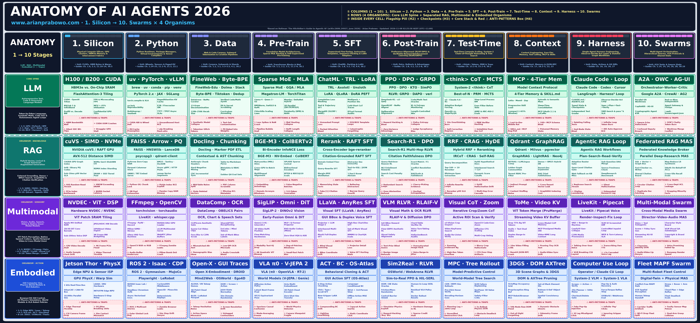

# ANATOMY OF AI AGENTS 2026 (`10 Stages: 1. Silicon → 10. Swarms` × `4 Organisms: LLM · RAG · Multimodal · Embodied`)

> **What actually runs under the hood of an autonomous AI agent in 2026? Trace left to right across the 10 stages (`1. Silicon`, `2. Python`, `3. Data`, `4. Pre-Train`, `5. SFT`, `6. Post-Train`, `7. Test-Time`, `8. Context`, `9. Harness`, `10. Swarms`) and top to bottom across the 4 distinct organisms (`LLM`, `RAG`, `Multimodal`, `Embodied`), with production `⚠ ANTI-PATTERNS & TRAPS` embedded directly inside every cell.**  
> **How to Read ([www.arianprabowo.com](https://www.arianprabowo.com) · Based on Haggai Roitman's *The Hitchhiker's Guide to Agentic AI*, `arXiv:2606.24937` · `Updated: 2026-11-08 02:25:58 AEDT (UTC+11:00)`):** **`① COLUMNS (1 → 10):`** Follow `1. Silicon → 10. Swarms` · **`② ROWS (4 ORGANISMS):`** Compare the `LLM` Core Spine against `RAG`, `Multimodal`, and `Embodied` · **`③ INSIDE EVERY CELL:`** Audit the Flagship Banner (`H2 = 24 pt`), Checkpoints (`H3 = 14.83 pt`), Core Stack (`H4 = 9.17 pt`), and Red **`⚠ ANTI-PATTERNS & TRAPS`** box (`H4 = 9.17 pt`).

---

## 1. Complete 10-Stage × 4-Organism Matrix Overview

| Stage (`H1` Short Name · `H4` Full Name · Core Unit · Book Ref) | `LLM` (*Autoregressive Text, Code & Reasoning Language Models*) | `RAG` (*Hybrid Vector, Lexical & Graph Retrieval-Augmented Generation*) | `Multimodal` (*Vision, Audio, Speech, Video & Native Omni-Modal Models*) | `Embodied` (*GUI Computer Use, Physics World Models & VLA Robotics*) |
| :--- | :--- | :--- | :--- | :--- |
| **1. Silicon** — *Physical Compute Silicon, GPU Clusters, HBM3e Memory & Interconnect Fabrics* GPUs/TPUs/NPUs, HBM3e vs. SRAM hierarchy, CUDA/Triton kernels & NVLink/InfiniBand. • **Unit: FLOPs, HBM Bytes & Warps** • **Guide: Ch. 1.6, 2.3, 11.10–14, 30.5** | **`[H100 / B200 · CUDA]`**  **HBM3e vs. On-Chip SRAM** · **FlashAttention-3 Tiling**  CUDA · OpenAI Triton · FP8 & Microscaling FP4 · NVLink 5 & InfiniBand · MFU > 45% Utilization · Prefill vs. Decode BW · Confidential GPU TEEs  **`⚠ HBM Bandwidth Wall`** · **`⚠ CUDA OOM Crashes`** · **`⚠ Silent SDC Bit-Flips`** · **`⚠ Straggler GPU Stall`** | **`[cuVS · SIMD · NVMe]`**  **NVIDIA cuVS / RAFT GPU** · **AVX-512 Distance SIMD**  CAGRA GPU Graph Index · NVMe Gen5 DiskANN I/O · Int8 / Binary PQ Codes · RDMA Index Sharding · Sub-10ms p99 Vector SLA · DRAM + SSD Tiered Pool  **`⚠ SSD Random-Read Thrash`** · **`⚠ HNSW Exceeding DRAM`** · **`⚠ PCIe Index Bottleneck`** · **`⚠ NUMA Socket Latency`** | **`[NVDEC · ViT · DSP]`**  **Hardware NVDEC / NVENC** · **ViT Patch SRAM Tiling**  Apple M4 Unified RAM · JPEG/HEVC HW Decode · 2D/3D DiT Conv Kernels · GPUDirect Video Ingest · Sub-200ms Voice DSP · 4K Frame BW Budgeting  **`⚠ CPU Video Decode Stall`** · **`⚠ 4K Frame PCIe Flood`** · **`⚠ Audio Sample Clock Drift`** · **`⚠ Video Thermal Throttle`** | **`[Jetson Thor · PhysX]`**  **Edge NPU & Sensor ISP** · **GPU PhysX / Warp Sim**  1 kHz Real-Time Bus · LiDAR / IMU Hardware · EtherCAT / CAN-FD Bus · INT4/FP8 Edge NPU · 10,000x Parallel Sim · Hardware E-Stop Relay  **`⚠ Edge Thermal Throttle`** · **`⚠ OS Jitter Breaking 1kHz`** · **`⚠ CSI Camera Frame Drop`** · **`⚠ Sim Contact Mismatch`** |
| **2. Python** — *Python Runtimes, Package Managers, Virtual Environments & Tensor Compilers* Package managers (brew, uv, conda, pip, venv), PyTorch, JAX, vLLM & sandboxes. • **Unit: Wheels, Tensors & Paged KV** • **Guide: Ch. 1.24–25, 11.1–9, 21.5, 22.1** | **`[uv · PyTorch · vLLM]`**  **brew · uv · conda · pip · venv** · **PyTorch 2.x · JAX · SGLang**  torch.compile & XLA · PagedAttention KV Cache · uv.lock Reproducibility · E2B / Firecracker VM · Bubblewrap / Seatbelt · TTFT / TPOT Async SLAs  **`⚠ CUDA ABI & Wheel Hell`** · **`⚠ Unsandboxed Host RCE`** · **`⚠ KV-Cache Preemption`** · **`⚠ pip Breaking flash-attn`** | **`[FAISS · Arrow · PQ]`**  **FAISS · HNSWlib · LanceDB** · **psycopg3 · qdrant-client**  PyArrow Zero-Copy RAM · BM25 · Tantivy · DuckDB · Parquet Columnar Store · Async gRPC / HTTP Pools · ONNX / TRT Embed Serve · mmap Vector Segments  **`⚠ Python GIL Chunk Lock`** · **`⚠ Pickle Index RCE Exploit`** · **`⚠ DB Pool Exhaustion`** · **`⚠ Pandas Copy RAM Blowup`** | **`[FFmpeg · OpenCV]`**  **torchvision · torchaudio** · **LiveKit · whisper.cpp**  FFmpeg · PyAV · Decord · NVIDIA DALI GPU Loader · Pillow-SIMD · librosa · vLLM Multimodal Serve · Silero VAD Turn Runtime · WebRTC Jitter Buffers  **`⚠ OpenCV BGR vs RGB Bug`** · **`⚠ FFmpeg Zombie Leaks`** · **`⚠ Audio Buffer Underruns`** · **`⚠ Pillow Bomb DoS Crash`** | **`[ROS 2 · Isaac · CDP]`**  **ROS 2 · Gymnasium · MuJoCo** · **Playwright · LeRobot**  NVIDIA Isaac Lab / Gym · CycloneDDS Middleware · Headless Chromium Xvfb · Open3D · Pinocchio IK · Async Vectorized Envs · Deterministic Replays  **`⚠ ROS 2 Multicast Storms`** · **`⚠ Zombie Browser Leaks`** · **`⚠ Euler Gimbal Lock Bug`** · **`⚠ Sim Step Drift Desync`** |
| **3. Data** — *Web & Code Corpora, Subword Tokenization & Curation Pipelines* Pre/post-training corpora, BPE/Tiktoken tokenizers, deduplication & synthetic data. • **Unit: Corpora, Subwords & Shards** • **Guide: Ch. 1.2, 3.1, 3.3–3.5, 4.1, 30.2** | **`[FineWeb · Byte-BPE]`**  **FineWeb-Edu · Dolma · Stack** · **Byte-BPE · Tiktoken · Dedup**  Datatrove · NeMo Curator · Verified Code/Math Synth · 13-Gram Decontamination · PII & Secret Scrubbing · 128k–256k Vocab Size · Curriculum Annealing  **`⚠ Synthetic Model Collapse`** · **`⚠ Test-Set Contamination`** · **`⚠ Tokenizer Glitch Tokens`** · **`⚠ PII Baked into Weights`** | **`[Docling · Chunking]`**  **Docling · Marker PDF ETL** · **Contextual & AST Chunking**  Anthropic Chunk Headers · Table-to-Markdown Parse · Hard-Negative Mining · Metadata & RBAC Tags · CDC Incremental Sync · Golden QA Eval Sets  **`⚠ Mid-Table Naive Split`** · **`⚠ PDF Column Scramble`** · **`⚠ Stale Deleted Vectors`** · **`⚠ Missing ACL Metadata`** | **`[DataComp · OCR]`**  **DataComp · OBELICS Pairs** · **OCR, Chart & Speech Sets**  CLIPScore Aesthetic Gate · ShareGPT4V Recaptioning · Scene-Cut Video Clips · EnCodec / Mimi Tokens · Face Blur & C2PA Scrub · Set-of-Mark BBox Labels  **`⚠ Mismatched Alt-Text`** · **`⚠ Low-DPI OCR Misreads`** · **`⚠ Demographic Bias Skew`** · **`⚠ Audio Crosstalk Bleed`** | **`[Open-X · GUI Traces]`**  **Open X-Embodiment · DROID** · **Mind2Web · OSWorld · Ego4D**  ALOHA / VR Teleop Demos · DOM + Screen + Action · 3D Point-Cloud Align · Joint-State Normalize · RLDS / LeRobot Parquet · Sim Domain Randomize  **`⚠ Teleop Hesitation Noise`** · **`⚠ Screen Resolution Drift`** · **`⚠ Action-Space Mismatch`** · **`⚠ Unlogged Confounders`** |
| **4. Pre-Train** — *Foundation Model Architectures, Sparse MoE Routing & Self-Supervised Pre-Training* Transformer/MoE/hybrid architectures, GQA/MLA, RoPE, next-token pre-training & scaling. • **Unit: Transformer Blocks & MoE** • **Guide: Ch. 1.1, 2.2, 3.1, 11.1–9, 30.1** | **`[Sparse MoE · MLA]`**  **Sparse MoE · GQA / MLA** · **Megatron-LM · TorchTitan**  Llama 4 · Qwen 3 · V3 · Mamba / DeltaNet Hybrid · RMSNorm, SwiGLU & RoPE · 3D Parallel (DP/TP/PP/EP) · Chinchilla Scaling Laws · Perplexity (BPB) & NIAH  **`⚠ Loss Spikes & NaN Crash`** · **`⚠ MoE Routing Collapse`** · **`⚠ Pipeline Bubble Stall`** · **`⚠ RoPE Length Collapse`** | **`[BGE-M3 · ColBERTv2]`**  **Bi-Encoder InfoNCE Loss** · **BGE-M3 · NV-Embed · ColBERT**  Matryoshka (MRL) Dims · SPLADE Sparse Lexical · Cross-GPU In-Batch Negs · Bidirectional Encoders · Multilingual Alignment · MTEB & NDCG@10 Evals  **`⚠ Embedding Anisotropy`** · **`⚠ False-Negative Batches`** · **`⚠ Domain Acronym Blindness`** · **`⚠ 512-Token Truncation`** | **`[SigLIP · Omni · DiT]`**  **SigLIP-2 · DINOv2 Vision** · **Early-Fusion Omni & DiT**  Qwen2.5-VL · InternVL3 · MLP / Q-Former Projector · 3D Video RoPE Position · RVQ Audio Codecs (Mimi) · Flow-Matching Backbones · Zero-Shot VQA & ASR  **`⚠ Modality Text-IQ Drop`** · **`⚠ Bag-of-Patches Blindness`** · **`⚠ 4K Quadratic ViT Blowup`** · **`⚠ Small-Text Patch Blur`** | **`[VLA π0 · V-JEPA 2]`**  **VLA (π0 · OpenVLA · RT-2)** · **World Models (V-JEPA / Genie)**  Diffusion Action Policy · Octo Multi-Embodiment · Latent Next-Frame Pred · 3D Point-Cloud Encoder · SE(3) Equivariant Pose · Zero-Shot Sim Transfer  **`⚠ Spurious Causal Confusion`** · **`⚠ World Physics Delusion`** · **`⚠ Mode-Averaging Freeze`** · **`⚠ Camera Viewpoint Fragile`** |
| **5. SFT** — *Supervised Fine-Tuning, Instruction Templates, Sequence Packing & LoRA Adapters* Instruction tuning, ChatML formatting, sequence packing, loss masking & PEFT (LoRA/DoRA). • **Unit: ChatML, Packing & LoRA** • **Guide: Ch. 1.8, 3.2, 7.6, 9.4, 30.2** | **`[ChatML · TRL · LoRA]`**  **TRL · Axolotl · Unsloth** · **LoRA · QLoRA · DoRA PEFT**  Completion Loss Masking · Multipack + Position IDs · Tool & Trajectory SFT · Cold-Start CoT Traces · MergeKit (SLERP / DARE) · IFEval Format Audits  **`⚠ Unmasked Prompt Loss`** · **`⚠ EOS/BOS Template Loops`** · **`⚠ Packed Attention Bleed`** · **`⚠ Catastrophic Forgetting`** | **`[Rerank · RAFT SFT]`**  **Cross-Encoder bge-reranker** · **Citation-Grounded RAFT SFT**  Domain Embed Fine-Tune · Distractor Doc Immunity · Query-Rewrite SFT · Text-to-SQL / JSON SFT · Margin-MSE Distillation · 'I Don't Know' Abstain  **`⚠ Memorizing Stale Facts`** · **`⚠ Believing Distractors`** · **`⚠ Fake [1] Citation Tags`** · **`⚠ Narrow Query Overfit`** | **`[LLaVA · AnyRes SFT]`**  **Visual SFT (LLaVA / AnyRes)** · **GUI BBox & Duplex Voice SFT**  Projector + LLM Stage-2 · High-Res Chart/Doc SFT · Interleaved Multi-Turn · Set-of-Mark Visual SFT · Moshi Full-Duplex SFT · MMMU & ChartQA Evals  **`⚠ Blind Visual Guessing`** · **`⚠ Projector Detail Loss`** · **`⚠ BBox Coordinate Drift`** · **`⚠ Voice SFT Hurting Math`** | **`[ACT · BC · OS-Atlas]`**  **Behavioral Cloning & ACT** · **GUI Action SFT (OS-Atlas)**  k-Step Action Chunking · Language-Conditioned BC · Click / Type / Scroll SFT · Wrist + 3rd-Person View · New-Gripper LoRA Tune · Offline Action MSE Eval  **`⚠ Compounding BC Drift`** · **`⚠ Copycat Action Inertia`** · **`⚠ Lighting Overfitting`** · **`⚠ Static Coordinate Click`** |
| **6. Post-Train** — *Preference Alignment (RLHF/DPO) & Verifiable-Reward Reinforcement Learning (RLVR/GRPO)* Preference tuning (PPO, DPO, KTO) and critic-free RL with Verifiable Rewards (RLVR, GRPO). • **Unit: Pairs, Rollouts & Advantages** • **Guide: Ch. 1.8, 3.2, 12.1–8, 30.2** | **`[PPO · DPO · GRPO]`**  **PPO · DPO · KTO · SimPO** · **RLVR: GRPO · DAPO · verl**  DeepSeek-R1 · o3 · QwQ · Code/Math Test Oracles · OpenRLHF · NeMo Aligner · KL & Entropy Monitoring · Deliberative Alignment · Length-Controlled Win  **`⚠ Reward Hacking & Bloat`** · **`⚠ Policy Entropy Collapse`** · **`⚠ Zero-Variance Advantage`** · **`⚠ Judge Sycophancy Bias`** | **`[Search-R1 · DPO]`**  **Search-R1 Multi-Hop RLVR** · **Citation Faithfulness DPO**  Query-Retrieve-Reason RL · Exact-Match / F1 Oracles · NLI Entailment Rewards · Conflict Resolution RL · Search Cost Penalty RL · RAGTruth & FaithBench  **`⚠ Redundant Search Loops`** · **`⚠ Cherry-Picking Evidence`** · **`⚠ Over-Abstention Refusal`** · **`⚠ Uncited Extrapolation`** | **`[VLM RLVR · RLAIF-V]`**  **Visual Math & OCR RLVR** · **RLAIF-V & Diffusion DPO**  IoU BBox Reward Oracles · Chart/Table Verifier RL · Flow-GRPO Aesthetic RL · Voice Turn-Taking RLHF · Visual Safety Alignment · HallusionBench Audits  **`⚠ Text-Prior Blind Guess`** · **`⚠ Oversaturated Image Hack`** · **`⚠ Benign Image Refusals`** · **`⚠ Voice Barge-In Jitter`** | **`[Sim2Real · RLVR]`**  **OSWorld / WebArena RLVR** · **Sim-to-Real PPO & HIL-SERL**  DOM / DB State Oracles · Human-in-Loop SERL RL · Friction/Mass Randomize · Residual VLA Policy RL · Control-Barrier Shield · Docker Rollout Resets  **`⚠ Simulator Physics Exploit`** · **`⚠ Hardware Damage in RL`** · **`⚠ Reward-Hacking 'Buy' Btn`** · **`⚠ Sparse Credit Stall`** |
| **7. Test-Time** — *Test-Time Compute Scaling, System-2 Chain-of-Thought Reasoning & Tree Search* Inference-time System-2 scaling: <think> CoT, Best-of-N, Process Reward Models & MCTS. • **Unit: <think> Tokens, PRM & Trees** • **Guide: Ch. 13.1–8, 15.1–9, 30.2** | **`[<think> CoT · MCTS]`**  **System-2 <think> CoT** · **Best-of-N · PRM · MCTS**  o3 · Claude 4.6 · R1 · Step-Level Process RM · Adaptive Budget Forcing · Exec-Filter Before Vote · Pass@k vs. Majority@k · AIME & ARC-AGI-2 Evals  **`⚠ 10x Overthinking Burn`** · **`⚠ PRM Verifier Hacking`** · **`⚠ Self-Correction Regress`** · **`⚠ Unfaithful Post-Hoc CoT`** | **`[RRF · CRAG · HyDE]`**  **Hybrid RRF + Reranking** · **IRCoT · CRAG · Self-RAG**  Query Decomposition · HyDE Hypothetical Docs · Top-100 -> 10 Reranker · Interleaved Search + CoT · Minimum-Span Extraction · Dynamic Score Cutoffs  **`⚠ Infinite Rewrite Loops`** · **`⚠ HyDE Hallucination Drift`** · **`⚠ Reranker p99 SLA Blowup`** · **`⚠ Multi-Hop Error Cascade`** | **`[Visual CoT · Zoom]`**  **Iterative Crop/Zoom CoT** · **Active ROI Scan & Verify**  o3-Vision Crop Inspect · OpenCV Code-Exec Zoom · Video Keyframe Search · Diffusion CFG Scaling · Audio Re-Listen Verify · Multi-Crop Voting  **`⚠ Zooming Irrelevant Bg`** · **`⚠ Blurry Crop Hallucinate`** · **`⚠ High-Res Token Overflow`** · **`⚠ CFG Over-Step Artifacts`** | **`[MPC · Tree Rollout]`**  **Model-Predictive Control** · **World-Model Tree Search**  CEM / MPPI Sim Rollouts · VLM Failure Replanning · Pre-Click Hover Verify · VoxPoser 3D Value Maps · Receding-Horizon Exec · Safety-Filter Critic  **`⚠ Planning Lag > 1kHz Loop`** · **`⚠ 5s Rollout Physics Drift`** · **`⚠ Unverified Destructive Click`** · **`⚠ Obstacle Deadlock Loop`** |
| **8. Context** — *Context Engineering, Four-Tier Memory, Tool Calling, MCP & Skills* Context budgeting, 4-tier agentic memory, function calling, MCP, and SKILL.md. • **Unit: Context, Memory & JSON-RPC** • **Guide: Ch. 17, 18.2–5, 22, 23** | **`[MCP · 4-Tier Mem]`**  **Model Context Protocol** · **4-Tier Memory & SKILL.md**  Letta · Mem0 · Zep · Episodic & Semantic Mem · Progressive Skill Load · Sleep-Time Consolidation · /compact (<65% Window) · MCP OAuth 2.1 & LoCoMo  **`⚠ Lost-in-the-Middle Rot`** · **`⚠ 100+ MCP Schema Bloat`** · **`⚠ SKILL.md / MCP Rug-Pull`** · **`⚠ Poisoned Memory State`** | **`[Qdrant · GraphRAG]`**  **Qdrant · Milvus · pgvector** · **GraphRAG · LightRAG · Neo4j**  REFRAG / LLMLingua Comp · Dense + BM25 Hybrid DB · Leiden Graph Communities · Parent-Doc Expansion · Tenant RBAC Pre-Filter · RAG Triad Faithfulness  **`⚠ Indirect Prompt Inject`** · **`⚠ Cross-Tenant Vector Leak`** · **`⚠ Context Stuffing Noise`** · **`⚠ GraphRAG Indexing Cost`** | **`[ToMe · Video KV]`**  **ViT Token Merge (PruMerge)** · **Streaming Video KV Buffer**  Drop 75% Bg ViT Tokens · Cross-Modal CLIP Memory · Audio + Text Dual Index · MCP Presigned Media URI · Duplex Barge-In State · Video-MME Long Context  **`⚠ 10m Video Filling 128k`** · **`⚠ Pruning Tiny OCR Text`** · **`⚠ Base64 JSON-RPC Crash`** · **`⚠ Audio-Video Sync Drift`** | **`[3DGS · DOM AXTree]`**  **3D Scene Graphs & 3DGS** · **DOM & AXTree Pruning**  OctoMap Occupancy Grid · Set-of-Mark Element IDs · Proprioceptive Ring Buf · Kalman 6-DoF Object Track · MCP Robot/Browser Bus · Spatial Consistency QA  **`⚠ 50k-Node Raw DOM Flood`** · **`⚠ Dynamic Obstacle Ghosts`** · **`⚠ Out-of-Sight Forgetting`** · **`⚠ Odometry Frame Drift`** |
| **9. Harness** — *Single-Agent Harness Engineering, Observe-Decide-Act Loops & Stateful Graph Workflows* The CPU/OS of an agent: CLAUDE.md, Loop Engineering, LangGraph & Harness² verification. • **Unit: State, Actions & Git Diffs** • **Guide: Ch. 16, 19, 20, 27** | **`[Claude Code · Loop]`**  **Claude Code · Codex · Cursor** · **LangGraph · Harness² Loop**  CLAUDE.md / AGENTS.md · Observe–Decide–Act Loop · Typed State & Checkpoints · Spec->Plan->Test->Verify · Independent Test Grader · SWE-bench & pass^k SLA  **`⚠ Deleting Failing Tests`** · **`⚠ Infinite Loop Token Burn`** · **`⚠ God-Node State Bloat`** · **`⚠ IDE Auto-Approve RCE`** | **`[Agentic RAG Loop]`**  **Agentic RAG Workflows** · **Plan–Search–Read–Verify**  Adaptive Router Gate · Sub-Question DAG Merge · Span-Level Citation Gate · Source Freshness Check · Web Fallback on KB Miss · DeepResearch Benchmark  **`⚠ Rephrase Search Thrash`** · **`⚠ Silent Hallucination`** · **`⚠ Citation Laundering`** · **`⚠ Unbounded Research Lag`** | **`[LiveKit · Pipecat]`**  **LiveKit / Pipecat Voice** · **Render–Inspect–Fix Loop**  VAD + Barge-In Machine · VLM UI Screenshot Diff · ComfyUI Gen-Critique · ControlNet Inpaint Loop · C2PA Media Provenance · WER & Turn-Latency SLA  **`⚠ Talking Over User Voice`** · **`⚠ Transcribing Own TTS`** · **`⚠ VLM Breaking CSS Layout`** · **`⚠ >3s Cascaded Voice Lag`** | **`[Computer Use Loop]`**  **Operator / Claude CU Loop** · **System-2 VLM + System-1 VLA**  Screen -> Action -> Verify · Pop-Up & Auth Recovery · 2Hz Planner + 50Hz Motor · Force/Torque Reflex Stop · Checkout/Delete Gate · OSWorld / WebArena Eval  **`⚠ Fake Pop-Up Injection`** · **`⚠ Infinite 'Pay' Clicks`** · **`⚠ UI Lag Misaligned Click`** · **`⚠ Ignoring Gripper Slip`** |
| **10. Swarms** — *Multi-Agent Orchestration, Hierarchical Swarms, A2A Protocols & Shared State* Multi-agent topologies (OWC), inter-agent protocols (A2A, ACP), worktree swarms & AG-UI. • **Unit: A2A Tasks & Swarm State** • **Guide: Ch. 1.14, 14, 24, 26, 28, 30.10** | **`[A2A · OWC · AG-UI]`**  **Orchestrator–Worker–Critic** · **Google A2A · CrewAI · AG2**  Parallel Git Worktrees · Red-vs-Blue Independent · CopilotKit · AG-UI · Agent Gateway & FinOps · Cryptographic Agent KYA · /.well-known/agent.json  **`⚠ Swarm Echo Hallucinate`** · **`⚠ O(N²) Chatty Token Burn`** · **`⚠ Confused Deputy Breach`** · **`⚠ Worktree Merge Conflict`** | **`[Federated RAG MAS]`**  **Federated Knowledge Broker** · **Parallel Deep-Research MAS**  SQL + Vector + Graph Bus · Map-Reduce Lit Synthesis · Fact-Checker vs. Writer · OAuth On-Behalf-Of ACLs · Shared Citation Board · Cross-Silo Recall Evals  **`⚠ Circular Citation Loop`** · **`⚠ Cross-Dept ACL Leakage`** · **`⚠ Duplicate Doc Fetching`** · **`⚠ Dropping Minority Facts`** | **`[Multi-Modal Swarm]`**  **Cross-Modal Media Swarm** · **Director–Video–Audio MAS**  Voice + Tool Subagents · Character Style Board · Scene + Foley Sync Gen · VLM Visual QA Gatekeeper · Streaming AG-UI Canvas · Copyright & Brand Gate  **`⚠ Character Identity Drift`** · **`⚠ Voice Promising Failed Op`** · **`⚠ Audio-Video Lip Desync`** · **`⚠ Runaway Render Spend`** | **`[Fleet MAPF Swarm]`**  **Multi-Robot Fleet Control** · **Digital-Twin + Physical MAS**  Conflict-Free MAPF Path · Drone + Rover + Arm MAS · V2X Spatial Perception · Cloud Plan + Edge Reflex · Human Teleop Handoff · Fleet Deadlock Evals  **`⚠ Corridor Traffic Gridlock`** · **`⚠ Faulty Sensor Map Poison`** · **`⚠ Wi-Fi Drop Fleet Split`** · **`⚠ Dual-Arm Grasp Collision`** |

---

## 2. Stage-by-Stage Breakdown (`1. Silicon` → `10. Swarms` Across All 4 Organisms)

### 1. Silicon — Physical Compute Silicon, GPU Clusters, HBM3e Memory & Interconnect Fabrics

GPUs/TPUs/NPUs, HBM3e vs. SRAM hierarchy, CUDA/Triton kernels & NVLink/InfiniBand.

* **Core Unit of Compute / State:** `Unit: FLOPs, HBM Bytes & Warps`
* **Primary Reference (`arXiv:2606.24937`):** Guide: Ch. 1.6, 2.3, 11.10–14, 30.5

| Organism (`Short` — *Full Name*) | Flagship Banner (`H2 = 24pt`) | Checkpoints (`H3 = 14.83pt`) | Core Stack (`H4 = 9.17pt`) | Inner `⚠ Anti-Patterns & Traps` (`H4 = 9.17pt`) |
| :--- | :--- | :--- | :--- | :--- |
| **LLM** (*Autoregressive Text, Code & Reasoning Language Models*) | **`H100 / B200 · CUDA`** | **`HBM3e vs. On-Chip SRAM`**, **`FlashAttention-3 Tiling`** | `CUDA · OpenAI Triton`, `FP8 & Microscaling FP4`, `NVLink 5 & InfiniBand`, `MFU > 45% Utilization`, `Prefill vs. Decode BW`, `Confidential GPU TEEs` | **`✕ HBM Bandwidth Wall`**, **`✕ CUDA OOM Crashes`**, **`✕ Silent SDC Bit-Flips`**, **`✕ Straggler GPU Stall`** |
| **RAG** (*Hybrid Vector, Lexical & Graph Retrieval-Augmented Generation*) | **`cuVS · SIMD · NVMe`** | **`NVIDIA cuVS / RAFT GPU`**, **`AVX-512 Distance SIMD`** | `CAGRA GPU Graph Index`, `NVMe Gen5 DiskANN I/O`, `Int8 / Binary PQ Codes`, `RDMA Index Sharding`, `Sub-10ms p99 Vector SLA`, `DRAM + SSD Tiered Pool` | **`✕ SSD Random-Read Thrash`**, **`✕ HNSW Exceeding DRAM`**, **`✕ PCIe Index Bottleneck`**, **`✕ NUMA Socket Latency`** |
| **Multimodal** (*Vision, Audio, Speech, Video & Native Omni-Modal Models*) | **`NVDEC · ViT · DSP`** | **`Hardware NVDEC / NVENC`**, **`ViT Patch SRAM Tiling`** | `Apple M4 Unified RAM`, `JPEG/HEVC HW Decode`, `2D/3D DiT Conv Kernels`, `GPUDirect Video Ingest`, `Sub-200ms Voice DSP`, `4K Frame BW Budgeting` | **`✕ CPU Video Decode Stall`**, **`✕ 4K Frame PCIe Flood`**, **`✕ Audio Sample Clock Drift`**, **`✕ Video Thermal Throttle`** |
| **Embodied** (*GUI Computer Use, Physics World Models & VLA Robotics*) | **`Jetson Thor · PhysX`** | **`Edge NPU & Sensor ISP`**, **`GPU PhysX / Warp Sim`** | `1 kHz Real-Time Bus`, `LiDAR / IMU Hardware`, `EtherCAT / CAN-FD Bus`, `INT4/FP8 Edge NPU`, `10,000x Parallel Sim`, `Hardware E-Stop Relay` | **`✕ Edge Thermal Throttle`**, **`✕ OS Jitter Breaking 1kHz`**, **`✕ CSI Camera Frame Drop`**, **`✕ Sim Contact Mismatch`** |

### 2. Python — Python Runtimes, Package Managers, Virtual Environments & Tensor Compilers

Package managers (brew, uv, conda, pip, venv), PyTorch, JAX, vLLM & sandboxes.

* **Core Unit of Compute / State:** `Unit: Wheels, Tensors & Paged KV`
* **Primary Reference (`arXiv:2606.24937`):** Guide: Ch. 1.24–25, 11.1–9, 21.5, 22.1

| Organism (`Short` — *Full Name*) | Flagship Banner (`H2 = 24pt`) | Checkpoints (`H3 = 14.83pt`) | Core Stack (`H4 = 9.17pt`) | Inner `⚠ Anti-Patterns & Traps` (`H4 = 9.17pt`) |
| :--- | :--- | :--- | :--- | :--- |
| **LLM** (*Autoregressive Text, Code & Reasoning Language Models*) | **`uv · PyTorch · vLLM`** | **`brew · uv · conda · pip · venv`**, **`PyTorch 2.x · JAX · SGLang`** | `torch.compile & XLA`, `PagedAttention KV Cache`, `uv.lock Reproducibility`, `E2B / Firecracker VM`, `Bubblewrap / Seatbelt`, `TTFT / TPOT Async SLAs` | **`✕ CUDA ABI & Wheel Hell`**, **`✕ Unsandboxed Host RCE`**, **`✕ KV-Cache Preemption`**, **`✕ pip Breaking flash-attn`** |
| **RAG** (*Hybrid Vector, Lexical & Graph Retrieval-Augmented Generation*) | **`FAISS · Arrow · PQ`** | **`FAISS · HNSWlib · LanceDB`**, **`psycopg3 · qdrant-client`** | `PyArrow Zero-Copy RAM`, `BM25 · Tantivy · DuckDB`, `Parquet Columnar Store`, `Async gRPC / HTTP Pools`, `ONNX / TRT Embed Serve`, `mmap Vector Segments` | **`✕ Python GIL Chunk Lock`**, **`✕ Pickle Index RCE Exploit`**, **`✕ DB Pool Exhaustion`**, **`✕ Pandas Copy RAM Blowup`** |
| **Multimodal** (*Vision, Audio, Speech, Video & Native Omni-Modal Models*) | **`FFmpeg · OpenCV`** | **`torchvision · torchaudio`**, **`LiveKit · whisper.cpp`** | `FFmpeg · PyAV · Decord`, `NVIDIA DALI GPU Loader`, `Pillow-SIMD · librosa`, `vLLM Multimodal Serve`, `Silero VAD Turn Runtime`, `WebRTC Jitter Buffers` | **`✕ OpenCV BGR vs RGB Bug`**, **`✕ FFmpeg Zombie Leaks`**, **`✕ Audio Buffer Underruns`**, **`✕ Pillow Bomb DoS Crash`** |
| **Embodied** (*GUI Computer Use, Physics World Models & VLA Robotics*) | **`ROS 2 · Isaac · CDP`** | **`ROS 2 · Gymnasium · MuJoCo`**, **`Playwright · LeRobot`** | `NVIDIA Isaac Lab / Gym`, `CycloneDDS Middleware`, `Headless Chromium Xvfb`, `Open3D · Pinocchio IK`, `Async Vectorized Envs`, `Deterministic Replays` | **`✕ ROS 2 Multicast Storms`**, **`✕ Zombie Browser Leaks`**, **`✕ Euler Gimbal Lock Bug`**, **`✕ Sim Step Drift Desync`** |

### 3. Data — Web & Code Corpora, Subword Tokenization & Curation Pipelines

Pre/post-training corpora, BPE/Tiktoken tokenizers, deduplication & synthetic data.

* **Core Unit of Compute / State:** `Unit: Corpora, Subwords & Shards`
* **Primary Reference (`arXiv:2606.24937`):** Guide: Ch. 1.2, 3.1, 3.3–3.5, 4.1, 30.2

| Organism (`Short` — *Full Name*) | Flagship Banner (`H2 = 24pt`) | Checkpoints (`H3 = 14.83pt`) | Core Stack (`H4 = 9.17pt`) | Inner `⚠ Anti-Patterns & Traps` (`H4 = 9.17pt`) |
| :--- | :--- | :--- | :--- | :--- |
| **LLM** (*Autoregressive Text, Code & Reasoning Language Models*) | **`FineWeb · Byte-BPE`** | **`FineWeb-Edu · Dolma · Stack`**, **`Byte-BPE · Tiktoken · Dedup`** | `Datatrove · NeMo Curator`, `Verified Code/Math Synth`, `13-Gram Decontamination`, `PII & Secret Scrubbing`, `128k–256k Vocab Size`, `Curriculum Annealing` | **`✕ Synthetic Model Collapse`**, **`✕ Test-Set Contamination`**, **`✕ Tokenizer Glitch Tokens`**, **`✕ PII Baked into Weights`** |
| **RAG** (*Hybrid Vector, Lexical & Graph Retrieval-Augmented Generation*) | **`Docling · Chunking`** | **`Docling · Marker PDF ETL`**, **`Contextual & AST Chunking`** | `Anthropic Chunk Headers`, `Table-to-Markdown Parse`, `Hard-Negative Mining`, `Metadata & RBAC Tags`, `CDC Incremental Sync`, `Golden QA Eval Sets` | **`✕ Mid-Table Naive Split`**, **`✕ PDF Column Scramble`**, **`✕ Stale Deleted Vectors`**, **`✕ Missing ACL Metadata`** |
| **Multimodal** (*Vision, Audio, Speech, Video & Native Omni-Modal Models*) | **`DataComp · OCR`** | **`DataComp · OBELICS Pairs`**, **`OCR, Chart & Speech Sets`** | `CLIPScore Aesthetic Gate`, `ShareGPT4V Recaptioning`, `Scene-Cut Video Clips`, `EnCodec / Mimi Tokens`, `Face Blur & C2PA Scrub`, `Set-of-Mark BBox Labels` | **`✕ Mismatched Alt-Text`**, **`✕ Low-DPI OCR Misreads`**, **`✕ Demographic Bias Skew`**, **`✕ Audio Crosstalk Bleed`** |
| **Embodied** (*GUI Computer Use, Physics World Models & VLA Robotics*) | **`Open-X · GUI Traces`** | **`Open X-Embodiment · DROID`**, **`Mind2Web · OSWorld · Ego4D`** | `ALOHA / VR Teleop Demos`, `DOM + Screen + Action`, `3D Point-Cloud Align`, `Joint-State Normalize`, `RLDS / LeRobot Parquet`, `Sim Domain Randomize` | **`✕ Teleop Hesitation Noise`**, **`✕ Screen Resolution Drift`**, **`✕ Action-Space Mismatch`**, **`✕ Unlogged Confounders`** |

### 4. Pre-Train — Foundation Model Architectures, Sparse MoE Routing & Self-Supervised Pre-Training

Transformer/MoE/hybrid architectures, GQA/MLA, RoPE, next-token pre-training & scaling.

* **Core Unit of Compute / State:** `Unit: Transformer Blocks & MoE`
* **Primary Reference (`arXiv:2606.24937`):** Guide: Ch. 1.1, 2.2, 3.1, 11.1–9, 30.1

| Organism (`Short` — *Full Name*) | Flagship Banner (`H2 = 24pt`) | Checkpoints (`H3 = 14.83pt`) | Core Stack (`H4 = 9.17pt`) | Inner `⚠ Anti-Patterns & Traps` (`H4 = 9.17pt`) |
| :--- | :--- | :--- | :--- | :--- |
| **LLM** (*Autoregressive Text, Code & Reasoning Language Models*) | **`Sparse MoE · MLA`** | **`Sparse MoE · GQA / MLA`**, **`Megatron-LM · TorchTitan`** | `Llama 4 · Qwen 3 · V3`, `Mamba / DeltaNet Hybrid`, `RMSNorm, SwiGLU & RoPE`, `3D Parallel (DP/TP/PP/EP)`, `Chinchilla Scaling Laws`, `Perplexity (BPB) & NIAH` | **`✕ Loss Spikes & NaN Crash`**, **`✕ MoE Routing Collapse`**, **`✕ Pipeline Bubble Stall`**, **`✕ RoPE Length Collapse`** |
| **RAG** (*Hybrid Vector, Lexical & Graph Retrieval-Augmented Generation*) | **`BGE-M3 · ColBERTv2`** | **`Bi-Encoder InfoNCE Loss`**, **`BGE-M3 · NV-Embed · ColBERT`** | `Matryoshka (MRL) Dims`, `SPLADE Sparse Lexical`, `Cross-GPU In-Batch Negs`, `Bidirectional Encoders`, `Multilingual Alignment`, `MTEB & NDCG@10 Evals` | **`✕ Embedding Anisotropy`**, **`✕ False-Negative Batches`**, **`✕ Domain Acronym Blindness`**, **`✕ 512-Token Truncation`** |
| **Multimodal** (*Vision, Audio, Speech, Video & Native Omni-Modal Models*) | **`SigLIP · Omni · DiT`** | **`SigLIP-2 · DINOv2 Vision`**, **`Early-Fusion Omni & DiT`** | `Qwen2.5-VL · InternVL3`, `MLP / Q-Former Projector`, `3D Video RoPE Position`, `RVQ Audio Codecs (Mimi)`, `Flow-Matching Backbones`, `Zero-Shot VQA & ASR` | **`✕ Modality Text-IQ Drop`**, **`✕ Bag-of-Patches Blindness`**, **`✕ 4K Quadratic ViT Blowup`**, **`✕ Small-Text Patch Blur`** |
| **Embodied** (*GUI Computer Use, Physics World Models & VLA Robotics*) | **`VLA π0 · V-JEPA 2`** | **`VLA (π0 · OpenVLA · RT-2)`**, **`World Models (V-JEPA / Genie)`** | `Diffusion Action Policy`, `Octo Multi-Embodiment`, `Latent Next-Frame Pred`, `3D Point-Cloud Encoder`, `SE(3) Equivariant Pose`, `Zero-Shot Sim Transfer` | **`✕ Spurious Causal Confusion`**, **`✕ World Physics Delusion`**, **`✕ Mode-Averaging Freeze`**, **`✕ Camera Viewpoint Fragile`** |

### 5. SFT — Supervised Fine-Tuning, Instruction Templates, Sequence Packing & LoRA Adapters

Instruction tuning, ChatML formatting, sequence packing, loss masking & PEFT (LoRA/DoRA).

* **Core Unit of Compute / State:** `Unit: ChatML, Packing & LoRA`
* **Primary Reference (`arXiv:2606.24937`):** Guide: Ch. 1.8, 3.2, 7.6, 9.4, 30.2

| Organism (`Short` — *Full Name*) | Flagship Banner (`H2 = 24pt`) | Checkpoints (`H3 = 14.83pt`) | Core Stack (`H4 = 9.17pt`) | Inner `⚠ Anti-Patterns & Traps` (`H4 = 9.17pt`) |
| :--- | :--- | :--- | :--- | :--- |
| **LLM** (*Autoregressive Text, Code & Reasoning Language Models*) | **`ChatML · TRL · LoRA`** | **`TRL · Axolotl · Unsloth`**, **`LoRA · QLoRA · DoRA PEFT`** | `Completion Loss Masking`, `Multipack + Position IDs`, `Tool & Trajectory SFT`, `Cold-Start CoT Traces`, `MergeKit (SLERP / DARE)`, `IFEval Format Audits` | **`✕ Unmasked Prompt Loss`**, **`✕ EOS/BOS Template Loops`**, **`✕ Packed Attention Bleed`**, **`✕ Catastrophic Forgetting`** |
| **RAG** (*Hybrid Vector, Lexical & Graph Retrieval-Augmented Generation*) | **`Rerank · RAFT SFT`** | **`Cross-Encoder bge-reranker`**, **`Citation-Grounded RAFT SFT`** | `Domain Embed Fine-Tune`, `Distractor Doc Immunity`, `Query-Rewrite SFT`, `Text-to-SQL / JSON SFT`, `Margin-MSE Distillation`, `'I Don't Know' Abstain` | **`✕ Memorizing Stale Facts`**, **`✕ Believing Distractors`**, **`✕ Fake [1] Citation Tags`**, **`✕ Narrow Query Overfit`** |
| **Multimodal** (*Vision, Audio, Speech, Video & Native Omni-Modal Models*) | **`LLaVA · AnyRes SFT`** | **`Visual SFT (LLaVA / AnyRes)`**, **`GUI BBox & Duplex Voice SFT`** | `Projector + LLM Stage-2`, `High-Res Chart/Doc SFT`, `Interleaved Multi-Turn`, `Set-of-Mark Visual SFT`, `Moshi Full-Duplex SFT`, `MMMU & ChartQA Evals` | **`✕ Blind Visual Guessing`**, **`✕ Projector Detail Loss`**, **`✕ BBox Coordinate Drift`**, **`✕ Voice SFT Hurting Math`** |
| **Embodied** (*GUI Computer Use, Physics World Models & VLA Robotics*) | **`ACT · BC · OS-Atlas`** | **`Behavioral Cloning & ACT`**, **`GUI Action SFT (OS-Atlas)`** | `k-Step Action Chunking`, `Language-Conditioned BC`, `Click / Type / Scroll SFT`, `Wrist + 3rd-Person View`, `New-Gripper LoRA Tune`, `Offline Action MSE Eval` | **`✕ Compounding BC Drift`**, **`✕ Copycat Action Inertia`**, **`✕ Lighting Overfitting`**, **`✕ Static Coordinate Click`** |

### 6. Post-Train — Preference Alignment (RLHF/DPO) & Verifiable-Reward Reinforcement Learning (RLVR/GRPO)

Preference tuning (PPO, DPO, KTO) and critic-free RL with Verifiable Rewards (RLVR, GRPO).

* **Core Unit of Compute / State:** `Unit: Pairs, Rollouts & Advantages`
* **Primary Reference (`arXiv:2606.24937`):** Guide: Ch. 1.8, 3.2, 12.1–8, 30.2

| Organism (`Short` — *Full Name*) | Flagship Banner (`H2 = 24pt`) | Checkpoints (`H3 = 14.83pt`) | Core Stack (`H4 = 9.17pt`) | Inner `⚠ Anti-Patterns & Traps` (`H4 = 9.17pt`) |
| :--- | :--- | :--- | :--- | :--- |
| **LLM** (*Autoregressive Text, Code & Reasoning Language Models*) | **`PPO · DPO · GRPO`** | **`PPO · DPO · KTO · SimPO`**, **`RLVR: GRPO · DAPO · verl`** | `DeepSeek-R1 · o3 · QwQ`, `Code/Math Test Oracles`, `OpenRLHF · NeMo Aligner`, `KL & Entropy Monitoring`, `Deliberative Alignment`, `Length-Controlled Win` | **`✕ Reward Hacking & Bloat`**, **`✕ Policy Entropy Collapse`**, **`✕ Zero-Variance Advantage`**, **`✕ Judge Sycophancy Bias`** |
| **RAG** (*Hybrid Vector, Lexical & Graph Retrieval-Augmented Generation*) | **`Search-R1 · DPO`** | **`Search-R1 Multi-Hop RLVR`**, **`Citation Faithfulness DPO`** | `Query-Retrieve-Reason RL`, `Exact-Match / F1 Oracles`, `NLI Entailment Rewards`, `Conflict Resolution RL`, `Search Cost Penalty RL`, `RAGTruth & FaithBench` | **`✕ Redundant Search Loops`**, **`✕ Cherry-Picking Evidence`**, **`✕ Over-Abstention Refusal`**, **`✕ Uncited Extrapolation`** |
| **Multimodal** (*Vision, Audio, Speech, Video & Native Omni-Modal Models*) | **`VLM RLVR · RLAIF-V`** | **`Visual Math & OCR RLVR`**, **`RLAIF-V & Diffusion DPO`** | `IoU BBox Reward Oracles`, `Chart/Table Verifier RL`, `Flow-GRPO Aesthetic RL`, `Voice Turn-Taking RLHF`, `Visual Safety Alignment`, `HallusionBench Audits` | **`✕ Text-Prior Blind Guess`**, **`✕ Oversaturated Image Hack`**, **`✕ Benign Image Refusals`**, **`✕ Voice Barge-In Jitter`** |
| **Embodied** (*GUI Computer Use, Physics World Models & VLA Robotics*) | **`Sim2Real · RLVR`** | **`OSWorld / WebArena RLVR`**, **`Sim-to-Real PPO & HIL-SERL`** | `DOM / DB State Oracles`, `Human-in-Loop SERL RL`, `Friction/Mass Randomize`, `Residual VLA Policy RL`, `Control-Barrier Shield`, `Docker Rollout Resets` | **`✕ Simulator Physics Exploit`**, **`✕ Hardware Damage in RL`**, **`✕ Reward-Hacking 'Buy' Btn`**, **`✕ Sparse Credit Stall`** |

### 7. Test-Time — Test-Time Compute Scaling, System-2 Chain-of-Thought Reasoning & Tree Search

Inference-time System-2 scaling: <think> CoT, Best-of-N, Process Reward Models & MCTS.

* **Core Unit of Compute / State:** `Unit: <think> Tokens, PRM & Trees`
* **Primary Reference (`arXiv:2606.24937`):** Guide: Ch. 13.1–8, 15.1–9, 30.2

| Organism (`Short` — *Full Name*) | Flagship Banner (`H2 = 24pt`) | Checkpoints (`H3 = 14.83pt`) | Core Stack (`H4 = 9.17pt`) | Inner `⚠ Anti-Patterns & Traps` (`H4 = 9.17pt`) |
| :--- | :--- | :--- | :--- | :--- |
| **LLM** (*Autoregressive Text, Code & Reasoning Language Models*) | **`<think> CoT · MCTS`** | **`System-2 <think> CoT`**, **`Best-of-N · PRM · MCTS`** | `o3 · Claude 4.6 · R1`, `Step-Level Process RM`, `Adaptive Budget Forcing`, `Exec-Filter Before Vote`, `Pass@k vs. Majority@k`, `AIME & ARC-AGI-2 Evals` | **`✕ 10x Overthinking Burn`**, **`✕ PRM Verifier Hacking`**, **`✕ Self-Correction Regress`**, **`✕ Unfaithful Post-Hoc CoT`** |
| **RAG** (*Hybrid Vector, Lexical & Graph Retrieval-Augmented Generation*) | **`RRF · CRAG · HyDE`** | **`Hybrid RRF + Reranking`**, **`IRCoT · CRAG · Self-RAG`** | `Query Decomposition`, `HyDE Hypothetical Docs`, `Top-100 -> 10 Reranker`, `Interleaved Search + CoT`, `Minimum-Span Extraction`, `Dynamic Score Cutoffs` | **`✕ Infinite Rewrite Loops`**, **`✕ HyDE Hallucination Drift`**, **`✕ Reranker p99 SLA Blowup`**, **`✕ Multi-Hop Error Cascade`** |
| **Multimodal** (*Vision, Audio, Speech, Video & Native Omni-Modal Models*) | **`Visual CoT · Zoom`** | **`Iterative Crop/Zoom CoT`**, **`Active ROI Scan & Verify`** | `o3-Vision Crop Inspect`, `OpenCV Code-Exec Zoom`, `Video Keyframe Search`, `Diffusion CFG Scaling`, `Audio Re-Listen Verify`, `Multi-Crop Voting` | **`✕ Zooming Irrelevant Bg`**, **`✕ Blurry Crop Hallucinate`**, **`✕ High-Res Token Overflow`**, **`✕ CFG Over-Step Artifacts`** |
| **Embodied** (*GUI Computer Use, Physics World Models & VLA Robotics*) | **`MPC · Tree Rollout`** | **`Model-Predictive Control`**, **`World-Model Tree Search`** | `CEM / MPPI Sim Rollouts`, `VLM Failure Replanning`, `Pre-Click Hover Verify`, `VoxPoser 3D Value Maps`, `Receding-Horizon Exec`, `Safety-Filter Critic` | **`✕ Planning Lag > 1kHz Loop`**, **`✕ 5s Rollout Physics Drift`**, **`✕ Unverified Destructive Click`**, **`✕ Obstacle Deadlock Loop`** |

### 8. Context — Context Engineering, Four-Tier Memory, Tool Calling, MCP & Skills

Context budgeting, 4-tier agentic memory, function calling, MCP, and SKILL.md.

* **Core Unit of Compute / State:** `Unit: Context, Memory & JSON-RPC`
* **Primary Reference (`arXiv:2606.24937`):** Guide: Ch. 17, 18.2–5, 22, 23

| Organism (`Short` — *Full Name*) | Flagship Banner (`H2 = 24pt`) | Checkpoints (`H3 = 14.83pt`) | Core Stack (`H4 = 9.17pt`) | Inner `⚠ Anti-Patterns & Traps` (`H4 = 9.17pt`) |
| :--- | :--- | :--- | :--- | :--- |
| **LLM** (*Autoregressive Text, Code & Reasoning Language Models*) | **`MCP · 4-Tier Mem`** | **`Model Context Protocol`**, **`4-Tier Memory & SKILL.md`** | `Letta · Mem0 · Zep`, `Episodic & Semantic Mem`, `Progressive Skill Load`, `Sleep-Time Consolidation`, `/compact (<65% Window)`, `MCP OAuth 2.1 & LoCoMo` | **`✕ Lost-in-the-Middle Rot`**, **`✕ 100+ MCP Schema Bloat`**, **`✕ SKILL.md / MCP Rug-Pull`**, **`✕ Poisoned Memory State`** |
| **RAG** (*Hybrid Vector, Lexical & Graph Retrieval-Augmented Generation*) | **`Qdrant · GraphRAG`** | **`Qdrant · Milvus · pgvector`**, **`GraphRAG · LightRAG · Neo4j`** | `REFRAG / LLMLingua Comp`, `Dense + BM25 Hybrid DB`, `Leiden Graph Communities`, `Parent-Doc Expansion`, `Tenant RBAC Pre-Filter`, `RAG Triad Faithfulness` | **`✕ Indirect Prompt Inject`**, **`✕ Cross-Tenant Vector Leak`**, **`✕ Context Stuffing Noise`**, **`✕ GraphRAG Indexing Cost`** |
| **Multimodal** (*Vision, Audio, Speech, Video & Native Omni-Modal Models*) | **`ToMe · Video KV`** | **`ViT Token Merge (PruMerge)`**, **`Streaming Video KV Buffer`** | `Drop 75% Bg ViT Tokens`, `Cross-Modal CLIP Memory`, `Audio + Text Dual Index`, `MCP Presigned Media URI`, `Duplex Barge-In State`, `Video-MME Long Context` | **`✕ 10m Video Filling 128k`**, **`✕ Pruning Tiny OCR Text`**, **`✕ Base64 JSON-RPC Crash`**, **`✕ Audio-Video Sync Drift`** |
| **Embodied** (*GUI Computer Use, Physics World Models & VLA Robotics*) | **`3DGS · DOM AXTree`** | **`3D Scene Graphs & 3DGS`**, **`DOM & AXTree Pruning`** | `OctoMap Occupancy Grid`, `Set-of-Mark Element IDs`, `Proprioceptive Ring Buf`, `Kalman 6-DoF Object Track`, `MCP Robot/Browser Bus`, `Spatial Consistency QA` | **`✕ 50k-Node Raw DOM Flood`**, **`✕ Dynamic Obstacle Ghosts`**, **`✕ Out-of-Sight Forgetting`**, **`✕ Odometry Frame Drift`** |

### 9. Harness — Single-Agent Harness Engineering, Observe-Decide-Act Loops & Stateful Graph Workflows

The CPU/OS of an agent: CLAUDE.md, Loop Engineering, LangGraph & Harness² verification.

* **Core Unit of Compute / State:** `Unit: State, Actions & Git Diffs`
* **Primary Reference (`arXiv:2606.24937`):** Guide: Ch. 16, 19, 20, 27

| Organism (`Short` — *Full Name*) | Flagship Banner (`H2 = 24pt`) | Checkpoints (`H3 = 14.83pt`) | Core Stack (`H4 = 9.17pt`) | Inner `⚠ Anti-Patterns & Traps` (`H4 = 9.17pt`) |
| :--- | :--- | :--- | :--- | :--- |
| **LLM** (*Autoregressive Text, Code & Reasoning Language Models*) | **`Claude Code · Loop`** | **`Claude Code · Codex · Cursor`**, **`LangGraph · Harness² Loop`** | `CLAUDE.md / AGENTS.md`, `Observe–Decide–Act Loop`, `Typed State & Checkpoints`, `Spec->Plan->Test->Verify`, `Independent Test Grader`, `SWE-bench & pass^k SLA` | **`✕ Deleting Failing Tests`**, **`✕ Infinite Loop Token Burn`**, **`✕ God-Node State Bloat`**, **`✕ IDE Auto-Approve RCE`** |
| **RAG** (*Hybrid Vector, Lexical & Graph Retrieval-Augmented Generation*) | **`Agentic RAG Loop`** | **`Agentic RAG Workflows`**, **`Plan–Search–Read–Verify`** | `Adaptive Router Gate`, `Sub-Question DAG Merge`, `Span-Level Citation Gate`, `Source Freshness Check`, `Web Fallback on KB Miss`, `DeepResearch Benchmark` | **`✕ Rephrase Search Thrash`**, **`✕ Silent Hallucination`**, **`✕ Citation Laundering`**, **`✕ Unbounded Research Lag`** |
| **Multimodal** (*Vision, Audio, Speech, Video & Native Omni-Modal Models*) | **`LiveKit · Pipecat`** | **`LiveKit / Pipecat Voice`**, **`Render–Inspect–Fix Loop`** | `VAD + Barge-In Machine`, `VLM UI Screenshot Diff`, `ComfyUI Gen-Critique`, `ControlNet Inpaint Loop`, `C2PA Media Provenance`, `WER & Turn-Latency SLA` | **`✕ Talking Over User Voice`**, **`✕ Transcribing Own TTS`**, **`✕ VLM Breaking CSS Layout`**, **`✕ >3s Cascaded Voice Lag`** |
| **Embodied** (*GUI Computer Use, Physics World Models & VLA Robotics*) | **`Computer Use Loop`** | **`Operator / Claude CU Loop`**, **`System-2 VLM + System-1 VLA`** | `Screen -> Action -> Verify`, `Pop-Up & Auth Recovery`, `2Hz Planner + 50Hz Motor`, `Force/Torque Reflex Stop`, `Checkout/Delete Gate`, `OSWorld / WebArena Eval` | **`✕ Fake Pop-Up Injection`**, **`✕ Infinite 'Pay' Clicks`**, **`✕ UI Lag Misaligned Click`**, **`✕ Ignoring Gripper Slip`** |

### 10. Swarms — Multi-Agent Orchestration, Hierarchical Swarms, A2A Protocols & Shared State

Multi-agent topologies (OWC), inter-agent protocols (A2A, ACP), worktree swarms & AG-UI.

* **Core Unit of Compute / State:** `Unit: A2A Tasks & Swarm State`
* **Primary Reference (`arXiv:2606.24937`):** Guide: Ch. 1.14, 14, 24, 26, 28, 30.10

| Organism (`Short` — *Full Name*) | Flagship Banner (`H2 = 24pt`) | Checkpoints (`H3 = 14.83pt`) | Core Stack (`H4 = 9.17pt`) | Inner `⚠ Anti-Patterns & Traps` (`H4 = 9.17pt`) |
| :--- | :--- | :--- | :--- | :--- |
| **LLM** (*Autoregressive Text, Code & Reasoning Language Models*) | **`A2A · OWC · AG-UI`** | **`Orchestrator–Worker–Critic`**, **`Google A2A · CrewAI · AG2`** | `Parallel Git Worktrees`, `Red-vs-Blue Independent`, `CopilotKit · AG-UI`, `Agent Gateway & FinOps`, `Cryptographic Agent KYA`, `/.well-known/agent.json` | **`✕ Swarm Echo Hallucinate`**, **`✕ O(N²) Chatty Token Burn`**, **`✕ Confused Deputy Breach`**, **`✕ Worktree Merge Conflict`** |
| **RAG** (*Hybrid Vector, Lexical & Graph Retrieval-Augmented Generation*) | **`Federated RAG MAS`** | **`Federated Knowledge Broker`**, **`Parallel Deep-Research MAS`** | `SQL + Vector + Graph Bus`, `Map-Reduce Lit Synthesis`, `Fact-Checker vs. Writer`, `OAuth On-Behalf-Of ACLs`, `Shared Citation Board`, `Cross-Silo Recall Evals` | **`✕ Circular Citation Loop`**, **`✕ Cross-Dept ACL Leakage`**, **`✕ Duplicate Doc Fetching`**, **`✕ Dropping Minority Facts`** |
| **Multimodal** (*Vision, Audio, Speech, Video & Native Omni-Modal Models*) | **`Multi-Modal Swarm`** | **`Cross-Modal Media Swarm`**, **`Director–Video–Audio MAS`** | `Voice + Tool Subagents`, `Character Style Board`, `Scene + Foley Sync Gen`, `VLM Visual QA Gatekeeper`, `Streaming AG-UI Canvas`, `Copyright & Brand Gate` | **`✕ Character Identity Drift`**, **`✕ Voice Promising Failed Op`**, **`✕ Audio-Video Lip Desync`**, **`✕ Runaway Render Spend`** |
| **Embodied** (*GUI Computer Use, Physics World Models & VLA Robotics*) | **`Fleet MAPF Swarm`** | **`Multi-Robot Fleet Control`**, **`Digital-Twin + Physical MAS`** | `Conflict-Free MAPF Path`, `Drone + Rover + Arm MAS`, `V2X Spatial Perception`, `Cloud Plan + Edge Reflex`, `Human Teleop Handoff`, `Fleet Deadlock Evals` | **`✕ Corridor Traffic Gridlock`**, **`✕ Faulty Sensor Map Poison`**, **`✕ Wi-Fi Drop Fleet Split`**, **`✕ Dual-Arm Grasp Collision`** |
