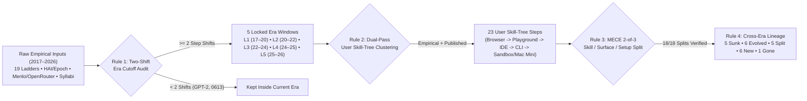

# AI Ladder Evolution (v2): Multi-Agent History, Resource Economics & Visual Atlas of AI Ladders (2017–2026)

**Executive Summary (BLUF):** From June 2017 to October 2026, how people use artificial intelligence (AI), large language models (LLMs), and action-taking AI (agentic AI) reorganized five times across **5 distinct Era Ladders ($L_1 \dots L_5$)** comprising **23 mutually exclusive user skill-tree steps** (reconciled across both our **Mainstream Production-Crossover Lens** [`2017-06` to `2026-10`] and the **Gemini Deep Research First-Release Capability Lens** [`2018-10` to `2026-10`]). Crucially, **"Up the Ladder" (`Step 1` $\to$ `Step N`) is defined strictly as Complexity from the Perspective of the Human User (a Practitioner AI Skill Tree)** — **NOT** the internal complexity of the AI model, the backend workflow, or the abstract task itself. Moving **up** to a higher rung means the **user is more sophisticated in their AI usage** across three user-facing dimensions: (1) **applying more learned AI-specific skill ($\Delta\text{Skill}$)** (progressing from zero AI training $\to$ deliberate prompt engineering $\to$ context/RAG/`MCP` configuration $\to$ `CLAUDE.md`/`AGENTS.md` specification & test-harness engineering $\to$ multi-agent swarm & RLVR orchestration); (2) **installing and operating specialized tool surfaces beyond the web browser ($\Delta\text{Surface}$)** (progressing from a zero-install Web Browser $\to$ Browser Playground/Workspace $\to$ Specialized AI IDE [`Cursor`, `Windsurf`] $\to$ Terminal CLI [`Claude Code`, `Codex CLI`] $\to$ Parallel `git worktree` Swarms & 24/7 Self-Hosted Daemons [`OpenClaw`]); and (3) **investing more setup time and non-compute hardware/environment resources ($\Delta\text{Setup}$)** (such as configuring `.mcp.json` servers, provisioning isolated Docker/VM sandboxes so `--dangerously-skip-permissions` agents cannot damage a primary laptop, building local `RTX 3090/4090` rigs, or **buying a dedicated Apple M4 / M4 Pro Mac Mini** with `Tailscale` networking to run 24/7 headless `OpenClaw` + `Claude Code` agent sandboxes). Across all nine years, four repeating empirical laws governed this evolution: (1) **The Two-Shift Era Law**, where a new ladder emerges only when a breakthrough triggers $\ge 2$ structural step changes on the User Skill Tree at once; (2) **The 15-to-18-Month Downward Sinking Law**, where higher skill-tree steps from one era (2021 API completion prompting, 2023 custom single-PDF vector search, and 2024 standalone `o1` selection) sink directly into the **zero-setup Step 1 default web browser UI** of the next era as vendors absorb the setup friction (cutting per-task cost $30\times–50\times$ and flipping corporate AI procurement from **47% built / 53% bought in 2024 to 24% built / 76% bought in 2025**, with MIT NANDA recording a **67% production success rate for purchased tools vs. 33% for in-house builds**); (3) **The Price-to-Horizon Jevons Paradox & Runtime Compute Crossover**, where a $2,000\times$ drop in token price ($\$60/1\text{M}\to\$0.03–\$0.20/1\text{M}$) unlocked $4,000\times$ larger top-step loops ($2\text{k}\to 8\text{M}+$ tokens) and propelled annual enterprise GenAI spend $21.7\times$ from **$\$1.7\text{B}$ (2023) to $\$11.5\text{B}$ restated / $\$13.8\text{B}$ total (2024) and $\$37.0\text{B}$ in 2025** (6% of global SaaS, led by $\$4.0\text{B}–\$4.2\text{B}$ [55%] in coding); and (4) **The Pareto Compute Inversion & Verification Bottleneck**, where 50%–68% of users remain at Step 1 browser chat/autocomplete, while the top 10%–12% of users at Steps 4–5 consume **50%–60% of all global AI tokens and electricity** — succeeding where fast deterministic verifiers exist while facing a **4.8 to 22.5 percentage-point accuracy drop on unseen private commercial codebases** (`Scale AI SWE-bench Pro`).

**Visual Abstract — Across nine years (`2017-06` to `2026-10`), AI, LLM, and agentic systems reorganized across five empirically locked Era Ladders ($L_1 \dots L_5$, 23 complexity steps) governed by four repeating laws, as a 2,000x collapse in token price unlocked 4,000x larger autonomous agent horizons.** Panel A traces the five chronological Era Ladders and the 15-to-18-Month Downward Sinking Law whereby complex engineering steps continuously sink into the next era's Step 1 default consumer interface. Panel B summarizes the four repeating structural and economic laws across all nine years. Panel C charts the log-scale 10-year trajectory (`2017–2026`) of baseline inference price (USD/1M tokens), annual enterprise generative AI spend (USD billions, rising from $\$1.7\text{B}$ in 2023 to $\$13.8\text{B}$ in 2024 and $\$37.0\text{B}$ in 2025 per Menlo Ventures), top-step single-task token volume ($10^3$ tokens), and active monthly practitioners/users ($10^6$), paired with a right-hand unfilled step marginal histogram sharing the log Y-axis.

### Structural Index
* [1. Part I — Extended Summary](#1-part-i--extended-summary)
  * [1.1 Literature, Evidence & Cost Synthesis (Part II Digest)](#11-literature-evidence--cost-synthesis-part-ii-digest)
  * [1.2 Applied Ladder-Building Method (Part III Digest)](#12-applied-ladder-building-method-part-iii-digest)
  * [1.3 Five Chronological Era Ladders (L1 to L5, 2017–2026) (Part IV Digest)](#13-five-chronological-era-ladders-l1-to-l5-20172026-part-iv-digest)
  * [1.4 Evolutionary Laws, Literature Comparison & Executive Matrix (Part V Digest)](#14-evolutionary-laws-literature-comparison--executive-matrix-part-v-digest)
* [2. Part II — Literature & Cost Survey](#2-part-ii--literature--cost-survey)
  * [2.1 Review of Published & Informal AI, LLM & Agentic Ladders (2017–2026)](#21-review-of-published--informal-ai-llm--agentic-ladders-20172026)
  * [2.2 Step Use-Case Sources: Reports, Traffic Logs, Courses, Surveys & News (2017–2026)](#22-step-use-case-sources-reports-traffic-logs-courses-surveys--news-20172026)
  * [2.3 Single-Task vs. Industry-Wide Resource Metrics & Fallback Math](#23-single-task-vs-industry-wide-resource-metrics--fallback-math)
* [3. Part III — Applied Ladder-Building Method](#3-part-iii--applied-ladder-building-method)
  * [3.1 Two-Shift Era Threshold Audit (2017–2026 Cutoff Decisions)](#31-two-shift-era-threshold-audit-20172026-cutoff-decisions)
  * [3.2 Bottom-Up & Top-Down Reconciliation Against Published Ladders](#32-bottom-up--top-down-reconciliation-against-published-ladders)
  * [3.3 No-Overlap & No-Gaps (MECE) Two-of-Three Step Split Verification Matrix](#33-no-overlap--no-gaps-mece-two-of-three-step-split-verification-matrix)
  * [3.4 Locked Master Skeleton (L1 to L5 Dates, Steps & Cross-Era Links)](#34-locked-master-skeleton-l1-to-l5-dates-steps--cross-era-links)
* [4. Part IV — Chronological Ladder Evolution (L1 to L5, 2017–2026)](#4-part-iv--chronological-ladder-evolution-l1-to-l5-20172026)
  * [4.1 Era 1 Ladder (L1: 2017-06 to 2020-05) — Pre-LLM & Transfer-Learning NLP Ladder](#41-era-1-ladder-l1-2017-06-to-2020-05--pre-llm--transfer-learning-nlp-ladder)
  * [4.2 Era 2 Ladder (L2: 2020-06 to 2022-10) — Completion Foundation Models & Early Copilot Ladder](#42-era-2-ladder-l2-2020-06-to-2022-10--completion-foundation-models--early-copilot-ladder)
  * [4.3 Era 3 Ladder (L3: 2022-11 to 2024-05) — Conversational Web Chat, Custom Vector RAG & Early Agent Loops Ladder](#43-era-3-ladder-l3-2022-11-to-2024-05--conversational-web-chat-custom-vector-rag--early-agent-loops-ladder)
  * [4.4 Era 4 Ladder (L4: 2024-06 to 2025-01) — Built-In Multimodal Context, Multi-File IDE Pairing & First Reasoning Models Ladder](#44-era-4-ladder-l4-2024-06-to-2025-01--built-in-multimodal-context-multi-file-ide-pairing--first-reasoning-models-ladder)
  * [4.5 Era 5 Ladder (L5: 2025-02 to 2026-10) — Terminal CLI Agents, Deep Research, MCP Ecosystems & Parallel Agent Fleets Ladder](#45-era-5-ladder-l5-2025-02-to-2026-10--terminal-cli-agents-deep-research-mcp-ecosystems--parallel-agent-fleets-ladder)
* [5. Part V — Overall Patterns, Literature Ladder Comparison & Summary Visuals](#5-part-v--overall-patterns-literature-ladder-comparison--summary-visuals)
  * [5.1 Four Repeating Structural & Economic Laws Across Eras](#51-four-repeating-structural--economic-laws-across-eras)
  * [5.2 Cross-Era Master Comparison Tables & Full-Timeline Visual Synthesis](#52-cross-era-master-comparison-tables--full-timeline-visual-synthesis)
  * [5.3 Post-Synthesis Comparison: Our Five-Era Ladder Evolution vs. Existing Literature Ladders](#53-post-synthesis-comparison-our-five-era-ladder-evolution-vs-existing-literature-ladders)
  * [5.4 Final Verification Audit Checklist](#54-final-verification-audit-checklist)

***

## 1. Part I — Extended Summary

**Part I Overview:** Condenses the nine-year historical, user skill-tree, and resource-cost synthesis (`2017-06` to `2026-10`) into a standalone executive digest (~5%–7% of the full v2 report). Surveys 19 published and historical ladders (including the Gemini Deep Research 23-step ladder) and nine years of empirical evidence from Menlo Ventures, MIT NANDA, OpenRouter, Scale AI `SWE-bench Pro`, and Epoch AI (Part II); details the four-rule MECE ladder construction method ordered strictly by **User-Side Sophistication & Skill-Tree Complexity** across both Production-Crossover and First-Release chronological lenses (Part III); traces the step-by-step evolution and resource economics of all five Era Ladders $L_1 \dots L_5$ across 23 user skill-tree steps (Part IV); and synthesizes the four macro evolutionary laws, three strategic capital-allocation rules, and a post-synthesis comparison mapping our completed 5-era ladder evolution against all 19 existing literature ladders (Part V).

**Part I Visual Abstract — The Executive Summary condenses 19 published ladders, nine years of usage/billing logs, four MECE construction rules, five Era Ladders ($L_1 \dots L_5$), four macro laws, and a post-synthesis literature comparison into a unified reference architecture.** Panel A maps the four-pillar digest structure of Part I (`Sections 1.1–1.4`) to its full-depth counterparts (`Parts II–V`). Panel B plots the five-era macro scaling summary across active monthly users ($10^6$), total era spending (USD billions), total era electricity (TWh), and top-step single-task token horizon ($10^6$ tokens), paired with a right-hand unfilled step marginal distribution.

#### Part I Structural Index
* [1.1 Literature, Evidence & Cost Synthesis (Part II Digest)](#11-literature-evidence--cost-synthesis-part-ii-digest)
  * [1.1.1 Nineteen Published & Historical Ladders Across Labs, Industry & Practitioners](#111-nineteen-published--historical-ladders-across-labs-industry--practitioners)
  * [1.1.2 Nine Years of Evidence: Enterprise Spend, MIT Audits, Syllabi & SWE-bench Pro](#112-nine-years-of-evidence-enterprise-spend-mit-audits-syllabi--swe-bench-pro)
  * [1.1.3 Single-Task vs. Industry-Wide Cost System, Epoch Trade-Offs & Price Deflation](#113-single-task-vs-industry-wide-cost-system-epoch-trade-offs--price-deflation)
* [1.2 Applied Ladder-Building Method (Part III Digest)](#12-applied-ladder-building-method-part-iii-digest)
  * [1.2.1 Two-Shift Era Threshold Across Production-Crossover & First-Release Lenses](#121-two-shift-era-threshold-across-production-crossover--first-release-lenses)
  * [1.2.2 Dual-Pass Reconciliation, MECE Two-of-Three User Skill-Tree Split Test & Cross-Era Lineage](#122-dual-pass-reconciliation-mece-two-of-three-user-skill-tree-split-test--cross-era-lineage)
* [1.3 Five Chronological Era Ladders (L1 to L5, 2017–2026) (Part IV Digest)](#13-five-chronological-era-ladders-l1-to-l5-20172026-part-iv-digest)
  * [1.3.1 Era 1 (L1: 2017-06–2020-05) — Pre-LLM & Encoder NLP Ladder](#131-era-1-l1-2017-062020-05--pre-llm--encoder-nlp-ladder)
  * [1.3.2 Era 2 (L2: 2020-06–2022-10) — Completion Models & Copilot Ladder](#132-era-2-l2-2020-062022-10--completion-models--copilot-ladder)
  * [1.3.3 Era 3 (L3: 2022-11–2024-05) — Web Chat, Vector RAG & Early Agents Ladder](#133-era-3-l3-2022-112024-05--web-chat-vector-rag--early-agents-ladder)
  * [1.3.4 Era 4 (L4: 2024-06–2025-01) — Multimodal Context, IDE Pairing & o1 Ladder](#134-era-4-l4-2024-062025-01--multimodal-context-ide-pairing--o1-ladder)
  * [1.3.5 Era 5 (L5: 2025-02–2026-10) — Terminal CLI, Deep Research, AAIF MCP & Fleets Ladder](#135-era-5-l5-2025-022026-10--terminal-cli-deep-research-aaif-mcp--fleets-ladder)
* [1.4 Evolutionary Laws, Literature Comparison & Executive Matrix (Part V Digest)](#14-evolutionary-laws-literature-comparison--executive-matrix-part-v-digest)
  * [1.4.1 Four Repeating Structural Laws & Three Strategic Capital Rules (2017–2026)](#141-four-repeating-structural-laws--three-strategic-capital-rules-20172026)
  * [1.4.2 Condensed Five-Era Macro & 23-Step Executive Summary Table](#142-condensed-five-era-macro--23-step-executive-summary-table)
  * [1.4.3 Post-Synthesis Comparison Against the 19 Existing Literature Ladders (Section 5.3 Digest)](#143-post-synthesis-comparison-against-the-19-existing-literature-ladders-section-53-digest)

### 1.1 Literature, Evidence & Cost Synthesis (Part II Digest)

**Evidence Base Summary:** Unites 19 published and historical hierarchies with nine years of enterprise billing disclosures, workforce productivity surveys, university syllabi, standardized agentic benchmark audits, and two-level physical compute accounting across artificial intelligence (AI), large language models (LLMs), and action-taking AI (agentic AI).

#### 1.1.1 Nineteen Published & Historical Ladders Across Labs, Industry & Practitioners

**Published Framework Convergence:** Nineteen cataloged frameworks (`2017-11`–`2026-10`) divide into three complementary traditions:

* **Academic & AI Lab Ladders:** Andrej Karpathy's *Software 1.0/2.0/3.0* (`2017-11`–`2025-06`) tracks programming shifting from explicit code (*1.0*), to learned neural network weights (*2.0*), to natural English prompts where active reading memory (context window) acts as working RAM (*3.0*), paired with an *Autonomy Slider* progressing from single-line tab autocomplete (`GitHub Copilot`) to scoped edits (`Cmd+K`), multi-file repo diffs (`Cursor Composer`), and background agent loops. Google DeepMind's *Levels of AGI* (`2023-11` / `2025-09`, Morris et al.) decouples a 6-tier capability depth $\times$ 2-column generality grid (`No AI` to `Superhuman ASI`) from a 6-level human-AI autonomy scale (`No AI` $\to$ `Tool` $\to$ `Consultant` $\to$ `Collaborator` $\to$ `Expert` $\to$ `Agent`). OpenAI's *Five Levels of AGI* (`2024-07`) orders *Chatbots (L1)*, *Reasoners (L2)*, *Agents (L3)*, *Innovators (L4)*, and *Organizations (L5)* — with 2026 empirical audits calibrating real enterprise usage at **Level 2.5**, where step-by-step reasoning is routine, Level 3 agents succeed in verifiable software engineering, and Levels 4–5 remain theoretical. Anthropic's *Building Effective Agents* (Schluntz & Zhang, `2024-12`) and Princeton's *CoALA* (`2023-09`) draw the definitive production boundary between an *Augmented LLM* + **5 Predefined Workflow patterns** (*Prompt Chaining*, *Routing*, *Parallelization via Sectioning/Voting*, *Orchestrator-Workers*, and *Evaluator-Optimizer*) versus model-directed **Autonomous Agents**.
* **Industry, Enterprise & Coding Autonomy Ladders:** Dan Shapiro (`2026-01`), Steve Yegge (`2024-06`–`2026-01`), and industry surveys adapt automotive self-driving tiers (`SAE L0–L5`) to software engineering — ascending from manual coding (`L0`) and ghost-text autocomplete (`L1`), to chat function drafting (`L2`), conditional multi-file IDE editing under *"plan, approve, execute"* supervision (`L3`), background autonomous pull-request resolution in sandboxed test containers (`L4`), and unsupervised full-lifecycle engineering (`L5`) / Yegge's 8-rung *Gas Town* orchestrators. Harrison Chase's *LangChain Cognitive Architectures* (`2023-11`–`2026-03`) tracks control flow from *Fixed Code* $\to$ *Single LLM Call* $\to$ *Chain* $\to$ *Router* $\to$ *State-Machine Graph (`LangGraph`)* $\to$ *Deep Agents* (launched July 2025, hitting 9.9k GitHub stars in 5 hours in March 2026). Venture frameworks (*Sequoia Acts 1–3*, *a16z*, *Menlo Ventures*), *Gartner's 5-Level AI Maturity Model* (`Foundational/Awareness` $\to$ `Transformational`), and the **Gemini Deep Research 5-Era / 23-Step Historical Ladder ($L_1^{\text{Gem}} \dots L_5^{\text{Gem}}$, `2018-10`–`2026-10`)** anchor commercial stack evolution.
* **Practitioner Intervention Hierarchies:** Applied engineering guides (*Chip Huyen* `2023-04` / `2025-01`, *Eugene Yan* `2023-07`, *OpenAI DevDay* `2023-11`, *Ruder* `2018-07`, *Liu et al.* `2021-07`) enforce a strict cost-and-latency ladder: exhaust zero/few-shot prompting and automated evaluations (`Evals`) first, add private document lookup (retrieval-augmented generation / RAG) for external facts, and reserve custom weight training (parameter-efficient fine-tuning / `LoRA` or reinforcement learning) for strict domain syntax or cost distillation.

#### 1.1.2 Nine Years of Evidence: Enterprise Spend, MIT Audits, Syllabi & SWE-bench Pro

**Four Empirical Grounding Pillars:** Populates every step from four verified historical archives:

* **Longitudinal Enterprise Spend & Build-vs-Buy Flip (*Menlo Ventures* & *MIT NANDA*):** *Menlo Ventures* (`2023–2026`) documents corporate generative AI spending surging **$21.7\times$ in two years** — from **$\$1.7\text{B}$ in 2023** to **$\$11.5\text{B}$ restated (excluding raw cloud inference, or $\$13.8\text{B}$ total) in 2024** and **$\$37.0\text{B}$ in 2025** (representing **6% of the entire global SaaS market**), while consumer AI spend tripled in 2026. Of 2025's $\$37.0\text{B}$, user-facing applications captured **$\$19.0\text{B}$ (51.4%)** and foundation model APIs/infrastructure captured **$\$18.0\text{B}$ (48.6%)**. Departmental AI reached **$\$7.3\text{B}$**, led by **Software Coding at $\$4.0\text{B}–\$4.2\text{B}$ (55%)**, IT Operations (**10%**), Marketing (**9%**), Customer Support (**9%**), Design (**7%**), and HR (**5%**), alongside **$\$8.4\text{B}$** in horizontal copilots and **$\$3.5\text{B}$** in vertical AI led by **Healthcare at $\$1.5\text{B}$** (up from $\$450\text{M}$ in 2024). Simultaneously, enterprise procurement flipped from **47% internal custom builds / 53% bought in 2024 to 24% built / 76% bought off-the-shelf in 2025**, directly reflecting *MIT NANDA*'s 2025 audit of 300 enterprise deployments showing that **purchased or partner-built tools succeeded in production 67% of the time versus only 33% for custom in-house builds** (while 80%–95% of poorly scoped enterprise pilots delivered zero measurable operating-earnings impact).
* **Workforce Surveys, Token Telemetry & Open Standards (*St. Louis Fed*, *OpenRouter*, *AAIF MCP*):** Workforce tracking records **37.4% of US workers aged 18–64** using GenAI on the job with a **+33% hourly productivity boost** during active use (*St. Louis Fed*), **87% weekly usage** at large US employers (*KPMG* mid-2025), **75% global knowledge-worker adoption** across 31,000 workers in 31 countries (*Microsoft 2024 Work Trend Index*), **84% developer AI adoption** (*Stack Overflow 2025*), and **62% of production agent teams** adopting the Model Context Protocol (`MCP`, *State of AI Engineering 2025*). On December 9, 2025, Anthropic donated `MCP` to the **Linux Foundation's Agentic AI Foundation (AAIF)**, co-founded with Block (donating `goose`) and OpenAI (donating `AGENTS.md`) and backed by Google, Microsoft, AWS, Cloudflare, and Bloomberg (`10,000+` public servers, `97M+` monthly SDK downloads). *OpenRouter*'s 100T+ token telemetry confirms that coding and reasoning loops now drive **>50% of all commercial API tokens**, propelling Anthropic to **43.5% corporate spend share** on the *Ramp AI Index* by Summer 2026.
* **Timestamped Curricula & Standardized Agentic Benchmarks (*DeepLearning.AI*, *SWE-bench Pro*):** Practitioner training evolved from `Stanford CS224N` (`2018–2020` `Word2Vec`/`BiLSTM`/`BERT`) and `Stanford CS324` (`Winter 2022` by Percy Liang & Tatsu Hashimoto on foundation model scaling) to `UVA CS 6501` (`Spring 2026` Agentic AI), mirrored across *DeepLearning.AI*'s 7M-learner course sequence (*ChatGPT Prompt Engineering*, *Building Systems with ChatGPT*, *LangChain: Chat with Your Data*, *Building and Evaluating Advanced RAG*, *Reasoning with o1*, *Multi AI Agent Systems with crewAI*, *Building with the Claude API & MCP*, and *Building Adaptive AI Agents with Claude Code*). While `SWE-bench Verified` climbed from `22.0%` (`Claude 3 Opus`, `2024-03`) and `33.0%` (`Claude 3.5 Sonnet v1`, `2024-06`) to `49.0%` (`Sonnet 3.5 v2`, `2024-10`), `72.7%` (`Sonnet 4`, `2025-05`), `79.6%` (`Sonnet 4.6`, `2026-02`), and `85.8%–96.0%` (`Claude Code` / `Opus 5.5`), **Scale AI's `SWE-bench Pro`** (`1,865` tasks across 41 repos: `731` public GPL, `642` V2 Harbor, `276` unseen private commercial) exposed both a **10 to 30 percentage-point vendor scaffold gap** (`GPT-5.2 Codex` scoring `56.4%` on vendor scaffold vs. `41.0%` on Scale's standardized harness) and a **4.8 to 22.5 percentage-point drop on unseen private commercial code** (`Muse Spark 1.1` dropping `-10.0 pt` from `61.5%` public to `51.5%` commercial; `Claude Opus 4.6 thinking` dropping `-4.8 pt` from `51.9%` to `47.1%`; `GPT-5.4 xHigh` dropping `-15.7 pt` from `59.1%` to `43.4%`; `Claude Opus 4.5` dropping `-22.5 pt` from `45.9%` to `23.4%`).

#### 1.1.3 Single-Task vs. Industry-Wide Cost System, Epoch Trade-Offs & Price Deflation

**Two-Level Five-Unit Resource Accounting:** Quantifies every step at **Level 1 Single-Task Footprint** and **Level 2 Industry-Wide Share** (summing to $100.0\%$ per era across Users, Human-Hours, Compute/Tokens, and USD Spend):

* **Five Coupled Units & Lifetime Compute Crossover:** Tracks **Tokens**, **FLOPs** ($C_{\text{deployment}} \approx 2 N_{\text{active}} T_{\text{total}}$), **Electricity (`Wh`/`TWh`)** (from $0.24–0.34\text{ Wh}$ per short 2025 chat turn to $40–220\text{ Wh}$ per autonomous CLI/GUI agent job, supported by $+34\%/\text{yr}$ GPU FLOP/s per watt and $+49\%/\text{yr}$ chip performance per dollar), **Money (`USD`)**, and **Human-vs-AI Duration**. In 2024, OpenAI spent **$\$7.0\text{B}$ on cloud compute** — allocating **$\$5.0\text{B}$ (71%) to R&D, experimental runs, and final training** (including $\$386\text{M}–\$400\text{M}$ for `GPT-4.5` final training and $\$80\text{M}–\$83\text{M}$ for `GPT-4o`/`o1` post-training) and **$\$1.8\text{B}–\$2.0\text{B}$ (29%–30%) to deployment inference**. As formalized by Oxford and Epoch AI ($C_{\text{total}} \approx N D + C_{\text{post-training}} + d N I$), lifetime deployment inference compute overtook pre-training compute globally in 2024–2025 once deployed tokens ($d \times I$) surpassed training dataset tokens ($D \approx 10^{13}$).
* **Epoch AI's Three Runtime-vs-Training Trade-Off Spans & $2,000\times$ Token Deflation:** While frontier pre-training compute grew $5\times/\text{yr}$ from $3.1\times 10^{23}\text{ FLOPs}$ (`GPT-3`, 2020) to $2.5\times 10^{26}\text{ FLOPs}$ (`GPT-4.5` / `Sonnet 4`, 2025) and $\sim 10^{27}\text{ FLOPs}$ (`Claude Opus 5.5` / `GPT-5.4`, 2026), Epoch AI proved that multiplying runtime inference compute by **$+1–2\text{ OOM}$ saves $\sim 1\text{ OOM}$ of training compute** on general language tasks, **$+2–3\text{ OOM}$ saves $\sim 2\text{ OOM}$** on sequential reasoning, and **$+5–6\text{ OOM}$ via parallel sampling (`pass@k`) saves $3–4\text{ OOM}$** on verifiable coding and math. Simultaneously, API prices fell from $\$60.00/1\text{M}$ (`davinci`, `2020-06`) and $\$20.00/1\text{M}$ (`davinci-003`, `2022-11`) to $\$2.00/1\text{M}$ (`gpt-3.5-turbo`, `2023-03`), $\$0.30/1\text{M}$ on 90% KV-cached `Claude 3.5 Sonnet` (`2024-08`), and $\$0.03–\$0.20/1\text{M}$ on 2025–2026 Flash and specialized coding models (`Poolside Laguna S 2.1`, `InclusionAI Ling 3.0 Flash`).

**Table 1.1: Five-Pillar Empirical Evidence & Cost Accounting Synthesis (2017–2026)**

| Evidence Pillar (Part II Survey) | Primary Sources Covered (`2017–2026`) | Core Quantitative Span Across Nine Years | Role in Ladder Construction |
| :--- | :--- | :--- | :--- |
| **1. Published Ladders ($n = 19$)** | Karpathy (`1.0–3.0` + Slider), DeepMind AGI, OpenAI (`L1–L5`), Anthropic, CoALA, Shapiro (`L0–L5`), Yegge (`L1–L8`), LangChain (`Deep Agents`), HF, Huyen, Yan, Ruder, Liu, Gemini 23-Step | $3\text{ to }8\text{ rungs}$ per framework ($\mu = 5.1\text{ rungs}$) across 4 ordering axes + 23-step historical synthesis | Top-Down structural cross-check (`Rule 2`) |
| **2. Macro & Enterprise Reports** | *Menlo Ventures* (`2023–2026`), *MIT NANDA* ($n=300$), *Stanford HAI*, *State of AI*, *Epoch AI* | Enterprise GenAI spend: $\$1.7\text{B}\ (2023) \to \$11.5\text{B}/\$13.8\text{B}\ (2024) \to \$37.0\text{B}\ (2025)$; $76\%$ bought vs. $24\%$ built; $67\%$ vs. $33\%$ success | Anchors era macro FLOPs, TWh, USD & build-vs-buy rules |
| **3. Telemetry, Workforce & MCP** | *OpenRouter* ($100\text{T}+\text{ tok}$), *St. Louis Fed*, *KPMG*, *Microsoft WTI*, *Ramp*, *Linux Foundation AAIF* | $37.4\%$ US workers ($+33\%$ productivity); $87\%$ weekly large-corp use; `AAIF MCP` $10\text{k}+$ servers & $97\text{M}+$ SDK/mo | Bottom-Up workflow clustering & token/spend % |
| **4. Curricula & Agent Benchmarks** | *Stanford CS224N/CS324*, *UVA CS 6501*, *DeepLearning.AI* ($7\text{M}$ learners), *SWE-bench Verified & Pro*, *OSWorld* | `SWE-bench Verified`: $22\% \to 96\%$; `SWE-bench Pro` ($1,865$ tasks): $-4.8\text{ to }-22.5\text{ pt}$ unseen commercial drop | Concrete tool stacks, generalization limits & time |
| **5. Five Physical Cost Units** | Level 1 Single-Task vs. Level 2 Industry Share; *Epoch AI* Trade-Off Spans; *Oxford/Epoch* Crossover | API price: $\$60.00/1\text{M} \to \$0.06/1\text{M}$ ($2,000\times$ drop); Runtime $+5–6\text{ OOM}$ saves $3–4\text{ OOM}$ train compute | Enforces $10\times–100\times$ step cost splits & conservation |

**Figure 1 — Published ladders converge around an average of 5.1 complexity rungs (Panel A), while commercial billing logs show enterprise production workloads flipping from custom model fine-tuning (68% in 2020 to 5% in 2026) to custom RAG (51% peak in 2024) and MCP/agentic loops (57% in 2026, Panel B).** Panel A compares framework counts and mean rung depth across Academic/AI Lab, Industry/Coding, and Practitioner NLP/LLM ladder traditions. Panel B charts the seven-year trajectory (`2020–2026`) of production enterprise workload shares across fine-tuning, custom vector RAG, long-context/MCP/agent loops, and direct prompting, paired with a right-hand unfilled step marginal histogram.

### 1.2 Applied Ladder-Building Method (Part III Digest)

**Four-Rule User Skill-Tree Protocol:** Converts raw historical evidence into five Era Ladders ($L_1 \dots L_5$) ordered strictly from bottom (`Step 1`) to top (`Step N`) by **User-Side Sophistication & Skill-Tree Complexity** with no overlap and no gaps (MECE).

#### 1.2.1 Two-Shift Era Threshold Across Production-Crossover & First-Release Lenses

**Timeline & Dual-Lens Filtering:** Locks era cutoff dates and reconciles real user skill-tree practices against corporate frameworks:

* **Rule 1 — Simultaneous Two-Shift Era Threshold ($\Delta_{\text{structural}} \ge 2$):** Opens a new Era Ladder ($L_t$) only when a technical breakthrough or $\ge 10\times$ unit price drop triggers **at least two simultaneous structural step changes on the User Skill Tree** (an old higher-skill step sinking into the zero-setup Step 1 browser UI, an existing step splitting/combining, a new top user skill-tree step emerging, or a legacy step collapsing), absorbing single-checkpoint upgrades (`GPT-2` `2019-02`, `gpt-3.5-turbo-0613` `2023-06`, `Claude 3.7` `2025-02`) inside existing eras. Evaluating candidate cutoffs under both the **Mainstream Production-Crossover Lens** (`2017-06`, `2020-06`, `2022-11`, `2024-06`, `2025-02`) and the **First-Release Capability Lens** (`2018-10`, `2020-06`, `2022-11`, `2023-11`, `2024-09`) confirms that both conventions yield the exact same five Era Ladders.
* **Rule 2 — Bottom-Up + Top-Down Reconciliation:** Groups empirical user habits from *DeepLearning.AI*, *CS224N/CS324*, *Menlo Ventures*, and *OpenRouter* bottom-up first, then cross-checks against published ladders — preserving high-volume user steps missed by model-centric AGI roadmaps ($L_1$ Step 1 turnkey cloud APIs, $L_2$ Step 1 one-keystroke Copilot `Tab`, $L_3$ Step 4 `QLoRA` local GPU tuning, $L_5$ Step 2 `Deep Research` specification, $L_5$ Step 3 `MCP` configuration) while pruning unverified speculative rungs (OpenAI *Level 4 Innovators* / *Level 5 Organizations*, DeepMind *Level 5 ASI*, and SAE *Level 5 Dark Factory*).

#### 1.2.2 Dual-Pass Reconciliation, MECE Two-of-Three User Skill-Tree Split Test & Cross-Era Lineage

**User Skill-Tree Boundary & Lineage Rules:** Defines "Up the Ladder" strictly from the user's perspective and enforces continuous lineage across eras:

* **Rule 3 — Two-of-Three User Skill-Tree Split Test ("What Up Means") & The Two-Track Producer–Consumer Split:** Moving **up** from Step $k$ to Step $k+1$ is defined strictly by **user sophistication**, not model or task complexity. Two usage patterns form separate rungs only when climbing from Step $k$ to Step $k+1$ requires the user to advance on **at least two of three User Skill-Tree variables**: (1) **Learned AI-Specific Skill ($\Delta\text{Skill}$)** (e.g., learning prompt engineering, RAG chunking, `.mcp.json` wiring, `NeMo Guardrails` policy rails, `CLAUDE.md`/`AGENTS.md` architecture specs, or `pytest` verifier harnesses), (2) **Specialized Tool & Environment Surface ($\Delta\text{Surface}$)** (moving out of a zero-install Web Browser to open/install a Playground, a specialized AI IDE like `Cursor`, a terminal CLI like `Claude Code`, or a 24/7 daemon like `OpenClaw`), and (3) **Upfront Setup Time & Non-Compute Hardware/Sandbox Commitment ($\Delta\text{Setup}$)** (investing setup time or buying/configuring non-compute resources like isolated Docker/VM sandboxes, local `RTX 3090/4090` rigs, or a **dedicated Apple M4 Mac Mini** server). Crucially, this User Skill-Tree lens resolves **how AI-integrated products (`Grammarly`, `Notion AI`, `Klarna`) and Internal Company RAG + Tool-Calling + Policy-Guardrailed Chatbots fit on the ladder**: **End-Users (Consumers)** of those products or internal company chatbots sit strictly at **`Step 1` (`L1-S1` to `L5-S1`)** ($\Delta\text{Skill}=0, \Delta\text{Surface}=0, \Delta\text{Setup}=0$), whereas the **Builders (Producers)** who integrate LLMs, corporate RAG, tools, and policy guardrails into a product or internal company bot climb **`Steps 2–5` on Track B (`AI-as-Product-Component / Compound AI Builder`)** in parallel with **Track A (`Direct Personal-Output User`)**: **`Step 2`** (API Wrapper & Hidden Policy System Prompt Builder) $\to$ **`Step 3`** (**Internal Company RAG + Tool-Calling + Policy Guardrail Chatbot Builder**, wiring `SharePoint`/`Confluence` RBAC retrieval, `ServiceNow`/`Workday`/MCP tools, and `NeMo Guardrails`/`Llama Guard` policy compliance) $\to$ **`Step 4`** (Stateful Multi-Step Product Backend [`LangGraph`], Custom Product Model Fine-Tuner [**Grammarly's** `GECToR`/`CoEdIT`], & Eval-Driven CI/CD Engineer) $\to$ **`Step 5`** (Product Telemetry Flywheel, Custom `DPO`/`RLVR` Post-Training & Distillation Architect).
* **Rule 4 — Five Cross-Era Transition Categories:** Links every step in $L_t$ to $L_{t-1}$ as **Old Higher-Skill Step Sinking into Default Step 1 Browser UI** (where product/chatbot builders at Steps 3–5 package complex RAG/tool/policy pipelines into a one-click Step 1 consumer experience), **Evolved Core Workhorse**, **Split & Specialized Step**, **New Breakthrough Top Skill-Tree Step**, or **Combined / Gone Step**.

**Table 1.2: Four-Rule Methodological Verification Summary Across L1 to L5 (2017–2026)**

| Methodological Rule (Part III) | Operational Verification Criterion | Empirical Audit Result (`2017-06` to `2026-10`) | Structural Guarantee |
| :--- | :--- | :--- | :--- |
| **Rule 1: Two-Shift Era Threshold** | Candidate cutoff date must trigger $\ge 2$ simultaneous user skill-tree step changes (sinking, splitting, or new top step) | **5 Era Cutoffs Locked** under both Production-Crossover & First-Release lenses; single-step checkpoints absorbed | Prevents single-model hype from fragmenting eras |
| **Rule 2: Dual-Pass Reconciliation** | Pass 1 clusters empirical user habits/syllabi bottom-up; Pass 2 reconciles against 20 published ladders top-down | **21 Standard Rungs Adopted**, **2 Practical User Steps Added** (`L1-S1` Cloud APIs, `L5-S2` Deep Research), **3 Speculative Tiers Set Aside** | Grounds every rung in verified user practice |
| **Rule 3: MECE 2-of-3 Skill-Tree Split** | Adjacent steps ($k \to k+1$) split only if $\ge 2$ of 3 user axes jump: (1) $\Delta\text{Skill}$, (2) $\Delta\text{Surface}$ (Browser$\to$IDE$\to$CLI), (3) $\Delta\text{Setup}$ (Sandboxes/Mac Mini); resolves Track A (Direct User) vs. Track B (Product/Bot Builder) vs. Step 1 End-User | **16 of 18 boundaries clear 3/3 axes**; **2 boundaries clear 2/3 axes** (`L3 S4->S5`, `L5 S2->S3`); **0 invalid splits** | 100% MECE user skill-tree step separation |
| **Rule 4: Five Lineage Categories** | Every step in $L_t$ links to $L_{t-1}$ via 1 of 5 explicit user skill-tree mechanisms | **5 Sunk into Browser UI**, **6 Evolved Workhorse**, **5 Split Steps**, **6 New Top Skill-Tree Steps**, **1 Legacy Gone** (`L1-S2`) | Continuous nine-year alluvial flow tracking |

**Figure 2 — The Two-Shift Era Rule cleanly separates the five historical era openings ($\ge 2$ simultaneous step shifts) from single-model upgrades (Panel A), while 100% of the 18 within-era step boundaries clear the MECE Two-of-Three User Skill-Tree Split Test (Panel B).** Panel A evaluates seven candidate historical cutoff dates against the mandatory threshold of two simultaneous structural step changes, accepting five era transitions ($L_1 \dots L_5$) and rejecting `2019-02` (`GPT-2`) and `2023-11` (`GPT-4 Turbo` when evaluated as a standalone pre-Sonnet 3.5 checkpoint). Panel B breaks down the 18 adjacent within-era step boundaries across $L_1 \dots L_5$, showing 16 boundaries clearing all three user skill-tree axes ($\Delta\text{Skill} + \Delta\text{Surface} + \Delta\text{Setup}$) and 2 clearing two axes.

### 1.3 Five Chronological Era Ladders (L1 to L5, 2017–2026) (Part IV Digest)

**Nine-Year User Skill-Tree Synthesis:** Tracks all five Era Ladders and 23 user-sophistication steps from `2017-06` to `2026-10`.

#### 1.3.1 Era 1 (L1: 2017-06–2020-05) — Pre-LLM & Encoder NLP Ladder

**Fine-Tuned Encoder Skill Tree (36 Months [`2018-10`–`2020-05` 20m Post-BERT Window], 4 Steps):** Opened by `Transformer` (`2017-06`), `ULMFiT` (`2018-01`), and Google's `BERT` + HuggingFace `pytorch-pretrained-bert` (`2018-10`), spanning $1.8\text{M}$ users, $4.5\text{T}$ subwords, $1.5\text{e}23\text{ FLOPs}$, $0.95\text{ TWh}$, and $\$2.80\text{B}$:

* **$L_1$ Step 1 (Rung 1 — Turnkey API / Regex Surface, Zero ML Training) — Rule Engines, Turnkey Classifiers & Cloud NLP APIs (62% Users, 15% Compute, 28% Spend):** Calling pre-built `AWS Comprehend`/`Google Cloud NLP` REST endpoints or writing Python `re` / `spaCy v2` `Matcher` rules with zero neural training or GPU setup ($10^6–10^8\text{ FLOPs}$, $0.0005\text{ Wh}$, $\$0.0001$).
* **$L_1$ Step 2 (Rung 2 — Local `Jupyter` Notebook & Feature/Vector Engineering Skill) — Classical ML & Static Word Vectors + Task RNNs/CNNs (23% Users, 25% Compute, 30% Spend):** Learning `TF-IDF` + `XGBoost` feature engineering or loading 300d `Word2Vec`/`GloVe` vectors into `PyTorch`/`Keras` `BiLSTM-CRF` taggers in a local laptop notebook (`Stanford CS224N`) ($10^{15}\text{ train FLOPs}$, $30\text{ Wh}$, $\$25/\text{run}$).
* **$L_1$ Step 3 (Rung 3 — Transfer-Learning Skill + Dedicated Single-GPU Setup) — Pretrained Encoder Fine-Tuning (13% Users, 40% Compute, 27% Spend):** Learning `WordPiece` tokenization and learning-rate warmup schedules, curating labeled CSVs, and provisioning a dedicated CUDA GPU (`GTX 1080 Ti`/`V100`) to fine-tune `BERT-Base` (110M) or `RoBERTa-Large` (340M) via `HuggingFace transformers` ($5\text{e}16\text{ train FLOPs}$, $200\text{ Wh}$, $\$50/\text{run}$).
* **$L_1$ Step 4 (Rung 4 — Distributed Cluster Engineering + Multi-Node GPU/TPU Racks) — From-Scratch Sequence & Deep RL (2% Users, 20% Compute, 15% Spend):** Mastering distributed multi-GPU `Horovod`/`fairseq`/`tensor2tensor` compilation and provisioning multi-node server racks for `BioBERT`, `T5-11B`, `GPT-2`, and `OpenAI Five` ($2\text{e}20\text{ FLOPs}$, $1.2\text{ MWh}$, $\$35,000+$).

#### 1.3.2 Era 2 (L2: 2020-06–2022-10) — Completion Models & Copilot Ladder

**Few-Shot Completion Skill Tree (29 Months, 4 Steps):** Triggered by OpenAI's 175B `GPT-3 davinci` API (`2020-06`, $\$60/1\text{M}$ tokens), `GitHub Copilot` (`2021-06`, `Codex` reaching $1.2\text{M}+$ users), and `InstructGPT` ($\$20/1\text{M}$), eliminating $L_1$ Step 2 (`Word2Vec`+`BiLSTM`) across $4.5\text{M}$ users, $18\text{T}$ tokens, $3.5\text{e}25\text{ FLOPs}$, $0.24\text{ TWh}$, and $\$3.20\text{B}$:

* **$L_2$ Step 1 (Rung 1 — Zero Prompt-Engineering Skill, 1-Click Plugin / Web Form) — Single-Line Ghost-Text Autocomplete & SaaS Templates (50% Users [55% in Gemini $L_2$], 18% Compute, 20% Spend):** Installing the 1-click `GitHub Copilot` extension to press `Tab` or filling out a `Jasper.ai` web form with zero prompt-engineering knowledge ($50–250\text{ tok}$, $1.2\text{e}12–6\text{e}12\text{ FLOPs}$, $0.02–0.03\text{ Wh}$, $\$0.0005–\$0.002$).
* **$L_2$ Step 2 (Rung 2 — Learned Prompt Engineering in Browser Playground) — Zero/Few-Shot Completion Prompting (25% Users, 22% Compute, 18% Spend):** Opening `OpenAI Playground` and applying learned AI skills (`Stanford CS324`): formatting 3–10 input/output demonstrations, setting `stop=["\n\n", "Input:"]`, tuning temperature, and adding *"Let's think step by step"* ($300–1,500\text{ tok}$, $1.05\text{e}14–5.25\text{e}14\text{ FLOPs}$, $1.75\text{ Wh}$, $\$0.018–\$0.06$).
* **$L_2$ Step 3 (Rung 3 — Local Python SDK + Vector Index Setup) — Early Embedding Search & Demonstration Chains (7% Users, 15% Compute, 12% Spend):** Leaving the browser Playground to install Python SDKs, provision a local `FAISS` or cloud `Pinecone` (`2021`) vector index, and wire multi-call `davinci-002` chains ($11,500\text{ tok}$, $4\text{e}15\text{ FLOPs}$, $13.3\text{ Wh}$, $\$0.40$).
* **$L_2$ Step 4 (Rung 4 — Dataset Curation + Dedicated GPU / Fine-Tuning CLI Infrastructure) — Encoder, Seq2Seq & API Fine-Tuning (18% Users, 45% Compute, 50% Spend):** Curating JSONL training datasets, running `openai api fine_tunes.create` CLI or `DeepSpeed ZeRO` scripts, and provisioning `A100` GPUs for `RoBERTa`, `DeBERTa-v3`, `flan-t5-xl`, and `GPT-J-6B` ($10^{19}\text{ train FLOPs}$, $3.2\text{ kWh}$, $\$450/\text{run}$).

#### 1.3.3 Era 3 (L3: 2022-11–2024-05) — Web Chat, Vector RAG & Early Agents Ladder

**ChatGPT & Custom RAG Skill Tree (19 Months [`2022-11`–`2023-11` 12m First-Release Window], 5 Steps):** Ignited by `ChatGPT` (`2022-11`), `gpt-3.5-turbo` cutting API prices $10\times$ to $\$2.00/1\text{M}$ (`2023-03`), `GPT-4`, and Meta's `LLaMA-2` (`2023-07`), reaching $250\text{M}$ users, $450\text{T}$ total tokens ($28\text{T}$ commercial API), $1.8\text{e}26\text{ FLOPs}$, $0.50–2.4\text{ TWh}$, and $\$10.5\text{B}$ total spend ($\$1.7\text{B}$ enterprise GenAI spend per Menlo Ventures, 47% built in-house):

* **$L_3$ Step 1 (Rung 1 — Zero-Setup Web Browser Chat) — Single-Turn Web Chat & Autocomplete (68% Users, 32% Compute, 28% Spend):** Conversational RLHF sank $L_2$ Step 2 prompting into free browser chat (`ChatGPT`, `Bing Chat`, `Claude 2.0`, `Bard`), requiring zero AI training or installation ($800–1,200\text{ tok}$, $3.2\text{e}13–2\text{e}14\text{ FLOPs}$, $0.30\text{ Wh}$, $\$0.0016–\$0.002$).
* **$L_3$ Step 2 (Rung 2 — Learned Prompt Engineering & `Custom GPT` Setup in Browser) — Multi-Turn Prompting, System Personas & Chaining (20% Users, 28% Compute, 35% Spend):** Applying structured prompt engineering (System Personas, CoT, delimiters, JSON schemas taught in Andrew Ng & Isa Fulford's May 2023 *DeepLearning.AI* courses) and configuring `Custom GPTs` in `ChatGPT Plus` (`GPT-4`) ($2,500–6,000\text{ tok}$, $1.5\text{e}16\text{ FLOPs}$, $1.50\text{ Wh}$, $\$0.005–\$0.21$).
* **$L_3$ Step 3 (Rung 3 — Local IDE + External Vector Database Setup) — Custom Vector Document Search (RAG) (8% Users, 23% Compute, 24% Spend):** Leaving the web browser to install `LangChain`/`LlamaIndex` in Python, provision a `Pinecone`/`Chroma`/`Weaviate` vector database, and tune 500-token PDF chunkers and `Ragas` evals ($6,000–20,000\text{ tok}$, $5\text{e}16\text{ FLOPs}$, $4.0–15.0\text{ Wh}$, $\$0.12–\$0.65$).
* **$L_3$ Step 4 (Rung 4 — Dedicated Local 24GB GPU Rig / Cloud A100 Setup + Adapter Tuning) — Parameter-Efficient Fine-Tuning (`PEFT` / `QLoRA`) (3% Users, 10% Compute, 8% Spend):** Buying/provisioning a dedicated local `RTX 3090/4090` workstation or cloud `A100` instance, configuring CUDA + Tim Dettmers' 4-bit `NF4` `bitsandbytes`, and training `Llama-2`/`Mistral-7B` `QLoRA` adapters via `Axolotl`/`trl` + `vLLM` ($5\text{e}18\text{ train FLOPs}$, $6.0\text{ kWh}$, $\$45/\text{run}$).
* **$L_3$ Step 5 (Rung 5 — Isolated Docker Container & Autonomous Loop Sandbox Setup) — Unconstrained `ReAct` Agent Loops (1% Users, 7% Compute, 5% Spend):** Setting up isolated Docker containers, headless browser sandboxes, and recursive `AutoGPT`/`BabyAGI` daemon harnesses ($45,000–180,000\text{ tok}$, $4\text{e}17\text{ FLOPs}$, $25–180\text{ Wh}$, $\$1.80–\$6.00$), failing $>87\%$ of 20-step runs ($0.90^{20} = 12.2\%$).

#### 1.3.4 Era 4 (L4: 2024-06–2025-01) — Multimodal Context, IDE Pairing & o1 Ladder

**Sonnet 3.5, Cursor & o1 Skill Tree (8 Months [`2023-11`–`2024-09` 10m First-Release Window], 5 Steps):** Initiated by `GPT-4 Turbo` 128k & `Claude 2.1` 200k (`2023-11`) and `Gemini 1.5 Pro` 1M–2M (`2024-02`), and crossing into production dominance with `GPT-4o` (`2024-05`), `Claude 3.5 Sonnet` (`2024-06`, jumping from `22.0%` to `33.0%` on `SWE-bench Verified`) + `Artifacts`, Anthropic **90% Prompt Caching** (\$0.30/1M cached reads), `Cursor Composer`, and `OpenAI o1-preview` (`2024-09`), spanning $480\text{M}$ users, $350\text{T}$ tokens, $9.0\text{e}25\text{ FLOPs}$, $3.80–9.50\text{ TWh}$, and $\$18.5\text{B}$ ($\$11.5\text{B}$ restated / $\$13.8\text{B}$ total 2024 enterprise GenAI spend):

* **$L_4$ Step 1 (Rung 1 — Zero-Setup Web Browser + Drag-and-Drop File Upload) — Multimodal Chat + Built-In Upload & Artifacts (62% Users, 22% Compute, 20% Spend):** Vendor 200k–2M contexts sank $L_3$ Step 3 single-PDF RAG into a zero-skill browser paperclip upload (`ChatGPT-4o`, `Claude Artifacts`, `NotebookLM`), used by 75% of knowledge workers ($3,000–5,500\text{ tok}$, $3\text{e}15\text{ FLOPs}$, $0.50\text{ Wh}$, $\$0.015–\$0.018$).
* **$L_4$ Step 2 (Rung 2 — Learned Specification Prompting & Curated Browser Workspaces) — Single-Call RLVR Reasoning (`o1`) & Curated `Claude Projects` / Predefined Workflows (12% Users, 16% Compute, 14% Spend):** Operating in browser workspaces (`Claude Projects`) or playgrounds while applying learned Era-4 skills: curating 200k-token reference packs, writing constraint-heavy single-shot specs for `OpenAI o1`/`DeepSeek-R1`, and chaining structured JSON schemas (`Instructor`) ($8,000–25,000\text{ tok}$, $4\text{e}16\text{ FLOPs}$, $5.0\text{ Wh}$, $\$0.035–\$0.42$).
* **$L_4$ Step 3 (Rung 3 — Installing a Specialized AI IDE & Configuring `.cursorrules` / KV-Cache) — Multi-File IDE Pairing & Long-Context KV-Cache Analysis (18% Users, 34% Compute, 36% Spend):** Leaving the web browser to **install a specialized AI-native IDE (`Cursor` or `Windsurf`)**, authoring `.cursorrules`, tagging `@file`/`@codebase`, and reviewing multi-file `Composer` diffs under SAE L3 supervision with 90% KV-cache discounts ($40,000–70,000\text{ tok}$, $8\text{e}16\text{ FLOPs}$, $6.0\text{ Wh}$, $\$0.20–\$0.30$).
* **$L_4$ Step 4 (Rung 4 — Programmatic State-Graph & Hybrid Reranker Engineering) — Stateful Graph Workflows (6% Users, 18% Compute, 18% Spend):** Writing explicit Python/TypeScript cyclic state-machine code (`LangGraph` `StateGraph`, checkpoint databases, human-in-the-loop interrupts, `CrewAI`) and hybrid `BM25` + cross-encoder reranking pipelines ($180,000–200,000\text{ tok}$, $2\text{e}17\text{ FLOPs}$, $15\text{ Wh}$, $\$1.10$).
* **$L_4$ Step 5 (Rung 5 — Isolated X11/Docker VM Sandboxes & Multi-GPU `DPO` Setup) — Cloud Sandbox & Screen Agents + Post-Training (2% Users, 10% Compute, 12% Spend):** Provisioning isolated Docker/X11 virtual machines (so `Anthropic Computer Use` [`Sonnet 3.5 v2`, `49.0%` `SWE-bench`] or `SWE-agent` / `Devin` can safely execute bash and GUI actions without touching the host OS) or running multi-GPU `Llama-3.1` `DPO` training ($1,200,000\text{ tok}$, $1.5\text{e}18\text{ FLOPs}$, $45–50\text{ Wh}$, $\$6.80$).

#### 1.3.5 Era 5 (L5: 2025-02–2026-10) — Terminal CLI, Deep Research, AAIF MCP & Fleets Ladder

**Agentic Harness, Protocol & Dedicated Sandbox/Mac Mini Skill Tree (21 Months [`2024-09`–`2026-10` 25m First-Release Window], 5 Steps):** Opened by `OpenAI Deep Research` & `Claude Code` CLI (`2025-02`), Linux Foundation **AAIF `MCP` standardization** (`2025-03` / `2025-12`), and tool-integrated RLVR (`o3`, `Claude Sonnet 4/4.6`, `Claude Opus 4.6/5.5`, `GPT-5.2 Codex`/`GPT-5.4`, `Gemini 3.5 Flash`, `Muse Spark 1.1`), spanning $1.15\text{B}$ users, $180\text{Q}$ total tokens ($1,100\text{T}$ commercial API), $6.5\text{e}26\text{ FLOPs}$, $48.0–68.0\text{ TWh}$, and $\$95.0\text{B}–\$115.0\text{B}$ cumulative spend ($\$37.0\text{B}$ 2025 enterprise GenAI spend per Menlo Ventures, 76% bought off-the-shelf):

* **$L_5$ Step 1 (Rung 1 — Zero-Setup Web Browser Chat with Auto-Routing & 1-Click `MCP Apps`) — Auto-Routed Hybrid Chat, `MCP Apps` & Tab Edit (55% Users, 12% Compute, 20% Spend):** Vendor auto-routers inside `GPT-5.4`, `Claude Sonnet 4.6` (`MCP Apps`), and `Gemini 3.5 Flash` sank $L_4$ Step 2 reasoning selection into the default browser box — requiring zero user skill or setup ($3,500–4,000\text{ tok}$, $2\text{e}15\text{ FLOPs}$, $0.30\text{ Wh}$, $\$0.008$).
* **$L_5$ Step 2 (Rung 2 — Learned Research-Specification & Audit Skill in Browser) — Extended Test-Time Compute Reasoning & `Deep Research` (18% Users, 16% Compute, 18% Spend):** Working in the browser while exercising advanced specification and verification skills: writing structured multi-part research briefs, scoping clarifying constraints, and auditing 20-page cited reports from `OpenAI`/`Gemini`/`Perplexity Deep Research` and `o3-pro`/`Opus 4.6 thinking` ($35,000–300,000\text{ tok}$, $3\text{e}17\text{ FLOPs}$, $8.5–18\text{ Wh}$, $\$0.25–\$1.50$).
* **$L_5$ Step 3 (Rung 3 — Installing Specialized AI IDEs & Wiring `.mcp.json` / `SKILL.md` Configs) — Standardized `AAIF MCP` Protocol Workflows & Scoped IDE (15% Users, 22% Compute, 25% Spend):** Leaving the web browser to install `Cursor`/`Windsurf` or desktop hosts, manually configuring JSON-RPC 2.0 `AAIF MCP` servers (`claude_desktop_config.json`, `.mcp.json` across `97M+` monthly SDK downloads, hardened against the April 2026 OX Security `stdio` RCE flaw), and authoring reusable `SKILL.md` playbooks ($25,000–150,000\text{ tok}$, $1.8\text{e}17\text{ FLOPs}$, $4.5–10\text{ Wh}$, $\$0.12–\$0.55$).
* **$L_5$ Step 4 (Rung 4 — Terminal CLI Mastery, `CLAUDE.md`/`AGENTS.md` Specs & Isolated Test Sandboxes) — Autonomous Terminal CLI & Repo Coding Agents (9% Users, 30% Compute, 22% Spend):** Moving from GUI IDEs into the Unix terminal (`zsh`/`bash`) to operate `Claude Code` CLI (`bash`, `read`, `write`, `edit`, `glob`, `grep`), `GPT-5.2 Codex`, and `Mini-SWE-agent` — writing `CLAUDE.md`/`AGENTS.md` architecture specs, building fast `pytest`/typecheck verifiers, and setting up isolated Docker/devcontainer sandboxes ($250,000–1,300,000\text{ tok}$, $1.5\text{e}18\text{ FLOPs}$, $40–45\text{ Wh}$, $\$1.10–\$3.20$).
* **$L_5$ Step 5 (Rung 5 — Buying Dedicated Agent Hardware [`Mac Mini M4`] + Parallel `git worktree` Swarms & Custom RLVR) — Dedicated Hardware Sandboxes (`OpenClaw` on Mac Mini), Parallel Agent Fleets & RLVR Flywheels (3% Users, 20% Compute, 15% Spend):** At the top of the User Skill Tree, power users invest in **dedicated physical hardware and multi-sandbox infrastructure** — such as **buying a dedicated Apple M4 / M4 Pro Mac Mini** (configured with a non-admin sandbox account and `Tailscale` mesh networking to run 24/7 self-hosted **`OpenClaw`** and **`Claude Code --dangerously-skip-permissions`** daemons plus local `Ollama`/`mlx` models without risking their main work laptop), orchestrating 5–10 concurrent `git worktree` CLI agent branches (*Yegge's Gas Town* L6–L8 / `LangChain Deep Agents`), or running multi-GPU `GRPO` RLVR post-training flywheels ($1,200,000–8,000,000\text{ tok}$, $8\text{e}18\text{ FLOPs}$, $150–220\text{ Wh}$, $\$6.50–\$20.00$).

**Table 1.3: Five-Era User Skill-Tree Hierarchy — Rung 1 Browser Floor, Rung 3 Installed Workhorse, Top Rung Setup/Hardware Ceiling & Sunk Capabilities (2017–2026)**

| Era Ladder ($L_1 \dots L_5$) | Step 1 Zero-Setup Default Surface (Rung 1 Floor) | Step 2–3 Learned Skill & Installed Tool Workhorse | Top Rung Dedicated Setup / Hardware Ceiling | Prior Higher-Skill Step Sunk into Step 1 |
| :--- | :--- | :--- | :--- | :--- |
| **$L_1$ (`2017-06`–`2020-05`)** | **S1:** Turnkey Cloud NLP APIs & Regex ($0\text{ GPU}$, $\$0.0001$) | **S3:** `BERT` / `RoBERTa` Single-GPU Fine-Tuning (`V100`, $\$50$) | **S4:** Multi-Node `fairseq` / `T5` / Deep RL Server Racks ($\$35\text{k}$) | Pre-2017 tokenization & sentiment APIs |
| **$L_2$ (`2020-06`–`2022-10`)** | **S1:** 1-Click `GitHub Copilot` `Tab` & `Jasper` Web Form ($\$0.002$) | **S2/S3:** `GPT-3` Playground Few-Shot & `FAISS`/`Pinecone` SDK | **S4:** Dedicated `A100` GPU `DeBERTa` / `flan-t5` / CLI Fine-Tuning ($\$450$) | $L_1$ S1 single-line completion & templates |
| **$L_3$ (`2022-11`–`2024-05`)** | **S1:** Free Browser `ChatGPT` (`3.5-turbo`) ($0\text{ setup}$, $\$0.002$) | **S2/S3:** Learned Persona Prompting & `LangChain` + `Pinecone` RAG | **S4/S5:** Local `RTX 3090/4090` `QLoRA` Rig & Docker `AutoGPT` Sandboxes | $L_2$ S2 zero/few-shot completion prompting |
| **$L_4$ (`2024-06`–`2025-01`)** | **S1:** Browser `GPT-4o` / `Sonnet 3.5` PDF Upload & `Artifacts` ($\$0.018$) | **S3:** Installed `Cursor Composer` IDE + `.cursorrules` + 90% KV-Cache | **S5:** Isolated X11/Docker VM Sandboxes (`Computer Use`, `SWE-agent`) & `DPO` | $L_3$ S2 personas & $L_3$ S3 single-PDF RAG |
| **$L_5$ (`2025-02`–`2026-10`)** | **S1:** Browser Auto-Routed `GPT-5.4` / `Sonnet 4.6` `MCP Apps` ($\$0.008$) | **S3/S4:** Installed `Cursor` + `.mcp.json` & `Claude Code` CLI + `CLAUDE.md` | **S5:** Dedicated **M4 Mac Mini** (`OpenClaw` 24/7 Sandbox), `git worktree` Fleets & RLVR | $L_4$ S2 manual `o1` selection & UI scripts |

**Figure 3 — Single-task token horizons climb five orders of magnitude across the 23 verified complexity steps from 50 subwords in $L_1$-S1 to 8,000,000 tokens in $L_5$-S5 (Panel A), shifting industry USD spending from Step 1–2 chat toward Step 3–5 agentic engineering (Panel B).** Panel A bars display the log-scale single-task token volume for every step from `L1-S1` through `L5-S5` color-coded by evolutionary mechanism, paired with a right-hand unfilled step marginal histogram. Panel B shows the 100% stacked breakdown of era-wide USD spending share across Steps 1 to 5 for each of the five Era Ladders ($L_1 \dots L_5$).

### 1.4 Evolutionary Laws, Literature Comparison & Executive Matrix (Part V Digest)

**Macro Laws, Post-Synthesis Literature Cross-Walk & Master Matrix:** Distills the nine-year empirical record into four governing structural laws, three strategic capital-allocation directives, a unified five-era reference table, and a post-synthesis comparison of our completed 5-Era / 23-Step ladder against the 19 existing literature ladders (`Section 5.3`).

#### 1.4.1 Four Repeating Structural Laws & Three Strategic Capital Rules (2017–2026)

**Four Empirical Invariants & Three Operational Directives:** Across every transition from $L_1$ to $L_5$, four quantitative rules held without exception, yielding three concrete rules for 2026 engineering leaders:

* **Law 1 — The 15-to-18-Month Downward Sinking Law:** Every 15–18 months, an advanced engineering workflow at Step 2 or Step 3 sinks into the zero-setup **Step 1 Default UI** of the next era (`BERT` classification $\to$ `GPT-3` prompt $\to$ free `ChatGPT`; custom single-PDF `Pinecone` RAG $\to$ `Claude 200k` / `ChatGPT` paperclip upload; standalone `o1` reasoning and UI scripts $\to$ `GPT-5.4`/`Sonnet 4.6` auto-routers and `MCP Apps`), cutting per-task cost $30\times–50\times$.
* **Law 2 — The Price-to-Horizon Jevons Paradox:** A $2,000\times$ drop in unit token price ($\$60/1\text{M}\to\$0.06/1\text{M}$) combined with 90% KV-cache discounts triggered a $4,000\times$ surge in top-step task tokens ($2\text{k}\to 8\text{M}$ tokens) and a $21.7\times$ surge in annual enterprise GenAI spending ($\$1.7\text{B}\to\$37.0\text{B}$).
* **Law 3 — The Pareto Compute Inversion & Verification Law:** While Step 1 serves 50%–68% of users at sub-cent cost, the top 12% of users in Era 5 (Steps 4 and 5) consume **50% of all global tokens and datacenter electricity**. Per Epoch AI's $+5–6\text{ OOM}$ `pass@k` law, high-compute agents succeed in production only when paired with fast, objective verifiers (unit tests, compilers, formal math checks), explaining why coding captures **55% ($\$4.0\text{B}$) of departmental AI spend** while 40%+ of unverified non-coding agent pilots risk cancellation (*Gartner* / *MIT NANDA*).
* **Law 4 — Upward Migration of Human Engineering Labor:** Human bottlenecks shifted from *Dataset Curator* ($L_1$: 45m prep / 0.5s AI) $\to$ *Few-Shot Crafter* ($L_2$: 10m prep / 5s AI) $\to$ *RAG Plumber* ($L_3$: 15m prep / 12s AI) $\to$ *Multi-File Diff Reviewer* ($L_4$: 4m review / 15s AI) $\to$ *Specification Architect & PR Verifier* ($L_5$: 8–20m `CLAUDE.md` spec & private-repo diff audit / 4–25m autonomous execution).
* **Three Strategic Capital-Allocation Rules for 2026:** (1) **Buy Commodity Steps** (purchase off-the-shelf seat licenses and connect internal data via Linux Foundation `AAIF MCP` servers rather than building custom RAG wrappers, capturing the **67% bought vs. 33% built** production success advantage); (2) **Bound Unverified Back-Office Workflows** (deploy deterministic Step 2 workflows and Step 3 `MCP` integrations capped at **$\$0.10–\$0.25$ and $30\text{k}–50\text{k}$ tokens per ticket** where unit tests do not exist); and (3) **Target High-Compute Autonomy at Verifiable Domains** (reserve **$\$1.10–\$20.00$ and $250\text{k}–8\text{M}$ token Step 4/5 budgets** for test-verified coding, QA, and formal data pipelines while enforcing senior human review to bridge the **4.8–22.5 pt private-code generalization gap**).

#### 1.4.2 Condensed Five-Era Macro & 23-Step Executive Summary Table

**Complete Era-and-Step Digest:** Summarizes valid dates, macro totals, step hierarchies, single-task scales, and user/compute/spend shares across $L_1 \dots L_5$.

**Table 1.4: Condensed Five-Era Macro & 23-Step Executive Summary Matrix (2017–2026)**

| Era & Window | Macro Totals (Total / Menlo Enterprise) | Ordered Steps ($S_1 \dots S_N$) | Single-Task Scale ($S_1 \to S_N$) | User/Compute/Spend % |
| :--- | :--- | :--- | :--- | :--- |
| **$L_1$** (`2017-06`–`2020-05`) | $1.8\text{M}\cdot 4.5\text{T}\cdot 1.5\text{e}23\cdot 0.95\text{TWh}\cdot\$2.8\text{B}$ | **S1:**Regex/TF-IDF/API·**S2:**`Word2Vec`·**S3:**`BERT`·**S4:**Scratch/RL | $50\to 2\text{k}$ tok·$10^6\to 2\text{e}20$ FLOPs·$\$0.0001\to\$35\text{k}$ | 62/23/13/2%·15/25/40/20%·28/30/27/15% |
| **$L_2$** (`2020-06`–`2022-10`) | $4.5\text{M}\cdot 18\text{T}\cdot 3.5\text{e}25\cdot 0.24\text{TWh}\cdot\$3.2\text{B}$ | **S1:**`Copilot`·**S2:**`GPT-3`·**S3:**`FAISS`/Chains·**S4:**`RoBERTa`/`T5` FT | $50\to 50\text{k}$ tok·$1.2\text{e}12\to 10^{19}$ FLOPs·$\$0.0005\to\$450$ | 50/25/7/18%·18/22/15/45%·20/18/12/50% |
| **$L_3$** (`2022-11`–`2024-05`) | $250\text{M}\cdot 450\text{T}\cdot 1.8\text{e}26\cdot 0.50\text{TWh}\cdot\$10.5\text{B}$ ($\$1.7\text{B}$ Ent) | **S1:**Chat·**S2:**`GPT-4`·**S3:**RAG·**S4:**`QLoRA`·**S5:**`AutoGPT` | $800\to 180\text{k}$ tok·$3.2\text{e}13\to 4\text{e}17$ FLOPs·$\$0.0016\to\$6$ | 68/20/8/3/1%·32/28/23/10/7%·28/35/24/8/5% |
| **$L_4$** (`2024-06`–`2025-01`) | $480\text{M}\cdot 350\text{T}\cdot 9.0\text{e}25\cdot 3.80\text{TWh}\cdot\$18.5\text{B}$ ($\$13.8\text{B}$ Ent) | **S1:**Multimodal·**S2:**`o1`/Workflows·**S3:**`Cursor`·**S4:**`LangGraph`·**S5:**`Devin` | $3\text{k}\to 1.2\text{M}$ tok·$1.2\text{e}14\to 1.5\text{e}18$ FLOPs·$\$0.015\to\$6.80$ | 62/12/18/6/2%·22/16/34/18/10%·20/14/36/18/12% |
| **$L_5$** (`2025-02`–`2026-10`) | $1.15\text{B}\cdot 180\text{Q}\cdot 6.5\text{e}26\cdot 48.0\text{TWh}\cdot\$95.0\text{B}$ ($\$37.0\text{B}$ Ent) | **S1:**Auto-Chat·**S2:**`Deep Research`·**S3:**`AAIF MCP`·**S4:**`Claude Code`·**S5:**Fleets | $3.5\text{k}\to 8\text{M}$ tok·$8\text{e}13\to 8\text{e}18$ FLOPs·$\$0.008\to\$20$ | 55/18/15/9/3%·12/16/22/30/20%·20/18/25/22/15% |

#### 1.4.3 Post-Synthesis Comparison Against the 19 Existing Literature Ladders (Section 5.3 Digest)

**Why Post-Synthesis Comparison Follows Our Ladder Build (`Section 5.3`):** Only after constructing our complete 5-Era, 23-Step ladder (`Part IV`) do we perform a formal cross-walk and structural comparison against the **19 existing ladders cataloged in our Literature Review (`Section 2.1`)** (`Section 5.3`, `Table 5.3a`, `Table 5.3b`, and `Figure 22`):

* **Why Static Single-Era Ladders Map Only to Isolated Slices of Our 23-Step Matrix:** Pre-LLM paradigm hierarchies (*Ruder 2018*, *Liu et al. 2021*) map onto $L_1\text{–}L_2$; early agent/RAG taxonomies (*Weng 2023*, *CoALA 2023*, *OpenAI DevDay 2023*, *Eugene Yan 2023*) map onto $L_3$; and workflow/autonomy scales (*OpenAI 5 Levels*, *DeepMind 6 Levels*, *Anthropic Building Effective Agents*, *LangChain Cognitive Architectures & Deep Agents*, *SAE L0–L5 Coding*, *Yegge/Shapiro Gas Town*) map onto $L_4\text{–}L_5$ but treat steps as stationary rungs rather than tracking **Law 1 (Downward Sinking)** across eras.
* **Head-to-Head Reconciliation with the Gemini Deep Research 5-Era / 23-Step Ladder ($L_1^{\text{Gem}}\dots L_5^{\text{Gem}}$, `Section 5.3.3`):** Comparing our completed `v2` ladder against the Gemini Deep Research ladder (`Table 1.4b` and `Table 5.3b`) demonstrates that **First-Release Cutoffs** (`2018-10`, `2020-06`, `2022-11`, `2023-11`, `2024-09`) and **Production-Crossover Cutoffs** (`2017-06`, `2020-06`, `2022-11`, `2024-06`, `2025-02`) identify the exact same five eras separated by a 5-to-7-month enterprise adoption lag, while `v2` resolves Gemini's $400\times$ Era 2/3 token underestimates (`18T` vs. `45B` in $L_2$; `450T` total / `28T` API vs. `1.8T` in $L_3$) and cleanly separates `Deep Research` (`L5-S2`), `AAIF MCP` (`L5-S3`), and `Claude Code` CLI (`L5-S4`).

**Table 1.4b: Executive Cross-Walk — How the 19 Literature Ladders Map Onto Our Completed Five-Era / 23-Step Ladder (Section 5.3 Summary)**

| Literature Ladder Group (`Section 2.1`) | Representative Frameworks | Coverage Across Our 23 Steps ($L_1\text{-S1}\dots L_5\text{-S5}$) | What Our `v2` Ladder Adds Beyond the Literature (`Section 5.3`) |
| :--- | :--- | :--- | :--- |
| **Pre-LLM & Paradigm Ladders** | Ruder (`2018`), Liu et al. 4 Paradigms (`2021`), Karpathy Software 1.0/2.0/3.0 | `L1-S1` $\to$ `L2-S2` (Paradigms 1–4); Software 3.0 spans `L2-S2` $\to$ `L5-S5` | Adds 5-unit task/macro economics (`Tokens`, `FLOPs`, `Wh`, `USD`, `Time`) and tracks post-2022 agentic eras $L_3\text{–}L_5$. |
| **Lab Capability & Workflow Ladders** | DeepMind $6\times 2$ + Autonomy (`2023`), OpenAI 5 Levels (`2024`), Anthropic Workflows (`2024`) | DeepMind Autonomy L1–L5 & Anthropic Rungs 0–6 map across `L3-S1` $\to$ `L5-S5`; OpenAI L1–L3 = `L3-S1` $\to$ `L5-S4` (**2026 = Level 2.5**) | Prunes unverified speculative rungs (OpenAI L4/L5) and proves how workflow rungs (`L3-S3` RAG, `L4-S2` `o1`) sink into `S1` chat. |
| **Coding & Orchestration Ladders** | SAE L0–L5 Coding, LangChain L0–L5 & `Deep Agents`, Yegge/Shapiro 8-Level *Gas Town* | SAE L0=`L1-S1`, L1=`L2-S1`, L2=`L3-S1`, L3=`L4-S3`, L4=`L5-S4`, L5=`L5-S5`; Yegge L5–L8 = `L5-S4` $\to$ `L5-S5` | Generalizes coding autonomy to all enterprise work and explains the 55% coding spend share via Epoch AI's $+5\text{–}6\text{ OOM}$ verifier law. |
| **Practitioner & Enterprise Ladders** | Huyen/Husain/Willison Evals, Eugene Yan, OpenAI DevDay, Sequoia Acts 1–3, Gartner L1–L5 | Maps within-era intervention order (`S1` Prompt $\to$ `S3` RAG/MCP $\to$ `S4` FT/CLI $\to$ `S5` Fleets) | Quantifies why DIY `L3-S3` builds fail (`33%` vs. `67%` bought, *MIT NANDA*) and bounds unverified workflows at $\$0.10–\$0.25$. |
| **Historical Era-Ladder Peer** | **Gemini Deep Research 5-Era / 23-Step Ladder** ($L_1^{\text{Gem}}\dots L_5^{\text{Gem}}$, `2018-10`–`2026-10`) | Full 5-Era / 23-Step peer (`4+4+5+5+5`); First-Release cutoffs precede our Production-Crossover dates by 5–7 mos | Adopts Gemini's `L2-S1` Copilot & Menlo/NANDA/SWE-bench Pro telemetry; corrects $400\times$ $L_2/L_3$ token undercounts & splits `MCP` (`S3`) from `CLI` (`S4`). |

**Figure 4 — When specialist workflows sink into the next era's Step 1 default UI, per-task execution cost drops 30x–50x (Panel A), while Era 5 exhibits a stark Pareto inversion where 12% of users at Steps 4–5 consume 50% of all tokens and 37% of total spend (Panel B).** Panel A compares log-scale single-task USD costs before and after three historical downward-sinking transitions (`L2 Few-Shot -> L3 ChatGPT`, `L3 PDF Vector RAG -> L4 File Upload`, and `L4 Standalone o1 -> L5 Auto-Router`). Panel B contrasts 100% stacked shares of active users, global compute/tokens, and total USD spending across Step 1, Steps 2–3, and Steps 4–5 in Era 5 ($L_5$).

***
## 2. Part II — Literature & Cost Survey

**Part II Overview:** **Part II — Literature & Cost Survey** grounds the five-era ladder history in primary empirical evidence across three dimensions: (1) a comprehensive review of **19 published and informal AI, LLM, and agentic ladders (`2017–2026`)**, including academic/lab taxonomies, coding autonomy scales, enterprise maturity models, and the *Gemini Deep Research 23-Step Historical AI Ladder* (`Section 2.1`); (2) an exhaustive audit of **real-world usage telemetry, longitudinal enterprise spending reports (*Menlo Ventures*, *MIT NANDA*), labor productivity surveys (*St. Louis Fed*, *KPMG*, *Microsoft*), university syllabi (*Stanford CS224N/CS324*, *UVA CS 6501*), and standardized agentic benchmarks (*SWE-bench Verified*, *SWE-bench Pro*, *OSWorld*, *MCP Atlas*)** (`Section 2.2`); and (3) a **five-unit resource accounting framework (`Tokens`, `FLOPs`, `Wh/TWh`, `USD`, `Human-vs-AI Time`)** paired with historical API price curves (`2020–2026`), Epoch AI's runtime-vs-training compute trade-off laws, OpenAI's \$7.0B 2024 compute ledger, and reproducible 3-step rough-math fallback equations (`Section 2.3`).

**Visual Abstract — Part II synthesizes 19 published AI ladders (`2017–2026`), five empirical telemetry streams covering 100T+ API tokens and \$37.0B in annual enterprise spending, and a five-unit micro-to-macro cost accounting engine.** Left-hand panels classify the 19 academic, industrial, practitioner, and historical ladders by ordering axis (`Autonomy`, `System Engineering`, `Capability`, `Paradigm Shift`, and `Historical Era + Step`). Middle panels link real-world adoption records (*Menlo Ventures*, *OpenRouter*, *Anthropic Economic Index*, *MIT NANDA*, and *Scale AI SWE-bench Pro*) to the 23 ladder steps. Right-hand panels trace the $2,000\times$ collapse in unit token pricing alongside Epoch AI's $+1\text{ to }+6\text{ OOM}$ test-time compute scaling laws.

#### Part II Structural Index

* **[2.1 Review of Published & Informal AI, LLM & Agentic Ladders (2017–2026)](#21-review-of-published--informal-ai-llm--agentic-ladders-20172026)**
  * [2.1.1 Academic & AI Lab Ladders](#211-academic--ai-lab-ladders)
  * [2.1.2 Industry, Enterprise & Autonomy Ladders](#212-industry-enterprise--autonomy-ladders)
  * [2.1.3 Developer & Practitioner Informal Ladders](#213-developer--practitioner-informal-ladders)
  * [2.1.4 Master Chronological Comparison Table of Published Ladders (2017–2026)](#214-master-chronological-comparison-table-of-published-ladders-20172026)
* **[2.2 Step Use-Case Sources: Reports, Traffic Logs, Courses, Surveys & News (2017–2026)](#22-step-use-case-sources-reports-traffic-logs-courses-surveys--news-20172026)**
  * [2.2.1 Annual Industry & Academic Macro Reports](#221-annual-industry--academic-macro-reports)
  * [2.2.2 Empirical Token, API & Usage Telemetry Studies](#222-empirical-token-api--usage-telemetry-studies)
  * [2.2.3 University Curricula, Practitioner Courses & Agentic Evaluation Suites](#223-university-curricula-practitioner-courses--agentic-evaluation-suites)
  * [2.2.4 Developer Surveys & Yearly News Milestones](#224-developer-surveys--yearly-news-milestones)
* **[2.3 Single-Task vs. Industry-Wide Resource Metrics & Fallback Math](#23-single-task-vs-industry-wide-resource-metrics--fallback-math)**
  * [2.3.1 Five Candidate Resource Units & Why All Five Are Required](#231-five-candidate-resource-units--why-all-five-are-required)
  * [2.3.2 Historical API Token Pricing, Prompt Caching & Runtime-vs-Training Compute Trade-Offs (2020–2026)](#232-historical-api-token-pricing-prompt-caching--runtime-vs-training-compute-trade-offs-20202026)
  * [2.3.3 Single-Query Compute & Electricity Baselines vs. Frontier Lifetime Compute Balance](#233-single-query-compute--electricity-baselines-vs-frontier-lifetime-compute-balance)
  * [2.3.4 Two-Level Cost System & 3-Step Rough-Math Fallback Formulas](#234-two-level-cost-system--3-step-rough-math-fallback-formulas)
  * [2.3.5 Archetypal Step Cost Reference Table](#235-archetypal-step-cost-reference-table)

***

### 2.1 Review of Published & Informal AI, LLM & Agentic Ladders (2017–2026)

**Scope of the Taxonomy Survey:** Between `2017-06` and `2026-10`, researchers, frontier AI labs, developer-tooling vendors, venture capital firms, and software practitioners published dozens of maturity scales, capability hierarchies, and engineering ladders to organize the rapidly mutating landscape of artificial intelligence (`AI`). While each published framework captured an important slice of the ecosystem — such as model benchmark performance, human-AI autonomy allocation, workflow orchestration topology, or enterprise cost optimization — virtually all prior ladders suffered from a single structural blind spot: **they treated the AI ladder as a static, timeless hierarchy rather than a moving historical staircase whose bottom steps continuously sink into the default user interface**. Below we review **19 foundational published and informal ladders (`2017–2026`)**, grouped into academic/lab frameworks (`Section 2.1.1`), industry/autonomy ladders (`Section 2.1.2`), and practitioner intervention hierarchies (`Section 2.1.3`), and catalog them in a master literature table (`Section 2.1.4`). Once our own 5-Era, 23-Step ladder evolution is constructed from scratch in `Parts III–IV`, `Section 5.3` (`Part V`) performs a comprehensive post-synthesis cross-walk and head-to-head audit comparing our completed ladder against all 19 literature frameworks.

#### 2.1.1 Academic & AI Lab Ladders

**1. Andrej Karpathy's Software 1.0 $\to$ 2.0 $\to$ 3.0 & The "Autonomy Slider" (`2017-11` to `2025-06`):** Across an eight-year arc beginning with his November 2017 medium post *Software 2.0* and culminating in his June 2025 *AI Startup School* keynote (*Software in the Era of AI / Software 3.0*), Andrej Karpathy articulated the most influential programming-paradigm ladder in modern computing:

* **Three Generations of Software Programming:** **Software 1.0** consists of explicit human-written instructions in languages like Python, C++, and Java where engineers manually code every control branch; **Software 2.0** shifts the programming medium to curated datasets and objective loss functions that optimize neural network weight matrices via backpropagation [gradient-based optimization]; and **Software 3.0** uses natural-language English specifications (`prompts`, `system instructions`, `CLAUDE.md` files) to program Large Language Models (`LLMs`) acting as a new kind of operating system (`LLM OS`) that orchestrates CPU tools, memory hierarchies (`context window` = RAM, `vector/file storage` = disk), and external APIs.
* **The Continuous "Autonomy Slider" (`Tab` $\to$ `Cmd+K` $\to$ `Cmd+L` $\to$ `Agent` $\to$ `Fleet`):** Rather than treating AI as a binary replacement for engineers, Karpathy introduced the concept of a continuous **Autonomy Slider** inside modern development environments: (1) **1-second `Tab` ghost-text autocomplete**, (2) **5-second `Cmd+K` single-chunk inline code generation**, (3) **15-second `Cmd+L` / `Composer` multi-file diff editing**, (4) **10-minute autonomous background CLI/repo agents**, and (5) **parallel multi-agent fleets**. Crucially, Karpathy emphasized that effective human engineers slide autonomy up and down depending on **verification speed** — keeping the slider low when visual inspection of diffs is fast and pushing it high only when automated test suites can verify the output.

**2. Google DeepMind's *Levels of AGI* Matrix (Morris et al., `2023-11` / Updated `2025-09`, `arXiv:2311.02462`):** Meredith Ringel Morris, Shane Legg, and colleagues at Google DeepMind recognized that public debates over Artificial General Intelligence (`AGI`) conflated raw model capability with task generality and human-AI deployment risk. They introduced a two-part operational ontology that decoupled **capability** from **autonomy**:

* **The $6 \times 2$ Capability & Generality Matrix:** DeepMind crossed six percentile-grounded **Performance Tiers** — **Level 0 (`No AI`**, rule-based software), **Level 1 (`Emerging`**, equal to or somewhat better than an unskilled human, $<50\text{th}$ percentile), **Level 2 (`Competent`**, $\ge 50\text{th}$ percentile of skilled adults), **Level 3 (`Expert`**, $\ge 90\text{th}$ percentile of skilled adults), **Level 4 (`Virtuoso`**, $\ge 99\text{th}$ percentile), and **Level 5 (`Superhuman`**, $>100\text{th}$ percentile, outperforming 100% of humans such as `AlphaFold` or `AlphaZero`) — against two **Generality Columns** (`Narrow` single-domain systems vs. `General` systems capable of learning new cross-domain skills, including metacognitive tasks).
* **The Six Levels of Deployment Autonomy (`Level 0` to `Level 5`):** Crucially, Morris et al. paired their capability matrix with an independent six-level **Autonomy & Risk Scale**: **Autonomy Level 0 (`No AI`**, human does all work), **Level 1 (`AI as a Tool`**, human fully controls workflow and invokes AI for bounded subtasks), **Level 2 (`AI as a Consultant`**, human drives work but AI provides substantive analytical recommendations when asked), **Level 3 (`AI as a Collaborator`**, interactive co-equal human-AI parity with shared initiative), **Level 4 (`AI as an Expert`**, AI drives execution while human provides high-level oversight and verification), and **Level 5 (`AI as an Agent`**, fully autonomous multi-horizon execution without human intervention). DeepMind demonstrated that a **Competent (Level 2) General model** can be safely deployed at **Autonomy Level 1–3**, whereas pushing it to **Autonomy Level 5** without verification triggers systemic failure.

**3. OpenAI's *5 Levels of AGI* (`2024-07`) & DevDay *LLM Optimization Ladder* (`2023-11`):** OpenAI contributed both a macro capability roadmap for executives and a concrete engineering matrix for API developers:

* **OpenAI's 5-Level AGI Roadmap & 2026 Level 2.5 Calibration:** Presented internally and to investors in July 2024, OpenAI organized frontier progress into five rungs: **Level 1 (`Chatbots`**, conversational AI with natural language, `ChatGPT`), **Level 2 (`Reasoners`**, human-level problem solving via internal chain-of-thought at the PhD level, `OpenAI o1`/`o3`), **Level 3 (`Agents`**, systems that can take autonomous actions over multi-hour or multi-day horizons on behalf of a user, `Claude Code`/`Deep Research`/`Codex`), **Level 4 (`Innovators`**, AI capable of generating novel scientific discoveries and inventions), and **Level 5 (`Organizations`**, AI capable of executing the end-to-end operational work of an entire corporation). **Empirical 2026 Calibration:** By October 2026, real-world enterprise deployments sit squarely at **"Level 2.5"**: Level 2 reasoning (`o3`, `Opus 4.6`, `GPT-5.4`) is a routine production commodity, and Level 3 agents succeed reliably in **verifiable environments** (software engineering, unit-tested refactoring, formal math), but Level 3 agents in unstructured, non-verifiable enterprise operations still suffer high error compounding and project cancellation rates (*Gartner* / *MIT NANDA*), while Levels 4 and 5 remain aspirational rather than deployed reality.
* **OpenAI DevDay Two-Axis Optimization Ladder (John Allard & Colin Jarvis, `2023-11`):** To stop enterprise teams from prematurely fine-tuning models when retrieval failed, OpenAI introduced a four-quadrant grid crossing **Context Optimization** (*what the model needs to know*) against **LLM Optimization** (*how the model needs to act*): **Step 1 (`Prompt Engineering`**, zero/few-shot baseline) $\to$ **Step 2 (`RAG`**, injecting dynamic external facts via embeddings and search) $\to$ **Step 3 (`Fine-Tuning`**, locking in consistent formatting, tone, or domain syntax via `SFT`) $\to$ **Step 4 (`RAG + Fine-Tuning`**, combining fresh knowledge retrieval with specialized weight adaptation).

**4. Anthropic's *Building Effective Agents* Taxonomy (Erik Schluntz & Barry Zhang, `2024-12`):** Published in December 2024 and adopted as the industry bible for agentic engineering across 2025–2026, Anthropic drew a sharp architectural boundary between **Workflows** (systems where LLMs and tools are orchestrated through predefined, deterministic code paths) and **Agents** (systems where LLMs dynamically direct their own control flow and tool usage):

* **Rung 0 — The Augmented LLM Foundation:** A single LLM call augmented with retrieval, tool definitions (`JSON Schema` / `MCP`), and short-term state.
* **Rungs 1–5 — Five Predefined Workflow Patterns:** (1) **Prompt Chaining** (decomposing a task into fixed sequential LLM calls with programmatic validation gates between steps), (2) **Routing** (classifying an input and directing it to a specialized downstream prompt, model, or workflow), (3) **Parallelization** (executing concurrent LLM calls via *Sectioning* [independent subtasks] or *Voting* [multiple attempts aggregated by majority or verifier]), (4) **Orchestrator-Workers** (a central LLM dynamically breaking down a complex request, delegating subtasks to worker LLMs, and synthesizing results), and (5) **Evaluator-Optimizer** (one LLM generating a draft while a second critic LLM evaluates against explicit rubrics in an iterative feedback loop).
* **Rung 6 — Open-Ended Autonomous Agents:** An LLM operating in an unconstrained environment loop (`while not done: think -> call bash/edit tool -> observe feedback`) where the number of steps cannot be predicted in advance. Anthropic established the cardinal engineering rule of 2025–2026: **always start with a single Augmented LLM call, move to predefined Workflows only when measurable evals justify the latency/cost, and deploy open-ended Agents only when the task path is inherently unpredictable and backed by ground-truth environment feedback** (such as unit tests or compiler errors).

**5. Academic Language Agent Architectures — Lilian Weng (`2023-06`), Princeton `CoALA` (`2023-09`) & Andrew Ng's 4 Agentic Patterns (`2024-03`):** Three academic-practitioner syntheses provided the cognitive vocabulary for modern language agents:

* **Lilian Weng's *LLM Powered Autonomous Agents* (`2023-06`):** Defined the canonical equation $\text{Agent} = \text{LLM} + \text{Planning (Subgoal Decomposition + Self-Reflection)} + \text{Memory (Short-Term Context + Long-Term Vector Store)} + \text{Tool Use (MRKL / Toolformer / APIs)}$.
* **Princeton `CoALA` (*Cognitive Architectures for Language Agents*, Sumers et al., `2023-09`, `arXiv:2309.02427`):** Grounded LLM agents in classical cognitive science (`Soar`, `ACT-R`), organizing agents by a four-part **Memory Hierarchy** (**Working Memory** [active prompt context], **Episodic Memory** [past execution traces], **Semantic Memory** [external knowledge facts / RAG], and **Procedural Memory** [model weights + code tools]) and a structured **Action Space** (internal memory read/write + external grounding actions + planning/decision cycles).
* **Andrew Ng's Four Agentic Design Patterns (`2024-03`):** Demonstrated at Sequoia's AI Ascent that an older model (`GPT-3.5`) wrapped in an iterative agent loop could outperform a zero-shot frontier model (`GPT-4`) on `HumanEval` coding tasks, codifying four ascending patterns: **Reflection** $\to$ **Tool Use** $\to$ **Planning** $\to$ **Multi-Agent Collaboration**.

#### 2.1.2 Industry, Enterprise & Autonomy Ladders

**6. Coding Autonomy Ladders — SAE L0–L5 Adaptation (`2023–2025`), Dan Shapiro's 5 Levels (`2026-01`) & Steve Yegge's 8-Level *Gas Town* Hierarchy (`2024-06`–`2026-01`):** Because software engineering accounts for **55% (\$4.0B–\$4.2B) of all departmental enterprise AI spending** (*Menlo Ventures 2025*), the developer tools industry built the most granular autonomy ladders, directly adapting the **Society of Automotive Engineers (`SAE J3016`) L0–L5 self-driving vehicle standard**:

* **The SAE L0–L5 Coding Autonomy Standard (`Cognition`, `Sourcegraph`, `GitHub`, `Latent Space`):**
  * **SAE L0 — Manual Coding:** Zero generative AI; developer writes every character assisted only by deterministic AST syntax highlighting, linters, and `IntelliSense`.
  * **SAE L1 — Single-Line Ghost-Text Autocomplete:** Continuous inline cursor suggestions (`GitHub Copilot v1` on `Codex`, `TabNine`); developer keeps hands on the wheel and accepts/rejects line-by-line via `Tab`.
  * **SAE L2 — Chat-Assisted Function Drafting:** Developer copies stack traces or functions into a sidebar/web chat (`ChatGPT`, `Copilot Chat`) and manually pastes generated snippets back into the editor.
  * **SAE L3 — Conditional Multi-File IDE Editing ("Plan, Approve, Execute"):** The IDE agent (`Cursor Composer`, `Windsurf Cascade`) reads `@codebase` context and proposes synchronized multi-file diffs, but **pauses under explicit human supervision ("plan, approve, execute")** so the engineer reviews and approves changes before execution or commit.
  * **SAE L4 — High-Autonomy Background PR Resolution in Sandboxed Test Environments:** Autonomous CLI and cloud agents (`Claude Code`, `GPT-5.2 Codex`, `Cognition Devin`) operate inside isolated containers or terminal sessions, running `bash`, executing unit test suites, reading compiler tracebacks, and iterating through 20–50 steps to submit a verified Pull Request (`PR`) within bounded repository geo-fences.
  * **SAE L5 — Unsupervised Full-Lifecycle Software Engineering (Theoretical Ceiling):** Autonomous agent fleets managing end-to-end architecture, multi-repo coordination, deployment, production monitoring, and self-healing rollback without human code review.
* **Dan Shapiro's 5 Levels of AI Coding (`2026-01`) & Steve Yegge's 8-Level Evolution (`2024-06`–`2026-01`):** Dan Shapiro mapped developer workflows from **Level 0 (Spicy Autocomplete)** $\to$ **Level 1 (Coding Intern)** $\to$ **Level 2 (Junior Developer / Pairing)** $\to$ **Level 3 (Developer as Manager / PR Reviewer)** $\to$ **Level 4 (Developer as Product Manager)** $\to$ **Level 5 ("Dark Factory"**, automated spec-in/software-out boxes). Complementing Shapiro, veteran engineer Steve Yegge (*Sourcegraph* / *Gas Town*) expanded the upper rungs into an 8-level progression: **L1 Zero AI** $\to$ **L2 Coding Intern** $\to$ **L3 Junior Dev in IDE** $\to$ **L4 Agent in IDE (`Diffs`)** $\to$ **L5 CLI Agent (`Claude Code` in YOLO mode)** $\to$ **L6 Parallel CLI Fleet (3–5 `git worktree` instances)** $\to$ **L7 10+ Hand-Managed Agents (hitting human cognitive triage limits)** $\to$ **L8 Custom Orchestrated Multi-Agent Swarms (*Gas Town*)**.

**7. LangChain's *Cognitive Architectures* (`2023-11`–`2025-06`), *LangChain Deep Agents* (`2025-07`–`2026-03`) & Hugging Face `smolagents` (`2024-12`):**

* **Harrison Chase's 6-Level Cognitive Architecture Ladder & Compounding Error Law:** LangChain CEO Harrison Chase defined six ascending degrees of runtime control delegated to an LLM: **L0 Fixed Code** $\to$ **L1 Single LLM Call** $\to$ **L2 Chain of Calls** $\to$ **L3 Router** $\to$ **L4 State Machine (`LangGraph` cyclic graph with explicit state schemas, human-in-the-loop interrupts, and bounded retries)** $\to$ **L5 Independent Autonomous Agent**. Chase popularized the mathematical reason why unconstrained `AutoGPT` loops collapsed in 2023: under the **Compounding Step Reliability Law** ($P_{\text{success}}(N) = p^N$), a single step with $p = 90\%$ accuracy across $N = 20$ chained steps succeeds only $0.90^{20} = \mathbf{12.16\%}$ of the time, failing $87.84\%$ of runs unless bounded by `LangGraph` state-machine verification gates or RLVR test-time self-correction.
* **The Evolution into *LangChain Deep Agents* (`2025-07` Launch $\to$ `2026-03` Viral Surge):** As frontier models (`Claude Sonnet 4/4.6`, `GPT-5.2/5.4`, `Gemini 3.5`) gained native RLVR tool-use stability in 2025–2026, LangChain launched **`Deep Agents`** in **July 2025** — an opinionated multi-horizon harness combining explicit **Planning tools** (`write_todos`), **Sub-agent spawning** (context isolation for deep subtasks), and a **Persistent Virtual File System** (`read_file`, `write_file`, `edit_file`, `ls`) — which went viral in **March 2026**, accumulating **9,900+ GitHub stars in 5 hours**.
* **Hugging Face `smolagents` Agency Scale (Aymeric Roucher et al., `2024-12`):** Mapped **0-Star Agency (No LLM)** $\to$ **1-Star (Deterministic Call)** $\to$ **2-Star (Router)** $\to$ **3-Star (Tool Calling / `CodeAgent` writing executable Python rather than brittle JSON)** $\to$ **4-Star (Multi-Step Planning & Hierarchical Multi-Agent Orchestration)**.

**8. Venture Capital Market Ladders (*Sequoia*, *Menlo Ventures*, *a16z*) & Gartner's 5-Level Enterprise AI Maturity Model (`2019–2026`):**

* **Sequoia Capital's *Generative AI Act 1 $\to$ Act 2 $\to$ Act 3* (Sonya Huang & Pat Grady, `2022–2025`):** Tracked the commercial evolution from **Act 1 (`2022–2023`: Technology-Out Foundation Models & Novelty Chat Wrappers)** $\to$ **Act 2 (`2023–2024`: Customer-Back Copilots, RAG & Multimodal Templates)** $\to$ **Act 3 (`2025–2026`: Autonomous Agentic Workforces & Service-as-a-Software, selling completed work outcomes rather than per-seat tools)**.
* **Gartner's 5-Level AI Maturity Model & 2026–2027 Cancellation Warning:** Gartner classifies enterprise AI adoption across five organizational stages — **Level 1 (`Awareness` / `Foundational`**, ad-hoc employee experimentation), **Level 2 (`Active` / `Emerging`**, formal pilots and sandbox proofs-of-concept), **Level 3 (`Operational`**, production AI workflows in at least one business unit with SLA monitoring), **Level 4 (`Systemic` / `Scaled`**, pervasive cross-department AI integration backed by standardized data/protocol governance), and **Level 5 (`Transformational`**, AI-native business models where autonomous systems drive core revenue). Crucially, Gartner's 2025–2026 enterprise forecasts established two benchmark boundary conditions: while **40% of enterprise applications will embed task-specific AI agents by late 2026** (up from $<5\%$ in early 2025), **over 40% of poorly scoped "agentic AI" projects will be canceled by the end of 2027** due to escalating token costs (including documented **800% cloud API cost spikes** from runaway multi-agent loops), unclear ROI in unverified back-office workflows, and legacy "agent washing."

**9. The Gemini Deep Research 5-Era / 23-Step Historical AI Ladder ($L_1^{\text{Gem}} \dots L_5^{\text{Gem}}$, `2018-10`–`2026-10`):** Compiled as an independent deep-research synthesis (`gemini/2026 10 17 AI_ladder_evol gemini.txt` and `gemini/AI Ladder Evolution Report.pdf`), the **Gemini Historical AI Ladder** represents the **19th cataloged literature taxonomy** and the only prior framework organized as a multi-era chronological sequence (`4 + 4 + 5 + 5 + 5 = 23` steps across five eras):

* **Gemini's Five First-Release Era Windows & Step Hierarchies:**
  * **$L_1^{\text{Gem}}$ (`2018-10` to `2020-05`, Pre-LLM & Early Encoder Era, 4 Steps):** Anchored to Google's October 2018 release of `BERT`, ordering **P1 (`Rule-Based Regex & Keyword Scripts`**, 50% users) $\to$ **P2 (`Classical Statistical ML — TF-IDF + XGBoost/SVM`**, 30% users) $\to$ **P3 (`Static Word Embeddings + Task RNNs/CNNs`**, 15% users) $\to$ **P4 (`Fine-Tuned Pre-Trained Encoders — BERT/RoBERTa`**, 5% users).
  * **$L_2^{\text{Gem}}$ (`2020-06` to `2022-10`, Completion & In-Context Learning Era, 4 Steps):** Anchored to the June 2020 `GPT-3` API beta, ordering **P1 (`Inline Ghost-Text Code Autocomplete — GitHub Copilot on Codex`**, 55% users) $\to$ **P2 (`Zero-Shot & Few-Shot Text Completion — GPT-3 davinci`**, 25% users) $\to$ **P3 (`Task-Specific Model Fine-Tuning — OpenAI CLI / Flan-T5`**, 15% users) $\to$ **P4 (`Early Embedding Search + Completion Chains`**, 5% users).
  * **$L_3^{\text{Gem}}$ (`2022-11` to `2023-11`, Chat, Vector RAG & Brittle Loops Era, 5 Steps):** Anchored to the November 2022 launch of `ChatGPT`, ordering **P1 (`Zero-Shot Conversational Web Chat`**, 70% users) $\to$ **P2 (`Sequential Prompt Chains & Structured Output`**, 15% users) $\to$ **P3 (`Naive Vector RAG`**, 10% users) $\to$ **P4 (`Parameter-Efficient Fine-Tuning — LoRA/QLoRA`**, 3% users) $\to$ **P5 (`Unconstrained Autonomous Agent Loops — AutoGPT/BabyAGI`**, 2% users).
  * **$L_4^{\text{Gem}}$ (`2023-11` to `2024-09`, Long-Context, Multimodal & Predefined Workflow Era, 5 Steps):** Anchored to the November 2023 release of `GPT-4 Turbo (128k)` and `Claude 2.1 (200k)`, ordering **P1 (`Multimodal Chat, File Uploads & Live Artifacts`**, 60% users) $\to$ **P2 (`Deterministic Predefined Workflows & Prompt Caching`**, 20% users) $\to$ **P3 (`IDE Context-Aware Chat & Multi-File Diffs — Cursor`**, 12% users) $\to$ **P4 (`Production Hybrid RAG with Reranking & Contextual Retrieval`**, 6% users) $\to$ **P5 (`Cyclic State-Machine Graphs — LangGraph`**, 2% users).
  * **$L_5^{\text{Gem}}$ (`2024-09` to `2026-10`, Test-Time Reasoning, MCP & Autonomous Coding Era, 5 Steps):** Anchored to the September 2024 release of `OpenAI o1-preview`, ordering **P1 (`System-1/System-2 Auto-Routed Chat & MCP Apps`**, 65% users) $\to$ **P2 (`Extended Test-Time Reasoning & Deep Research Synthesis`**, 15% users) $\to$ **P3 (`Standardized Protocol Tool Integration — AAIF MCP`**, 12% users) $\to$ **P4 (`Autonomous Terminal & Sandbox Coding Agents — Claude Code / Codex`**, 6% users) $\to$ **P5 (`Multi-Agent Orchestrator Swarms & GUI Computer Use`**, 2% users).
* **How `v2` Uses the Gemini Ladder:** In this section (`Part II`), we treat $L_1^{\text{Gem}}\dots L_5^{\text{Gem}}$ strictly as an existing literature ladder and incorporate its validated empirical sources (`Menlo Ventures`, `MIT NANDA`, `St. Louis Fed`, `KPMG`, `Scale AI SWE-bench Pro`, `Epoch AI`, `OpenAI 2024 compute split`, and `Linux Foundation AAIF`). Then, in **`Section 5.3` (`Part V`)** — after we construct our own 5-Era / 23-Step ladder in `Part IV` — we conduct a complete post-synthesis comparison and quantitative fact-check across all 19 literature ladders (`Table 5.3a` and `Table 5.3b`).

#### 2.1.3 Developer & Practitioner Informal Ladders

**10. The Practitioner "Applied LLM Intervention Hierarchy" (Chip Huyen, Hamel Husain, Simon Willison, Eugene Yan & swyx, `2023–2025`):** Across O'Reilly's *AI Engineering* (Chip Huyen, `2025-01`), Maven's top-grossing *LLM Evals* course (Hamel Husain & Shreya Shankar, `2024–2025`), Eugene Yan's *7 Patterns for Building LLM Systems* (`2023-08`), and Simon Willison's developer logs, seasoned practitioners converged on a strict **Cost-and-Complexity Defense Ladder** designed to prevent junior engineers from jumping straight to fine-tuning or multi-agent swarms:

* **Rung 1 — Zero-Shot Prompt + Explicit Rubric Evals:** Write a clear system instruction and build 50–100 domain-specific evaluation test cases before changing any architecture.
* **Rung 2 — Few-Shot In-Context Examples & Structured Schema Outputs:** Inject 3–5 canonical input/output examples and enforce `JSON Schema` / `Pydantic` validation.
* **Rung 3 — Hybrid Retrieval (`BM25` + Dense Vector Embeddings + Cross-Encoder Reranker):** Ground the model in fresh external documents or long-context KV-cached prompts.
* **Rung 4 — Deterministic Prompt Chaining & Code-Verified Tool Calls (`MCP`):** Decompose multi-step logic into verifiable state machines.
* **Rung 5 — Domain Fine-Tuning (`QLoRA` / `DPO`) or Distillation:** Train custom weights **only** after Rungs 1–4 hit a hard latency, unit-cost, or syntax ceiling.
* **Rung 6 — Open-Ended Autonomous Loops & Agent Fleets:** Deploy unconstrained loops **only** when paired with automated ground-truth verifiers (compilers, unit tests, sandboxed browsers).

**11. Pre-LLM & Early Transformer Paradigm Ladders (Sebastian Ruder `2018-07`; Stanford `Foundation Models` Report `2021-08`; Liu et al. `2021-07`, `arXiv:2107.13586`):** Before ChatGPT existed, NLP researchers documented the structural ladder that underpins early modern NLP: Liu et al. (`2021-07`) formalized the **Four-Paradigm NLP Evolution** — **Paradigm 1 (`Fully Supervised Non-Neural NLP`**, feature engineering + `TF-IDF` + `SVM`/`XGBoost`) $\to$ **Paradigm 2 (`Fully Supervised Neural NLP`**, `Word2Vec`/`GloVe` + task-specific `BiLSTM`/`CNN` architectures) $\to$ **Paradigm 3 (`Pre-train, Fine-tune`**, bidirectional masked language models `BERT`/`RoBERTa` adapted via task heads) $\to$ **Paradigm 4 (`Pre-train, Prompt, Predict`**, autoregressive `GPT-3` conditioning tasks via natural-language prompts without gradient updates).

**12. Compound AI Systems, Enterprise Internal RAG/Tool/Guardrail Chatbots & Embedded SaaS Product AI (Zaharia et al., UC Berkeley BAIR `2024-02`; Rebedea et al., NVIDIA `NeMo Guardrails` `2023-10`; Omelianchuk et al. `2020-05` & Raheja et al. `2023-05`, `Grammarly`):** A critical blind spot of purely personal-productivity AI ladders is that they overlook engineers who **do not use AI merely to generate their own personal output**, but instead **embed AI/LLMs into an internal corporate chatbot or a commercial SaaS product (`Grammarly`, `Notion AI`, `Klarna`) so that thousands or millions of end-users can consume it safely**:

* **UC Berkeley BAIR — *The Shift from Models to Compound AI Systems* (Matei Zaharia, Omar Khattab, Lingjiao Chen, Jared Quincy Davis, et al., `2024-02-18`):** Formalized why state-of-the-art production AI applications are rarely raw foundation model calls, but rather **Compound AI Systems** that orchestrate multiple interacting components: (1) **Knowledge Retrievers** (hybrid vector + lexical RAG over private corporate documents with Role-Based Access Control [RBAC]), (2) **Deterministic Tool & API Execution** (calling internal HR/IT/CRM systems like `ServiceNow`, `Workday`, `Salesforce`, or SQL databases via function calling or `MCP`), (3) **System Prompting & Routing Logic**, and (4) **Input/Output Guardrails & Verifiers**.
* **Programmable Policy, Compliance & Safety Guardrails (`NVIDIA NeMo Guardrails`, `Meta Llama Guard`, `Guardrails AI` & `OWASP Top 10 for LLM Applications`):** When enterprises deploy an internal company chatbot or customer-facing assistant, prompt engineering alone is insufficient to enforce corporate policy, prevent prompt injection (`OWASP LLM01`), or block unauthorized tool execution (`OWASP LLM07` / `LLM08`). **Rebedea et al. (NVIDIA, *EMNLP 2023*, `arXiv:2310.10501`, *"NeMo Guardrails: A Toolkit for Controllable and Safe LLM Applications with Programmable Rails"*)** established the canonical **Five-Rail Programmable Guardrail Architecture** written in the `Colang` modeling language:
  1. **Input Rails:** Detect jailbreaks, indirect prompt injections, and PII (`Microsoft Presidio`, `Lakera Guard`) before the query reaches the LLM.
  2. **Retrieval Rails:** Enforce document-level RBAC ACLs and filter out untrusted or out-of-policy RAG chunks before context injection.
  3. **Dialog / Topical Rails:** Force the chatbot to stay strictly within approved corporate topics (e.g., answering HR benefit or IT ticket questions while refusing competitor comparisons, legal/medical advice, or unauthorized refunds).
  4. **Execution (Tool-Call) Rails:** Validate arguments and policy compliance before and after executing any internal tool or API call.
  5. **Output / Fact-Checking Rails:** Run secondary classifier checks (**Meta's `Purple Llama / Llama Guard`**, Inan et al., `2023-12`, `arXiv:2312.06674`, or `Pydantic` validators in `Guardrails AI`) to verify that the generated answer is grounded in the retrieved policy documents and complies with brand/compliance rules.
* **Application-Centric Evaluation & Policy Red-Teaming (Shreya Shankar, Hamel Husain, et al., `2024-04`, `arXiv:2404.12272`, *"Who Validates the Validators? Aligning LLM-Assisted Evaluation of LLM Outputs with Human Judgments"*):** Demonstrated why production AI product and internal chatbot builders must maintain continuous CI/CD evaluation harnesses (`Braintrust`, `Promptfoo`, `LangSmith`, `Ragas`) that test every prompt, RAG chunker, or model upgrade against golden policy-compliance datasets and adversarial red-team prompts.
* **Embedded SaaS Product ML Architecture — The `Grammarly` Evolution (`GECToR` `2020` $\to$ `CoEdIT` `2023` $\to$ Multi-Agent Writing Surface `2025–2026`):** Commercial AI-native SaaS products illustrate how product builders operate at the upper rungs (`Steps 3–5`) so that end-users can operate at `Step 1`:
  * **Era 1 / Era 2 (`L1-S3` / `L2-S4`): `GECToR` (Omelianchuk et al., Grammarly, *ACL/BEA 2020*, `arXiv:2005.12592`, *"GECToR — Grammatical Error Correction: Tag, Not Rewrite"*):** Rather than running slow autoregressive sequence-to-sequence generation for 30M+ daily active writers, Grammarly's ML engineers trained custom `BERT`/`RoBERTa`/`XLNet` sequence-tagging encoders that predicted token-level edit operations (`$KEEP`, `$DELETE`, `$APPEND_the`, `$TRANSFORM_VERB_VBZ_VBP`), achieving **$10\times$ faster inference latency** than full Seq2Seq transformers while consumer writers experienced zero-setup red/blue browser underlines at **`Step 1`**.
  * **Era 3 / Era 4 (`L3-S4` / `L4-S4`): `CoEdIT` (Raheja et al., Grammarly, *EMNLP 2023*, `arXiv:2305.09857`, *"CoEdIT: Text Editing by Task-Specific Instruction Tuning"*):** Grammarly fine-tuned custom `Flan-T5` (`770M` to `11B`) models on `82k+` task-specific editing instructions (*"Make this paragraph more formal and concise"*), powering GrammarlyGO's one-click rewrite buttons (`Step 1` for end-users; `Step 4` custom model fine-tuning + `Step 5` telemetry flywheel for Grammarly's engineers).
* **How the `v2` Ladder Positions Product/Internal-Chatbot Builders vs. Product End-Users (The Producer–Consumer Asymmetry):** In our User Skill-Tree framework (`Part III` `Section 3.3.1` and `Part IV`), **end-users** of an internal company chatbot (e.g., 16,000 Morgan Stanley financial advisors or 50,000 Walmart employees asking HR/IT questions in Slack/Teams) or a SaaS product (`Grammarly` writers) sit at **`Step 1`** ($\Delta\text{Skill}=0, \Delta\text{Surface}=0, \Delta\text{Setup}=0$). Conversely, the **builders** of those internal chatbots and AI products sit at **`Steps 2–5`** (`Step 2` API/Policy Prompt Wrapper $\to$ **`Step 3` Internal Company RAG + Tool-Calling + Policy Guardrail Chatbot Builder** $\to$ `Step 4` Stateful `LangGraph` Workflow / Custom Fine-Tuned Product Model & Eval CI/CD Engineer $\to$ `Step 5` Product Telemetry & RLVR/Distillation Flywheel Architect).

#### 2.1.4 Master Chronological Comparison Table of Published Ladders (2017–2026)

**Unified Literature Taxonomy Catalog:** `Table 2.1` synthesizes all **20 published and informal ladders and architectural frameworks (`2017–2026`)** by publication date, author/institution, rung structure, primary ordering axis, and primary analytical scope. See **`Section 5.3` (`Part V`)** after our `Part IV` ladder evolution for the full post-synthesis cross-walk (`Table 5.3a`) and head-to-head reconciliation (`Table 5.3b`).

**Table 2.1: Master Chronological Comparison of 20 Published & Informal AI, LLM & Agentic Ladders (2017–2026)**

| # | Date | Author / Institution | Ladder / Framework Name | Rungs / Steps (Bottom $\to$ Top) | Primary Ordering Axis | Key Analytical Contribution & Scope Limit |
| :--- | :--- | :--- | :--- | :--- | :--- | :--- |
| **1** | `2017-11`–`2025-06` | **Andrej Karpathy** (*Tesla* / *OpenAI* / *Eureka*) | **Software 1.0 $\to$ 2.0 $\to$ 3.0 & Autonomy Slider** | **Paradigms:** Code (`1.0`) $\to$ Weights (`2.0`) $\to$ Prompts (`3.0`). **Slider:** `Tab` $\to$ `Cmd+K` $\to$ `Cmd+L` $\to$ `Agent` $\to$ `Fleet`. | Programming Medium & Human-AI Verification Loop | Captures why autonomy depends on verification speed; lacks era-by-era token/USD/energy accounting. |
| **2** | `2018-07` | **Sebastian Ruder** (*Insight* / *DeepMind*) | **NLP Transfer Learning Hierarchy** | Feature Engineering $\to$ Shallow Word Vectors (`Word2Vec`) $\to$ Contextual Pretraining (`ELMo`/`ULMFiT`/`BERT`). | Representation Depth & Transfer Reuse | Explains the pre-2020 transition from shallow vectors to pretrained encoders; predates prompting and agents. |
| **3** | `2019`–`2026` | **Gartner** | **5-Level Enterprise AI Maturity Model** | **L1:** Awareness/Foundational $\to$ **L2:** Active/Emerging $\to$ **L3:** Operational $\to$ **L4:** Systemic/Scaled $\to$ **L5:** Transformational. | Organizational Governance & Production SLA Scale | Grounded in enterprise cancellation telemetry (40%+ agent cancellation warning); omits technical stack primitives. |
| **4** | `2021-07` | **Pengfei Liu et al.** (*CMU*, `arXiv:2107.13586`) | **Four Paradigms of NLP Engineering** | **P1:** Non-Neural Feature Eng $\to$ **P2:** Neural Arch Eng (`LSTM`) $\to$ **P3:** Objective Eng (`BERT` FT) $\to$ **P4:** Prompt Eng (`GPT-3`). | ML Engineering Bottleneck & Supervision Mode | Definitively maps the fine-tuning to prompting paradigm shift; stops before RLHF chat, RAG, and tool-using agents. |
| **5** | `2022-09`–`2025-05` | **Sequoia Capital** (Huang & Grady) | **Generative AI Act 1 $\to$ Act 2 $\to$ Act 3** | **Act 1:** Foundation Models/Chat $\to$ **Act 2:** Copilots & RAG Templates $\to$ **Act 3:** Autonomous Agent Workforces (*Service-as-Software*). | Commercial Value Capture & Go-to-Market Motion | Explains the shift from per-seat SaaS to outcome billing; lacks single-task FLOP/token/Wh cost metrics. |
| **6** | `2023-06` | **Lilian Weng** (*OpenAI*) | **LLM-Powered Autonomous Agent Architecture** | Base LLM $\to$ `+Memory` (Short/Long-Term) $\to$ `+Tool Use` (`MRKL`) $\to$ `+Planning & Self-Reflection` (`ReAct`/`Reflexion`). | Cognitive Sub-System Composition | Canonical component breakdown for LLM agents; treats architecture statically without cross-era sinking. |
| **7** | `2023-08` | **Eugene Yan** (*Amazon*) | **7 Patterns for Building LLM Systems** | Evals $\to$ RAG $\to$ Fine-Tuning $\to$ Caching $\to$ Guardrails $\to$ Defensive UX $\to$ User Feedback Flywheels. | Production Reliability & Latency/Cost Defense | Practical production engineering order; does not separate historical eras or multi-agent CLI workflows. |
| **8** | `2023-09` | **Sumers et al.** (*Princeton*, `arXiv:2309.02427`) | **`CoALA` Cognitive Architectures for Language Agents** | Working/Episodic/Semantic/Procedural Memory $\times$ Internal Reasoning / External Grounding / Planning Actions. | Cognitive Science Memory & Action Topology | Formalizes how context (`RAM`), RAG (`Semantic`), and weights (`Procedural`) interact; lacks economic cost data. |
| **9** | `2023-11` | **Google DeepMind** (Morris et al., `arXiv:2311.02462`) | **Levels of AGI ($6\times 2$ Capability + 6 Autonomy Levels)** | **Perf:** L0 No AI $\to$ L1 Emerging $\to$ L2 Competent $\to$ L3 Expert $\to$ L4 Virtuoso $\to$ L5 Superhuman ($\times$ Narrow/General). **Autonomy:** L0 $\to$ L5. | Human Percentile Capability $\times$ Deployment Autonomy | Decouples model capability from human-in-the-loop autonomy; does not track how steps sink across eras. |
| **10** | `2023-11` | **OpenAI DevDay** (Allard & Jarvis) | **Two-Axis LLM Optimization Matrix** | **Step 1:** Prompt Engineering $\to$ **Step 2:** RAG (Context) $\to$ **Step 3:** Fine-Tuning (Behavior) $\to$ **Step 4:** RAG + Fine-Tuning. | Context Knowledge Need vs. Behavioral Consistency | Stopped premature fine-tuning in 2023; superseded in 2024–2026 by 1M context KV-caching and RLVR agents. |
| **11** | `2023-11`–`2026-03` | **Harrison Chase** (*LangChain*) | **6 Cognitive Architectures & `Deep Agents`** | **L0:** Code $\to$ **L1:** Call $\to$ **L2:** Chain $\to$ **L3:** Router $\to$ **L4:** State Machine (`LangGraph`) $\to$ **L5:** Autonomous / `Deep Agents`. | Runtime Control Flow Delegated to the LLM | Explains $0.90^{20}=12.2\%$ error compounding and why `LangGraph` state machines preceded `Deep Agents`. |
| **12** | `2023`–`2025` | **SAE J3016 Coding Adaptation** (*Cognition* / *Sourcegraph*) | **SAE L0–L5 Software Engineering Autonomy Scale** | **L0:** Manual $\to$ **L1:** Ghost-Text (`Tab`) $\to$ **L2:** Chat Paste $\to$ **L3:** IDE Diff (`Composer`) $\to$ **L4:** Sandbox PR (`Claude Code`) $\to$ **L5:** Full Auto. | Scope of Code Mutation & Human Verification Gate | Granular human-in-the-loop verification gates for software engineering; restricted to coding workflows. |
| **13** | `2024-03` | **Andrew Ng** (*DeepLearning.AI*) | **Four Agentic Design Patterns** | Zero-Shot Baseline $\to$ **1.** Reflection $\to$ **2.** Tool Use $\to$ **3.** Planning $\to$ **4.** Multi-Agent Collaboration. | Iterative Test-Time Compute & Agentic Scaffolding | Proved older models in agent loops beat newer zero-shot models; lacks longitudinal era boundaries. |
| **14** | `2024-07` | **OpenAI** (Executive Roadmap) | **5 Levels of AGI Roadmap** | **L1:** Chatbots $\to$ **L2:** Reasoners (`o1`) $\to$ **L3:** Agents (`Codex`/`Deep Research`) $\to$ **L4:** Innovators $\to$ **L5:** Organizations. | Macro Capability Horizon (2026 calibrated at **Level 2.5**) | High executive clarity; L4 and L5 remain unverified future projections excluded by empirical production filters. |
| **15** | `2024-12` | **Anthropic** (Schluntz & Zhang) | **Building Effective Agents (Workflows vs. Agents)** | Augmented LLM $\to$ **5 Workflows** (Chaining, Routing, Parallel, Orchestrator-Workers, Evaluator-Optimizer) $\to$ **Open-Ended Agents**. | Deterministic Code Control vs. Dynamic LLM Loop | Industry gold standard for 2025–2026 agent design; single-era snapshot without historical cost curves. |
| **16** | `2024-12` | **Hugging Face** (Roucher et al.) | **`smolagents` Multi-Step Agency Scale** | **0-Star:** No LLM $\to$ **1-Star:** Fixed Call $\to$ **2-Star:** Router $\to$ **3-Star:** Tool/Code Agent $\to$ **4-Star:** Multi-Agent Planner. | Programmatic Action Expressiveness (`CodeAgent`) | Highlights why Python code actions beat brittle JSON tool calls; omits macro spending and token telemetry. |
| **17** | `2023`–`2025` | **Huyen, Husain, Shankar, Willison & swyx** | **Practitioner Intervention & Evals Hierarchy** | Prompt + Rubric Evals $\to$ Few-Shot/JSON $\to$ Hybrid RAG $\to$ Deterministic Workflows/MCP $\to$ `QLoRA` FT $\to$ Verified Agents. | Engineering ROI & Complexity Minimization | Prevents over-engineering; establishes eval-first escalation across prompt, retrieval, weights, and loops. |
| **18** | `2024-06`–`2026-01` | **Steve Yegge & Dan Shapiro** | **5-to-8 Level Developer Autonomy & *Gas Town* Scale** | Autocomplete $\to$ Intern $\to$ IDE Pairing $\to$ Diff Manager $\to$ Single CLI Agent $\to$ 3–5 Parallel CLI (`worktree`) $\to$ 10+ Swarm (*Gas Town*). | Concurrent Agent Orchestration & Human Triage Load | Captures the exact transition from single-file IDE diffs to single CLI agents and parallel `git worktree` swarms. |
| **19** | `2026-10` | **Gemini Deep Research** (`gemini.txt`) | **5-Era / 23-Step Historical AI Ladder ($L_1^{\text{Gem}}\dots L_5^{\text{Gem}}$)** | **5 Eras (`2018-10`–`2026-10`), 23 Steps (`4+4+5+5+5`):** First-release cutoffs (`BERT`, `GPT-3`, `ChatGPT`, `GPT-4 Turbo`, `o1-preview`). | Historical First-Release Era Cutoffs $\times$ Within-Era Complexity | Only prior 5-era / 23-step historical taxonomy; compared head-to-head against our `v2` ladder in `Section 5.3`. |
| **20** | `2020-05`–`2024-02` | **UC Berkeley BAIR** (Zaharia et al.), **NVIDIA** (`NeMo Guardrails`) & **Grammarly** (`GECToR`/`CoEdIT`) | **Compound AI Systems, Guardrail Rails & Embedded Product ML** | **End-User (`Step 1`)** vs. **Product/Chatbot Builder (`Steps 2–5`):** Prompt/API Wrapper $\to$ RAG + Tools + Policy Guardrails (`Colang`) $\to$ Fine-Tuned Product Model (`GECToR`/`CoEdIT`) + CI/CD Evals $\to$ Telemetry Flywheel. | Producer (Builder) vs. Consumer (End-User) Asymmetry & Guardrailed System Integration | Explains how internal company RAG/tool/policy chatbots and AI SaaS (`Grammarly`) split between `Steps 2–5` (builders) and `Step 1` (end-users). |

**Figure 5 — Published AI and LLM taxonomies evolved from 3–4 rung model-training paradigms in 2017–2021 to 5–8 rung agentic autonomy and workflow hierarchies in 2023–2026, while only the five-era historical ladder tracks downward capability sinking across time.** Panel A plots the publication timeline and rung count of the landmark taxonomies across `2017–2026`, grouped by primary ordering axis (`Paradigm Shift`, `Autonomy Scale`, `System Engineering`, and `Capability/Market`). Panel B displays a structural coverage heatmap showing that prior ladders cover at most one or two eras statically, whereas the `v2` Five-Era Historical Synthesis integrates all six analytical requirements (`Multi-Era Sinking`, `Pre-LLM to Fleet Coverage`, `Single-Task Cost`, `Macro Spend`, `Empirical Telemetry`, and `MECE Split Verification`).

### 2.2 Step Use-Case Sources: Reports, Traffic Logs, Courses, Surveys & News (2017–2026)

**Five Independent Empirical Streams:** To prevent our historical ladder from reflecting vendor hype or theoretical capabilities, every step across Eras $L_1 \dots L_5$ is cross-checked against five independent empirical records: (1) annual macro and enterprise spending audits (`Section 2.2.1`), (2) direct API token and labor productivity telemetry (`Section 2.2.2`), (3) timestamped university syllabi, practitioner courses, and standardized agentic benchmarks (`Section 2.2.3`), and (4) developer surveys paired with documented production wins and catastrophic failures (`Section 2.2.4`).

#### 2.2.1 Annual Industry & Academic Macro Reports

**1. Stanford HAI *AI Index Reports* (`2018–2026`), Air Street Capital *State of AI* (`2018–2025`) & Epoch AI Databases (`2022–2026`):** These three longitudinal datasets provide our foundational macro baselines for model training compute ($1.8\text{e}19\text{ FLOPs}$ for `BERT-Large` in 2018 $\to 3.14\text{e}23\text{ FLOPs}$ for `GPT-3` in 2020 $\to 2.1\text{e}25\text{ FLOPs}$ for `GPT-4` in 2023 $\to 5\text{e}25–10^{26}\text{ FLOPs}$ for 2025–2026 frontier runs), hardware stock growth, and corporate AI investment across `2017–2026`.

**2. Menlo Ventures *State of Generative AI in the Enterprise* (`2023–2026` Series) & *2026 State of Consumer AI*:** Surveying 600+ enterprise IT decision-makers and 5,000+ US consumers annually, Menlo Ventures provides the single most rigorous financial ledger of real-world software and API spending across Eras $L_3 \dots L_5$:

* **The \$1.7B $\to$ \$11.5B (\$13.8B) $\to$ \$37.0B Enterprise Spending Trajectory:** Enterprise generative AI spending surged from **\$1.7B in 2023** (`L3`) to **\$11.5B (restated application/API baseline; \$13.8B total reported in 2024)** (`L4`, a $6.8\times$ expansion) and reached **\$37.0B in 2025** (`L5`, a $3.2\times$ year-over-year jump). By late 2025, generative AI captured **6% of the entire global SaaS market**, representing the fastest software category ramp in enterprise history.
* **The Application Layer Overtakes Infrastructure (\$19.0B vs. \$18.0B):** In 2025, enterprise spending on the **AI Application Layer reached \$19.0B (`51.4%` of total spend)**, surpassing the **Foundation Model & Infrastructure Layer (\$18.0B, `48.6%`)** for the first time as companies shifted from experimental model training to deployed workflows.
* **Granular Breakdown of the \$19.0B Application Layer (Coding = `55%` of Departmental Spend):**
  * **Horizontal Employee Copilots (\$8.4B):** Company-wide seat licenses for `ChatGPT Enterprise`, `Claude Enterprise`, `Microsoft 365 Copilot`, `Google Workspace Gemini`, and `Cursor` (`L4`–`L5` Step 1 & Step 3).
  * **Departmental AI Applications (\$7.3B, up $4.1\times$ YoY):** Dominated overwhelmingly by **Software Engineering & Coding at \$4.0B–\$4.2B (`55%` of all departmental AI spend)**, followed by **IT Operations (`10%`)**, **Marketing (`9%`)**, **Customer Support (`9%`)**, **Design (`7%`)**, and **Human Resources (`5%`)**. This $5.5\times$ lead of coding over every other corporate department directly reflects **Law 3 (The Verification Law)**: software code can be automatically verified by compilers and unit tests, whereas unverified back-office automation faces high error rates.
  * **Vertical Industry AI (\$3.5B):** Led by **Healthcare AI at \$1.5B (tripling from \$450M in 2024)** via ambient clinical scribes (`Abridge`, `Nuance DAX`) and automated medical coding, followed by Legal (`Harvey`) and Financial Services.
* **The Great "Build vs. Buy" Reversal (`47% Built / 53% Bought` in 2024 $\to$ `24% Built / 76% Bought` in 2025):** In 2024 (`L3`/`L4`), nearly half (**47%**) of enterprise AI solutions were custom-built in-house by internal engineering teams wiring together `LangChain` and vector databases (`Pinecone`/`Weaviate`). Within twelve months (`2025`, `L5`), custom in-house builds collapsed to **24%**, while **76% of enterprise AI solutions were purchased off-the-shelf** and connected to internal systems via standardized `AAIF MCP` servers (`L5` Step 3). Simultaneously, nimble AI startups captured **63% (\$12.0B) of the application layer** vs. **37% (\$7.0B) for legacy SaaS incumbents**, while enterprise buyers consolidated foundation-model API spend into closed-weight reasoning/coding leaders (Anthropic, OpenAI, and Google).
* **Consumer AI Subscription Surge (*Menlo 2026 State of Consumer AI*):** Over **50% of US adults** used generative AI by 2025–2026, **20% used it daily**, and **consumer subscription revenue (\$20/mo Plus/Pro and \$200/mo Pro/Max tiers) tripled in 2026**, accounting for the gap between \$37.0B enterprise spend and \$95.0B+ total ecosystem spend.

**3. MIT Project NANDA Audit (*The GenAI Divide: State of AI in Business 2025*):** Auditing **300+ enterprise AI initiatives**, **150 executive interviews**, and **350 employee surveys**, researchers at MIT's Project NANDA documented the structural mechanics behind enterprise pilot failures:

* **The 67% Bought vs. 33% Built Production Success Rate:** External vendor partnerships and purchased tools succeeded in reaching full production deployment **67% of the time**, whereas internal corporate DIY builds succeeded only **33% of the time** (with only **22% of internal proofs-of-concept** ever scaling past the pilot phase). Across unstructured, non-verifiable back-office operations, **80%–95% of custom enterprise pilots failed to deliver measurable P&L impact**.
* **The "Shadow AI Economy" (`40%` Official Rollout vs. `90%` Employee Usage):** While only **40% of audited companies** had completed official enterprise LLM procurement, **90% of surveyed employees** regularly used personal `ChatGPT` or `Claude` accounts to complete daily work (`L4`–`L5` Step 1).

**Table 2.2: Macro Reports, Longitudinal Enterprise Spending Breakdowns & Buy-vs-Build Audits (2017–2026)**

| Report Series & Institution | Empirical Scope & Sample | Key Longitudinal Findings (`2017–2026`) | Primary Era & Step Calibration |
| :--- | :--- | :--- | :--- |
| **Stanford HAI *AI Index* & Epoch AI** (`2018–2026`) | $1,000+$ notable models; global GPU stock & capex | Training compute grew $\sim 4.1\times/\text{yr}$; AI chip stock grew $3.4\times/\text{yr}$ past **16M H100-equivalents**; inference cost fell **280x–2,000x**. | Calibrates macro FLOPs, TWh, and GPU capex across $L_1 \dots L_5$. |
| **Menlo Ventures *Enterprise GenAI*** (`2023–2026`) | $600+$ enterprise IT buyers/yr | Enterprise GenAI spend jumped **\$1.7B (`2023`) $\to$ \$11.5B/\$13.8B (`2024`) $\to$ \$37.0B (`2025`)** (\$19B apps vs. \$18B infra). | Separates enterprise SaaS/API spend from total cloud/consumer spend (`Table 1.2`). |
| **Menlo Ventures *Departmental & Vertical Split*** (`2025`) | \$19.0B application layer audit | **Horizontal Copilots:** \$8.4B. **Departmental (\$7.3B):** **Coding = \$4.0B (`55%`)**, IT `10%`, Marketing `9%`, Support `9%`, Design `7%`, HR `5%`. **Vertical (\$3.5B):** **Healthcare = \$1.5B** (up $3.3\times$ from \$450M). | Explains why coding (`L4-S3`, `L5-S4`) dominates high-step spend (**Law 3**). |
| **Menlo Ventures *Build vs. Buy* Flip** (`2024–2025`) | Enterprise architecture procurement | **2024:** `47%` built in-house / `53%` bought. **2025:** **`24%` built in-house / `76%` bought off-the-shelf** (`Startups 63%` vs. `Incumbents 37%`). | Proves why custom `L3-S3` RAG sank into bought `L4-S1`/`L5-S3` `MCP` apps. |
| **MIT Project NANDA *The GenAI Divide*** (`2025`) | $300+$ deployments, $150$ executives, $350$ workers | **Bought tools succeed `67%` vs. `33%` for in-house builds**; `80%–95%` of unverified custom pilots stall; **`90%` employee Shadow AI use** vs. `40%` IT rollout. | Grounds Strategic Capital Rule 1 (*Buy Commodity Steps*) and Rule 2 (*Bound Workflows*). |

#### 2.2.2 Empirical Token, API & Usage Telemetry Studies

**1. OpenRouter *State of AI: 100 Trillion Token Empirical Study* (`2024–2026`, with a16z):** By inspecting real-world API routing headers and token distributions across $>100\text{T}$ commercial tokens and $300+$ models, OpenRouter documented the exact transition from Era 3/4 chat to Era 5 agentic harnesses:

* **Coding Surges from 11% to $>50\%$ of All API Tokens:** Software programming requests grew from **11% of total token volume in early 2025 to over 50% by late 2025/2026**, driven by multi-file repository context loading (`Cursor`) and iterative terminal loops (`Claude Code`, `Mini-SWE-agent`, `Codex`) where single tasks consume $250\text{k}–1.3\text{M}$ tokens (`L5` Step 4).
* **Prompt Context Quadrupling (`4x`) & Reasoning Dominance (`>50%`):** Average input prompt length across all API calls quadrupled to **$>6,000\text{ tokens}$** (and **$>20,000\text{ tokens}$ for coding workloads**), while **test-time reasoning models (`o1`/`o3`, `Claude Thinking`, `DeepSeek-R1`) crossed $>50\%$ of total token volume** and **tool-calling sequences exceeded 60% of API traffic**.
* **Open-Weight Bifurcation (`~30%` Token Share):** Open-weight models (`DeepSeek-V3/R1`, `Qwen-2.5/3`, `Llama-3.3/4`) captured roughly **30% of developer gateway tokens**, heavily concentrated in consumer roleplay/companion chat (`~52%` of open-weight traffic) and high-throughput batch classification, while closed-weight models (`Claude Sonnet 4.6/Opus 4.6`, `GPT-5.2/5.4`) held $>75\%$ of high-autonomy agentic coding traffic.

**2. Anthropic *Economic Index* (`2025-02` to `2026-06`, Handa et al.):** Using the privacy-preserving `Clio` system to map millions of real `Claude.ai` and `Claude API` sessions onto the **US Department of Labor `O*NET` taxonomy (19,000+ tasks across 900+ occupations)**, Anthropic quantified how AI penetrates the labor market:

* **Concentration in Software & Analytical Work (`34%–37.2%` of All Traffic):** *Computer & Mathematical* occupations generate **34% to 37.2% of all Claude conversations** (writing, modifying, and debugging code), followed by *Arts, Design, Entertainment & Media* (**10.3%**, technical writing and editing), *Education & Library* (**9.3%**), and *Business & Financial Operations* (**8.8%**).
* **Breadth of Task Penetration (`36%` $\to$ `49%` of Occupations):** By February 2025, **36% of all US occupations** used AI across at least 25% of their `O*NET` subtasks, rising to **49% of occupations by 2026**, while only **4% of occupations** used AI across $>75\%$ of their tasks — confirming that AI transforms specific workflow rungs rather than erasing entire job titles overnight.
* **Shift from Collaborative Augmentation to Directive Automation (`77%` on API):** On `Claude.ai` web chat, usage split **57% Augmentation** (collaborative back-and-forth iteration, `L4` Step 1/3) vs. **43% Automation** (directive task completion) in early 2025, shifting toward **49%–52% directive automation by 2026**; on first-party **API traffic (`Claude Code`, `MCP` harnesses)**, **77% of tasks are directive automation** (`L5` Steps 3–5).

**3. Macro Workforce, Developer & Protocol Telemetry (*St. Louis Fed*, *KPMG*, *Microsoft WTI*, *Stack Overflow*, *Linux Foundation AAIF*, *Ramp*):**

* **Federal Reserve Bank of St. Louis (*Real-Time Population Survey*, Bick, Blandin & Deming `2024–2025`):** Found **37.4% of US workers aged 18–64 actively used Generative AI on the job**, saving **5.4% of aggregate work hours (~2.2 hours/week)** and delivering a **+33% hourly productivity increase** during hours when AI is used.
* **KPMG *US Workforce Survey* (`Mid-2025`) & Microsoft *Work Trend Index* (`2024`):** KPMG reported **87% weekly GenAI usage** among employees at large US corporations (`Mid-2025`), building on Microsoft's 31,000-person global survey showing **75% knowledge-worker adoption** and **78% Bring-Your-Own-AI (`BYOAI`)** behavior (`2024-05`).
* **Stack Overflow *Developer Survey* (`2023–2025`) & *State of AI Engineering* (`2025`):** Developer AI tool adoption rose from **70% (`2023`) $\to$ 76% (`2024`) $\to$ 84% (`2025`)** (`51%` daily use among pros), while blind trust fell from **40%+ to 29%**, driving **62% of production agent teams** to adopt standardized **`MCP` tool protocols** (*State of AI Engineering 2025*).
* **Linux Foundation *Agentic AI Foundation (`AAIF`, Dec 9, 2025)* & *Ramp AI Spend Index* (`2026`):** On **December 9, 2025**, Anthropic, OpenAI, and Block co-founded the **Linux Foundation `AAIF`** (backed by Google, Microsoft, AWS, Cloudflare, and Bloomberg), standardizing **`MCP`** (`10,000+` active servers, `97M+` monthly SDK downloads), Block's **`goose`**, and OpenAI's **`AGENTS.md`**. Corporate card telemetry from **Ramp (`2026-Q2`)** confirmed that **46.8% of US businesses** pay for AI subscriptions/APIs, with **Anthropic (`43.5%`) overtaking OpenAI (`39.7%`)** in US B2B spend share during Summer 2026 due to `Claude Code` (`L5` Step 4) and `MCP` (`L5` Step 3) adoption.

**Table 2.2b: Empirical Token, Labor Productivity, Corporate Spend & Protocol Telemetry Studies (2023–2026)**

| Telemetry Study & Date | Empirical Dataset & Scale | Core Quantitative Findings | Ladder Step Calibration |
| :--- | :--- | :--- | :--- |
| **OpenRouter + a16z *100T Token Study*** (`2024–2026`) | $>100\text{T}$ API tokens across $300+$ models | **Coding jumped from `11%` to `>50%` of all API tokens**; prompt length $4\times$ to $>6\text{k}$ ($>20\text{k}$ coding); **reasoning models $>50\%$ of tokens**; open-weights `~30%`. | Proves the Pareto compute inversion where `L5` Steps 3–5 consume $>70\%$ of tokens. |
| **Anthropic *Economic Index*** (`2025-02`–`2026-06`) | Millions of `Claude.ai` & API sessions mapped to `O*NET` | **Coding/Math = `34%–37.2%` of all traffic**; **36% $\to$ 49% of US occupations** use AI on $\ge 25\%$ of tasks; **77% of API traffic is directive automation** vs. 57% web augmentation. | Separates `L4`/`L5` Step 1 interactive chat from `L5` Step 3–5 API automation. |
| **St. Louis Fed *Labor Productivity Survey*** (`2024–2025`) | Representative US workforce sample (ages 18–64) | **37.4% of US workers use GenAI at work**, saving **5.4% of total work hours (`~2.2 hrs/wk`)** with a **+33% hourly productivity boost** during active AI use. | Calibrates our **Human-vs-AI Time** column across $L_3 \dots L_5$. |
| **KPMG (`2025`), Microsoft WTI (`2024`) & Stack Overflow (`2025`)** | $31,000$ knowledge workers; $65,000+$ developers | **75% global knowledge worker adoption** (`78% BYOAI`); **87% weekly use** at large US firms; **84% developer adoption** (`51%` daily), while unverified trust dropped to **29%**. | Explains why Step 1 captures 55%–68% of users while developers demand verified CLI tests (`L5-S4`). |
| **Linux Foundation `AAIF` (`2025-12`) & Ramp Index (`2026`)** | $97\text{M}+/\text{mo}$ SDK downloads; $30,000+$ US corporate card ledgers | `AAIF` unites **`MCP` + `goose` + `AGENTS.md`** (`10,000+` servers; **62% agent team adoption**); **Anthropic (`43.5%`) passes OpenAI (`39.7%`)** in US corporate spend share. | Establishes `L5` Step 3 (`AAIF MCP`) and `L5` Step 4 (`Claude Code`) as mainstream standards. |

#### 2.2.3 University Curricula, Practitioner Courses & Agentic Evaluation Suites

**1. Timestamped University Syllabi (`Stanford CS224N`, `Stanford CS324`, `UC Berkeley CS 294-196`, `UVA CS 6501`):** University computer science curricula provide an incorruptible timestamp of when frontier research solidified into teachable engineering practice (`Table 2.3`):

* **`Stanford CS224N` (`2017–2026`):** Transitioned from training `Word2Vec` embeddings and `BiLSTM` dependency parsers (`2017–2018`, `L1` Step 2) $\to$ pretraining and fine-tuning `BERT` transformers (`2019–2020`, `L1` Step 3) $\to$ zero/few-shot `GPT-3` prompting and `T5` prefix tuning (`2021–2022`, `L2` Steps 2 & 4) $\to$ `RLHF`, `DPO`, `RAG`, and tool-using agents (`2023–2026`).
* **`Stanford CS324: Large Language Models` (`Winter 2022`, Percy Liang & Tatsu Hashimoto):** Launched 10 months before ChatGPT, codifying scaling laws, in-context learning, and `davinci` prompt engineering (`L2` Steps 2–4).
* **`UC Berkeley CS 294-196: LLM Agents` (`Fall 2024`–`Spring 2025`, Dawn Song) & `UVA CS 6501: Agentic AI` (`Spring 2026`, Aidong Zhang):** Shifted graduate assignments from single-model training to multi-step `LangGraph` orchestration, `SWE-bench` coding agents, **Model Context Protocol (`MCP`) server architectures**, and tool-integrated RLVR (`Search-R1`, `Agent-R1`, `DeepResearcher`, `L5` Steps 2–5).

**2. Practitioner Course Sequences — *DeepLearning.AI* (`7M+` Learners, `70+` Courses) & *Anthropic Claude Academy* (`2023–2026`):** Andrew Ng's *DeepLearning.AI* short-course catalog and Anthropic's *Claude Academy* track the exact quarter-by-quarter climb of the developer ladder (`Table 2.3`): starting with *ChatGPT Prompt Engineering for Developers* (`2023-04`, `L3-S2`) $\to$ *LangChain: Chat with Your Data* (`2023-07`, `L3-S3`) $\to$ *Building and Evaluating Advanced RAG* (`2023-11`, `L3-S3`) $\to$ *Multi AI Agent Systems with crewAI* (`2024-05`, `L4-S4`) $\to$ *Reasoning with o1* (`2024-10`, `L4-S2`) $\to$ *MCP: Build Rich-Context AI Apps with Anthropic* (`2025-05`, `L5-S3`) $\to$ *Claude Code: A Highly Agentic Coding Assistant* (`2025-07`–`2026`, `L5-S4`).

**Table 2.3: Timestamped University Syllabi & Practitioner Course Progression Mapping to Ladder Steps (2017–2026)**

| Date | Course / Curriculum & Instructors | Core Technical Primitives Taught | Mapped Era & Complexity Step |
| :--- | :--- | :--- | :--- |
| `2017–2018` | **Stanford `CS224N`** (Chris Manning) & **fast.ai NLP** (Jeremy Howard) | `Word2Vec`, `GloVe`, `BiLSTM-CRF`, `ULMFiT` AWD-LSTM transfer learning | **$L_1$ Step 2** (Static Word Vectors + RNNs) |
| `2019–2020` | **Stanford `CS224N`** (`2019–2020`) & **HuggingFace Course v1** | `BERT`/`RoBERTa` masked LM pretraining & `Trainer` GPU fine-tuning | **$L_1$ Step 3** (Pretrained Encoder Fine-Tuning) |
| `2022-01` | **Stanford `CS324: Large Language Models`** (Liang, Hashimoto, Ré) | `GPT-3 davinci` few-shot in-context learning, scaling laws, `flan-t5` tuning | **$L_2$ Step 2 & Step 4** (Completion & Adapter FT) |
| `2023-04`–`2023-11` | **DeepLearning.AI** (Ng, Fulford, Chase, Liu): *Prompt Eng*, *LangChain*, *Advanced RAG* | `gpt-3.5-turbo`/`gpt-4` chains, `ada-002` embeddings, `Chroma`/`Pinecone` RAG, `QLoRA` | **$L_3$ Step 2, Step 3 & Step 4** (Chains, RAG, PEFT) |
| `2024-05`–`2024-10` | **DeepLearning.AI** (*crewAI*, *Reasoning with o1*) & **UC Berkeley `CS 294-196`** | `o1` reasoning, Anthropic 90% KV cache, `Cursor` diffs, `LangGraph`/`CrewAI` | **$L_4$ Step 2, Step 3 & Step 4** (Reasoning, IDE, Graphs) |
| `2025-05`–`2026-03` | **DeepLearning.AI** (*MCP*, *Claude Code*), **Claude Academy** & **UVA `CS 6501: Agentic AI`** | `AAIF MCP` JSON-RPC 2.0 servers, `Claude Code` CLI loops, `SWE-bench` agents, RLVR | **$L_5$ Step 2, Step 3, Step 4 & Step 5** (Deep Research to Fleets) |

**3. Standardized Agentic Evaluation Suites (`SWE-bench Verified`, Scale AI's `SWE-bench Pro`, `OSWorld-Verified`, `Terminal-Bench 2.1` & `MCP Atlas`):** In Era 4 and Era 5, static multiple-choice exams (`MMLU`, `GSM8K`) saturated above 90% and were replaced by **containerized execution benchmarks** where agents must edit multi-file repositories, run bash commands, operate desktop GUIs, and pass real unit tests (`Table 2.3b`):

* **`SWE-bench Verified` Saturation (`1.96%` $\to$ `96.0%`):** Across 500 human-validated Python GitHub issues, autonomous resolution climbed from **`1.96%` (`Claude 2 + RAG`, `2023-10`)** $\to$ **`12.5%` (`Devin`, `2024-03`)** $\to$ **`33.0%` (`Claude 3.5 Sonnet`, `2024-06`)** $\to$ **`49.0%` (`Sonnet 3.5 v2`, `2024-10`)** $\to$ **`65.4%–72.7%` (`Sonnet 3.7` / `Sonnet 4`, `2025-05`)** $\to$ **`80.9%–96.0%` (`Claude Opus 4.5/4.6/5.5`, `GPT-5.2/5.4`, `Muse Spark 1.1` in `2025-11`–`2026-10`)**.
* **Scale AI's *`SWE-bench Pro`* (`arXiv:2509.16941`, 1,865 Tasks across 41 Repositories) — The Two Laws of Production Coding Agents:** Because `SWE-bench Verified` suffered from pretraining data contamination and single-file edits, Scale AI introduced **`SWE-bench Pro`** (`2025-09`–`2026`), featuring **1,865 long-horizon software engineering problems** requiring an average of **107.4 lines changed across 4.1 files** in `Python`, `Go`, `TypeScript`, and `Rust`, partitioned into **731 Public GPL tasks**, **642 V2 Harbor held-out tasks**, and **276 Unseen Private Commercial Repository tasks** sourced directly from proprietary startup codebases. `SWE-bench Pro` established two foundational empirical laws for Era 5 (`Table 2.3b`):
  1. **The 10-to-30 Percentage-Point Vendor Harness Advantage:** Running the exact same frontier weights inside their native vendor CLI harness (`Claude Code`, `OpenAI Codex CLI`, `Cursor Composer 2`) outperforms generic third-party scaffolds (`SWE-agent`) by **10 to 30 percentage points** (`45.9%–58.3%` vs. `23.1%–43.6%` on `SWE-bench Pro` Public), proving that **tool-harness co-design (`bash`/`edit`/context compaction trained end-to-end via RLVR)** is inseparable from model intelligence.
  2. **The 4.8-to-22.5 Percentage-Point Unseen Private-Code Generalization Drop:** Across all 12 frontier models tested under an identical standardized scaffold, resolution rates drop sharply when moving from the **731 Public Repo split** to the **276 Unseen Private Commercial Repo split**: `Claude Opus 4.5` drops **8.2 points** (`45.9%` Public $\to$ `37.7%` Commercial), `Claude Sonnet 4.5` drops **7.3 points** (`43.6%` $\to$ `36.3%`), `Gemini 3 Pro Preview` drops **7.5 points** (`43.3%` $\to$ `35.8%`), `GPT-5` drops **20.4 points** (`35.3%` $\to$ `14.9%`), `Gemini 2.5 Pro` drops **18.0 points** (`31.8%` $\to$ `13.8%`), and late-2026 `Claude Opus 4.6` / `GPT-5.4` drop **6.8 to 22.5 points** (`58.3%` Public $\to$ `51.5%` Commercial). This proves why human specification architects (`CLAUDE.md` / `AGENTS.md`) and senior PR reviewers remain mandatory on proprietary enterprise codebases.
* **`OSWorld-Verified` (`369` Desktop GUI Tasks), `Terminal-Bench 2.1` & `MCP Atlas` (`1,000+` Multi-Server Tasks):** Autonomous desktop GUI execution on `OSWorld-Verified` climbed from **`12.2%` (`GPT-4V`, `2024`) $\to$ `38.1%` (`OpenAI Operator` / `Sonnet 3.7`, `2025-02`) $\to$ `72.5%–78.4%` (`Claude Opus 4.6` / `Sonnet 4.6` / `UI-TARS-2` in `2026`, surpassing the `72.4%` human benchmark)**, while `Terminal-Bench 2.1` reached **`75.1%–80.2%`** and `MCP Atlas` multi-server tool orchestration reached **`62.3%`**.

**Table 2.3b: Standardized Agentic Evaluation Benchmarks — Public vs. Unseen Commercial Generalization & Harness Gaps (2023–2026)**

| Benchmark Suite & Scope | Task Horizon & Verification Mechanism | Historical Trajectory (`2023` $\to$ `2026`) | Public vs. Private / Harness Generalization Findings |
| :--- | :--- | :--- | :--- |
| **`SWE-bench Verified`** (OpenAI/Princeton, $500$ Python tasks) | Containerized repo bug fix verified by unit test suite (`PASS_TO_PASS` + `FAIL_TO_PASS`). | `1.96%` (`2023-10`) $\to$ `33.0%` (`2024-06`) $\to$ `65.4%` (`2025-02`) $\to$ **`85.8%–96.0%`** (`2026`). | Saturated by mid-2026; largely single-file Python bugs with public GitHub pretraining overlap. |
| **`SWE-bench Pro`** (Scale AI, `arXiv:2509.16941`, $1,865$ tasks, $41$ repos) | Multi-file (`4.1` files, `107.4` LOC avg) across **731 Public GPL**, **642 V2 Harbor**, **276 Private Commercial** repos. | `~14%` (`2024`) $\to$ `45.9%` Public / `37.7%` Commercial (`Opus 4.5`, `2025-11`) $\to$ **`58.3%` Public / `51.5%` Commercial** (`2026`). | **10–30 pt Vendor Harness Gap** (`Claude Code`/`Codex CLI` > generic scaffold); **4.8–22.5 pt drop** on unseen private commercial repos (`GPT-5`: `35.3%` $\to$ `14.9%`; `Opus 4.5`: `45.9%` $\to$ `37.7%`). |
| **`OSWorld-Verified`** (HKU/Salesforce, $369$ real desktop apps) | Live Ubuntu/Windows VM (`Chrome`, `VS Code`, `LibreOffice`, `GIMP`) verified by OS state scripts. | `12.2%` (`2024`) $\to$ `38.1%` (`Operator`, `2025-02`) $\to$ `61.4%` (`2025-10`) $\to$ **`72.5%–78.4%`** (`2026`, vs. `72.4%` human). | Crossed human parity on structured GUI tasks in 2026 (`L5` Step 5), though at $10\times–20\times$ higher token cost than CLI (`L5` Step 4). |
| **`Terminal-Bench 2.1` & `MCP Atlas`** (Scale AI / Stanford, $1,000+$ tasks) | Multi-step Linux sysadmin/DevOps terminal tasks & $36$-server real `MCP` tool coordination. | `Terminal-Bench`: `<25%` (`2024`) $\to$ **`75.1%–80.2%`** (`2026`). `MCP Atlas`: **`62.3%`** (`Opus 4.5/4.6`). | Validates `L5` Step 3 (`AAIF MCP` orchestration) and `L5` Step 4 (`Claude Code` / `Codex CLI` bash execution). |

#### 2.2.4 Developer Surveys & Yearly News Milestones

**Production Wins & Catastrophic Failure Boundaries (`2017–2026`):** Real-world news milestones provide a crucial check on benchmark scores: every era's top step was defined not only by its breakthrough wins (e.g., `GitHub Copilot` writing 46% of code in enabled files in 2022, or **Salesforce's `Headless 360` platform executing 4.5 million production `MCP` tool calls** in 2025–2026) but also by high-profile **production failures** that exposed the exact reliability ceiling of that era (`Table 2.3c`) — culminating in the **April 2026 OX Security disclosure (CVE-class architectural flaw)** showing that `stdio` command execution without input sanitization in the `MCP` reference SDK left **over 200,000 unauthenticated local and cloud `MCP` server instances vulnerable to Remote Code Execution (`RCE`)** via malicious prompt injection.

**Table 2.3c: Yearly Breakthrough Wins & High-Profile Production Failures Validating Step Ceilings (2017–2026)**

| Era & Year | Landmark Production Win (Validating Step Capability) | High-Profile Production Failure / Vulnerability (Exposing Era Ceiling) | Structural Lesson Encoded in the Ladder |
| :--- | :--- | :--- | :--- |
| **$L_1$ (`2017–2020`)** | **Google Search `BERT` Rollout (`2019-10`):** `BERT` fine-tuning applied to 10% of all US English search queries (`L1` Step 3). | **`OpenAI Five` Compute Wall (`2019-04`):** Required $128,000$ CPU cores + $256$ `P100` GPUs ($2\text{e}20\text{ FLOPs}$, `L1` Step 4) for a single game domain. | Proved task-specific RL (`L1-S4`) could not generalize economically, motivating zero/few-shot `GPT-3` (`L2-S2`). |
| **$L_2$ (`2020–2022`)** | **`GitHub Copilot` GA (`2022-06`):** Reached $1.2\text{M}+$ developers, generating 27%–46% of code via `Codex` ghost-text (`L2` Step 1). | **Meta `Galactica` Pulled After 3 Days (`2022-11`):** Pure completion model (`L2` Step 2) generated authoritative-sounding fabricated scientific papers. | Demonstrated that raw completion models without RLHF instruction tuning or retrieval grounding were unsafe for public chat. |
| **$L_3$ (`2022–2024`)** | **`ChatGPT` 100M MAU in 60 Days (`2023-01`):** Fastest consumer product ramp in history (`L3` Step 1). | **`Mata v. Avianca` (`2023-05`), `Samsung` Code Leak (`2023-04`), Chevy \$1 Tahoe (`2023-12`), `Air Canada` Tribunal (`2024-02`) & `AutoGPT` Loops:** Hallucinated legal citations, data leaks, prompt injection, and $87.8\%$ 20-step `ReAct` failure. | Forced enterprise adoption of grounded RAG (`L3-S3`), enterprise zero-data-retention APIs, and bounded state machines (`L4-S4`). |
| **$L_4$ (`2024–2025`)** | **`Cursor` \$100M+ ARR & Anthropic 90% KV Cache (`2024-06`–`2024-12`):** Multi-file `Composer` diffs (`L4` Step 3) became the default IDE standard. | **`Cursor` "Sam" Support Bot Policy Hallucination (`2025-04`) & Early `Devin` 15% Audit (`2025-01`):** Unbounded customer-support bot invented a fake login policy triggering user cancellations; early cloud agents struggled on ambiguous tasks. | Proved customer-facing support requires **deterministic Step 2 workflows** (`Anthropic` pattern), while coding agents require local CLI speed (`L5-S4`). |
| **$L_5$ (`2025–2026`)** | **`Claude Code` CLI \$1B+ Run-Rate & Salesforce `Headless 360` 4.5M `MCP` Calls (`2025–2026`):** Validated `L5` Steps 3 & 4 at massive enterprise scale. | **Replit Agent Prod DB Wipe (`2025-07`), Runaway 800% Multi-Agent Cloud Bills (`2025`), & OX Security `MCP` `stdio` RCE Across 200,000+ Servers (`2026-04`):** Unfenced CLI agent dropped live database; unsanitized `MCP` `stdio` pipes enabled arbitrary shell RCE. | Mandated containerized sandbox isolation, explicit human approval gates for destructive commands, and authenticated OAuth 2.1 / sandboxed `AAIF MCP` transports. |

**Figure 6 — Empirical telemetry across 2023–2026 confirms that software engineering drives 55% of departmental enterprise AI spend and over 50% of commercial API token volume (Panel A), while standardized execution benchmarks reveal both a 10–30 pt native harness advantage and a 4.8–22.5 pt private-code generalization drop (Panel B).** Panel A tracks the longitudinal surge in Menlo Ventures enterprise GenAI spend (\$1.7B -> \$11.5B/\$13.8B -> \$37.0B), the 2025 flip to `76% bought vs. 24% built`, and OpenRouter's coding token share climbing past `50%`. Panel B plots `SWE-bench Verified` saturation (`1.96% -> 96.0%`) alongside `SWE-bench Pro` (`arXiv:2509.16941`), contrasting public GPL resolution (`58.3%`) against unseen private commercial repository performance (`51.5%`).

### 2.3 Single-Task vs. Industry-Wide Resource Metrics & Fallback Math

**Bridging Micro Engineering Costs and Macro Industry Totals:** A rigorous historical ladder must evaluate every complexity step at two coupled scales simultaneously: (1) **Single-Task Cost (`Micro Scale`)**, measuring the exact resources required to execute one representative task on that step, and (2) **Era-Wide Industry Cost (`Macro Scale`)**, measuring the aggregate human population, token throughput, silicon compute, datacenter electricity, and financial capital consumed across the entire era. Below we define our five mandatory resource units (`Section 2.3.1`), trace the `2020–2026` API price deflation and Epoch AI runtime-vs-training trade-off laws (`Section 2.3.2`), reconcile single-query electricity against OpenAI's \$7.0B 2024 R&D-vs-inference ledger (`Section 2.3.3`), specify our 3-step rough-math fallback equations (`Section 2.3.4`), and present the complete 23-step archetypal cost reference table (`Section 2.3.5`).

#### 2.3.1 Five Candidate Resource Units & Why All Five Are Required

**Why No Single Unit Suffices:** Relying on any single cost metric distorts historical comparisons across `2017–2026`. For example, tracking only **USD API price** masks the physical reality that a \$0.015 multimodal chat in Era 4 consumes $50\times$ more floating-point operations than a \$0.018 `GPT-3` prompt in Era 2 because unit token prices fell $2,000\times$. Conversely, tracking only **FLOPs** or **Tokens** misses the **Human-vs-AI Time** shift where human preparation time fell while autonomous execution loops expanded from milliseconds to 25 minutes. We therefore mandate **all five orthogonal resource units** for every era and step (`Table 2.4`):

* **Unit 1 — `Tokens` (Subword / Token Volume):** The fundamental unit of data throughput, decomposed into **Fresh Input Tokens ($T_{\text{in,new}}$)**, **Cached Prefix Tokens ($T_{\text{in,cached}}$)**, **Hidden Internal Reasoning Tokens ($T_{\text{reason}}$)**, and **Visible Output Tokens ($T_{\text{out}}$)**. One English word equals $\approx 1.33$ tokens ($\approx 0.75$ words/token).
* **Unit 2 — `FLOPs` (Floating-Point Operations):** The hardware-independent measure of raw mathematical work (`FP16`/`BF16`/`FP8`/`INT4` multiply-accumulates), capturing **Active Parameter Inference Compute ($C_{\text{inf}} \approx 2 N_{\text{active}} T$)** for dense and Mixture-of-Experts (`MoE`) models and **Training/Fine-Tuning Compute ($C_{\text{train}} \approx 6 N_{\text{total}} D$)** for weight updates.
* **Unit 3 — `Energy` (`Wh` per Task / `MWh` per Training Run / `TWh` per Era):** The physical electrical energy drawn by accelerators, host CPUs/DRAM, cooling, and power distribution (incorporating Datacenter Power Usage Effectiveness, `PUE` $\approx 1.12–1.25$).
* **Unit 4 — `Financial Cost` (`USD` per Task / `USD Billions` per Era):** The realized economic price paid via commercial API token billing (`$/1M` input/cached/output), cloud GPU rental (`$/GPU-hr`), enterprise SaaS seat licenses (*Menlo Ventures* ledger), and infrastructure capital expenditure.
* **Unit 5 — `Human-vs-AI Time` (Active Human Minutes vs. AI Wall-Clock Seconds/Minutes):** The operational labor-allocation ratio contrasting **Active Human Engineering Time** (dataset curation, prompt writing, diff review, or `CLAUDE.md` specification + PR audit) against **AI Execution Latency** (from $50\text{ ms}$ inline autocomplete to $25\text{ min}$ background CLI/fleet runs).

**Table 2.4: Comparison of the Five Mandatory Resource Accounting Units Across Micro and Macro Scales**

| Resource Unit | Micro Scale (Single-Task Unit) | Macro Scale (Era-Wide Unit) | What This Unit Captures Unique From the Other Four | Primary Distortion if Omitted |
| :--- | :--- | :--- | :--- | :--- |
| **1. `Tokens`** | `tok` / task ($50\text{ tok} \to 8\text{M tok}$) | `T` ($10^{12}$) or `Q` ($10^{15}$) tokens | Context window loading, KV-cache reuse, hidden CoT reasoning, and multi-turn loop horizon. | Fails to distinguish a 1-turn 500-token chat from a 50-turn 1M-token `Claude Code` loop. |
| **2. `FLOPs`** | `FLOPs` / task ($10^6 \to 2\text{e}20\text{ FLOPs}$) | `FLOPs` / era ($1.5\text{e}23 \to 6.5\text{e}26$) | Raw silicon mathematical work invariant to vendor pricing subsidies or MoE sparsity tricks. | Confuses price cuts from MoE/quantization with a reduction in physical computation. |
| **3. `Energy`** | `Wh` or `kWh` / task ($0.0005\text{ Wh} \to 1.2\text{ MWh}$) | `TWh` / era ($0.24\text{ TWh} \to 68.0\text{ TWh}$) | Real datacenter electrical grid load, `PUE` cooling overhead, and hardware `FLOP/s/W` gains (`+34%/yr`). | Misses why 2026 gigawatt clusters (\$38B/GW) are bottlenecked by power rather than silicon alone. |
| **4. `Financial Cost`** | `USD` / task ($\$0.0001 \to \$35,000$) | `USD Billions` ($\$2.8\text{B} \to \$95\text{B} / \$37\text{B}$ Ent) | Economic adoption barriers, KV-cache discounts (`-90%`), and Jevons Paradox budget reallocation. | Cannot explain why workflows sink into Step 1 only after per-task cost drops below $\$0.02$. |
| **5. `Human-vs-AI Time`** | `Human min` vs. `AI sec/min` | `Active Users (M/B)` & `+33%` productivity | The human cognitive bottleneck (Data Curator $\to$ Diff Reviewer $\to$ Spec Architect). | Ignores the 8–20 min human PR verification cost on private enterprise repos (`SWE-bench Pro`). |

#### 2.3.2 Historical API Token Pricing, Prompt Caching & Runtime-vs-Training Compute Trade-Offs (2020–2026)

**1. The $2,000\times$ Commercial API Token Price Collapse (`2020-06` to `2026-10`):** Across the 76 months from OpenAI's June 2020 `GPT-3 davinci` beta (\$60.00 / 1M tokens) to October 2026, the price of achieving an equivalent benchmark level of language intelligence fell by **280x to 2,000x** (`~10x/year` for fixed capability, *Epoch AI* / *a16z*), while frontier flagship token prices declined $6\times–20\times$ even as parameter counts, context windows (`2k -> 2M`), and multimodal reasoning capabilities expanded (`Table 2.4c`):

* **Era 2 (`2020-06`–`2022-10`):** `GPT-3 davinci` launched at **\$60.00 / 1M tokens** (\$0.06 / 1k flat rate for input and output), before dropping $3\times$ to **\$20.00 / 1M** in September 2022 alongside `curie` (\$2.00 / 1M), `babbage` (\$0.50 / 1M), and `ada` (\$0.40 / 1M).
* **Era 3 (`2022-11`–`2024-05`):** In March 2023, `gpt-3.5-turbo` cut the `davinci` price $10\times$ overnight to **\$2.00 / 1M** (and to **\$0.50 / \$1.50 per 1M** by early 2024), while `GPT-4 (8k)` opened at **\$30.00 / 1M input and \$60.00 / 1M output** (`GPT-4 32k` at \$60 / \$120), followed by `gpt-4-1106-preview` (`GPT-4 Turbo` 128k) at **\$10.00 / \$30.00** in November 2023.
* **Era 4 (`2024-06`–`2025-01`) & The Prompt Caching Revolution:** `GPT-4o` (`2024-05`/`08`) dropped frontier multimodal pricing to **\$2.50 / 1M input and \$10.00 / 1M output**, `GPT-4o-mini` (`2024-07`) hit **\$0.15 / \$0.60**, and `Claude 3.5 Sonnet` (`2024-06`) anchored coding at **\$3.00 / \$15.00**. Crucially, in August–October 2024, **Anthropic introduced Prompt Caching (`KV-Cache Reuse`) with a 90% input price discount (dropping cached reads on `Claude 3.5 Sonnet` to \$0.30 / 1M tokens and cutting time-to-first-token latency by up to 85%)**, followed by OpenAI's **50%–75% automatic prefix caching discount** (\$1.25 / 1M on `GPT-4o`) and DeepSeek's **\$0.014 / 1M disk-cached reads**. Prompt caching fundamentally altered the economics of Era 4 and Era 5: an IDE (`Cursor`) or CLI agent (`Claude Code`) resending a 100,000-token repository prefix across 30 iterative tool turns pays full price once (\$0.30) and pays \$0.03 per subsequent turn instead of \$9.00 total.
* **Era 5 (`2025-02`–`2026-10`):** In early 2025, `DeepSeek-V3` (\$0.14 / \$0.28) and `DeepSeek-R1` (\$0.55 / \$2.19) triggered a wave of reasoning price compression, with OpenAI cutting `o3` pricing by **80% to \$2.00 / 1M input and \$8.00 / 1M output** (`2025-06`). By mid-to-late 2026, the market stratified into three pricing tiers (`Table 2.4c`): (1) **Ultra-Low-Cost Fast/Coding Models** such as `Gemini 3.5 Flash-Lite` (\$0.06 / \$0.24), `InclusionAI Ling 3.0 Flash` (**\$0.18 / 1M**), and `Poolside Laguna S 2.1` (**\$0.20 / 1M**); (2) **Workhorse Hybrid Reasoning & Coding Models** such as `Gemini 3.5 Flash` (**\$1.50 / \$9.00**), `GPT-5.2` / `GPT-5.4` (**\$2.50 / \$10.00**, cached \$0.25 / 1M), and `Claude Sonnet 4.6` (**\$3.00 / \$15.00**, cached \$0.30 / 1M); and (3) **Heavy Frontier Reasoners** such as `Claude Opus 4.6` (\$5.00 / \$25.00) and `Claude Opus 5.5` (**\$20.00 / 1M output**).

**2. Epoch AI's Three Runtime-vs-Training Compute Trade-Off Spans & Hardware Efficiency Laws (`2024–2026`):** Beginning with `OpenAI o1` (`2024-09`) and scaling through `o3`, `DeepSeek-R1`, `Claude Opus 4.6`, and `GPT-5.4` (`2025–2026`), AI labs discovered a quantitative exchange rate between **one-time pretraining compute ($C_{\text{train}}$)** and **per-task runtime inference compute ($C_{\text{inf}}$)**. Empirical scaling audits by **Epoch AI** codified three distinct runtime-vs-training substitution spans alongside four hardware efficiency trends (`Table 2.4b`):

* **Span 1 — Moderate Internal Chain-of-Thought (`+1 to +2 OOM` Runtime Compute $\leftrightarrow$ `~1 OOM` Training Compute Saved):** Scaling inference compute by $10\times\text{ to }100\times$ (`1,000 to 15,000` hidden reasoning tokens in `o1`, `o3-mini`, or `Sonnet 4.6 Thinking`, `L4` Step 2 / `L5` Step 1) allows a smaller model to match the benchmark accuracy of a base model trained with **$\sim 10\times$ (`1 OOM`) more pretraining FLOPs**.
* **Span 2 — Heavy Reasoning & Multi-Source Deep Research (`+2 to +3 OOM` Runtime Compute $\leftrightarrow$ `~2 OOM` Training Compute Saved):** Scaling inference compute by $100\times\text{ to }1,000\times$ (`35,000 to 300,000` tokens across parallel search, reading, and synthesis in `o3 High`, `GPT-5.4 xHigh`, and `Deep Research`, `L5` Step 2) substitutes for **$\sim 100\times$ (`2 OOM`) of pretraining compute**.
* **Span 3 — Extreme Search, Best-of-$N$ & Iterative Agentic Verification (`+5 to +6 OOM` Runtime Compute via `pass@k` $\leftrightarrow$ `3 to 4 OOM` Training Compute Saved):** Scaling runtime compute by $100,000\times\text{ to }1,000,000\times$ via parallel candidate generation (`pass@k`), tree search, and iterative `bash`/test repair loops (`L5` Steps 4 & 5) substitutes for **$1,000\times\text{ to }10,000\times$ (`3–4 OOM`) of pretraining compute** — **under one strict mathematical boundary condition**: **an automated, high-precision ground-truth verifier (such as a compiler, unit test suite, or formal proof checker) must exist to filter candidates**. Without an objective verifier, scaling runtime compute past $+2\text{ OOM}$ merely amplifies hallucination and compounds step errors (**Law 3**).
* **Epoch AI Hardware & Cluster Scaling Rates:** Underneath these software trade-offs, hardware energy efficiency (`FLOP/s per watt`) improved by **`+34% per year`**, hardware price-performance (`FLOP/s per dollar`) improved by **`+49% per year`**, global AI chip inventory grew **`3.4x per year`** to pass **16 million H100-equivalents** in 2025–2026, and frontier gigawatt-scale AI datacenters reached a capital cost of **\$38B per GW** of power capacity.

**Table 2.4b: Frontier Training Compute vs. Runtime Inference Trade-Off Spans & Hardware Efficiency Laws (Epoch AI, 2020–2026)**

| Scaling Regime / Hardware Metric | Quantitative Scaling Span / Rate | Pretraining Compute Equivalent / Economic Impact | Primary Ladder Step & Operational Boundary Condition |
| :--- | :--- | :--- | :--- |
| **Span 1: Moderate CoT Reasoning** | **`+1 to +2 OOM`** ($10\times–100\times$) runtime inference compute | Saves **`~1 OOM` ($10\times$)** of pretraining compute (`o3-mini` / `Flash Thinking` matches $10\times$ larger base model). | **`L4` Step 2 & `L5` Step 1:** Fast single-call reasoning ($2\text{k}–15\text{k}$ thinking tokens, $\$0.008–\$0.15$). |
| **Span 2: Heavy Reasoning & Deep Research** | **`+2 to +3 OOM`** ($100\times–1,000\times$) runtime inference compute | Saves **`~2 OOM` ($100\times$)** of pretraining compute across multi-hop synthesis and scientific analysis. | **`L5` Step 2 (`Deep Research` / `xHigh`):** $35\text{k}–300\text{k}$ tokens over 10–30 minutes ($\$0.25–\$1.50$). |
| **Span 3: Extreme Verified Search (`pass@k`)** | **`+5 to +6 OOM`** ($10^5\times–10^6\times$) runtime compute with verifier | Saves **`3 to 4 OOM` ($1,000\times–10,000\times$)** of pretraining compute **only when a fast objective verifier exists**. | **`L5` Step 4 & Step 5 (`Claude Code` / Fleets):** $250\text{k}–8\text{M}$ tokens backed by unit tests/compilers; fails in unverified back-office ops. |
| **Hardware Energy & Cost Gains** | **`+34%/yr` `FLOP/s/W`**; **`+49%/yr` `FLOP/s/$`** | Combined with MoE sparsity and quantization, drove **280x–2,000x** fixed-capability API price deflation (`2020–2026`). | Prevented per-query energy from exploding (`0.24–0.34 Wh` in 2025/2026 vs. `~4.0 Wh` in 2022). |
| **Global Accelerator & Cluster Scale** | **`3.4x/yr` chip stock** ($>16\text{M}$ H100-eq); **\$38B / GW** cluster capex | Shifted industry bottleneck from chip wafer fabrication (`2023`) to gigawatt electrical substation capacity (`2025–2026`). | Drives the $48–68\text{ TWh}$ and $\$95\text{B}–\$115\text{B}$ Era 5 macro totals (`Table 1.2`). |

**Table 2.4c: Historical Commercial API Token Pricing & KV-Cache Discount Reference Ledger (2020–2026)**

| Release Date | Era | Model Name & Provider | Fresh Input (`$/1M tok`) | Cached Input (`$/1M tok`) | Output (`$/1M tok`) | Context Window | Key Economic & Architectural Milestone |
| :--- | :--- | :--- | :--- | :--- | :--- | :--- | :--- |
| `2020-06` | **$L_2$** | **OpenAI `GPT-3 davinci`** (175B dense) | $\$60.00$ | N/A | $\$60.00$ | $2,048$ | First commercial foundation model API; flat $\$0.06/1\text{k}$ billing. |
| `2021-08` | **$L_2$** | **OpenAI `Codex` (`code-cushman`/`davinci-002`)** | Free beta / $\$20.00$ | N/A | Free beta / $\$20.00$ | $4,096–8,192$ | Powered \$10/mo `GitHub Copilot` (`L2` Step 1); Sept 2022 `davinci` cut $3\times$ to $\$20/1\text{M}$. |
| `2023-03` | **$L_3$** | **OpenAI `gpt-3.5-turbo`** | $\$2.00$ ($\to\$0.50$) | N/A | $\$2.00$ ($\to\$1.50$) | $4,096\to 16\text{k}$ | **$10\times$ overnight price cut** vs. `davinci-003`; ignited Era 3 SaaS & RAG boom. |
| `2023-03` | **$L_3$** | **OpenAI `GPT-4` (8k / 32k)** | $\$30.00$ / $\$60.00$ | N/A | $\$60.00$ / $\$120.00$ | $8,192 / 32\text{k}$ | Introduced asymmetric $1:2$ input-to-output token pricing reflecting memory-bandwidth decode cost. |
| `2023-11` | **$L_3\to L_4$** | **OpenAI `GPT-4 Turbo` (`1106`) & `Claude 2.1`** | $\$10.00$ / $\$8.00$ | N/A | $\$30.00$ / $\$24.00$ | $128\text{k} / 200\text{k}$ | $3\times$ price cut + $16\times$ context expansion; initiated death of single-PDF vector RAG. |
| `2024-06`–`08` | **$L_4$** | **Anthropic `Claude 3.5 Sonnet` & `GPT-4o`** | $\$3.00$ / $\$2.50$ | **$\$0.30$ (`-90%`)** / $\$1.25$ | $\$15.00$ / $\$10.00$ | $200\text{k} / 128\text{k}$ | **Anthropic 90% KV-cache discount (\$0.30/1M) + 85% latency cut** enabled `Cursor Composer` (`L4-S3`). |
| `2024-07` | **$L_4$** | **OpenAI `GPT-4o-mini` & `Gemini 1.5 Flash`** | $\$0.15$ / $\$0.075$ | $\$0.075$ / $\$0.018$ | $\$0.60$ / $\$0.30$ | $128\text{k} / 1\text{M}$ | Sub-20-cent frontier-grade small models (`400x` cheaper than 2020 `GPT-3`). |
| `2024-09`–`2025-01` | **$L_4\to L_5$** | **OpenAI `o1` & `DeepSeek-R1` (671B MoE, 37B active)** | $\$15.00$ / $\$0.55$ | $\$7.50$ / **$\$0.14$** | $\$60.00$ / $\$2.19$ | $200\text{k} / 128\text{k}$ | Billed hidden reasoning tokens as output; `DeepSeek-R1` cut open-weight RLVR cost by $27\times$. |
| `2025-06`–`2026-10` | **$L_5$** | **OpenAI `o3` (Post-80% Cut) & `GPT-5.2` / `GPT-5.4`** | $\$2.00$ / $\$2.50$ | $\$0.50$ / **$\$0.25$** | $\$8.00$ / $\$10.00$ | $200\text{k} / 1\text{M}$ | Workhorse enterprise reasoning & `Codex` CLI models with $90\%$ prefix cache reuse. |
| `2026-02`–`2026-10` | **$L_5$** | **Anthropic `Claude Sonnet 4.6` & `Opus 4.6` / `5.5`** | $\$3.00$ / $\$5.00$ | **$\$0.30$** / $\$0.50$ | $\$15.00$ / $\$20–\$25$ | $1\text{M}$ ($64\text{k}$ out) | Dominant `Claude Code` & `AAIF MCP` models (`Opus 5.5` at $\$20/\text{M}$ output; `Sonnet 4.6` workhorse). |
| `2026-03`–`2026-10` | **$L_5$** | **`Gemini 3.5 Flash` / `Poolside Laguna S 2.1` / `Ling 3.0 Flash`** | $\$1.50$ / $\$0.20$ / $\$0.18$ | $\$0.15$ / $\$0.04$ / $\$0.03$ | $\$9.00$ / $\$0.20$ / $\$0.18$ | $1\text{M}–2\text{M}$ | High-speed multimodal (`Gemini 3.5 Flash` $\$1.50/\$9.00$) & ultra-cheap code/flash (\$0.18–\$0.20/M). |

#### 2.3.3 Single-Query Compute & Electricity Baselines vs. Frontier Lifetime Compute Balance

**1. Evolution of Single-Query Electricity Consumption (`2022` to `2026`):** Public claims about AI electricity consumption frequently confuse outdated 2022 dense models with modern MoE hardware and confuse Step 1 chat with Step 4/5 agents. Empirical telemetry resolves both confusions:

* **Step 1 Chat Energy Deflation (`~4.0 Wh` in 2022 $\to$ `0.24–0.34 Wh` in 2025–2026):** In 2022, Luccioni et al. measured early dense 176B inference (`BLOOM-176B`) at **`~4.0 Wh` per query**, and early 2023 `GPT-4` dense/early-MoE calls drew **`1.5 to 3.0 Wh`** (`5x–10x` a `0.3 Wh` Google search). However, because of Mixture-of-Experts (`MoE`) routing (activating only $30\text{B}–50\text{B}$ parameters per token), `FP8`/`INT4` quantization, speculative decoding, and `+34%/yr` GPU `FLOP/s/W` gains (`H100` $\to$ `B200` / `TPU v6e`), **Google's August 2025 environmental audit measured a median `Gemini` text prompt at exactly `0.24 Wh`**, and **Epoch AI / Sam Altman (`2025-06`) confirmed a median `GPT-4o` query draws `0.30 to 0.34 Wh`** — equal to a standard web search or running a 60W lightbulb for 18 seconds.
* **Step 2–5 Agentic Energy Amplification (`4.5 Wh` to `220 Wh` per Task):** While Step 1 chat dropped to `0.30 Wh`, climbing the Era 5 ladder multiplies per-task energy by **$15\times\text{ to }730\times$**: an `L5` Step 2 `Deep Research` synthesis draws **`8.5–18.0 Wh`**, an `L5` Step 3 `AAIF MCP` workflow draws **`4.5–10.0 Wh`**, a 30-turn `L5` Step 4 `Claude Code` CLI bug fix (`500k–1.3M` cached+fresh tokens plus container test execution) draws **`40.0–45.0 Wh`**, and an `L5` Step 5 parallel `git worktree` fleet (`1.2M–8.0M` tokens) draws **`150–220 Wh`** (equivalent to charging a laptop 3 times for a single complex engineering task).

**2. Fact-Checking the "80%–90% Inference" Myth — OpenAI's \$7.0B 2024 Compute Ledger & The Oxford/Epoch AI/GovAI Lifetime Equation (`arXiv:2503.05705`):** A common industry claim asserts that 80%–90% of all AI datacenter compute is spent on customer inference rather than training. **Audited financial and compute disclosures prove that for frontier model developers, R&D and training compute still consume ~70% of total compute spend, whereas inference dominates only for downstream enterprise application buyers**:

* **OpenAI's Audited 2024 Compute Spend (\$7.0B Total = \$5.0B [71%] R&D/Training vs. \$1.8B–\$2.0B [29%] Inference):** In 2024, OpenAI spent approximately **\$7.0B on total cloud and accelerator compute**. Of that \$7.0B, **\$5.0B (`71.4%`) went to research and development (`R&D`) compute** — encompassing thousands of architecture ablations, scaling-law sweeps, synthetic data generation runs, failed pretraining checkpoints, final pretraining runs (such as **`GPT-4.5` (`Orion`), whose single final pretraining run cost \$386M–\$400M**), and RLHF/RLVR post-training runs (such as **`GPT-4o` and `o1` post-training at \$80M–\$83M**) — while **\$1.8B–\$2.0B (`28.6%`) went to serving live customer inference** across `ChatGPT` and the commercial API. Thus, while a single final training run (\$80M–\$400M) represents only 8%–10% of R&D compute, **amortized experimental R&D compute (\$5.0B) exceeded deployment inference (\$2.0B) by $2.5\times$**.
* **The Lifetime Compute Balance Equation (Oxford / Epoch AI / GovAI, `arXiv:2503.05705`, *Beyond Chinchilla-Optimal*):** To reconcile single-run training compute, total R&D compute, and cumulative deployment inference over a model's commercial lifetime, Villalobos, Besiroglu, Ho, and colleagues (`arXiv:2503.05705`) formalized the **Total Lifetime Compute Equation** for a model with $N$ active parameters trained on $D$ tokens (where $D \approx 20 N d_{\text{overtrain}}$) and serving $I$ cumulative inference tokens across its deployment life:
  $$C_{\text{total}} \approx \underbrace{6 N D}_{\text{Final Pretrain}} + \underbrace{C_{\text{R\&D Sweeps}} + C_{\text{Post-Train (RLVR)}}}_{\text{Total Lab R\&D Overhead } (\approx 5\times–12\times 6ND)} + \underbrace{2 N I}_{\text{Cumulative Deployment Inference}}$$
  From this equation, two exact crossover thresholds follow: (1) **Cumulative Deployment Inference ($2 N I$) exceeds Final-Run Pretraining ($6 N D$) as soon as cumulative served tokens cross $I > 3 D$** (roughly **15 to 45 trillion tokens**, reached within **6 to 12 months** for mass-market workhorses like `GPT-4o` or `Claude Sonnet 3.5/4.6`); and (2) **Cumulative Deployment Inference exceeds Total Lab R&D Compute ($\approx 10 \times 6 N D$) once cumulative served tokens cross $I > 30 D$** (roughly **150 to 450 trillion tokens**, reached across **12 to 24 months** in Era 5 as $1.15\text{B}$ users and agentic CLI loops push global throughput to $180\text{Q}$ total / $1,100\text{T}$ commercial API tokens).

#### 2.3.4 Two-Level Cost System & 3-Step Rough-Math Fallback Formulas

**Explicit Micro-to-Macro Accounting Equations:** Whenever a primary benchmark or vendor log omits one of our five required resource units for a specific step $s$ in Era $L_k$, we compute the missing value using our **Three-Step Rough-Math Fallback Protocol** and verify that the sum of step shares equals 100% of the Era Macro Totals:

* **Step 1 — Single-Task Inference & Training FLOPs Fallback:** For an inference task on step $s$ using a model with $N_{\text{active}}$ active parameters per token (e.g., $N_{\text{active}} = 175\text{B}$ for dense `GPT-3`, $N_{\text{active}} \approx 37\text{B}–55\text{B}$ for modern MoE models), feeding $T_{\text{in,new}}$ fresh input tokens, $T_{\text{in,cached}}$ KV-cached prefix tokens (where prefill compute is discounted by $\alpha_{\text{cache}} \approx 0.10–0.15$ because KV states are loaded from HBM/DRAM rather than recomputed through attention layers), and generating $T_{\text{out}} + T_{\text{reason}}$ output/reasoning tokens across $K$ turns:
  $$C_{\text{inf}}(s) \approx 2 \cdot N_{\text{active}} \cdot \left( T_{\text{in,new}} + \alpha_{\text{cache}} T_{\text{in,cached}} + T_{\text{out}} + T_{\text{reason}} \right) \quad [\text{FLOPs}]$$
  For a training or fine-tuning task (`L1` Steps 2–4, `L2` Step 4, `L3` Step 4, `L4` Step 5, `L5` Step 5) updating $N_{\text{total}}$ parameters (or adapter weights with forward/backward activation passes) over $D_{\text{train}}$ training tokens:
  $$C_{\text{train}}(s) \approx 6 \cdot N_{\text{total}} \cdot D_{\text{train}} \quad [\text{FLOPs}]$$
* **Step 2 — Single-Task Electrical Energy (`Wh`) & Financial Cost (`USD`) Fallback:** Converting hardware FLOPs or GPU wall-clock hours ($t_{\text{GPU-hr}}$) into physical electrical energy $E_{\text{Wh}}(s)$ using era-calibrated effective hardware efficiency $\eta_{\text{era}}$ (`FLOP/s/W` $\times$ utilization `MFU`, improving $+34\%/\text{yr}$ per Epoch AI) and datacenter `PUE` ($\approx 1.15–1.20$):
  $$E_{\text{Wh}}(s) \approx \frac{C(s)}{3600 \cdot \eta_{\text{era}}} \cdot \text{PUE} \approx N_{\text{GPUs}} \cdot P_{\text{TDP,kW}} \cdot t_{\text{GPU-hr}} \cdot \text{PUE} \cdot 1000 \quad [\text{Wh}]$$
  And converting token volumes into single-task API USD cost $C_{\text{USD}}(s)$ using era-specific pricing ($p_{\text{in}}, p_{\text{cache}}, p_{\text{out}}$ per $10^6$ tokens from `Table 2.4c`):
  $$C_{\text{USD}}(s) = \frac{T_{\text{in,new}} \cdot p_{\text{in}} + T_{\text{in,cached}} \cdot p_{\text{cache}} + (T_{\text{out}} + T_{\text{reason}}) \cdot p_{\text{out}}}{10^6} \quad [\text{USD}]$$
* **Step 3 — Macro Era Aggregation & Conservation Cross-Check:** Across all steps $s \in \{1 \dots S_k\}$ in Era $L_k$, user shares ($\sum u_s = 100\%$), compute/token/energy shares ($\sum c_s = 100\%$), and USD spending shares ($\sum m_s = 100\%$) must sum to 100% and satisfy the macro conservation identity linking active users $U_{\text{era}}$, task frequency $f_s$, and single-task resource consumption:
  $$T_{\text{era}} = \sum_{s=1}^{S_k} U_{\text{era}} \cdot u_s \cdot f_s \cdot T_{\text{task}}(s), \qquad E_{\text{era,TWh}} = 10^{-12} \sum_{s=1}^{S_k} C_{\text{total,tasks}}(s) \cdot E_{\text{Wh}}(s) + E_{\text{R\&D,TWh}}$$

#### 2.3.5 Archetypal Step Cost Reference Table

**Master 23-Step Single-Task & Macro Share Reference Ledger:** `Table 2.4d` compiles the complete single-task resource profile (`Tokens`, `FLOPs`, `Energy Wh/kWh`, `USD Cost`, and `Human-vs-AI Time`) alongside the reconciled era-wide percentage shares (`% Users`, `% Compute/Tokens`, `% USD Spend`) for all **23 complexity steps (`L1-S1` through `L5-S5`)** across `2017–2026`.

**Table 2.4d: Archetypal Single-Task Resource Profiles & Reconciled Era Shares Across All 23 Complexity Steps (2017–2026)**

| Step ID & Canonical Name | Representative Archetypal Task | Single-Task Tokens ($T_{\text{task}}$) | Single-Task Compute (`FLOPs`) | Single-Task Energy (`Wh` / `kWh`) | Single-Task Cost (`USD`) | Human Prep/Review vs. AI Time | Era Shares (Users / Compute / Spend %) |
| :--- | :--- | :--- | :--- | :--- | :--- | :--- | :--- |
| **`L1-S1`** Regex, TF-IDF & Cloud APIs | Classify 1 doc via `scikit-learn` TF-IDF or `AWS Comprehend` | $50–300\text{ tok}$ | $10^6–10^8\text{ FLOPs}$ | $0.0005\text{ Wh}$ | $\$0.0001$ | `15m` rule setup / `0.01s` CPU | **62%** / **15%** / **28%** |
| **`L1-S2`** `Word2Vec` + `BiLSTM-CRF` | Train `GloVe` + `BiLSTM-CRF` NER tagger on 50k sentences (`1x P100`) | $200\text{ tok/doc}$ ($10\text{M}$ train) | $1.0\text{e}15\text{ train FLOPs}$ | $30.0\text{ Wh}$ | $\$25.00/\text{run}$ | `8h` feature/data prep / `20m` GPU | **23%** / **25%** / **30%** |
| **`L1-S3`** `BERT` / `RoBERTa` Fine-Tuning | Fine-tune `BERT-Base` (110M) for 3 epochs on `V100` (`512` cap) | $512\text{ tok/doc}$ ($50\text{M}$ train) | $5.0\text{e}16\text{ train FLOPs}$ | $200.0\text{ Wh}$ | $\$50.00/\text{run}$ | `4h` label curation / `45m` GPU | **13%** / **40%** / **27%** |
| **`L1-S4`** Scratch Seq2Seq & Deep RL | Pretrain domain `BERT`/`T5` or run multi-node `fairseq` / RL | $2,000\text{ tok}$ ($10\text{B}+$ train) | $2.0\text{e}20\text{ train FLOPs}$ | $1.20\text{ MWh}$ | $\$35,000+$ | `3 wks` cluster eng / `5 days` GPU | **2%** / **20%** / **15%** |
| **`L2-S1`** `Copilot` Ghost-Text & Templates | Accept inline `GitHub Copilot` (`Codex`) single-line completion | $50–250\text{ tok}$ | $1.2\text{e}12–6.0\text{e}12\text{ FLOPs}$ | $0.02–0.03\text{ Wh}$ | $\$0.0005–\$0.002$ | `2s` visual glance / `0.2s` AI | **50%** / **18%** / **20%** |
| **`L2-S2`** `GPT-3` Zero/Few-Shot Prompt | 5-shot `text-davinci-002` extraction prompt (`stop` sequences) | $300–1,500\text{ tok}$ | $1.1\text{e}14–5.3\text{e}14\text{ FLOPs}$ | $1.75\text{ Wh}$ | $\$0.018–\$0.060$ | `10m` few-shot tuning / `4s` AI | **25%** / **22%** / **18%** |
| **`L2-S3`** Early `FAISS` Search & Chains | 3-step `Pinecone`/`FAISS` retrieval + `davinci` chain | $4,000–11,500\text{ tok}$ | $4.0\text{e}15\text{ FLOPs}$ | $13.30\text{ Wh}$ | $\$0.25–\$0.40$ | `25m` chain wiring / `15s` AI | **7%** / **15%** / **12%** |
| **`L2-S4`** `DeBERTa` / `T5` / API Fine-Tuning | Fine-tune `flan-t5-xl` or `davinci` API on 100k examples (`A100`) | $50,000+\text{ train tok}$ | $1.0\text{e}19\text{ train FLOPs}$ | $3.20\text{ kWh}$ | $\$450.00/\text{run}$ | `2 days` JSONL prep / `4h` GPU | **18%** / **45%** / **50%** |
| **`L3-S1`** Single-Turn Web Chat (`ChatGPT`) | Single-turn `ChatGPT` (`gpt-3.5-turbo`) Q&A or email draft | $800–1,200\text{ tok}$ | $3.2\text{e}13–2.0\text{e}14\text{ FLOPs}$ | $0.30\text{ Wh}$ | $\$0.0016–\$0.002$ | `1m` prompt typing / `3s` AI | **68%** / **32%** / **28%** |
| **`L3-S2`** Multi-Turn `GPT-4` & Chains | 6-turn `GPT-4` code/analysis session or `LLMChain` sequence | $2,500–6,000\text{ tok}$ | $1.5\text{e}16\text{ FLOPs}$ | $1.50\text{ Wh}$ | $\$0.05–\$0.21$ | `6m` multi-turn steering / `12s` AI | **20%** / **28%** / **35%** |
| **`L3-S3`** Custom Vector Document RAG | Chunk PDF (`500 tok`), embed (`ada-002`), query `Pinecone` + `GPT-4` | $6,000–20,000\text{ tok}$ | $5.0\text{e}16\text{ FLOPs}$ | $4.0–15.0\text{ Wh}$ | $\$0.12–\$0.65$ | `15m` chunk/index debug / `10s` AI | **8%** / **23%** / **24%** |
| **`L3-S4`** Open-Weight `QLoRA` PEFT | 4-bit `QLoRA` fine-tune of `Llama-2-7b/70b` via `trl` (`1x A100`) | $25\text{M}\text{ train tok}$ | $5.0\text{e}18\text{ train FLOPs}$ | $6.00\text{ kWh}$ | $\$45.00/\text{run}$ | `6h` dataset curation / `2.5h` GPU | **3%** / **10%** / **8%** |
| **`L3-S5`** Unconstrained `AutoGPT` Loops | 20-step recursive `ReAct` `AgentExecutor` loop (`87.8%` fail rate) | $45,000–180,000\text{ tok}$ | $4.0\text{e}17\text{ FLOPs}$ | $25.0–180\text{ Wh}$ | $\$1.80–\$6.00$ | `15m` loop babysitting / `4m` AI | **1%** / **7%** / **5%** |
| **`L4-S1`** Multimodal Upload & Artifacts | Upload 30-page PDF/image to `Sonnet 3.5` / `GPT-4o` + `Artifact` | $3,000–5,500\text{ tok}$ | $1.2\text{e}14–3.0\text{e}15\text{ FLOPs}$ | $0.50\text{ Wh}$ | $\$0.015–\$0.018$ | `1.5m` drag-and-drop / `5s` AI | **62%** / **22%** / **20%** |
| **`L4-S2`** `o1` Reasoning & Tool Workflows | Single `OpenAI o1` call or deterministic 3-step support workflow | $8,000–25,000\text{ tok}$ | $4.0\text{e}16\text{ FLOPs}$ | $5.00\text{ Wh}$ | $\$0.035–\$0.42$ | `2m` prompt/schema / `20s` AI | **12%** / **16%** / **14%** |
| **`L4-S3`** `Cursor Composer` & 90% KV-Cache | Multi-file `Cursor Composer` edit with 90% cached repo prefix | $40,000–70,000\text{ tok}$ | $8.0\text{e}16\text{ FLOPs}$ | $6.00\text{ Wh}$ | $\$0.20–\$0.30$ | `4m` SAE L3 diff review / `15s` AI | **18%** / **34%** / **36%** |
| **`L4-S4`** Stateful `LangGraph` Workflows | 12-node cyclic `LangGraph` state machine with human interrupt | $180,000–200,000\text{ tok}$ | $2.0\text{e}17\text{ FLOPs}$ | $15.0\text{ Wh}$ | $\$1.10$ | `10m` state graph review / `45s` AI | **6%** / **18%** / **18%** |
| **`L4-S5`** Cloud Sandbox (`Devin`) & DPO | Autonomous `Devin` container PR attempt or `Sonnet 3.5` GUI loop | $180\text{k}–1,200,000\text{ tok}$ | $1.5\text{e}18\text{ FLOPs}$ | $45.0–50.0\text{ Wh}$ | $\$6.80$ | `15m` PR salvage/audit / `12m` AI | **2%** / **10%** / **12%** |
| **`L5-S1`** Auto-Routed Chat & `MCP Apps` | Auto-routed `GPT-5.4` / `Sonnet 4.6` query rendering `MCP App` UI | $3,500–4,000\text{ tok}$ | $8.0\text{e}13–2.0\text{e}15\text{ FLOPs}$ | $0.30\text{ Wh}$ | $\$0.008$ | `1m` natural query / `3s` AI | **55%** / **12%** / **20%** |
| **`L5-S2`** `o3`/`GPT-5.4` & `Deep Research` | 20-minute `Deep Research` browsing 80 sources (`+2–3 OOM` compute) | $35,000–300,000\text{ tok}$ | $3.0\text{e}17\text{ FLOPs}$ | $8.5–18.0\text{ Wh}$ | $\$0.25–\$1.50$ | `5m` scoping + citation check / `15m` AI | **18%** / **16%** / **18%** |
| **`L5-S3`** `AAIF MCP` Workflows & Scoped IDE | Multi-server `MCP` (`Jira`+`Postgres`+`GitHub`) + IDE feature | $25,000–150,000\text{ tok}$ | $1.8\text{e}17\text{ FLOPs}$ | $4.5–10.0\text{ Wh}$ | $\$0.12–\$0.55$ | `4m` approval + diff check / `35s` AI | **15%** / **22%** / **25%** |
| **`L5-S4`** `Claude Code` CLI & `Codex` Agent | 35-turn `Claude Code` CLI bash + unit-test loop across 6 files | $250\text{k}–1,300,000\text{ tok}$ | $1.5\text{e}18\text{ FLOPs}$ | $40.0–45.0\text{ Wh}$ | $\$1.10–\$3.20$ | `8m` `CLAUDE.md` + PR review / `6m` AI | **9%** / **30%** / **22%** |
| **`L5-S5`** Parallel `worktree` Fleets & GUI | 5 concurrent `git worktree` CLI agents / `Deep Agents` / `OSWorld` | $1.2\text{M}–8,000,000\text{ tok}$ | $8.0\text{e}18\text{ FLOPs}$ | $150–220\text{ Wh}$ | $\$6.50–\$20.00$ | `20m` fleet spec + merge audit / `25m` AI | **3%** / **20%** / **15%** |

**Figure 7 — Frontier API token prices fell 280x–2,000x between 2020 and 2026 while 90% KV-cache discounts made 1M-token agentic loops economically viable (Panel A), driving a five-order-of-magnitude divergence between Step 1 chat (`0.30 Wh`, \$0.008) and Step 5 agent fleets (`220 Wh`, \$20.00) alongside OpenAI's \$7.0B R&D-dominated compute ledger (Panel B).** Panel A plots log-scale historical input, output, and cached-prefix token prices (`$/1M tokens`) across `2020–2026`, highlighting the `gpt-3.5-turbo` (`10x`), Anthropic `90% KV-cache` (\$0.30/1M), and `DeepSeek-R1`/`Flash` compression milestones. Panel B contrasts single-task energy (`Wh`) and USD cost across Steps 1 to 5 in Era 5 ($L_5$) alongside the audited 71% R&D (\$5.0B) vs. 29% Inference (\$2.0B) breakdown of OpenAI's 2024 compute expenditure.

***
