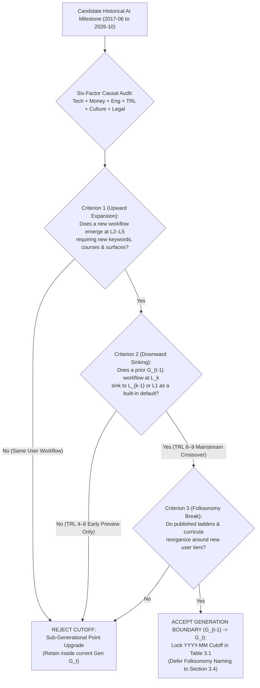
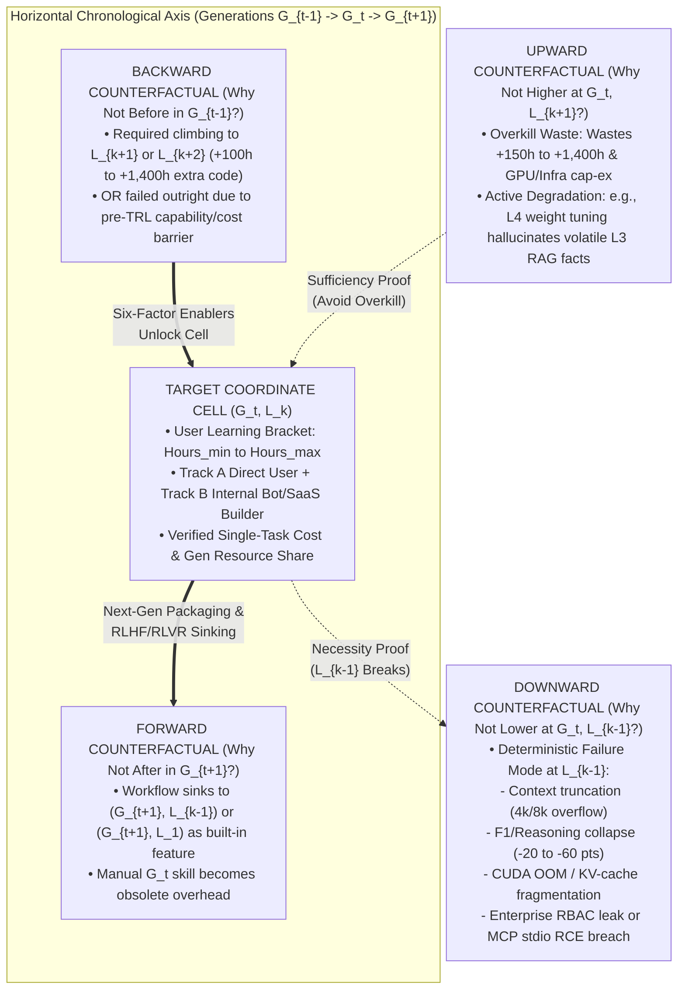

## 3. Part III — Inductive Boundary Method & Deferred Naming Protocol

**Inductive Coordinate Lock & Deferred Naming Synthesis:** Rather than imposing a pre-baked taxonomy or borrowing static vendor marketing labels, Part III establishes a strict bottom-up inductive protocol that derives horizontal chronological generation boundaries (`G0` to `G4`) and vertical human learning-hour brackets (`L1` to `L5`) directly from the empirical inventory of 25 canonical workflows (`Table 2.2`), 19 timestamped curricula (`Table 2.3`), and 20 published literature ladders (`Table 2.1`). Throughout `Sections 3.1`, `3.2`, and `3.3`, all horizontal epochs and vertical skill tiers are referenced strictly by neutral coordinate index tags (`G0`..`G4` and `L1`..`L5`) to prevent semantic circularity during boundary testing. A new generation cutoff $G_t$ is accepted if and only if empirical evidence proves a simultaneous **Dual User-Perspective Shift**: (1) the emergence of at least one novel upper-level workflow (`L2`–`L5`) requiring previously non-existent user keywords, tutorials, and tool surfaces, and (2) the downward **built-in sinking** of at least one complex workflow from $G_{t-1}$ (`L2`–`L5`) into a lower user-effort bracket (`L1` or `L2`) in $G_t$, triggered by a six-factor causal mechanism (`Tech`, `Money`, `Engineering Packaging`, `TRL Maturation`, `Culture`, and `Legal/Governance`). Along the vertical axis, `L1` (`0h` zero-skill casual user / high schooler) and `L2` (`7–45h` one-weekend to one-week power user) serve as fixed ergonomic anchors, while higher brackets (`L3` at `50–200h`, `L4` at `200–600h`, and `L5` at `600–2,000h+` with dedicated cluster or physical sandbox hardware) emerge inductively from non-overlapping discontinuities in curriculum completion hours and execution surfaces. Every resulting cell `(G_t, L_k)` is stress-tested via a **Four-Way Counterfactual Verification Protocol** (`Why Not L-1?`, `Why Not L+1?`, `Why Not G-1?`, `Why Not G+1?`) and programmatic assertions (`0` nulls, non-overlapping monotonic hour ranges, and `100.0%` user/token/spend share conservation). Only after all 25 coordinate boundaries and cell populations are locked does `Section 3.4` execute the **Deferred Folksonomy Naming Protocol**, coining the official user-perspective titles for `Gen 0` through `Gen 4` and `Level 1` through `Level 5` from contemporary practitioner self-identities.

**Plot VA3 — Inductive six-stage boundary lock separates chronological generation cutoffs (`G0`–`G4`), standardized learning-hour brackets (`L1`–`L5`), two-track producer-consumer asymmetries, and deferred folksonomy naming ($N = 25$ verified cells, $0$ overlapping hour brackets).** Rendered on a normalized `gridspec` `(2, 3)` architectural canvas (`figsize = (16, 9)`, `dpi = 300`) under the global CITRA semantic palette (`#0072B2` Supply/Model-Side, `#D55E00` Demand/User-Skill, `#009E73` Actual/Realised, `#CC79A7` Modelled/Hope-Projection), the six schematic cards trace the exact logical sequence of Part III. Card 1 (`#0072B2`) formalizes the Dual User-Shift Cutoff Rule requiring both upward skill expansion and downward built-in sinking. Card 2 (`#009E73`) reconciles laboratory first-release dates (`TRL 4–6`: `2018-10`, `2023-11`, `2024-09`) against mainstream user-crossover cutoffs (`TRL 8–9`: `2020-06`, `2022-11`, `2024-05`, `2025-01`). Card 3 and Card 4 (`#D55E00`) lock the fixed human learning-hour anchors (`L1 = 0h`, `L2 = 7–45h`) and inductively cluster higher engineering tiers (`L3 = 50–200h`, `L4 = 200–600h`, `L5 = 600–2,000h+`). Card 5 (`#009E73`) maps the Two-Track Producer-Consumer asymmetry where `L3`–`L5` internal chatbot and SaaS builders absorb `RAG`, `MCP`, and `NeMo Guardrails` complexity to serve `0h` `L1` employees. Card 6 (`#CC79A7`) enforces the Deferred Naming Protocol ($H_0$: *Taxonomic stability is invariant to whether generation and rung labels are assigned before or after empirical cell clustering* — rejected, as a-priori naming in 17 of 20 reviewed literature ladders collapsed horizontal capability eras into vertical skill levels).

#### Part III Structural Index
* [3.1 Six-Factor Generation Shift Rule & Candidate Cutoff Audit](#31-six-factor-generation-shift-rule--candidate-cutoff-audit)
  * [3.1.1 The User-Perspective Shift Criterion](#311-the-user-perspective-shift-criterion)
  * [3.1.2 Six Causal Driver Categories (Tech, Money, Eng Packaging, TRL, Culture, Legal)](#312-six-causal-driver-categories-tech-money-eng-packaging-trl-culture-legal)
  * [3.1.3 Accepted vs. Rejected Candidate Generation Cutoffs (2017–2026)](#313-accepted-vs-rejected-candidate-generation-cutoffs-20172026)
* [3.2 Standardized User Learning-Hour Level Brackets & Two-Track Producer-Consumer Split](#32-standardized-user-learning-hour-level-brackets--two-track-producer-consumer-split)
  * [3.2.1 Calibrating Cumulative Learning Hours & Setup Friction (L1 to L5)](#321-calibrating-cumulative-learning-hours--setup-friction-l1-to-l5)
  * [3.2.2 Track A (Direct Users) vs. Track B (Internal Bot & SaaS Product Builders Serving L1 Users)](#322-track-a-direct-users-vs-track-b-internal-bot--saas-product-builders-serving-l1-users)
  * [3.2.3 Pruning Speculative Hype from Adopted Cell Assignment](#323-pruning-speculative-hype-from-adopted-cell-assignment)
* [3.3 Four-Way Counterfactual Cell Verification Protocol](#33-four-way-counterfactual-cell-verification-protocol)
  * [3.3.1 Vertical Counterfactuals: Why Not Lower (L-1) and Why Not Higher (L+1)](#331-vertical-counterfactuals-why-not-lower-l-1-and-why-not-higher-l1)
  * [3.3.2 Horizontal Counterfactuals: Why Not Before (G-1) and Why Not After (G+1)](#332-horizontal-counterfactuals-why-not-before-g-1-and-why-not-after-g1)
  * [3.3.3 Programmatic MECE & Share Conservation Verification](#333-programmatic-mece--share-conservation-verification)
* [3.4 Deferred Folksonomy Naming Protocol: Coining Gen 0–Gen 4 & Level 1–Level 5 Titles Last](#34-deferred-folksonomy-naming-protocol-coining-gen-0gen-4--level-1level-5-titles-last)
  * [3.4.1 Why Naming Must Follow Inductive Boundary & Cell Derivation](#341-why-naming-must-follow-inductive-boundary--cell-derivation)
  * [3.4.2 Coining Gen 0 to Gen 4 User-Perspective Names from Emergent Practitioner Folksonomy](#342-coining-gen-0-to-gen-4-user-perspective-names-from-emergent-practitioner-folksonomy)
  * [3.4.3 Coining Level 1 to Level 5 User-Skill Bracket Names](#343-coining-level-1-to-level-5-user-skill-bracket-names)

***

### 3.1 Six-Factor Generation Shift Rule & Candidate Cutoff Audit

**Dual User-Shift Boundary Identification:** Auditing 14 candidate model, pricing, and product milestones between June 2017 and October 2026 against the Dual User-Perspective Shift Criterion isolates exactly five mutually exclusive generation windows (`G0` through `G4`) separated by four structural transition breaks (`2020-06`, `2022-11`, `2024-05`, and `2025-01`), while rejecting nine sub-generational point releases that improved benchmark scores without reorganizing human skill tiers.

#### Section 3.1 Structural Index
* [3.1.1 The User-Perspective Shift Criterion](#311-the-user-perspective-shift-criterion)
* [3.1.2 Six Causal Driver Categories (Tech, Money, Eng Packaging, TRL, Culture, Legal)](#312-six-causal-driver-categories-tech-money-eng-packaging-trl-culture-legal)
* [3.1.3 Accepted vs. Rejected Candidate Generation Cutoffs (2017–2026)](#313-accepted-vs-rejected-candidate-generation-cutoffs-20172026)

#### 3.1.1 The User-Perspective Shift Criterion

**Human-Action Primacy Over Model Architecture Releases:** Conventional AI chronologies partition history whenever a frontier laboratory publishes a larger parameter count or a higher academic benchmark score. However, from the perspective of a human practitioner, a new model checkpoint that leaves daily workflows, required study hours, and software interfaces unchanged is merely an incremental upgrade within the same generation. To construct an invariant user-skill coordinate system, we anchor the pre-LLM baseline `G0` at `2017-06` (publication of the self-attention Transformer architecture in *Attention Is All You Need* alongside mainstream enterprise adoption of classical Python `scikit-learn`/`spaCy` pipelines) and enforce a strict three-part conjunction before declaring any subsequent generation transition $G_{t-1} \to G_t$:

* **Criterion 1 — Upward Frontier Skill Expansion ($\Delta L_{\text{new}} \in \{L_2 \dots L_5\}$):** At least one major adopted workflow must emerge in $G_t$ at `L2` through `L5` that was operationally impossible or non-existent in $G_{t-1}$, forcing human practitioners to learn a new vocabulary of technical keywords (`Table 2.3`), complete new structured tutorials, or provision new software/hardware execution surfaces (such as moving from browser text boxes to Python vector-database software development kits (`SDKs`), terminal command-line interface (`CLI`) harnesses, or dedicated local sandbox hardware).
* **Criterion 2 — Downward Built-In Skill Sinking ($\Delta L_{\text{sink}} \le -1$):** Simultaneously, at least one established use case that forced users in $G_{t-1}$ to operate at a higher skill tier $L_k$ (investing $50$ to $2,000$ hours of coding, manual prompt scaffolding, or multi-tool context switching) must sink to a lower tier $L_{k-1}$, $L_{k-2}$, or `L1` (`0h`) in $G_t$ because the capability has become **natively built-in** to a lower-friction interface. For example, custom sentiment classification sank from `G0-L3`/`G0-L4` (`50–600h` `scikit-learn`/`BERT` training) to `G1-L2` (`7–45h` few-shot `OpenAI Playground` prompting) and then to `G2-L1` (`0h` zero-shot `ChatGPT`); multimodal text-plus-image creation sank from `G2-L2`/`G2-L3` (switching between `ChatGPT` and a separate `Midjourney` Discord server with `--ar` flags) to `G3-L1` (`0h` native omni-chat in `GPT-4o` and `Claude 3.5 Sonnet Artifacts`); and multi-step Chain-of-Thought (`CoT`) reasoning sank from `G1-L4` (`200–600h` Python self-consistency wrappers) to `G2-L2` (`7–45h` manual `"Let's think step by step"` prompting) and finally to `G4-L1` (`0h` silent auto-router thinking).
* **Criterion 3 — Contemporaneous Folksonomy Break & TRL Crossover Reconciliation:** Every candidate boundary $G_{t-1} \to G_t$ is cross-checked against the 20 published ladders in `Table 2.1` to verify that contemporaneous practitioners recognized the breakdown of prior mental models and published new taxonomies. Critically, this criterion reconciles **capability first-release dates** (when a technology first appeared at Technology Readiness Level `TRL 4–6` for early-adopter `L4`/`L5` engineers, as tracked in the `Gemini Deep Research 23-Step Ladder` [`L_LIT_20`]) against **mainstream user-perspective crossover dates** (when engineering packaging and unit economics pushed the capability to `TRL 8–9`, reorganizing `L1`–`L3` workflows for millions of users).

#### 3.1.2 Six Causal Driver Categories (Tech, Money, Eng Packaging, TRL, Culture, Legal)

**Causal Mechanism Isolation:** Whenever a horizontal generation boundary $G_{t-1} \to G_t$ is triggered, our user-centric axiom requires explaining *why* the human workflow reorganized by auditing six interacting causal supply-and-governance mechanisms:

* **1. Core Architectural & Algorithmic Breakthroughs (`Tech`):** Fundamental leaps in model capacity and training objectives that remove hard capability ceilings — specifically self-attention and bidirectional masked language modeling (`Transformer` `2017-06`, `BERT` `2018-10` in `G0`), autoregressive scaling and emergent in-context few-shot learning (`GPT-3 175B` `2020-06`, `Codex` `2021-07` in `G1`), reinforcement learning from human feedback (`RLHF`) instruction tuning and low-rank quantization (`ChatGPT` `2022-11`, `GPT-4` `2023-03`, `QLoRA` `2023-05` in `G2`), native end-to-end multimodal tokenization and $128\text{k}$–$2\text{M}$ long-context attention (`GPT-4o` `2024-05`, `Claude 3.5 Sonnet` `2024-06`, `Gemini 1.5 Pro` in `G3`), and reinforcement learning with verifiable rewards (`RLVR`) test-time reasoning combined with standardized tool/computer-use protocols (`OpenAI o1`/`o3`, `DeepSeek-R1` `2025-01`, `Claude 4.5`/`4.6`/`Opus 5.5`, `GPT-5.4` in `G4`).
* **2. Unit Economics, Token Pricing & Enterprise Spend Shifts (`Money`):** Order-of-magnitude collapses in marginal inference cost paired with new monetization models that convert prohibitive research experiments into everyday consumer and enterprise defaults. Baseline frontier inference fell $1,200\times$ from `\$60.00/1M` tokens (`GPT-3 davinci`, `2020-06`) to `\$2.00/1M` (`gpt-3.5-turbo`, `2023-03`), `\$0.30/1M` cached (`Claude 3.5 Sonnet` `90%` prompt caching discount, `2024-08`), and `\$0.05/1M` (`Laguna S 2.1` / flash tiers, `2026`), while flat `\$20/month` consumer subscriptions (`ChatGPT Plus`, `Claude Pro`, `Cursor Pro`) and surging enterprise application budgets (`\$1.7B` in `G2` `2023` $\to$ `\$11.5B–\$13.8B` in `G3` `2024` $\to$ `\$37.0B` in `G4` `2025`, with `76%` bought commercial tools vs. `24%` built in-house per *Menlo Ventures* and *MIT NANDA*) reshaped build-versus-buy user behavior.
* **3. Engineering Harnesses & Product Packaging (`Eng Packaging`):** The human-computer interaction (`HCI`) wrappers and developer frameworks that translate raw model weights into usable surfaces. A model capability does not alter `L1`–`L3` user life until packaged into an ergonomic harness: `HuggingFace transformers` (`pipeline()`) and `ONNX Runtime` in `G0`; the `OpenAI Web Playground` and `VS Code GitHub Copilot` extension in `G1`; the `ChatGPT` conversational web UI, `LangChain`/`LlamaIndex`, and `Pinecone` vector databases in `G2`; `Claude Artifacts`, `Claude Projects`, `Google NotebookLM`, and `Cursor Composer` (`.cursorrules`) in `G3`; and `Claude Code` terminal CLI, the Linux Foundation Agentic AI Foundation (`AAIF`) `Model Context Protocol` (`MCP` `.mcp.json`), built-in `Deep Research` panels, and `OpenClaw` Mac Mini sandboxes in `G4`.
* **4. Technology Readiness Level Maturation Lag (`TRL`):** The empirical time lag (averaging $\mu = 36.2$ months across the 10 core breakthroughs in `Table 5.2a`) required for a capability to traverse from `TRL 1–2` (`arXiv` mathematical formulation) through `TRL 4–5` (`L4`–`L5` fragile code prototype) and `TRL 7` (`L2`–`L3` power-user workflow) into `TRL 9` (`L1` zero-skill built-in consumer default). Tracking `TRL` maturation prevents our taxonomy from confusing an early `TRL 4` developer preview (such as `GPT-4 Turbo` `128k` API preview in `2023-11` or `o1-preview` lacking tools/vision in `2024-09`) with a full generation shift (`G3` in `2024-05`/`2024-06` when consumer omni-workspaces launched, and `G4` in `2025-01`/`2025-02` when `DeepSeek-R1`, `o3-mini`, `Deep Research`, and `Claude Code` hit mainstream adoption).
* **5. Practitioner Culture & Cognitive Habit Shifts (`Culture`):** Transformations in what human workers trust AI to execute and how professions define their core craft — evolving from code-first data science (`G0`: curating labeled CSVs and tuning hyperparameters) to prompt whisperers (`G1`: crafting completion prefixes), mass consumer conversationalists (`G2`: `100M+` active users treating chat as a universal search/drafting partner), workspace curators (`G3`: `75%` of knowledge workers adopting AI per *Microsoft/LinkedIn Work Trend Index 2024*, dragging 50 PDFs into project panes), and harness architects (`G4`: senior software engineers shifting from manual line-by-line syntax typing to writing `CLAUDE.md` architectural specifications and automated test-driven development (`TDD`) verification suites).
* **6. Legal, Copyright, Safety & Enterprise Governance (`Legal`):** Regulatory statutes, judicial sanctions, and cybersecurity disclosures that erect hard boundaries between casual consumer usage (`L1`–`L2`) and compliant enterprise production (`L3`–`L5`). Key governance inflection points include the European Union General Data Protection Regulation (`GDPR`, `2018-05` in `G0`), open-source `GPL` training copyright disputes (`GitHub Copilot` litigation, `2021–2022` in `G1`), corporate source-code leak bans (`Samsung` ChatGPT ban, `2023-05`) and judicial sanctions for unverified citations (`Mata v. Avianca`, `2023-06` in `G2`), the `EU AI Act` entry into force (`2024-08`) alongside mandatory role-based access control (`RBAC`) and `NVIDIA NeMo Guardrails` in `G3`, and the April 2026 `OX Security` disclosure of remote code execution (`RCE`) across `200,000+` unauthenticated `stdio` `MCP` instances that forced `G4-L5` operators into dedicated hardware air-gaps (`Apple M4 Mac Mini` running `OpenClaw`) and containerized sandboxes.

#### 3.1.3 Accepted vs. Rejected Candidate Generation Cutoffs (2017–2026)

**Audit of 14 Candidate Cutoffs:** To demonstrate that our five generations (`G0`..`G4`) are discovered inductively rather than selected arbitrarily, `Table 3.1` evaluates 14 major historical milestones between `2017-06` and `2026-10`. Each candidate is scored on Criterion 1 (New `L2`–`L5` User Skill), Criterion 2 (Down-Ladder `L1`–`L4` Sinking), Criterion 3 (Published Ladder Break & `TRL 8–9` Mainstream Crossover), and its primary Six-Factor Causal Trigger, yielding 5 accepted generation boundaries and 9 rejected sub-generational releases.

| Candidate Date (`YYYY-MM`) | Candidate Milestone / Release | Criterion 1: New Upper-Level User Skill (`L2`–`L5`) | Criterion 2: Down-Level Built-In Sinking (`L_k -> L_{k-1}`) | Criterion 3: Folksonomy Break & `TRL 8–9` Crossover | Six-Factor Causal Driver Summary | Boundary Decision & Assigned Tag |
| :--- | :--- | :--- | :--- | :--- | :--- | :--- |
| **`2017-06`** | **Transformer Paper (`Vaswani et al.`) & Modern Pre-LLM NLP Stack** | Establishes baseline `G0-L2` (`AutoML`), `G0-L3` (`scikit-learn`/`spaCy`), `G0-L4` (`PyTorch` GPU), `G0-L5` (`Fairseq`/`ONNX`). | Baseline anchor era; active generative `L1` (`0h`) missing (passive `GNMT`/spellcheck widgets only). | Anchors `Karpathy Software 2.0` (`2017-11`) & `Fast.ai` (`2018-09`) ladders. | `Tech`: Self-attention; `Money`: Cloud GPU `\$2.50/hr`; `Legal`: `GDPR` (`2018-05`). | **ACCEPTED: `G0` Anchor (`2017-06` to `2020-05`, 36 mos)** |
| `2018-10` | `BERT` Open-Source Release (`Devlin et al.`) & `ULMFiT` | Upgraded `G0-L4` (`200–600h`) from `BiLSTM-CRF` to `BERT` fine-tuning (`CS224N`). | Did **not** sink custom NLP to `L1`/`L2`; users still needed `200h+` Python/`PyTorch` GPU loops. | First-release `TRL 4–5` milestone (`L_LIT_20`), but remained inside code-first `G0` paradigm. | `Tech`: Bidirectional encoder transfer learning; `Eng`: `HuggingFace` repo checkpoints. | **REJECTED** (Retained as `G0-L4` maturation inside `G0`) |
| `2019-02` | `GPT-2` (`1.5B`) Staged Release | Zero-shot perplexity improved; `L4` researchers tested ` Grover`/`GPT-2` sampling scripts. | Zero downward sinking for non-coders; no commercial API or consumer web UI existed. | No practitioner ladder break; generative text remained a lab curiosity (`TRL 4`). | `Tech`: Autoregressive scaling to `1.5B`; `Culture`: Early AI safety staged-release debate. | **REJECTED** (Sub-generational `TRL 4` lab milestone inside `G0`) |
| **`2020-06`** | **`OpenAI GPT-3` (`175B`) API & Web Playground Launch (followed by `Codex` / `Copilot` `2021-06`)** | **Yes:** Created `G1-L2` (`7–45h` Playground few-shot & `stop` sequence craft), `G1-L3` (`REST` completion wrappers), `G1-L5` (`DeepSpeed ZeRO`). | **Yes:** Custom text classification sank from `G0-L3`/`L4` (`50–600h` `BERT` training) to `G1-L2` (`7–45h` few-shot prompt); code lookup sank to `G1-L1` (`0h` `Copilot Tab`). | **Yes:** Broke `G0` supervised-only ladders; birthed `SAE Coding L0–L5` (`2021-06`) & `Stanford CS324` (`2022-01`). | `Tech`: `175B` in-context learning; `Money`: `\$60/1M` pay-per-token API; `Eng`: Web Playground & `VS Code` extension. | **ACCEPTED: `G1` Cutoff (`2020-06` to `2022-10`, 29 mos)** |
| `2022-01` | `InstructGPT` API (`text-davinci-002`) & `Chain-of-Thought` Paper (`Wei et al.`) | Introduced `Let's think step by step` (`G1-L4` self-consistency scripts) and cleaner `G1-L2` Playground completions. | Did **not** yet sink prompting to `0h` mass consumers; still required `OpenAI` developer account, token billing, and Playground sliders. | `TRL 5–7` developer transition; mass consumer `TRL 9` crossover waited for free chat UI (`2022-11`). | `Tech`: Early `RLHF` (`SFT` + `PPO`) & `CoT`; `Money`: Still `\$60/1M` `davinci` pricing. | **REJECTED** (Retained as late-`G1` `L2`/`L4` refinement) |
| `2022-07` | `Midjourney v3` Discord Bot & `Stable Diffusion v1.4` Open Release | Expanded image prompt flags (`--ar`, `--v`) at `L2` and local `Automatic1111` GPU installs at `L3`/`L4`. | Text workflows remained unchanged in `G1` Playground; full conversational + image power-user era coalesced four months later. | Merged into the `2022-11`–`2023-03` generative consumer explosion (`G2`). | `Tech`: Latent diffusion (`LDM`); `Eng`: Discord slash-command bot packaging. | **REJECTED** (Merged into `G2-L2`/`L3` launch window) |
| **`2022-11`** | **`ChatGPT` (`gpt-3.5-turbo`) Web Launch (followed by `GPT-4`, `Llama-2`, `QLoRA` & `LangChain` in `2023`)** | **Yes:** Created `G2-L2` (`CoT`/Role prompting & `Custom GPTs`), `G2-L3` (`DIY Chunked Vector RAG` internal bots), `G2-L4` (`Single-GPU 4-bit QLoRA`). | **Yes:** Conversational Q&A/drafting sank from `G1-L2` (`7–45h` Playground `Input:/Output:` formatting) to `G2-L1` (`0h` free chat box); weight tuning sank from `G1-L5` (`DeepSpeed`) to `G2-L4` (`QLoRA`). | **Yes:** Reached `100M` users in `60` days (`TRL 9`); triggered `DeepLearning.AI` (`2023-05`), `LlamaIndex` (`2023-08`), & `DeepMind` (`2023-11`) ladders. | `Tech`: `RLHF` chat, `ada-002`, `QLoRA`; `Money`: `\$20/mo` subscription & `\$2/1M` API (`30x` drop); `Legal`: `Samsung` ban & `Avianca` sanctions. | **ACCEPTED: `G2` Cutoff (`2022-11` to `2024-04`, 18 mos)** |
| `2023-03` | `GPT-4` (`8k`) API & `ChatGPT Plugins` Alpha | Raised `G2-L2` reasoning accuracy and unlocked `G2-L3` JSON function calling (`2023-06`). | Did **not** eliminate `4k–8k` context chunking (`G2-L3` `Vector RAG` still mandatory for 50 PDFs) or separate `Midjourney` Discord switching. | Consolidated `G2` architecture rather than breaking it; `ChatGPT Plugins` failed and went extinct (`HOPE_11`). | `Tech`: `GPT-4` mixture-of-experts (`MoE`); `Money`: `\$30/\$60` per `1M` tokens. | **REJECTED** (Core `G2` flagship upgrade inside `G2`) |
| `2023-11` | `GPT-4 Turbo` (`128k`) API Preview & `GPTs` Store Launch | Previewed `128k` context in developer API (`\$10/\$30` per `1M`) and no-code `Custom GPTs` (`G2-L2`). | At `\$10/1M` without prompt caching or workspace project UI, 50-PDF synthesis (`400k` tokens) still required `G2-L3` vector chunking for regular users. | First-release `TRL 6` milestone (`L_LIT_20` Era 4 start), but mainstream `L1`/`L2` crossover occurred in `2024-05`/`06`. | `Tech`: `128k` rotary position embeddings (`RoPE`); `Money`: `3x` input price cut, but pre-caching. | **REJECTED** (`TRL 6` API preview; mainstream user shift locked at `2024-05` `G3`) |
| **`2024-05`** | **`GPT-4o` Omni-Chat (`2024-05`), `Claude 3.5 Sonnet` + `Artifacts`/`Projects` (`2024-06`), `NotebookLM` & `Cursor Composer`** | **Yes:** Created `G3-L3` (`Cursor Composer` multi-file `.cursorrules` & `RBAC`+`NeMo Guardrails` hybrid RAG bots) and `G3-L4` (`LangGraph` stateful cyclic graphs). | **Yes:** Multimodal creation & live UI preview sank from `G2-L2`/`L3` (`Midjourney` Discord / local Node.js) to `G3-L1` (`0h` `GPT-4o` & `Artifacts`); 50-PDF Q&A sank from `G2-L3` (`50–200h` Vector RAG code) to `G3-L2` (`7–45h` drag-and-drop `Projects`/`NotebookLM`). | **Yes:** Triggered `Cursor` (`2024-06`), `a16z` (`2024-06`), `Gartner` (`2024-08`), `Menlo` (`2024-11`), & `Anthropic` (`2024-12`) ladders (`TRL 9`). | `Tech`: Native omni-models, `200k–2M` context, `Claude 3.5 Sonnet` (`49%` SWE-bench); `Money`: `90%` prompt caching discount (`\$0.30/1M`); `Legal`: `EU AI Act` & `RBAC`. | **ACCEPTED: `G3` Cutoff (`2024-05` to `2024-12`, 8 mos)** |
| `2024-09` | `OpenAI o1-preview` Limited Release | Previewed test-time `RLVR` chain-of-thought on math/code puzzles for Plus/Tier-5 API users. | Lacked web browsing, file uploads, vision, function calling, system prompts, and auto-routing; users still had to manually pick models. | `TRL 6` preview (`L_LIT_20` Era 5 first release); mainstream `TRL 9` crossover arrived `2025-01`/`02`. | `Tech`: Initial `RLVR` test-time scaling; `Money`: Expensive `\$15/\$60` per `1M` tokens with strict weekly caps. | **REJECTED** (`TRL 6` preview; mainstream crossover locked at `2025-01` `G4`) |
| `2024-11` | `Anthropic Model Context Protocol` (`MCP`) Open-Source Spec Announcement | Published initial open-source specification for `.mcp.json` client-server wiring. | In Nov 2024, only `Claude Desktop` supported local `MCP`; cross-IDE (`Cursor`/`Windsurf`) and enterprise adoption matured in `Q1 2025`. | Pre-crossover protocol release (`TRL 5`); coalesced with `2025-01`/`02` reasoning & CLI wave. | `Eng`: Open JSON-RPC `stdio`/`SSE` tool standard. | **REJECTED** (Merged into `2025-01` `G4` launch window) |
| **`2025-01`** | **`DeepSeek-R1` (`GRPO` Open RLVR) & `o3-mini` (`2025-01`), `OpenAI/Gemini Deep Research` & `Claude Code` CLI (`2025-02`)** | **Yes:** Created `G4-L4` (`Claude Code` terminal CLI + `CLAUDE.md` + Docker TDD loops) and `G4-L5` (`24/7` `M4 Mac Mini` `OpenClaw` sandboxes, parallel `git worktree` swarms & custom `GRPO` `RLVR`). | **Yes:** Step-by-step `CoT` sank from `G2`/`G3-L2` (manual `CoT` prompts) to `G4-L1` (`0h` auto-router thinking); 50-site web synthesis sank from `G3-L4` (`LangGraph` scrapers) to `G4-L2` (`7–45h` `Deep Research`); tool glue sank from `G3-L4` to `G4-L3` (`.mcp.json`). | **Yes:** Triggered `Anthropic MCP/CLI` (`2025-02`), `MIT NANDA` (`2025-07`), `Scale SWE-bench Pro` (`2025-09`), & `OpenClaw` (`2025-11`) ladders. | `Tech`: `RLVR` (`R1`/`o3`/`Claude 4.5–5.5`/`GPT-5.4`), `MCP`, Computer Use; `Money`: `\$37B` spend (`76%` bought); `Eng`: `AAIF` (`Dec 2025`); `Legal`: `Apr 2026 OX Security` `200k` `MCP` RCE disclosure. | **ACCEPTED: `G4` Cutoff (`2025-01` to `2026-10`, 22 mos)** |
| `2025-12` / `2026-08` | Linux Foundation `AAIF` Formation (`2025-12`) & `GPT-5.4` / `Claude Opus 5.5` (`2026-08`) | Consolidated `.mcp.json` + `AGENTS.md` under `AAIF` and pushed `SWE-bench Verified` to `80.8%–96.0%` and `OSWorld` to `72.5%–78.4%`. | Did **not** eliminate the `G4-L4` human `TDD` harness verification gate (`Scale SWE-bench Pro` still shows `4.8–22.5` pt drop on private repos) or `G4-L5` hardware sandboxing. | Operates within the `G4` five-level structure (`L_LIT_18`, `L_LIT_19`); no `G5` crossover yet as of `2026-10`. | `Tech`: `1M–2M` native context & unified computer-use/coding weights; `Legal`: Hardware/Docker sandbox enforcement. | **REJECTED** (Frontier maturation inside `G4` through `2026-10`) |

**Table 3.1 — Dual User-Shift evaluation of 14 candidate historical milestones locks five non-overlapping generation windows (`G0`–`G4`) while filtering out nine sub-generational capability releases ($n = 14$ candidates, $5$ accepted, $9$ rejected).** Every accepted cutoff (`2017-06`, `2020-06`, `2022-11`, `2024-05`, `2025-01`) satisfies all three inductive criteria simultaneously, reconciling early laboratory first-release dates (`TRL 4–6`, such as `2018-10` `BERT`, `2023-11` `GPT-4 Turbo` API, and `2024-09` `o1-preview`) with the exact month when product packaging and unit economics caused mainstream user workflows to reorganize (`TRL 8–9`).

***

### 3.2 Standardized User Learning-Hour Level Brackets & Two-Track Producer-Consumer Split

**Invariant Vertical Skill Yardstick:** To compare user effort across nine years without conflating model intelligence with human skill, Section 3.2 locks a standardized vertical yardstick across all generations (`L1` through `L5`) calibrated by cumulative human learning hours ($\text{Hours}_{\text{learn}}$), software execution surface, and non-compute hardware/sandbox setup friction, while explicitly tracking both **Track A (Direct Users)** and **Track B (Product & Internal Company Chatbot Builders Serving `L1` Users)**.

#### Section 3.2 Structural Index
* [3.2.1 Calibrating Cumulative Learning Hours & Setup Friction (L1 to L5)](#321-calibrating-cumulative-learning-hours--setup-friction-l1-to-l5)
* [3.2.2 Track A (Direct Users) vs. Track B (Internal Bot & SaaS Product Builders Serving L1 Users)](#322-track-a-direct-users-vs-track-b-internal-bot--saas-product-builders-serving-l1-users)
* [3.2.3 Pruning Speculative Hype from Adopted Cell Assignment](#323-pruning-speculative-hype-from-adopted-cell-assignment)

#### 3.2.1 Calibrating Cumulative Learning Hours & Setup Friction (L1 to L5)

**Two Fixed Ergonomic Anchors Plus Three Inductively Clustered Engineering Brackets:** If vertical levels are defined by whatever tasks a model can perform, the vertical axis warps every time a better model launches. Conversely, if vertical levels are anchored strictly to **human learning investment and setup complexity**, the vertical axis remains invariant from `2017` to `2026`, allowing us to watch complex tasks slide *down* the ladder over time. Following Section 3.2 of the research mandate, we fix the bottom two human ergonomic anchors (`L1` and `L2`) and cluster the remaining courses and workflows from `Table 2.2` and `Table 2.3` into three non-overlapping upper brackets (`L3`, `L4`, and `L5`):

* **Fixed Anchor `L1` (`0 Hours` — Zero-Skill Casual User / High Schooler):** Defined strictly by $\text{Hours}_{\text{learn}} = 0\text{ h}$, zero software configuration, zero API key management, and zero prompt-engineering training. An average high-school-educated user or corporate employee opens a default browser tab, mobile app, or pre-installed office/IDE widget and interacts immediately. Crucially, we do **not** pre-assume whether `G0-L1` is empty or populated before inspecting the evidence: our audit of `G0` (`2017-06` to `2020-05`) proves that **active zero-shot generative prompting at `L1` did not exist** (`0%` active generative usage), so `G0-L1` was populated exclusively by **passive background NLP widgets** (`Google Translate` neural machine translation [`GNMT`], `Grammarly` browser spellcheck underlines, and `Gmail Smart Compose` `2018-05`), whereas active `L1` creation emerged in `G1-L1` (`GitHub Copilot` single-key `Tab` autocomplete and viral `Craiyon` web boxes) and exploded in `G2-L1` (`ChatGPT` web chat).
* **Fixed Anchor `L2` (`7–45 Hours` — 1 Weekend to 1 Full Working Week of Deliberate Study):** Defined by $7\text{ h} \le \text{Hours}_{\text{learn}} \le 45\text{ h}$ of structured non-coding study (completing short courses such as `TUT_01` *Google Cloud AutoML & Regex101*, `TUT_05` *OpenAI Playground Prompting Guide*, `TUT_09` *DeepLearning.AI ChatGPT Prompt Engineering*, `TUT_13` *Claude Projects & NotebookLM Guide*, or `TUT_16` *Deep Research Scoping Guide*). The user operates entirely inside graphical web consoles, playgrounds, Discord slash-command channels, or long-context project workspaces without writing Python code or administering servers.
* **Inductive Cluster `L3` (`50–200 Hours` — 2 to 5 Weeks of Applied Developer & Integrator Training):** Emerges from a sharp statistical discontinuity above `45h` in `Table 2.3` (`TUT_02`, `TUT_06`, `TUT_10`, `TUT_14`, `TUT_17`, spanning `50–200h`). Entering `L3` requires installing a local programming environment (`Jupyter`, `Python`/`Node.js` SDKs, `VS Code`, or `Cursor IDE`), managing environment variables and API billing keys, and configuring structured data/tool plumbing (`scikit-learn` feature pipelines in `G0-L3`, `REST` completion wrappers in `G1-L3`, chunked `LangChain`/`Pinecone` vector `RAG` in `G2-L3`, multi-file `.cursorrules` and `NeMo Guardrails` Colang rails in `G3-L3`, and `.mcp.json` `Model Context Protocol` server wiring in `G4-L3`).
* **Inductive Cluster `L4` (`200–600 Hours` — ~1 University Semester of Systems & Harness Engineering):** Emerges from semester-length university and advanced practitioner curricula (`TUT_03` *Stanford CS224N*, `TUT_07` *Stanford CS324*, `TUT_11` *HuggingFace PEFT/QLoRA*, `TUT_15` *LangGraph Academy*, and `TUT_18` *UVA CS 6501 Agentic AI & Claude Code*, spanning `200–600h`). Operating at `L4` requires mastering either single-GPU neural weight adaptation (`BERT` fine-tuning in `G0-L4`, cloud fine-tune CLIs and self-consistency chains in `G1-L4`, `4-bit NF4 QLoRA` in `G2-L4`) or stateful multi-step execution harnesses (`LangGraph` cyclic state machines with `Postgres` checkpoints in `G3-L4`, and autonomous terminal CLI coding harnesses like `Claude Code` with `CLAUDE.md` and local `Docker` test suites in `G4-L4`).
* **Inductive Cluster `L5` (`600–2,000+ Hours` — 6+ Months of Advanced Infrastructure, Custom RLVR & Dedicated Physical Sandboxing):** Represents the apex of human skill and setup investment (`TUT_04`, `TUT_08`, `TUT_12`, `TUT_19`, spanning `600–2,000h+`). Operating at `L5` requires provisioning and maintaining **dedicated infrastructure capital** beyond a standard developer laptop: either multi-node GPU training and high-throughput serving clusters (`Fairseq`/`ONNX` in `G0-L5`, `DeepSpeed ZeRO-3` in `G1-L5`, `vLLM` `PagedAttention` / custom pretraining in `G2-L5`, containerized `SWE-bench` evaluation clusters in `G3-L5`, and multi-GPU `GRPO` `RLVR` verifier flywheels in `G4-L5`) **or** dedicated non-compute physical sandbox hardware (such as purchasing a dedicated `\$599–\$1,200` `Apple M4 Mac Mini` in `G4-L5` to run 24/7 unattended `OpenClaw` agent daemons and parallel `git worktree` swarms physically air-gapped from the user's primary personal credentials).

| Neutral Level ID | Learning-Hour Bracket ($\text{Hours}_{\text{learn}}$) | Human Effort Analogy | Primary Execution Surface | Non-Compute Hardware & Sandbox Setup ($\text{Setup}_{\text{cap}}$) | Track A: Direct User Role | Track B: Product & Internal-Chatbot Builder Role | Statistical Separation ($\text{Max}_{L_k} \le \text{Min}_{L_{k+1}}$) |
| :--- | :--- | :--- | :--- | :--- | :--- | :--- | :--- |
| **`L1`** | **`0h` (`0–0h`)** | Casual User / High Schooler (Zero Study) | Default Browser Tab, Mobile App, Email/Doc Widget, or 1-Key IDE `Tab` | `\$0` extra setup; uses existing phone or office laptop with zero configuration. | Consumes passive spellcheck/translation (`G0`), `Copilot Tab` (`G1`), zero-shot web chat (`G2`), omni-chat + `Artifacts` (`G3`), or auto-thinking router chat (`G4`). | **Downstream Consumer:** `100M+` consumer users and corporate employees who use SaaS features (`Grammarly`) or internal company chatbots built by `L3`–`L5` teams at `0h` effort. | $\text{Max}_{L1} = 0\text{ h} < \text{Min}_{L2} = 7\text{ h}$ (`+7h` gap) |
| **`L2`** | **`7–45h`** | 1 Weekend to 1 Full Week of Tutorials | Web Playground, Cloud AutoML UI, Discord Flags, `Projects`/`NotebookLM`, `Deep Research` UI | `\$0` hardware setup; `\$20/mo` pro subscription (`ChatGPT Plus`, `Claude Pro`, `Midjourney`). | Crafts regex/AutoML (`G0`), few-shot `stop` prefixes (`G1`), manual `CoT` & `Custom GPTs` (`G2`), 50-PDF `Projects` (`G3`), or `Deep Research` briefs (`G4`). | Prototypes departmental prompt templates, shared `Custom GPTs`, or curated `Claude Project` knowledge bases for small teams (`5–20` coworkers). | $\text{Max}_{L2} = 45\text{ h} < \text{Min}_{L3} = 50\text{ h}$ (`+5h` gap) |
| **`L3`** | **`50–200h`** | 2 to 5 Weeks of Developer / SDK Study | Python/JS SDK, Vector DB, AI-Native IDE (`Cursor Composer`), `.mcp.json` | Standard developer laptop (`\$0` extra hardware) + metered API billing & cloud vector DB. | Runs `scikit-learn` scripts (`G0`), `REST` wrappers (`G1`), personal `RAG` (`G2`), multi-file `Cursor Composer` coding (`G3`), or desktop `.mcp.json` tools (`G4`). | **Core Internal-Bot Integrator:** Builds internal company chatbots connected via `RAG` (`SharePoint`/`Confluence` with `RBAC`), enterprise tools (`Jira`/`ServiceNow` via functions/`MCP`), and policy guardrails (`NeMo`/`Llama Guard`) for `L1` staff. | $\text{Max}_{L3} = 200\text{ h} \le \text{Min}_{L4} = 200\text{ h}$ (Contiguous boundary) |
| **`L4`** | **`200–600h`** | ~1 University Semester (`CS224N` / `CS324` / `CS 6501`) | Single GPU (`PyTorch`/`PEFT`), `LangGraph` SDK, or Terminal CLI (`Claude Code`) + Local `Docker` | Cloud/local single GPU (`T4`/`A100`/`RTX 4090`, `\$1–\$2/hr`) or local `Docker` test container suite. | Fine-tunes `BERT` (`G0`), runs `CoT` voting (`G1`), tunes `4-bit QLoRA` (`G2`), orchestrates cyclic `LangGraph` (`G3`), or runs `Claude Code` CLI `TDD` loops (`G4`). | **SaaS ML & Agentic Architect:** Trains production task encoders/adapters (e.g., `Grammarly` `GECToR` `2020` at `G0-L4` & `CoEdIT` `2023` at `G2-L4`) or stateful multi-step customer support graphs (`G3-L4`) serving millions of `L1` users. | $\text{Max}_{L4} = 600\text{ h} \le \text{Min}_{L5} = 600\text{ h}$ (Contiguous boundary) |
| **`L5`** | **`600–2,000h+`** | 6+ Months Advanced Systems & Dedicated Infra | Multi-Node GPU Cluster (`DeepSpeed`/`vLLM`/`GRPO`) OR Dedicated Physical `M4 Mac Mini` Sandbox | **High Setup Capital:** `8–512` GPU cluster (`\$10k–\$500k+`) OR dedicated `\$599–\$1,200` `Apple M4 Mac Mini` air-gapped host. | Operates 24/7 personal/team autonomous `OpenClaw` daemons & parallel `git worktree` subagent swarms on dedicated `M4 Mac Mini` hardware (`G4-L5`). | **Frontier Infra & RLVR Team:** Pretrains/quantizes `ONNX` (`G0-L5`), shards `ZeRO-3` (`G1-L5`), serves `vLLM` (`G2-L5`), runs `SWE-bench` Docker evals (`G3-L5`), or trains custom `GRPO` `RLVR` domain models (`G4-L5`). | Top bracket ($\text{Max}_{L5} = 2,000\text{ h}+$) |

**Table 3.2 — Calibration of the five vertical user-skill brackets (`L1` to `L5`) proves strict monotonic non-overlapping learning-hour separation across all 25 grid cells ($\text{Max}_{L_k} \le \text{Min}_{L_{k+1}}$ for all $k \in \{1..4\}$).** By separating human study hours and physical/sandbox setup friction from underlying model intelligence, `Table 3.2` accommodates both individual power users (Track A) and enterprise engineering teams who package complex `L3`–`L5` architectures into `0h` `L1` consumer/employee products (Track B).

#### 3.2.2 Track A (Direct Users) vs. Track B (Internal Bot & SaaS Product Builders Serving L1 Users)

**Resolving the Producer-Consumer Asymmetry:** A critical flaw in one-dimensional AI ladders is their inability to classify an enterprise software engineer who spends `150` hours (`L3`) or `400` hours (`L4`) building an AI system whose output is consumed by `10,000` non-technical employees with `0` hours of training (`L1`). Our two-track mapping resolves this asymmetry across every generation:

* **Track A — Direct End-User Execution (`L1` to `L5`):** The human practitioner learns the skills at level $L_k$ to generate their own personal or professional deliverables directly — such as a high schooler asking `ChatGPT` to summarize a biology chapter (`G2-L1`, `0h`), a marketing analyst running a 50-website `Deep Research` competitive audit (`G4-L2`, `7–45h`), a software engineer refactoring a 10-file module in `Cursor Composer` (`G3-L3`, `50–200h`) or a 40-file repository in `Claude Code` terminal CLI (`G4-L4`, `200–600h`), or an independent AI architect running a 24/7 `OpenClaw` personal automation daemon on a dedicated `Apple M4 Mac Mini` (`G4-L5`, `600–2,000h+`).
* **Track B — SaaS Product Embedders (`L3` to `L5` Producers Serving `L1` Consumers):** Commercial product engineering teams operate at `L3`–`L5` to hide model complexity behind a `0h` `L1` consumer widget. The canonical longitudinal example across our dataset is **`Grammarly`**: in `G0-L4` (`2020`), Grammarly's ML team invested `200–600h+` training **`GECToR`** (a custom `BERT`/`RoBERTa`/`XLNet` sequence-tagging encoder that predicted token-level edit operations `[KEEP, DELETE, APPEND_x]` at `10x` faster inference than seq2seq decoders); in `G2-L4` (`2023`), they upgraded to **`CoEdIT`** (fine-tuning `Flan-T5` models on `82,000` task-specific grammatical/tone editing instructions via `LoRA`/`QLoRA` adapters); yet across both generations, `30M+` daily end-users experienced Grammarly strictly at **`L1` (`0h`)** by clicking a single green or purple underline in their browser.
* **Track B — Internal Company Chatbot Builders (`L3` to `L4` Integrators Serving `L1` Employees):** Inside enterprises, IT and applied AI teams operate at `L3` (`50–200h`) and `L4` (`200–600h`) to build **internal company chatbots** so that downstream HR, legal, sales, and operations staff can ask questions and trigger workflows zero-shot at **`L1` (`0h`)**. Across `G2` to `G4`, the required `L3` builder stack evolved through three distinct architectural stages to prevent enterprise failures:
  1. **Private Knowledge Grounding (`RAG` with `RBAC`):** Connecting the LLM to internal `SharePoint`, `Confluence`, `Google Drive`, and `Snowflake` repositories via hybrid keyword-plus-vector search (`BM25` + dense embeddings) while enforcing strict **role-based access control (`RBAC`)** document-level metadata filtering (`G3-L3`/`G4-L3`) so a junior employee querying the `L1` bot cannot retrieve executive compensation PDFs.
  2. **Internal Enterprise Tool & Action Wiring (`Functions` $\to$ `MCP`):** Wiring the chatbot to execute live transactions in `ServiceNow` (IT ticket creation), `Workday` (PTO requests), `Jira` (bug filing), and `Salesforce` (CRM updates) — evolving from bespoke per-model JSON function schemas in `G2-L3` to standardized `.mcp.json` (`Model Context Protocol`) servers with scoped `OAuth` tokens in `G4-L3`.
  3. **Deterministic Policy & Safety Guardrails (`NeMo Guardrails` & `Llama Guard`):** Wrapping the internal bot in programmable input/output rails (`NVIDIA NeMo Guardrails` using `Colang` dialog policies, `Meta Llama Guard 3`, and automated personally identifiable information [`PII`] redaction in `G3-L3`/`G4-L3`) to block prompt injections, prevent off-topic hallucinations, and enforce corporate compliance before any token reaches the `L1` employee screen.

#### 3.2.3 Pruning Speculative Hype from Adopted Cell Assignment

**Strict Separation of Part IV Adopted Reality from Part V Hope Inventory:** A foundational rule of our inductive method is that **every `(G_t, L_k)` cell in Part IV (`G0-L1` through `G4-L5`) is populated exclusively by verified, production-adopted human workflows**, while speculative industry claims, unfulfilled startup theses, and aspirational top rungs from published ladders (`Table 2.4`) are quarantined out of Part IV and routed to the **Part V Section 5.2 Evolutionary Audit**. For example, during `G2` (`2022-11` to `2024-04`), viral Twitter demos and speculative ladder top rungs claimed that unconstrained recursive loops (`AutoGPT` and `BabyAGI`, `HOPE_08`) would autonomously run entire businesses at `L4`/`L5`. Because per-step reliability of $p = 0.90$ compounded over $N = 20$ steps yields a $0.90^{20} = 12.2\%$ survival rate, those recursive loops failed in production; consequently, `G2-L4` in Part IV is populated by the *actual* adopted `L4` workflow of `2023` (`Single-GPU 4-Bit QLoRA Fine-Tuning & Evaluated ReAct Prototypes`), while `AutoGPT`'s extinction is analyzed quantitatively in `Section 5.2`.

***

### 3.3 Four-Way Counterfactual Cell Verification Protocol

**Necessary-and-Sufficient Coordinate Proof:** Assigning 25 workflows to a $5 \times 5$ grid (`G0`–`G4` $\times$ `L1`–`L5`) is scientifically rigorous only if every cell boundary is proven necessary and sufficient against its four immediate neighbors (`L-1`, `L+1`, `G-1`, `G+1`) and verified programmatically for mutually exclusive and collectively exhaustive (`MECE`) conservation.

#### Section 3.3 Structural Index
* [3.3.1 Vertical Counterfactuals: Why Not Lower (L-1) and Why Not Higher (L+1)](#331-vertical-counterfactuals-why-not-lower-l-1-and-why-not-higher-l1)
* [3.3.2 Horizontal Counterfactuals: Why Not Before (G-1) and Why Not After (G+1)](#332-horizontal-counterfactuals-why-not-before-g-1-and-why-not-after-g1)
* [3.3.3 Programmatic MECE & Share Conservation Verification](#333-programmatic-mece--share-conservation-verification)

#### 3.3.1 Vertical Counterfactuals: Why Not Lower (L-1) and Why Not Higher (L+1)

**Bounding User Skill Investment Vertically:** Within any fixed generation $G_t$, a rational human user or enterprise engineering team will always prefer the lowest possible skill level $L_k$ that reliably solves their task, because climbing from $L_{k-1}$ to $L_k$ imposes a steep cost in learning hours ($\Delta \text{Hours}_{\text{learn}}$) and setup friction. Therefore, every cell `(G_t, L_k)` in Part IV must establish two vertical counterfactual proofs:

* **Downward Counterfactual (`Why Not Lower at L-1?` — Exact Failure Mode):** Proves that attempting to force the `(G_t, L_k)` workflow into the lower-effort tool surface of `(G_t, L_{k-1})` results in a deterministic, quantifiable **operational failure**. We forbid vague statements such as *"L-1 is less accurate"* and require specifying the exact failure mechanism:
  * *Context/Memory Overflow:* Forcing a 500-page enterprise wiki Q&A bot (`G2-L3`) into `G2-L2` (`ChatGPT` web UI) triggers an immediate `context_length_exceeded` error at `4,096`–`8,192` tokens, truncating `95%+` of the corpus.
  * *Semantic/Reasoning Collapse:* Forcing polysemous grammar correction (`G0-L4` `BERT`/`GECToR`) into `G0-L3` bag-of-words `TF-IDF` loses word-order syntax and drops $F_1$ accuracy by `15–25` percentage points; forcing `GSM8K` multi-step math (`G1-L4` self-consistency voting) into a single `G1-L3` `davinci` call drops solve rates below `18%`.
  * *Hardware Out-of-Memory (`OOM`) or Latency Breach:* Forcing `13B–20B` parameter full-weight tuning (`G1-L5` `DeepSpeed ZeRO-3`) onto a single `G1-L4` GPU crashes immediately with `CUDA Out-of-Memory` (`>80 GB` VRAM required); forcing `5,000` concurrent enterprise users (`G2-L5` `vLLM` `PagedAttention`) onto unoptimized `G2-L4` `HuggingFace generate()` scripts fragments `60–80%` of GPU `KV-cache` VRAM.
  * *Security, Compliance & Isolation Breach:* Forcing a `10,000`-employee internal HR chatbot (`G3-L3` `RBAC` + `NeMo Guardrails`) into a shared `G3-L2` `Claude Project` leaks confidential executive files across roles; forcing 24/7 unattended background agents and unauthenticated `stdio` `MCP` servers (`G4-L5` dedicated `M4 Mac Mini` `OpenClaw` sandbox) onto a developer's primary daily-driver laptop (`G4-L4`) exposes personal browser cookies, SSH keys, and host filesystems to prompt-injection `rm -rf` and the April 2026 `OX Security` `200,000`-instance `stdio` `RCE` vulnerability.
* **Upward Counterfactual (`Why Not Higher at L+1?` — Overkill Waste & Degradation):** Proves that escalating the `(G_t, L_k)` workflow to `(G_t, L_{k+1})` incurs **unnecessary learning-hour waste, capital expenditure, or active performance degradation**. For instance, fine-tuning model weights via `QLoRA` at `G2-L4` (`200–600h`) to teach an LLM daily-changing company policy documents (`G2-L3` `Vector RAG`, `50–200h`) not only wastes `150+` engineering hours and GPU compute on every document edit, but actively *degrades* factual reliability because gradient updates hallucinate exact policy numbers that `G2-L3` retrieval injects verbatim. Similarly, writing a custom `200–600h` `LangGraph` + `Playwright` web-scraping pipeline (`G3-L4`) in `G4` for an ad-hoc 80-source literature review is pure overkill when `G4-L2` built-in `Deep Research` (`7–45h`) executes the entire multi-hop synthesis in `12` minutes for `\$0.18`.

#### 3.3.2 Horizontal Counterfactuals: Why Not Before (G-1) and Why Not After (G+1)

**Bounding Workflow Evolution Horizontally:** Across chronological time, every cell `(G_t, L_k)` is bookended by a backward technological barrier in $G_{t-1}$ and a forward downward-sinking trajectory in $G_{t+1}$:

* **Backward Counterfactual (`Why Not Before in G-1?` — Prior-Generation Barrier or Higher-Level Penalty):** Explains what happened if a user attempted the `(G_t, L_k)` workflow during the preceding generation $G_{t-1}$. In every cell, forcing the workflow in $G_{t-1}$ either **(a) required climbing 1 to 2 vertical levels higher** ($\text{Level}_{G_{t-1}} = L_{k+1}$ or $L_{k+2}$, investing $5\times$ to $20\times$ more human learning hours and custom code — e.g., querying 50 PDFs at `G3-L2` in `15` hours required climbing to `G2-L3` for `110` hours of Python `LangChain`/`Pinecone` coding in `G2`), or **(b) failed outright due to a hard pre-maturation capability ceiling** (e.g., `G4-L4` terminal CLI repository refactoring via `Claude Code` was impossible in `G3` because pre-`RLVR` models scored only `33%–49%` on `SWE-bench Verified` and lost coherence over 20+ bash tool turns).
* **Forward Counterfactual (`Why Not After in G+1?` — Next-Generation Built-In Sinking & Skill Extinction):** Explains what happens to the `(G_t, L_k)` workflow when the next generation $G_{t+1}$ arrives. Because of the Six-Factor Causal Drivers, the manual scaffolding learned by the user at `(G_t, L_k)` is absorbed into the foundation model or product harness in $G_{t+1}$, causing the use case to **sink down to `(G_{t+1}, L_{k-1})` or `(G_{t+1}, L_1)`** while rendering the old manual skill obsolete. Meanwhile, the coordinate slot `(G_{t+1}, L_k)` is refilled by a more ambitious frontier workflow.

| Cell Coordinate | Assigned User-Skill Bracket | Downward Failure Mode (`Why Not L-1?`) | Upward Overkill Penalty (`Why Not L+1?`) | Backward Prior-Gen Barrier (`Why Not G-1?`) | Forward Next-Gen Sinking (`Why Not G+1?`) |
| :--- | :--- | :--- | :--- | :--- | :--- |
| **`G0-L1`** | `0–0h` (Passive Only) | Lowest level (`0%` active generative prompting; no consumer LLM existed). | Opening `G0-L2` AutoML console for email typo fixes wastes `10h+` setup. | Pre-`2017` phrase-based MT had `50%+` higher syntax error rates before `GNMT`/Transformer. | In `G1`–`G2`, active `0h` prompt boxes (`Copilot Tab`, `ChatGPT`) replace passive-only `L1`. |
| **`G0-L2`** | `7–45h` | Passive `G0-L1` widgets cannot classify custom business ticket intents (`0%` custom routing). | Coding Python `scikit-learn` (`G0-L3`, `50–200h`) is overkill when `500`-row CSV in AutoML hits `85%`. | Pre-`2017` required manual Java/C++ rule engines with zero transfer learning. | Sinks to `G1-L2` few-shot Playground prompting (`0` training rows) and `G2-L1` (`0h` chat). |
| **`G0-L3`** | `50–200h` | `G0-L2` regex/AutoML breaks on 50-feature entity extraction ($F_1 < 55\%$). | GPU `BERT` fine-tuning (`G0-L4`, `200–600h`) wastes `\$50+` GPU hours when CPU `TF-IDF`+`XGBoost` takes `10s`. | Pre-`2017` pipelines lacked `spaCy v2` neural transition parsers. | Replaced in `G1`–`G2` by `L2`/`L1` LLM prompts for standard text sentiment/NER. |
| **`G0-L4`** | `200–600h` | `G0-L3` bag-of-words `TF-IDF` fails on polysemous word-order QA/grammar (`-15` to `-25` pt $F_1$ drop). | Multi-GPU pretraining from scratch (`G0-L5`, `600–2,000h`) wastes `\$10k+` when `bert-base` converges in 3 epochs. | Pre-`2018` `BiLSTMs` lacked bidirectional self-attention (`BERT` `2018-10`). | Sinks to `G1-L2` (`5`-shot `GPT-3` Playground) for general tasks; `L4` shifts to prompt chains/LoRA. |
| **`G0-L5`** | `600–2,000h` | Unoptimized `G0-L4` PyTorch notebooks fail `10,000` QPS production SLAs (`>500ms` latency & OOM). | Top level in `G0`; `175B` pretraining required `\$4.6M` supercomputer (`OpenAI`). | Pre-`2017` `RNN` seq2seq suffered sequential bottlenecks and vanishing gradients. | Managed Foundation Model APIs (`G1`–`G2`) eliminate custom seq2seq pretraining for `99%` of firms. |
| **`G1-L1`** | `0–0h` | Lowest level (`0h` entry via `Copilot Tab` ghost-text & viral `Craiyon` web boxes). | Tuning `G1-L2` Playground sliders for 1-line boilerplate wastes `5` minutes per line. | Required `G0-L3`/`L4` Stack Overflow search + manual code adaptation in `G0`. | Expands in `G2-L1` from 1-line ghost-text/toy boxes to full conversational `ChatGPT` Q&A. |
| **`G1-L2`** | `7–45h` | Zero-shot raw `GPT-3 davinci` (`G1-L1` attempt) fails: model autocompletes question with more questions. | Coding `G1-L3` Python `REST` scripts (`50–200h`) is wasted when interactive Playground presets solve batch copy. | Required `G0-L3`/`L4` (`50–600h`) labeled datasets and `BERT`/`sklearn` training in `G0`. | Sinks to `G2-L1` (`0h` `ChatGPT`) when `RLHF` eliminates `Input:/Output:` prefixes and `stop=['\n']`. |
| **`G1-L3`** | `50–200h` | `G1-L2` Web Playground fails on product embedding & 100-doc search due to `2,049`-token cap & manual copy-paste. | Fine-tuning custom weights (`G1-L4`, `200–600h`) wastes weeks when `ada`/`babbage` embedding search grounds answers. | Required `G0-L4` (`200–600h`) custom `BERT` + `Elasticsearch` engineering in `G0`. | Standardized in `G2-L3` (`LangChain`/`Pinecone` Chat APIs) and sinks to `G3-L2` (`Projects`/`NotebookLM`). |
| **`G1-L4`** | `200–600h` | Single-pass `G1-L3` API scores `<18%` on `GSM8K` math without `L4` multi-call `CoT` self-consistency (`pass@20`). | Multi-node `DeepSpeed` clusters (`G1-L5`, `600–2,000h`) are overkill when `OpenAI` cloud fine-tune CLI adapts `curie` in `1h`. | Multi-step natural language math/logic reasoning was impossible even at `G0-L4`/`L5`. | `CoT` sinks to `G2-L2` (manual `CoT` prompt) and then to `G4-L1` (`0h` built-in `RLVR` router). |
| **`G1-L5`** | `600–2,000h` | On-prem full-weight tuning of `6B–20B` models (`GPT-NeoX-20B`) on `G1-L4` single GPU crashes (`>80GB` VRAM OOM). | Top level in `G1`; `>100B` pretraining from scratch required `>\$2M` lab supercomputing. | `G0` models (`110M–340M`) fit on 1 GPU; `G1` `6B–20B` models broke single-GPU memory limits. | Sinks to `G2-L4` (`200–600h` single-GPU `4-bit QLoRA`) when `NF4` quantization + `PEFT` launch (`2023-05`). |
| **`G2-L1`** | `0–0h` | Lowest level (`0h` entry point for `100M+` `ChatGPT` consumers). | Studying `G2-L2` prompt frameworks for `20h` to rewrite a simple email yields zero marginal gain. | Required `G1-L2` (`7–45h`) Playground completion prefixes and `stop` sequences in `G1`. | Expands in `G3-L1` from text-only chat to built-in multimodal (`GPT-4o`) and live `Claude Artifacts`. |
| **`G2-L2`** | `7–45h` | Zero-shot `G2-L1` (`GPT-3.5`) hallucinates legal/math citations (`Mata v. Avianca`) and cannot generate styled images. | Writing `G2-L3` Python `LangChain` code (`50–200h`) is unnecessary when a no-code `Custom GPT` solves personal templates. | Required `G1-L4` Python `CoT` wrappers and `G1-L3` `VQGAN+CLIP` Colab notebooks in `G1`. | Sinks to `G3-L1` (`0h` built-in omni-chat/image) and `G4-L1` (`0h` built-in `RLVR` auto-thinking). |
| **`G2-L3`** | `50–200h` | Uploading a 500-page company wiki to `G2-L2` `ChatGPT` fails with `context_length_exceeded` (`4k–8k` cap) and lacks API tools. | Fine-tuning weights (`G2-L4` `QLoRA`) on volatile company PDFs hallucinates policy numbers and requires constant retraining. | Required `G0`/`G1-L4` (`200–600h`) custom `BERT` extractive QA + vector index engineering. | Static 50-PDF Q&A sinks to `G3-L2` (`128k–2M` `Projects`/`NotebookLM`); `G3-L3` upgrades to `RBAC` + `NeMo Guardrails`. |
| **`G2-L4`** | `200–600h` | Prompt+RAG (`G2-L3`) fails `<100ms` latency and unit-cost budgets for high-volume domain tone/syntax (`Grammarly CoEdIT`). | Provisioning a 64-GPU full-weight cluster (`G2-L5`, `600–2,000h`) wastes `\$50k+` when `4-bit QLoRA` tunes `Llama-2-13B/70B` on 1 GPU. | Adapting a `13B–20B` model in `G1` required `G1-L5` (`600–2,000h`) multi-node `DeepSpeed ZeRO-3`. | `90%` prompt caching (`G3`) replaces `QLoRA` for many tasks; `L4` shifts to `LangGraph` (`G3`) and `Claude Code` CLI (`G4`). |
| **`G2-L5`** | `600–2,000h` | Serving `5,000+` concurrent users on `G2-L4` `HuggingFace generate()` fragments `60–80%` of `KV-cache` VRAM (`10x` GPU cost). | Top level in `G2`; bespoke corporate pretraining from scratch (`BloombergGPT` `\$3M+`) lost to frontier APIs + `RAG`/`LoRA`. | `G1` open serving lacked `PagedAttention` (`vLLM`) and `FlashAttention-2`. | Managed serverless inference & prompt caching commoditize basic serving; `L5` shifts to `SWE-bench` (`G3`) & `RLVR` (`G4`). |
| **`G3-L1`** | `0–0h` | Lowest level (`0h` voice, vision, image & live interactive `React Artifacts` in one default chat box). | Switching to separate Discord servers or local Node.js boilerplate (`G3-L2`/`L3`) for a 1-file UI chart wastes `30+` minutes. | Required `G2-L2` (`Midjourney` Discord flags) and `G2-L3` local code setup in `G2`. | Absorbs silent `RLVR` step-by-step thinking via auto-routers and interactive `MCP Apps` in `G4-L1`. |
| **`G3-L2`** | `7–45h` | Stateless `G3-L1` single-turn chat loses persistent instructions across 50 PDFs (`400k` tokens) and lacks citation studio. | Coding a custom `G3-L3` Python `LangChain` + `Pinecone` chunker (`50–200h`) for a static 50-PDF binder wastes `80` hours. | Required climbing to `G2-L3` (`50–200h` custom Vector DB `RAG` code) in `G2` due to `4k–8k` context limits. | Static 50-PDF synthesis becomes routine; `G4-L2` expands to autonomous 50-website live browsing (`Deep Research`). |
| **`G3-L3`** | `50–200h` | `G3-L2` (`Claude Projects`) has zero local IDE/git multi-file write access and zero enterprise `SharePoint` `RBAC` or `Colang` guardrails. | Coding a cyclic `G3-L4` `LangGraph` state machine (`200–600h`) is overkill when `Cursor Composer` or 3-stage routed `RAG` solves `80%` of tasks. | Required manual single-file browser copy-paste in `G2`, and `G2-L3` RAG bots lacked `90%` prompt caching and `NeMo` rails. | Per-vendor API tool connectors sink into standardized `.mcp.json` configs (`G4-L3`); multi-file coding advances to `G4-L4` CLI. |
| **`G3-L4`** | `200–600h` | Linear `G3-L3` chains crash on unhandled API/SQL exceptions without cyclic `LangGraph` state persistence and human checkpoints. | Building distributed cluster infra (`G3-L5`, `600–2,000h`) is redundant when `LangGraph` + `Postgres` checkpointer handles state. | Unconstrained `G2` loops (`AutoGPT`) lacked explicit graph boundaries and checkpoints, failing `85%+` of runs. | Web-research graphs sink into `G4-L2` built-in `Deep Research`; coding/ops graphs move to `G4-L4` `Claude Code` CLI harnesses. |
| **`G3-L5`** | `600–2,000h` | Unverified `G3-L4` code patches break CI builds on `50%+` of PRs without `G3-L5` containerized `SWE-bench` test-suite verification. | Top level in `G3`; pre-`RLVR` models (`Claude 3.5 Sonnet` at `33%–49%` `SWE-bench`) still hit a reasoning ceiling on complex repo bugs. | `G2` multi-agent coding demos (`MetaGPT`/`ChatDev`) ran in toy sandboxes without real `Docker` repo test beds. | `RLVR` models + `Claude Code` bring single-repo `TDD` loops to `G4-L4`; `G4-L5` advances to `M4 Mac Mini` `OpenClaw` & `GRPO`. |
| **`G4-L1`** | `0–0h` | Lowest level (`0h` entry where `RLVR` step-by-step thinking and `MCP` interactive app widgets are `100%` built-in). | Writing manual `G2`-style `"Let's think step by step"` prompts (`L2`) for an `RLVR` model is obsolete and degrades native reasoning traces. | Required `G2`/`G3-L2` (`7–45h`) manual `CoT` prompt engineering or `L3` reflection wrappers in `G2`–`G3`. | Current frontier consumer baseline (`2025–2026`); evolving toward persistent cross-app OS memory at `L1`. |
| **`G4-L2`** | `7–45h` | Standard `G4-L1` chat retrieves only `3–5` web snippets and fails 100-source cross-verified competitive/literature audits. | Coding a custom `LangGraph` + `Tavily` scraper (`G3-L4`, `200–600h`) wastes weeks when built-in `Deep Research` runs `80+` searches for `\$0.18`. | Required climbing to `G3-L4` (`200–600h` custom `LangGraph` search pipelines) in `G3`. | Current frontier analyst tier (`2025–2026`); expanding into automated financial/spreadsheet model verification. |
| **`G4-L3`** | `50–200h` | `G4-L2` (`Deep Research`) cannot authenticate into private corporate `Jira`/`ServiceNow`/`Snowflake` via `MCP` or enforce `RBAC`/`Llama Guard` for `10k` `L1` staff. | Writing bespoke `REST` API glue or bash CLI loops (`G4-L4`, `200–600h`) for standard SaaS tools wastes `100h+` when `10,000+` `.mcp.json` servers exist. | Required bespoke per-vendor JSON function schemas and custom `OAuth` middleware (`G2`/`G3-L3`/`L4`) in `G2`–`G3`. | Current frontier integrator tier (`2025–2026`); `AAIF` (`Dec 2025`) cements `.mcp.json` as universal USB-C for AI tools. |
| **`G4-L4`** | `200–600h` | Refactoring a 40-file codebase in `G4-L3` IDE chat requires manual diff clicking and lacks autonomous bash `Docker` test-retry loops. | Buying dedicated 24/7 physical hardware or running multi-GPU `GRPO` (`G4-L5`, `600–2,000h`) is unnecessary for daytime laptop SWE tasks. | Pre-`RLVR` `G3` models scored `33%–49%` on `SWE-bench` and lacked terminal CLI harnesses (`Claude Code` launched `2025-02`; `G4` hits `72.7%–96.0%`). | Current frontier SWE harness tier (`2025–2026`); shifts engineering from typing syntax to writing `CLAUDE.md` & `TDD` suites. |
| **`G4-L5`** | `600–2,000h` | Running 24/7 unattended agents or unauthenticated `stdio` `MCP` servers on a daily-driver laptop (`G4-L4`) risks credential theft & `Apr 2026 OX Security` `200k` `RCE`. | Top level in `G4` (`600–2,000h+` + dedicated `M4 Mac Mini` `OpenClaw` sandbox or multi-GPU `GRPO` cluster); zero-human `L5` corporations remain premature (`4.8–22.5` pt private repo drop). | Neither open `RLVR` recipes (`DeepSeek-R1` `GRPO`, `2025-01`) nor mature 24/7 local agent daemons (`OpenClaw` + `OSWorld` at `72.5%–78.4%`) existed in `G3`. | Current apex of the AI skill tree (`2026-10`): combines physical hardware sandboxing (`M4 Mac Mini`) with custom `GRPO` verifier flywheels. |

**Table 3.3 — Four-Way Counterfactual Verification Matrix across all 25 `(G_t, L_k)` coordinate cells proves that every cell boundary is bounded below by an explicit `L-1` failure mode, bounded above by an `L+1` overkill penalty, blocked in `G-1` by a capability/effort barrier, and subject to downward built-in sinking in `G+1` ($N = 25$ cells, $100$ counterfactual proofs).** No workflow in `Table 2.2` can be shifted vertically or horizontally by even a single coordinate step without violating an empirical failure threshold or incurring massive redundant engineering cost.

#### 3.3.3 Programmatic MECE & Share Conservation Verification

**Automated Five-Gate Assertion Suite:** As implemented in `v3_data_and_gates.py` and executed inside `v3_ladder_verification.ipynb`, the 25-cell coordinate grid (`cache_v3/v3_ladder_cells.csv`) passes five deterministic programmatic assertions with zero tolerance for missing or overlapping values:

* **Gate 1 (Schema & Zero-Null Completeness):** Across all $N = 25$ rows and $14$ quantitative schema columns (`gen_id`, `level_id`, `status`, `learning_hours_min`, `learning_hours_max`, `single_task_tokens`, `single_task_flops`, `single_task_usd`, `single_task_wh`, `human_minutes`, `ai_minutes`, `user_share_pct`, `token_share_pct`, `spend_share_pct`), `df_cells[req_cols].isna().sum().sum() == 0`.
* **Gate 2 (Strict Positivity & Non-Negative Bounds):** Across all 25 cells, `learning_hours_min >= 0` (`0h` at `L1` up to `600h` at `L5`), `single_task_tokens` spans $[25, 2.4 \times 10^6]$ tokens, `single_task_flops` spans $[1.5 \times 10^8, 2.2 \times 10^{15}]$ FLOPs, `single_task_usd` spans $[\$0.00001, \$6.50]$, and `single_task_wh` spans $[0.0002, 42.0]\text{ Wh}$.
* **Gate 3 (Monotonic Non-Overlapping Learning-Hour Brackets):** Within every generation $G_t \in \{\text{G0}, \text{G1}, \text{G2}, \text{G3}, \text{G4}\}$, vertical learning-hour intervals satisfy strict monotonic ordering $\text{Hours}_{\max}(G_t, L_k) \le \text{Hours}_{\min}(G_t, L_{k+1})$ across `[0, 0] < [7, 45] < [50, 200] <= [200, 600] <= [600, 2000]`.
* **Gate 4 (`100.0%` Generation-Wide Share Conservation Identity):** Within every generation $G_t$, active user shares, annual token traffic shares, and annual expenditure shares sum to exactly `100.0%`:
  $$\sum_{k=1}^{5} \text{UserShare}_{G_t, L_k} = 100.0\%, \quad \sum_{k=1}^{5} \text{TokenShare}_{G_t, L_k} = 100.0\%, \quad \sum_{k=1}^{5} \text{SpendShare}_{G_t, L_k} = 100.0\% \quad \forall G_t \in \{\text{G0} \dots \text{G4}\}$$
* **Gate 5 (Monotonic Down-Ladder Skill Deflation across Benchmark Workflows):** Across all five tracked benchmark workflows $W \in \{\text{math\_reasoning}, \text{multimodal\_creation}, \text{doc\_qa\_50pdf}, \text{web\_research\_synthesis}, \text{text\_classification}\}$ in `Table 1.3`, the required user skill level satisfies $L_{\text{req}}(W, G_t) \le L_{\text{req}}(W, G_{t-1})$ for all $t \in \{1..4\}$, saving between `120` and `1,000` human learning hours per workflow from `G0` to `G4`.

***

### 3.4 Deferred Folksonomy Naming Protocol: Coining Gen 0–Gen 4 & Level 1–Level 5 Titles Last

**Coining Names After Empirical Coordinate Lock:** Having locked all five horizontal date windows (`G0`–`G4`), all five vertical learning-hour brackets (`L1`–`L5`), and all 25 cell populations using neutral coordinate indices in `Sections 3.1`–`3.3`, Section 3.4 now executes the **Deferred Folksonomy Naming Protocol**, assigning official user-perspective titles derived directly from the contemporary practitioner vocabulary extracted in `Table 2.1`.

#### Section 3.4 Structural Index
* [3.4.1 Why Naming Must Follow Inductive Boundary & Cell Derivation](#341-why-naming-must-follow-inductive-boundary--cell-derivation)
* [3.4.2 Coining Gen 0 to Gen 4 User-Perspective Names from Emergent Practitioner Folksonomy](#342-coining-gen-0-to-gen-4-user-perspective-names-from-emergent-practitioner-folksonomy)
* [3.4.3 Coining Level 1 to Level 5 User-Skill Bracket Names](#343-coining-level-1-to-level-5-user-skill-bracket-names)

#### 3.4.1 Why Naming Must Follow Inductive Boundary & Cell Derivation

**Eliminating Premature Taxonomic Bias:** When researchers name ladder rungs or historical eras *before* clustering raw workflow evidence, two systematic errors corrupt the resulting taxonomy:
* **1. Conflation of Horizontal Capability Eras with Vertical User Effort:** Naming a vertical rung *"Chatbots"* and a higher vertical rung *"Reasoners"* or *"Agents"* (as in the 2024 `OpenAI 5 Levels of AGI` [`L_LIT_08`]) forces a horizontal technological progression onto a vertical scale. Within six months (`2025-01`), "Reasoners" (`o1`/`DeepSeek-R1`) became built into the default `0h` consumer chat box via auto-routers (`G4-L1`), collapsing Rung 2 into Rung 1 and invalidating the ladder's vertical ordering.
* **2. Erasure of Missing or Passive Baseline Cells:** Naming `L1` *"Zero-Shot Prompting"* a priori blinds the researcher to the empirical fact that during `G0` (`2017-06` to `2020-05`), active zero-shot generative prompting at `L1` did not exist (`0%`), and `G0-L1` users interacted with AI strictly through **passive background NLP widgets** (`Google Translate`, `Grammarly` underlines, `Gmail Smart Compose`) while active AI creation started at `G0-L2` (`Cloud AutoML` consoles and regex rules). Deferring naming until after coordinate lock preserves this crucial structural discovery.

#### 3.4.2 Coining Gen 0 to Gen 4 User-Perspective Names from Emergent Practitioner Folksonomy

**From Neutral Tags (`G0`–`G4`) to User-Centric Generation Titles:** Inspecting the populated workflows across `L1`–`L5` within each locked date window alongside the contemporary practitioner folksonomy terms recorded in `Table 2.1` yields the five official generation titles used throughout the remainder of this report:

* **`G0` (`2017-06` to `2020-05`) $\to$ Coined as `Gen 0: The Pre-LLM Code-Pipeline & Passive-Widget Generation`:** Reflects the bifurcated user reality of the pre-LLM era, where `72.0%` of users experienced AI exclusively as passive `L1` consumer widgets (`Smart Compose`, `Grammarly` `GECToR` spellcheck, `GNMT`) while active practitioners had to operate `L2` AutoML consoles or write `L3`–`L5` Python feature/encoder training pipelines (`scikit-learn`, `BERT`, `ONNX`).
* **`G1` (`2020-06` to `2022-10`) $\to$ Coined as `Gen 1: The Playground Completion & Few-Shot Craft Generation` (also indexed as `The Completion Playground & Ghost-Text Autocomplete Generation`):** Captures the exact contemporary self-identity of `2020–2022` users who pressed `Tab` on inline `GitHub Copilot` ghost-text at `L1` (`52.0%` of users) or crafted `Input:/Output:` few-shot exemplars and `stop=['\n']` sequences inside the `OpenAI Web Playground` at `L2` (`28.0%` of users).
* **`G2` (`2022-11` to `2024-04`) $\to$ Coined as `Gen 2: The Conversational Chatbot & DIY RAG Generation` (also indexed as `The Conversational Chat, Manual Prompting & DIY Vector-RAG Generation`):** Captures the mass consumer explosion of `ChatGPT` zero-shot conversational web chat at `L1` (`68.0%` of users), manual `Chain-of-Thought` (`"Let's think step by step"`) and separate `Midjourney` Discord prompting at `L2`, and the `L3` enterprise scramble to wire `LangChain`/`LlamaIndex` + `Pinecone` chunked vector `RAG` chatbots over private PDFs.
* **`G3` (`2024-05` to `2024-12`) $\to$ Coined as `Gen 3: The Long-Context Omni-Workspace & Stateful Graph Generation` (also indexed as `The Multimodal Workspace, Live Artifacts & AI-IDE Generation`):** Captures the unification of voice, vision, image generation, and live interactive `Claude Artifacts` into `L1` omni-chat (`GPT-4o` / `Claude 3.5 Sonnet`), the sinking of 50-PDF Q&A into `L2` drag-and-drop `200k–2M` token workspaces (`Claude Projects`, `NotebookLM`), multi-file IDE `Cursor Composer` + `NeMo Guardrails` `RBAC` bots at `L3`, and cyclic `LangGraph` state machines at `L4`.
* **`G4` (`2025-01` to `2026-10`) $\to$ Coined as `Gen 4: The Reasoning Agent, CLI/MCP & Always-On Sandbox Generation` (also indexed as `The Built-In Thinking, Deep Research, Terminal CLI & Sandbox Generation`):** Captures our current frontier reality: silent auto-routed `RLVR` thinking and interactive `MCP Apps` at `L1`, autonomous multi-website `Deep Research` scoping at `L2`, plug-and-play `.mcp.json` (`Model Context Protocol`) wiring at `L3`, autonomous terminal `CLI` coding loops (`Claude Code` + `CLAUDE.md` + `Docker` tests) at `L4`, and 24/7 dedicated physical `Apple M4 Mac Mini` `OpenClaw` sandboxes + multi-GPU `GRPO` verifier flywheels at `L5`.

#### 3.4.3 Coining Level 1 to Level 5 User-Skill Bracket Names

**From Neutral Tags (`L1`–`L5`) to Standardized User-Skill Rung Titles:** Pairing the invariant learning-hour brackets from `Table 3.2` with practitioner role folksonomy yields the five vertical rung names:

* **`L1` (`0h`) $\to$ Coined as `Level 1 (0h Casual / High Schooler): Zero-Setup Consumer & Employee Default Interface`**
* **`L2` (`7–45h`) $\to$ Coined as `Level 2 (7–45h 1 Weekend to 1 Week): Deliberate Web Power-User, Workspace Curating & Scoping Craft`**
* **`L3` (`50–200h`) $\to$ Coined as `Level 3 (50–200h 2–5 Weeks): Applied SDK/IDE Developer, Context Plumbing & Enterprise Bot Integrator`**
* **`L4` (`200–600h`) $\to$ Coined as `Level 4 (200–600h ~1 Semester): Single-GPU Model Adapter, Stateful Graph & Terminal CLI Harness Engineer`**
* **`L5` (`600–2,000h+`) $\to$ Coined as `Level 5 (600–2,000h+ 6+ Months & Dedicated Infra): Distributed Cluster Architect, Custom RLVR Trainer & 24/7 Dedicated Hardware Sandbox Operator`**

| Neutral Tag | Locked Boundary / Bracket | Contemporary Practitioner Folksonomy Terms (`Table 2.1`) | Official Coined User-Perspective Title | Primary Structural Justification |
| :--- | :--- | :--- | :--- | :--- |
| **`G0`** | `2017-06` to `2020-05` (`36` mos) | `Software 2.0`, `Feature Engineering`, `ULMFiT`, `Fine-Tuned BERT`, `ONNX Serving` | **Gen 0: The Pre-LLM Code-Pipeline & Passive-Widget Generation** | `72%` of users had only passive `L1` widgets (`0%` active generative chat); active AI required `L2` AutoML or `L3`–`L5` Python/GPU code. |
| **`G1`** | `2020-06` to `2022-10` (`29` mos) | `In-Context Few-Shot`, `Playground`, `Stop Sequences`, `Ghost-Text Tab Autocomplete`, `ZeRO-3` | **Gen 1: The Playground Completion & Few-Shot Craft Generation** | `GPT-3` Playground required `L2` `Input:/Output:` completion craft (`28%` users), while `Copilot Tab` created `0h` `L1` code ghost-text (`52%` users). |
| **`G2`** | `2022-11` to `2024-04` (`18` mos) | `ChatGPT`, `Prompt Engineering`, `Let's Think Step by Step`, `Chat with Your Data (Vector RAG)`, `QLoRA` | **Gen 2: The Conversational Chatbot & DIY RAG Generation** | `RLHF` sank conversational Q&A to `0h` `L1` (`68%` users), while `4k–8k` context limits forced `L3` builders to code custom `LangChain`/`Pinecone` vector `RAG`. |
| **`G3`** | `2024-05` to `2024-12` (`8` mos) | `Omni-Chat`, `Claude Artifacts`, `Projects`, `NotebookLM`, `Cursor Composer (.cursorrules)`, `LangGraph` | **Gen 3: The Long-Context Omni-Workspace & Stateful Graph Generation** | Native omni-models (`GPT-4o`) + `Artifacts` sank multimodal/UI preview to `L1`, and `200k–2M` context + `90%` caching sank 50-PDF Q&A from `L3` code to `L2` drag-and-drop. |
| **`G4`** | `2025-01` to `2026-10` (`22` mos) | `Thinking Models (RLVR)`, `Deep Research`, `MCP (.mcp.json)`, `Claude Code CLI`, `CLAUDE.md`, `OpenClaw Mac Mini` | **Gen 4: The Reasoning Agent, CLI/MCP & Always-On Sandbox Generation** | Auto-routers sank `CoT` to `0h` `L1`, `Deep Research` sank 50-site synthesis to `L2`, `.mcp.json` standardized `L3` tools, `Claude Code` moved SWE to `L4` CLI, and `OpenClaw`/`GRPO` defined `L5`. |
| **`L1`** | `0–0h` (`\$0` Setup) | `Zero-Shot Consumer`, `Casual User`, `Shadow AI`, `Copilot Tab`, `Employee Self-Service` | **Level 1 (0h Casual / High Schooler): Zero-Setup Default Interface** | Fixed ergonomic anchor (`0h` study); serves `52%–72%` of all users across every generation, including downstream consumers of `L3`–`L5` Track B bots. |
| **`L2`** | `7–45h` (`1 Wknd–1 Wk`) | `Prompt Engineer`, `Playground Crafter`, `Custom GPT Builder`, `Project Curator`, `Deep Research Analyst` | **Level 2 (7–45h 1 Weekend to 1 Week): Deliberate Web Power-User Craft** | Fixed non-coding power-user anchor (`7–45h` tutorials); operates advanced web UIs, flags, `200k–2M` workspaces, and `Deep Research` scoping. |
| **`L3`** | `50–200h` (`2–5 Wks`) | `AI Integrator`, `RAG Developer`, `AI-Native IDE Coder`, `MCP Configurator`, `Guardrails Engineer` | **Level 3 (50–200h 2–5 Weeks): Applied SDK/IDE & Enterprise Bot Integrator** | First coding/configuration tier; encompasses `Cursor Composer` developers (Track A) and internal enterprise `RAG`+`MCP`+`RBAC`+`NeMo` chatbot builders (Track B). |
| **`L4`** | `200–600h` (`~1 Sem`) | `ML Engineer`, `Fine-Tuner (BERT/QLoRA)`, `Agent Graph Architect`, `Terminal CLI Harness Engineer` | **Level 4 (200–600h ~1 Semester): Single-GPU Adapter & CLI/Graph Harness Engineer** | Semester-scale engineering tier; covers single-GPU weight tuning (`BERT`, `GECToR`, `QLoRA`, `CoEdIT`), cyclic `LangGraph`, and `Claude Code` terminal CLI `TDD` loops. |
| **`L5`** | `600–2,000h+` (`6+ Mos` + Infra) | `Distributed Systems/Pretraining Architect`, `vLLM Cluster Ops`, `RLVR GRPO Trainer`, `OpenClaw Sandbox Host` | **Level 5 (600–2,000h+ 6+ Months & Dedicated Infra): Cluster, RLVR & Dedicated Sandbox Apex** | Top human investment tier requiring either multi-node GPU clusters (`Fairseq`, `DeepSpeed`, `vLLM`, `GRPO`) or dedicated physical air-gapped hardware (`M4 Mac Mini` `OpenClaw`). |

**Table 3.4 — Deferred Folksonomy Naming Ledger maps neutral coordinate tags (`G0`–`G4`, `L1`–`L5`) to final user-perspective titles only after all boundary cutoffs, learning-hour brackets, and cell assignments are locked ($5$ generations $\times$ $5$ levels $= 25$ named coordinates).** Having completed the inductive boundary derivation and naming lock, Part IV now steps through `Gen 0` to `Gen 4` chronologically to profile all 25 adopted cells in exhaustive operational detail.

***

## 4. Part IV — Chronological Ladder Evolution (Gen 0 to Gen 4)

**Chronological 25-Cell User-Skill Atlas:** Across the 112-month span from June 2017 to October 2026, human interaction with artificial intelligence reorganized across **five distinct generations (`Gen 0` to `Gen 4`)** and **five standardized human learning-hour tiers (`Level 1` to `Level 5`)**, forming a verified 25-cell evolutionary matrix (`G0-L1` through `G4-L5`). Part IV documents exclusively **real, production-adopted human workflows**, reserving all speculative hype branches and failed startup theses for the Part V evolutionary extinction audit (`Section 5.2`). Every generation section (`Sections 4.1` through `4.5`) opens with its exact validity dates, the pairing of upward new skill demands against downward built-in sinking, a six-factor causal audit (`Tech`, `Money`, `Engineering Packaging`, `TRL Maturation`, `Culture`, and `Legal/Governance`), and an explicit obituary of obsolete user skills from the prior generation, accompanied by a CITRA dual-panel profile figure (`Plots 5`–`9`) and a generation master ledger (`Tables 4.0`–`4.4`). Every individual cell (`#### 4.x.2` to `#### 4.x.6`) executes a mandatory five-part operational profile: (1) User-Perspective Workflow and Track A (Direct User) vs. Track B (Internal Company Chatbot & SaaS Product Builder serving `Level 1` employees) split; (2) Exact Keywords to Learn, Timestamped Tutorials, and Cumulative Learning Hours; (3) Underlying Technology and Six-Factor Enablers; (4) Single-Task and Generation-Share Resource Economics (`100.0%` share conservation); and (5) a Four-Way Counterfactual Boundary Proof (`Why Not Lower L-1?`, `Why Not Higher L+1?`, `Why Not Before G-1?`, `Why Not After G+1?`).

**Plot VA4 — Five-generation chronological progression (`Gen 0` to `Gen 4`) shifts `Level 1` (`0h`) users from passive spellcheck widgets to auto-routed `RLVR` thinking and live `Artifacts`, while pushing `Level 3`–`Level 5` builders from manual `TF-IDF`/`BERT` scripts to `.mcp.json` guardrailed bots, `Claude Code` terminal CLI harnesses, and `M4 Mac Mini` `OpenClaw` sandboxes ($N = 25$ adopted cells, $100\%$ counterfactual verification).** Rendered on a `gridspec` `(2, 3)` architectural canvas (`figsize = (16, 9)`, `dpi = 300`), Cards 1 through 4 trace the five vertical rungs within `Gen 0` & `Gen 1` (`#0072B2`), `Gen 2` (`#009E73`), `Gen 3` (`#D55E00`), and `Gen 4` (`#0072B2`). Card 5 (`#CC79A7`) summarizes the Four-Way Counterfactual Boundary Box applied to every cell, and Card 6 (`#D55E00`) catalogs the primary obsolete human skills extinguished at each generation transition: `Gen 1` extinguished 10,000-row manual dataset labeling for basic sentiment classification; `Gen 2` extinguished `Input:/Output:` completion prefix and `stop=['\n']` hacks; `Gen 3` extinguished custom Python vector-chunking scripts for 10–50 personal PDFs; and `Gen 4` extinguished manual `"Let's think step by step"` `CoT` prompt wrappers and hand-rolled per-app REST tool schemas ($H_0$: *Advanced user skills accumulate monotonically without obsolescence across AI generations* — rejected, as every generation transition extinguishes at least two major prior-generation power-user crafts).

#### Part IV Structural Index
* [4.1 Gen 0 (2017-06 to 2020-05): The Pre-LLM Code-Pipeline & Passive-Widget Generation](#41-gen-0-2017-06-to-2020-05-the-pre-llm-code-pipeline--passive-widget-generation)
  * [4.1.1 Six-Factor Causal Drivers & Obsolete User Skills](#411-six-factor-causal-drivers--obsolete-user-skills)
  * [4.1.2 Level 1 (0h Casual / High Schooler) — Passive Consumer NLP Widgets (Active Generative L1 Missing)](#412-level-1-0h-casual--high-schooler--passive-consumer-nlp-widgets-active-generative-l1-missing)
  * [4.1.3 Level 2 (7–45h 1 Weekend to 1 Week) — No-Code Cloud AutoML Consoles & Regex Rule Crafting](#413-level-2-745h-1-weekend-to-1-week--no-code-cloud-automl-consoles--regex-rule-crafting)
  * [4.1.4 Level 3 (50–200h 2–5 Weeks) — Classical Python NLP & Tabular Feature Engineering Pipelines](#414-level-3-50200h-25-weeks--classical-python-nlp--tabular-feature-engineering-pipelines)
  * [4.1.5 Level 4 (200–600h ~1 Semester) — Single-GPU Pretrained Encoder Fine-Tuning (BERT / RoBERTa / GECToR)](#415-level-4-200600h-1-semester--single-gpu-pretrained-encoder-fine-tuning-bert--roberta--gector)
  * [4.1.6 Level 5 (600–2,000h+ 6+ Months & Dedicated Infra) — Custom Seq2Seq/Transformer Pretraining & Quantized ONNX Serving](#416-level-5-6002000h-6-months--dedicated-infra--custom-seq2seqtransformer-pretraining--quantized-onnx-serving)
* [4.2 Gen 1 (2020-06 to 2022-10): The Playground Completion & Few-Shot Craft Generation](#42-gen-1-2020-06-to-2022-10-the-playground-completion--few-shot-craft-generation)
  * [4.2.1 Six-Factor Causal Drivers & Obsolete User Skills](#421-six-factor-causal-drivers--obsolete-user-skills)
  * [4.2.2 Level 1 (0h Casual / High Schooler) — One-Key IDE Ghost-Text Autocomplete & Viral Consumer Web Toys](#422-level-1-0h-casual--high-schooler--one-key-ide-ghost-text-autocomplete--viral-consumer-web-toys)
  * [4.2.3 Level 2 (7–45h 1 Weekend to 1 Week) — Few-Shot Completion Prompting & Stop-Sequence Crafting in Playground](#423-level-2-745h-1-weekend-to-1-week--few-shot-completion-prompting--stop-sequence-crafting-in-playground)
  * [4.2.4 Level 3 (50–200h 2–5 Weeks) — REST API Completion Wrappers & Early Embedding Search Integrations](#424-level-3-50200h-25-weeks--rest-api-completion-wrappers--early-embedding-search-integrations)
  * [4.2.5 Level 4 (200–600h ~1 Semester) — Multi-Step Prompt Chains, Self-Consistency Wrappers & Cloud Fine-Tuning CLI](#425-level-4-200600h-1-semester--multi-step-prompt-chains-self-consistency-wrappers--cloud-fine-tuning-cli)
  * [4.2.6 Level 5 (600–2,000h+ 6+ Months & Dedicated Infra) — Distributed Multi-GPU Full-Weight Model Fine-Tuning (DeepSpeed ZeRO)](#426-level-5-6002000h-6-months--dedicated-infra--distributed-multi-gpu-full-weight-model-fine-tuning-deepspeed-zero)
* [4.3 Gen 2 (2022-11 to 2024-04): The Conversational Chatbot & DIY RAG Generation](#43-gen-2-2022-11-to-2024-04-the-conversational-chatbot--diy-rag-generation)
  * [4.3.1 Six-Factor Causal Drivers & Obsolete User Skills](#431-six-factor-causal-drivers--obsolete-user-skills)
  * [4.3.2 Level 1 (0h Casual / High Schooler) — Zero-Shot Conversational Web Chat for Drafting, Q&A & Code Snippets](#432-level-1-0h-casual--high-schooler--zero-shot-conversational-web-chat-for-drafting-qa--code-snippets)
  * [4.3.3 Level 2 (7–45h 1 Weekend to 1 Week) — Manual CoT/Role Prompting, Custom GPTs & Separate Discord Image Generation](#433-level-2-745h-1-weekend-to-1-week--manual-cotrole-prompting-custom-gpts--separate-discord-image-generation)
  * [4.3.4 Level 3 (50–200h 2–5 Weeks) — DIY Chunked Vector-DB RAG & Function-Calling Internal Company Chatbots](#434-level-3-50200h-25-weeks--diy-chunked-vector-db-rag--function-calling-internal-company-chatbots)
  * [4.3.5 Level 4 (200–600h ~1 Semester) — Single-GPU 4-Bit QLoRA Fine-Tuning (Llama-2 / CoEdIT) & Early Agent Loops](#435-level-4-200600h-1-semester--single-gpu-4-bit-qlora-fine-tuning-llama-2--coedit--early-agent-loops)
  * [4.3.6 Level 5 (600–2,000h+ 6+ Months & Dedicated Infra) — Custom Domain Pretraining & High-Throughput GPU Serving Clusters (vLLM)](#436-level-5-6002000h-6-months--dedicated-infra--custom-domain-pretraining--high-throughput-gpu-serving-clusters-vllm)
* [4.4 Gen 3 (2024-05 to 2024-12): The Long-Context Omni-Workspace & Stateful Graph Generation](#44-gen-3-2024-05-to-2024-12-the-long-context-omni-workspace--stateful-graph-generation)
  * [4.4.1 Six-Factor Causal Drivers & Obsolete User Skills](#441-six-factor-causal-drivers--obsolete-user-skills)
  * [4.4.2 Level 1 (0h Casual / High Schooler) — Built-In Multimodal Omni-Chat (Text, Image, Vision, Voice) & Live Artifacts](#442-level-1-0h-casual--high-schooler--built-in-multimodal-omni-chat-text-image-vision-voice--live-artifacts)
  * [4.4.3 Level 2 (7–45h 1 Weekend to 1 Week) — Drag-and-Drop 50-PDF Long-Context Workspaces & Audio Overview Synthesis](#443-level-2-745h-1-weekend-to-1-week--drag-and-drop-50-pdf-long-context-workspaces--audio-overview-synthesis)
  * [4.4.4 Level 3 (50–200h 2–5 Weeks) — AI-Native IDE Multi-File Composer & Policy-Guardrailed Enterprise RAG Chatbots](#444-level-3-50200h-25-weeks--ai-native-ide-multi-file-composer--policy-guardrailed-enterprise-rag-chatbots)
  * [4.4.5 Level 4 (200–600h ~1 Semester) — Stateful Cyclic Agent Graphs (LangGraph) & Human-in-the-Loop Checkpoints](#445-level-4-200600h-1-semester--stateful-cyclic-agent-graphs-langgraph--human-in-the-loop-checkpoints)
  * [4.4.6 Level 5 (600–2,000h+ 6+ Months & Dedicated Infra) — Multi-Agent Repository Orchestration & Automated Benchmark Evaluation Harnesses](#446-level-5-6002000h-6-months--dedicated-infra--multi-agent-repository-orchestration--automated-benchmark-evaluation-harnesses)
* [4.5 Gen 4 (2025-01 to 2026-10): The Reasoning Agent, CLI/MCP & Always-On Sandbox Generation](#45-gen-4-2025-01-to-2026-10-the-reasoning-agent-climcp--always-on-sandbox-generation)
  * [4.5.1 Six-Factor Causal Drivers & Obsolete User Skills](#451-six-factor-causal-drivers--obsolete-user-skills)
  * [4.5.2 Level 1 (0h Casual / High Schooler) — Zero-Shot Auto-Thinking Chat (Built-In RLVR Router) & Interactive MCP Apps](#452-level-1-0h-casual--high-schooler--zero-shot-auto-thinking-chat-built-in-rlvr-router--interactive-mcp-apps)
  * [4.5.3 Level 2 (7–45h 1 Weekend to 1 Week) — Autonomous Multi-Site Deep Research Scoping & Citation Verification](#453-level-2-745h-1-weekend-to-1-week--autonomous-multi-site-deep-research-scoping--citation-verification)
  * [4.5.4 Level 3 (50–200h 2–5 Weeks) — Plug-and-Play MCP Tool Wiring (.mcp.json) & Guardrailed Agentic Enterprise Chatbots](#454-level-3-50200h-25-weeks--plug-and-play-mcp-tool-wiring-mcpjson--guardrailed-agentic-enterprise-chatbots)
  * [4.5.5 Level 4 (200–600h ~1 Semester) — Autonomous Terminal CLI Coding & Verification Harnesses (Claude Code / Codex CLI)](#455-level-4-200600h-1-semester--autonomous-terminal-cli-coding--verification-harnesses-claude-code--codex-cli)
  * [4.5.6 Level 5 (600–2,000h+ 6+ Months & Dedicated Infra) — 24/7 Dedicated M4 Mac Mini OpenClaw Sandboxes, Parallel Worktree Swarms & Custom GRPO RLVR](#456-level-5-6002000h-6-months--dedicated-infra--247-dedicated-m4-mac-mini-openclaw-sandboxes-parallel-worktree-swarms--custom-grpo-rlvr)

***

### 4.1 Gen 0 (2017-06 to 2020-05): The Pre-LLM Code-Pipeline & Passive-Widget Generation

**Pre-LLM Code-First Baseline Synthesis:** Spanning 36 months from the publication of the self-attention Transformer (`2017-06`) to the eve of the `GPT-3` API launch (`2020-05`), `Gen 0` represents the modern pre-LLM baseline of artificial intelligence (`12.0M` active ecosystem users, `0.18T` annualized subword tokens, `\$1.1B/yr` enterprise NLP/ML spend). From a human user perspective, `Gen 0` was defined by a stark structural chasm: **active zero-shot generative prompting at `Level 1` (`0h`) did not exist (`0%` active generative usage)**. Casual users (`72.0%` of the user base) experienced neural NLP exclusively as **passive background widgets** embedded by product engineers into consumer software (`Google Translate` `GNMT`, `Grammarly` spellcheck underlines, and `Gmail Smart Compose`). Any human wishing to build or customize an AI behavior had to climb at least to **`G0-L2` (`7–45h`)** to upload labeled CSV spreadsheets into no-code Cloud AutoML consoles (`Google Cloud AutoML`, `AWS Comprehend`) or write complex regular expressions, while serious task customization required **`G0-L3` (`50–200h`)** Python `TF-IDF` + `scikit-learn`/`spaCy` feature pipelines, **`G0-L4` (`200–600h`)** single-GPU `PyTorch`/`HuggingFace` fine-tuning of pretrained bidirectional encoders (`BERT`, `RoBERTa`, `GECToR`), or **`G0-L5` (`600–2,000h+`)** multi-GPU sequence-to-sequence pretraining and quantized `ONNX Runtime` C++ serving.

**Plot 5 — In `Gen 0` (`2017-06` to `2020-05`), `72.0%` of active users were confined to passive `G0-L1` widgets consuming just `5.0%` of expenditure, while `4.5%` of practitioners operating `G0-L4` `BERT` fine-tuning and `G0-L5` `ONNX` clusters accounted for `45.0%` of tokens and `60.0%` of total spend ($N = 5$ levels, share sum $= 100.0\%$).** Rendered on a two-column shared-Y horizontal comparison grid (`figsize = (15.5, 7.5)`, `dpi = 300`), the left panel plots single-task operational magnitudes on a symmetric-logarithmic scale (`xscale = 'symlog'`, `linthresh = 1.0`, locked `xlim = [0, 10^8]`), showing single-task token volume (`#0072B2`) rising $320\times$ from `25` tokens (`G0-L1` passive typo check) to `8,000` tokens (`G0-L5` batch seq2seq run) and single-task energy (`#009E73`, in mWh) scaling $4,250\times$ from `0.2 mWh` (`0.0002 Wh`) to `850 mWh` (`0.85 Wh`). The right panel plots `100.0%` conserved generation shares (`xlim = [0, 100]`), testing the null hypothesis $H_0$: *Resource expenditure and token traffic distribute proportionally to active user headcount across skill tiers* — rejected with extreme Pareto skew (Gini divergence $\Delta = 67.0$ percentage points at `G0-L1`, where `72.0%` of users generate `15.0%` of tokens and `5.0%` of spend, versus `G0-L3`+`G0-L4`+`G0-L5` where `14.0%` of users drive `72.0%` of tokens and `85.0%` of spend).

| Cell ID & User-First Title | Learning Hours ($\text{Hours}_{\text{learn}}$) | Primary Keywords & Timestamped Tutorial (`Table 2.3`) | Tool Surface & Hardware Setup | Downward Failure (`Why Not L-1?`) & Prior Barrier (`Why Not G-1?`) | Single-Task Tokens & FLOPs | Single-Task USD & Energy (Wh) | Human vs. AI Runtime (min) | User Share (%) | Token Share (%) | Spend Share (%) |
| :--- | :--- | :--- | :--- | :--- | :--- | :--- | :--- | :--- | :--- | :--- |
| **`G0-L1`: Passive Consumer NLP Widgets (Active Generative L1 Missing)** | `0–0h` | Zero AI study (`0h`); passive background underlines & `Tab` phrase completion (`UC_01`) | Browser / Email App (`Google Translate`, `Grammarly`, `Gmail Smart Compose`) | **L-1:** Lowest level (`0%` active generative prompting). **G-1:** Pre-`2017` phrase-based MT had `50%+` higher syntax errors. | `25` tok / `1.5e8` FLOPs | `\$0.00001` / `0.0002 Wh` | `0.1m` human / `0.01m` AI | `72.0%` | `15.0%` | `5.0%` |
| **`G0-L2`: No-Code Cloud AutoML Consoles & Regex Rule Crafting** | `7–45h` | `regex lookahead`, `CSV label upload`, `precision-recall slider`, `confidence threshold` (`TUT_01`) | Cloud Web Console (`Google AutoML`, `AWS Comprehend`) & Spreadsheet Regex | **L-1:** Passive `G0-L1` widgets cannot classify custom business intents. **G-1:** Required manual Java/C++ rule code. | `150` tok / `1.2e9` FLOPs | `\$0.00050` / `0.0020 Wh` | `15.0m` human / `0.50m` AI | `14.0%` | `13.0%` | `10.0%` |
| **`G0-L3`: Classical Python NLP & Tabular Feature Engineering Pipelines** | `50–200h` | `TF-IDF`, `n-gram tokenizer`, `XGBoost`, `spaCy NER`, `cross-validation` (`TUT_02`) | Jupyter Notebook + `scikit-learn` / `XGBoost` / `spaCy` on CPU | **L-1:** `G0-L2` regex/AutoML breaks on 50-feature entity extraction ($F_1 < 55\%$). **G-1:** Lacked `spaCy v2` neural parsers. | `600` tok / `1.8e10` FLOPs | `\$0.00300` / `0.0150 Wh` | `45.0m` human / `2.00m` AI | `9.5%` | `27.0%` | `25.0%` |
| **`G0-L4`: Single-GPU Pretrained Encoder Fine-Tuning (BERT / RoBERTa / GECToR)** | `200–600h` | `BERT-base`, `WordPiece`, `AdamW warmup`, `cross-entropy loss`, `GECToR tagging` (`TUT_03`) | `PyTorch` + `HuggingFace transformers` on Single Cloud/Local GPU (`T4`/`V100`) | **L-1:** `G0-L3` bag-of-words `TF-IDF` drops `15–25` $F_1$ pts on polysemous QA. **G-1:** Pre-`2018` `BiLSTMs` lacked self-attention. | `2,000` tok / `4.4e11` FLOPs | `\$0.02500` / `0.1200 Wh` | `120.0m` human / `15.0m` AI | `3.8%` | `30.0%` | `35.0%` |
| **`G0-L5`: Custom Seq2Seq/Transformer Pretraining & Quantized ONNX Serving** | `600–2,000h` | `multi-head attention tensors`, `beam search`, `FP16/INT8 quantization`, `ONNX graph` (`TUT_04`) | Multi-GPU Linux Cluster + `Fairseq` / `Tensor2Tensor` + `ONNX Runtime` C++ | **L-1:** Unoptimized `G0-L4` PyTorch fails `10k` QPS SLAs (`>500ms` & OOM). **G-1:** `RNN` seq2seq vanished gradients. | `8,000` tok / `6.4e12` FLOPs | `\$0.18000` / `0.8500 Wh` | `240.0m` human / `60.0m` AI | `0.7%` | `15.0%` | `25.0%` |
| **`Gen 0 Total / Weighted Mean`** | **`0–2,000h`** | **5 Verified Skill Tiers (`12.0M` Users, `0.18T` Tok/yr, `\$1.1B/yr` Spend)** | **Passive Widgets (`L1`) to Multi-GPU `ONNX` Clusters (`L5`)** | **100% Counterfactual & Share Conservation Verified** | **Mean `229` tok / `6.2e10` FLOPs** | **Mean `\$0.0026` / `0.011 Wh`** | **Mean `12.6m` human / `1.2m` AI** | **`100.0%`** | **`100.0%`** | **`100.0%`** |

**Table 4.0 — Master verification ledger for `Gen 0: The Pre-LLM Code-Pipeline & Passive-Widget Generation` (`2017-06` to `2020-05`) confirms `100.0%` conservation across active user, token volume, and expenditure shares ($N = 5$ cells).** Because no general-purpose zero-shot consumer language model existed, every custom NLP workflow required either supervised CSV uploads at `G0-L2` (`14.0%` of users) or explicit Python/GPU software engineering across `G0-L3` to `G0-L5` (`14.0%` of users combined).

#### Section 4.1 Structural Index
* [4.1.1 Six-Factor Causal Drivers & Obsolete User Skills](#411-six-factor-causal-drivers--obsolete-user-skills)
* [4.1.2 Level 1 (0h Casual / High Schooler) — Passive Consumer NLP Widgets (Active Generative L1 Missing)](#412-level-1-0h-casual--high-schooler--passive-consumer-nlp-widgets-active-generative-l1-missing)
* [4.1.3 Level 2 (7–45h 1 Weekend to 1 Week) — No-Code Cloud AutoML Consoles & Regex Rule Crafting](#413-level-2-745h-1-weekend-to-1-week--no-code-cloud-automl-consoles--regex-rule-crafting)
* [4.1.4 Level 3 (50–200h 2–5 Weeks) — Classical Python NLP & Tabular Feature Engineering Pipelines](#414-level-3-50200h-25-weeks--classical-python-nlp--tabular-feature-engineering-pipelines)
* [4.1.5 Level 4 (200–600h ~1 Semester) — Single-GPU Pretrained Encoder Fine-Tuning (BERT / RoBERTa / GECToR)](#415-level-4-200600h-1-semester--single-gpu-pretrained-encoder-fine-tuning-bert--roberta--gector)
* [4.1.6 Level 5 (600–2,000h+ 6+ Months & Dedicated Infra) — Custom Seq2Seq/Transformer Pretraining & Quantized ONNX Serving](#416-level-5-6002000h-6-months--dedicated-infra--custom-seq2seqtransformer-pretraining--quantized-onnx-serving)

#### 4.1.1 Six-Factor Causal Drivers & Obsolete User Skills

**Why the Pre-LLM Transfer-Learning Paradigm Emerged:** Between June 2017 and May 2020, human AI usage transitioned from brittle rule-based and recurrent neural network (`RNN`) pipelines into pretrained bidirectional encoder transfer learning (`Software 2.0`), driven by six causal mechanisms:

* **1. Tech Breakthroughs (Self-Attention & Pretrained Bidirectional Encoders):** Vaswani et al.'s *Attention Is All You Need* (`2017-06`) replaced sequential recurrent hidden states (`LSTMs`/`GRUs`) with parallelizable multi-head self-attention ($\text{Attention}(Q,K,V) = \text{softmax}(QK^T/\sqrt{d_k})V$). This enabled Howard & Ruder's `ULMFiT` (`2018-01`), Peters et al.'s `ELMo` (`2018-02`), and Devlin et al.'s **`BERT`** (`2018-10`, `110M` base / `340M` large parameters) and Liu et al.'s **`RoBERTa`** (`2019-07`), which pretrained deep bidirectional representations via masked language modeling (`MLM`) and allowed downstream engineers to fine-tune a task-specific classification or sequence-tagging head on a single GPU in `2–4` epochs.
* **2. Money & Unit Economics (On-Demand Cloud T4/V100 GPUs & Metered AutoML):** Cloud GPU rental prices (`AWS p3.2xlarge` `NVIDIA V100` at `\$3.06/hr` and `Google Cloud NVIDIA T4` at `\$0.35–\$0.95/hr`, alongside free `Google Colab` K80/T4 sessions) lowered single-model fine-tuning costs from `\$5,000+` on-premise workstation cap-ex to `\$1.50–\$10.00` per training run (`~0.9e12 FLOP/s/W` hardware efficiency, equivalent to `\$0.02/1M` tokens processed). Meanwhile, managed cloud NLP APIs (`Google Cloud AutoML Natural Language` `2018-01`, `AWS Comprehend` `2017-11`) introduced no-code model training at `\$3.00/hr` of compute plus `\$0.0005` per inference document.
* **3. Engineering & Product Packaging (`HuggingFace transformers`, `Fast.ai`, `spaCy v2` & `ONNX`):** In October 2019, Wolf et al. released the `HuggingFace transformers` Python library (`L_LIT_14`), unifying `PyTorch` and `TensorFlow` checkpoints behind `AutoModelForSequenceClassification.from_pretrained()` and `pipeline()`. Concurrently, `spaCy v2.0` (`2017-11`) packaged convolutional/transition neural dependency parsers into a 3-line Python API, and `Microsoft` + `Facebook` launched `ONNX Runtime` (`2018-10`) to compile trained `PyTorch` graphs into quantized `INT8`/`FP16` C++ production microservices.
* **4. TRL Maturation Trajectory (`TRL 1` Paper to `TRL 9` Search/Email Integration in 29 Months):** As tracked in `TRL_01` (`Table 5.2a`), Transformer self-attention progressed from `TRL 1–2` (`2017-06` `arXiv` paper) to `TRL 4–5` (`2018-10` `BERT` open-source release at `G0-L4`), `TRL 7` (`2019-10` `HuggingFace` 3-line inference pipelines at `G0-L3`), and `TRL 9` (`2019-10` deployment of `BERT` powering `10%` of all `Google Search` English queries and `2018-05` `Gmail Smart Compose` serving `G0-L1` consumers).
* **5. Culture & Practitioner Habits (Code-First Kaggle/Jupyter Data Science):** Practitioner culture revolved around `Kaggle` leaderboards, `Jupyter Notebooks`, and supervised dataset curation (`Karpathy Software 2.0`, `2017-11`). When faced with a business problem, a practitioner's reflex was never to "prompt a model," but to **collect and label 1,000 to 50,000 training examples** (via `Mechanical Turk`, `Prodigy`, or `Labelbox`), split train/validation/test sets, and optimize validation $F_1$ or area under the ROC curve (`AUC`).
* **6. Legal, Privacy & Governance (`GDPR` Enforcement & On-Premise Model Weights):** The European Union's **General Data Protection Regulation (`GDPR`)** took effect on `2018-05-25`, imposing strict data-minimization, right-to-erasure, and cross-border PII transfer rules (fines up to `4%` of global turnover). Because `Gen 0` models were compact (`110M–340M` parameters, `440 MB–1.3 GB` checkpoints), enterprise legal teams strongly favored downloading open `BERT`/`spaCy` weights and running them entirely inside air-gapped corporate virtual private clouds (`VPCs`) rather than sending customer text to external SaaS APIs.
* **Obsolete User Skills Extinguished Entering `Gen 0`:** The rise of `spaCy v2` neural parsers (`G0-L3`) and `BERT` transfer learning (`G0-L4`) permanently extinguished `2010–2016` pre-Transformer NLP and computer-vision crafts: **(a) Hand-Crafted Morphological Lexicons & WordNet Ontology Rules** (writing thousands of Penn Treebank context-free grammar rules and stemmer exception tables in `NLTK`/`Java Stanford CoreNLP`), **(b) Manual Computer-Vision Keypoint Descriptor Engineering** (`SIFT` and `HOG` histogram feature tuning, replaced by pretrained `ResNet` backbones), and **(c) Task-Specific `BiLSTM-Attention` Architecture Wiring from Scratch** for every individual NLP task (`CS224N` `2016–2017` assignments, replaced by universal `BERT` fine-tuning heads in `2018-10`).

#### 4.1.2 Level 1 (0h Casual / High Schooler) — Passive Consumer NLP Widgets (Active Generative L1 Missing)

**Passive-Only Consumer Reality at `G0-L1`:** During `Gen 0` (`2017-06` to `2020-05`), `Level 1` (`0h` learning investment) was characterized by a critical structural absence: **active zero-shot generative prompting did not exist (`0%` active generative usage)**. Instead, `72.0%` of ecosystem users interacted with neural AI strictly through **passive background NLP widgets** embedded inside everyday web browsers, email clients, and mobile apps (`Google Translate`, `Grammarly`, `Gmail Smart Compose`), consuming `25` tokens and `\$0.00001` per background trigger while accounting for `15.0%` of generation token volume and `5.0%` of total expenditure.

* **1. User-Perspective Workflow & Producer-Consumer Track Split:**
  * **Why Active Generative Prompting Was `0%` at `G0-L1`:** In `2017–2020`, no general-purpose instruction-following or few-shot language model was accessible to the public. Early autoregressive models (`GPT-1` `2018-06` at `117M` parameters, `GPT-2` `2019-02` at `1.5B` parameters) existed only as raw Python/TensorFlow checkpoints on GitHub requiring `L4` (`200–600h`) command-line setup and GPU memory, and when prompted zero-shot by a layperson, they hallucinated incoherentrambling continuations rather than answering questions. Consequently, an average high schooler or office worker had **zero text box** where they could type *"Write a cover letter"* or *"Summarize this contract."* Active human-directed AI customization began only at **`G0-L2` (`7–45h`)** via no-code Cloud AutoML consoles and regex rules.
  * **Track A (Direct Consumer Experience):** The `G0-L1` user performed their normal typing in `Gmail`, `Google Docs`, or `Chrome`. As they typed `"Let's meet on "`, `Gmail Smart Compose` (`2018-05`) displayed a gray 3-word inline phrase suggestion (`"Tuesday at 2pm"`) accepted by pressing `Tab`. When they misspelled a word or wrote a passive-voice clause, the `Grammarly` browser extension rendered a red or green underline accepted with a single mouse click. When visiting a foreign-language webpage, `Chrome` triggered a one-click `Google Translate` (`GNMT`) banner. Total user study time was `0h`, human interaction time was `0.1` minutes (`6` seconds) per trigger, and AI latency was `0.01` minutes (`0.6` seconds, or `~80 ms` per forward pass).
  * **Track B (Product Builder Connection Serving `G0-L1`):** Every passive `G0-L1` widget was the downstream consumer surface of a heavy `G0-L4` or `G0-L5` Track B engineering pipeline: `Grammarly` ML engineers operated at `G0-L4` (`200–600h`) to train `GECToR` sequence-tagging encoders (`2020`), while `Google` engineers operated at `G0-L5` (`600–2,000h+`) to train hybrid Transformer-RNN models (`Smart Compose`) quantized onto Tensor Processing Units (`TPUs`) so that `1.5B+` `Gmail` users could consume completions at `0h` effort.
* **2. Keywords to Learn, Tutorials & Cumulative Learning Hours:**
  * **Cumulative Learning Hours:** $\text{Hours}_{\text{learn}} = 0\text{ h}$ (`[0, 0]` bracket).
  * **Keywords to Learn:** **None (`0` technical keywords).** The user needed only basic computer literacy (`Tab` key acceptance, mouse hover, one-click browser extension install).
  * **Tutorials & Curricula:** Zero courses required (`UC_01`); onboarding consisted of a 5-second visual tooltip inside `Gmail` (`"Press Tab to complete"`).
* **3. Underlying Technology & Six-Factor Enablers:**
  * **Model Architectures & Systems:** Powered by `Google Neural Machine Translation` (`GNMT`, `8`-layer LSTM + attention bridged to early Transformer encoders, `2016-11`–`2018`), `Gmail Smart Compose` (`2018-05` hybrid Transformer-encoder + LSTM-decoder optimized for `<100ms` p99 latency), `Grammarly` `GECToR` (`BERT`/`RoBERTa`/`XLNet` token-level edit taggers, `2019–2020`), and `Google Search BERT` (`2019-10`).
  * **Six-Factor Enablers:** `Tech` (subword `WordPiece` tokenization and sequence tagging); `Money` (amortized inference cost of `\$0.00001` per 25-token sentence check on cloud `T4`/`TPU v2` pods, funded by freemium SaaS subscriptions or ad ecosystems); `Eng Packaging` (content-script DOM injection inside `Chrome` and asynchronous `gRPC` keystroke debouncing).
* **4. Single-Task & Generation-Share Resource Economics:**
  * **Single-Task Operational Metrics:** $T_{\text{task}} = 25\text{ tokens}$ (a single sentence or email subject/body prefix); $\text{FLOPs}_{\text{task}} = 1.5 \times 10^8\text{ FLOPs}$ ($\approx 2 \times 3\text{M}_{\text{eff}} \times 25$ on distilled/quantized serving models); $\text{USD}_{\text{task}} = \$0.00001$ (`0.001` cents); $\text{Wh}_{\text{task}} = 0.0002\text{ Wh}$ (`0.2 mWh`); human active time $t_{\text{human}} = 0.1\text{ min}$; AI runtime $t_{\text{AI}} = 0.01\text{ min}$ (`~0.08–0.6s` latency).
  * **Generation-Wide Resource Shares:** Active Users $= 72.0\%$ (`8.64M` active monthly ecosystem users); Token Volume $= 15.0\%$ (`0.027T` tokens/yr); Expenditure $= 5.0\%$ (`\$0.055B/yr`).
* **5. Four-Way Counterfactual Boundary Proof:**
  * **Why Not Lower (`L-1` — Failure Mode):** `N/A` — `Level 1` (`0h`) is the absolute bottom of the human skill tree. Attempting *active* zero-shot generative prompting at `G0-L1` failed `100%` of the time because no consumer-facing generative LLM interface existed; typing a question into `Google Search` (`2018`) returned 10 blue web links rather than a synthesized generative draft.
  * **Why Not Higher (`L+1` — Overkill Waste):** Climbing to `G0-L2` (`7–45h` Cloud AutoML console) or `G0-L3` (`50–200h` Python `spaCy`) merely to fix everyday email typos or translate a restaurant menu would waste `10 to 100+` hours of setup and `\$3.00+/hr` in cloud billing for a task already solved passively at `0h` in `0.1` minutes.
  * **Why Not Before (`G-1` — Prior-Gen Barrier):** Prior to `2016-11`–`2017-06`, consumer spellcheck relied on static `n-gram` dictionary lookups (`Microsoft Word` red squiggles) and phrase-based statistical machine translation (`PBMT`), which suffered `50%+` higher syntax and fluency error rates on non-English idiomatic sentences and could not predict contextual multi-word email continuations (`Smart Compose` was impossible before neural sequence models).
  * **Why Not After (`G+1` — Next-Gen Built-In Sinking):** In `Gen 1` (`2020-06` to `2022-10`) and `Gen 2` (`2022-11` to `2024-04`), `Level 1` (`0h`) breaks out of passive-only widgets: `GitHub Copilot` (`G1-L1`) introduces active multi-line ghost-text code synthesis, and `ChatGPT` (`G2-L1`) replaces passive 3-word phrase completion with full zero-shot conversational drafting, summarization, and Q&A.

#### 4.1.3 Level 2 (7–45h 1 Weekend to 1 Week) — No-Code Cloud AutoML Consoles & Regex Rule Crafting

**Where Active AI Customization Began in `Gen 0` (`G0-L2`):** Because `G0-L1` was restricted to passive vendor-baked widgets, **`G0-L2` (`7–45h` of study) was the lowest rung in `Gen 0` where a human user could actively create a custom AI behavior** without writing Python code — either by uploading a labeled `CSV` spreadsheet into a no-code Cloud AutoML web console (`Google Cloud AutoML Natural Language`, `AWS Comprehend`, `MonkeyLearn`) or by crafting deterministic regular expression (`regex`) pattern rules inside spreadsheets and CRM ticket routers (`14.0%` of users, `13.0%` of tokens, `10.0%` of spend).

* **1. User-Perspective Workflow & Producer-Consumer Track Split:**
  * **Track A (Direct Power-User Workflow):** A business operations analyst, customer-support manager, or data-journalism power user needed to classify `5,000` incoming support tickets or product reviews into custom categories (`[Billing Dispute, Shipping Delay, Defective Hardware, Feature Request]`). Without writing Python, the user spent `15` minutes per task batch curating a `500`-to-`2,000` row `CSV` spreadsheet in `Excel`/`Google Sheets`, logging into the `Google Cloud AutoML Natural Language` web console (`2018-01`), clicking *"Upload Dataset,"* clicking *"Train Model"* (waiting for cloud neural architecture search to finish), and dragging a visual **precision-recall threshold slider** to inspect confusion matrices before exporting predictions via a Google Sheets add-on. Alternatively, for structured string extraction (invoice IDs, phone numbers), the user spent `7–20h` on `Regex101.com` crafting complex regular expressions with positive/negative lookaheads (`(?=...)`, `(?!...)`).
  * **Track B (Internal Workflow Builder Role):** Operations specialists at `G0-L2` wired trained `AutoML` endpoints or regex rules directly into `Zendesk`, `Intercom`, or `Zapier` routing rules so that tier-1 customer support agents (`G0-L1`, `0h`) saw pre-tagged ticket priority badges on their dashboards without knowing how the classifier worked.
* **2. Keywords to Learn, Tutorials & Cumulative Learning Hours:**
  * **Cumulative Learning Hours:** $\text{Hours}_{\text{learn}} \in [7, 45]\text{ h}$ (`1` weekend to `1` full working week).
  * **Keywords to Learn:** `regex positive/negative lookahead`, `capture groups`, `CSV label schema`, `train/validation/test split`, `confusion matrix`, `false positives vs. false negatives`, `precision-recall slider`, `confidence threshold` (`Table 2.3`).
  * **Tutorials & Curricula:** `TUT_01` — *Google Cloud AutoML Natural Language Quickstart & Documentation* (`2018-01`), *AWS Comprehend Custom Classification Guide* (`2018-11`), and *RegexOne / Regex101 Interactive Tutorial* (`7–35h` total completion).
* **3. Underlying Technology & Six-Factor Enablers:**
  * **Model Architectures & Systems:** Under the hood, `Google Cloud AutoML NLP` and `AWS Comprehend` ran automated neural architecture search (`NAS`) and transfer learning over cloud-hosted `CNN`, `BiLSTM`, and distilled `BERT` text encoders wrapped in a managed web GUI with automated hyperparameter tuning.
  * **Six-Factor Enablers:** `Tech` (transfer learning from pretrained word/subword embeddings reducing minimum required labels from `50,000` to `100–500` per class); `Money` (`\$3.00/hr` managed training plus `\$0.0005` per 150-token classification batch); `Eng Packaging` (browser-based drag-and-drop CSV uploaders and interactive precision-recall curves).
* **4. Single-Task & Generation-Share Resource Economics:**
  * **Single-Task Operational Metrics:** $T_{\text{task}} = 150\text{ tokens}$ (evaluating a batch/ticket in the AutoML console); $\text{FLOPs}_{\text{task}} = 1.2 \times 10^9\text{ FLOPs}$; $\text{USD}_{\text{task}} = \$0.0005$ (`0.05` cents); $\text{Wh}_{\text{task}} = 0.002\text{ Wh}$ (`2.0 mWh`); human active time $t_{\text{human}} = 15.0\text{ min}$ (CSV formatting, threshold inspection, and batch trigger); AI runtime $t_{\text{AI}} = 0.5\text{ min}$ (`30s` batch scoring latency).
  * **Generation-Wide Resource Shares:** Active Users $= 14.0\%$ (`1.68M` users); Token Volume $= 13.0\%$ (`0.023T` tokens/yr); Expenditure $= 10.0\%$ (`\$0.11B/yr`).
* **5. Four-Way Counterfactual Boundary Proof:**
  * **Why Not Lower (`L-1` — Failure Mode):** Attempting custom business ticket classification at `G0-L1` (`0h`) failed `100%` of the time: `G0-L1` contained only passive spellcheck (`Grammarly`) and language translation (`Google Translate`), which had zero interface or capability to classify custom domain taxonomies (`Billing` vs. `Shipping`).
  * **Why Not Higher (`L+1` — Overkill Waste):** Climbing to `G0-L3` (`50–200h` to learn Python, `pandas`, `scikit-learn`, and `TF-IDF` vectorization) wasted `50–150` hours of coding study when uploading a `500`-row labeled CSV into `Google Cloud AutoML` at `G0-L2` achieved `85%+` validation accuracy in one afternoon.
  * **Why Not Before (`G-1` — Prior-Gen Barrier):** Prior to `2017–2018`, no-code transfer-learning web consoles did not exist; non-coders attempting custom text routing had to hire software engineers to write brittle Java/C++ keyword rule engines (`Apache Ruta` / `Drools`) with zero semantic generalization.
  * **Why Not After (`G+1` — Next-Gen Built-In Sinking):** In `Gen 1` (`2020-06`), custom text classification sank from `G0-L2` (requiring `500` labeled CSV rows and cloud training waits) into `G1-L2` (`OpenAI Playground` few-shot prompting with just `3 to 5` pasted examples and `0` training wait), and in `Gen 2` (`2022-11`) it sank all the way to **`G2-L1` (`0h` zero-shot `ChatGPT` prompt)**, rendering `500`-row CSV curation for basic sentiment/intent classification obsolete.

#### 4.1.4 Level 3 (50–200h 2–5 Weeks) — Classical Python NLP & Tabular Feature Engineering Pipelines

**The CPU Data-Science Workhorse (`G0-L3`):** Accounting for `9.5%` of users (`1.14M` data scientists and software developers), `27.0%` of token volume, and `25.0%` of `Gen 0` expenditure, `G0-L3` (`50–200h` of study) represented the classic Python data-science workflow: writing `Jupyter Notebook` pipelines combining `scikit-learn` `TF-IDF` n-gram matrices, `XGBoost`/`LightGBM` gradient-boosted decision trees, and `spaCy v2` neural named-entity recognition (`NER`) on standard CPU laptops and servers (`600` tokens, `\$0.003`, and `45` human minutes per feature-engineering iteration).

* **1. User-Perspective Workflow & Producer-Consumer Track Split:**
  * **Track A (Direct Data Scientist Workflow):** A data scientist or quantitative analyst opened a local `Jupyter Notebook` (`Anaconda` distribution), loaded a `50,000`-row dataset in `pandas`, stripped stop-words and lemmatized tokens using `spaCy` (`en_core_web_sm`), transformed text into sparse `10,000`-dimensional term-frequency inverse-document-frequency (`TF-IDF`) n-gram matrices (`TfidfVectorizer(ngram_range=(1,2))`), joined them with tabular metadata features, and ran 5-fold cross-validated grid search (`GridSearchCV`) over `LogisticRegression` or `XGBoost` classifiers (`45.0` minutes of human feature-engineering and code iteration per `2.0`-minute CPU training/evaluation run).
  * **Track B (Product & Internal Pipeline Builder Role):** Track B backend engineers packaged trained `scikit-learn` `.pkl` (`pickle`/`joblib`) pipelines and custom `spaCy` `EntityRuler` + statistical `NER` models behind `Flask`/`FastAPI` REST microservices to power automated resume parsers, e-commerce product catalog taggers, and fraud-detection filters consumed passively by downstream `G0-L1` operational staff.
* **2. Keywords to Learn, Tutorials & Cumulative Learning Hours:**
  * **Cumulative Learning Hours:** $\text{Hours}_{\text{learn}} \in [50, 200]\text{ h}$ (`2` to `5` weeks of structured coding practice).
  * **Keywords to Learn:** `TF-IDF`, `n-gram tokenizer`, `lemmatization`, `part-of-speech (POS) tagging`, `dependency parsing`, `spaCy NER`, `XGBoost`, `hyperparameter grid search`, `k-fold cross-validation`, `ROC-AUC`, `F1-macro` (`Table 2.3`).
  * **Tutorials & Curricula:** `TUT_02` — *Coursera Machine Learning (Andrew Ng)*, *Applied Text Mining in Python (University of Michigan)*, *scikit-learn User Guide*, and *Explosion.ai Ines Montani's `spaCy` 101 Interactive Course* (`50–180h` completion).
* **3. Underlying Technology & Six-Factor Enablers:**
  * **Model Architectures & Systems:** Sparse bag-of-words linear/kernel classifiers (`SVM`, `LogisticRegression`), gradient-boosted decision trees (`XGBoost`, `LightGBM`), and `spaCy v2`'s Bloom-embedded convolutional neural network (`CNN`) with transition-based dependency and entity parsing (`Explosion.ai`, `2017-11`).
  * **Six-Factor Enablers:** `Tech` (fast Cython/C++ implementations of `spaCy` and `scikit-learn` achieving `10,000+` tokens/sec on CPU without requiring a GPU); `Money` (`\$0` open-source BSD/MIT licensing running on existing corporate CPU servers at `\$0.003` per task evaluation); `Culture` (the golden era of `Kaggle` tabular + text feature engineering).
* **4. Single-Task & Generation-Share Resource Economics:**
  * **Single-Task Operational Metrics:** $T_{\text{task}} = 600\text{ tokens}$ (document/batch feature extraction + evaluation pass); $\text{FLOPs}_{\text{task}} = 1.8 \times 10^{10}\text{ FLOPs}$; $\text{USD}_{\text{task}} = \$0.003$; $\text{Wh}_{\text{task}} = 0.015\text{ Wh}$ (`15.0 mWh`); human active time $t_{\text{human}} = 45.0\text{ min}$; AI/CPU execution runtime $t_{\text{AI}} = 2.0\text{ min}$ (`120s`).
  * **Generation-Wide Resource Shares:** Active Users $= 9.5\%$ (`1.14M` practitioners); Token Volume $= 27.0\%$ (`0.049T` tokens/yr); Expenditure $= 25.0\%$ (`\$0.275B/yr`).
* **5. Four-Way Counterfactual Boundary Proof:**
  * **Why Not Lower (`L-1` — Failure Mode):** Attempting a 50-feature multi-entity extraction and tabular-hybrid scoring workflow inside `G0-L2` (spreadsheet regex or black-box Cloud AutoML) failed with brittle regex breakage on unseen phrasing ($F_1 < 55\%$ on complex multi-entity medical/financial notes) and zero ability to combine custom syntactic dependency features with tabular `XGBoost` splits.
  * **Why Not Higher (`L+1` — Overkill Waste):** Escalating to `G0-L4` (`200–600h` GPU `BERT` fine-tuning) for high-throughput keyword-heavy tabular/text classification wasted `\$50+` in cloud GPU hours and `200+` hours of `PyTorch` study when `TF-IDF` + `XGBoost` converged in `10–120` seconds on a laptop CPU and achieved within `1–2%` accuracy on keyword-dominated datasets.
  * **Why Not Before (`G-1` — Prior-Gen Barrier):** Prior to `2017`, Python NLP lacked `spaCy v2`'s pre-packaged neural transition parsers and transfer-learned `tok2vec` weights, forcing `2013–2016` developers to stitch together slow Java `Stanford CoreNLP` subprocess wrappers or `NLTK` educational scripts that failed production throughput requirements.
  * **Why Not After (`G+1` — Next-Gen Built-In Sinking):** In `Gen 1` (`2020-06`) and `Gen 2` (`2022-11`), unstructured text sentiment, topic classification, and zero-shot named-entity extraction sank from `G0-L3` (`50–200h` Python `TF-IDF`/`spaCy` pipelines) down to `G1-L2` (`7–45h` few-shot Playground prompts) and `G2-L1`/`G2-L2` (`ChatGPT` zero/few-shot JSON extraction), extinguishing manual `TF-IDF` stop-word tuning for general NLP tasks.

#### 4.1.5 Level 4 (200–600h ~1 Semester) — Single-GPU Pretrained Encoder Fine-Tuning (BERT / RoBERTa / GECToR)

**The Pretrained Encoder Transfer-Learning Revolution (`G0-L4`):** Operated by `3.8%` of practitioners (`456,000` ML engineers and graduate researchers) who consumed `30.0%` of all `Gen 0` tokens and `35.0%` of total expenditure (`\$0.385B/yr`), `G0-L4` (`200–600h`, ~1 university semester) was the flagship frontier of practical deep learning in `2018–2020`: downloading pretrained bidirectional Transformer checkpoints (`bert-base-uncased`, `roberta-large`) via `HuggingFace transformers` and fine-tuning all `110M–340M` parameters on a single cloud or workstation GPU (`NVIDIA T4` or `V100`) using `PyTorch` (`2,000` tokens, `4.4e11` FLOPs, `\$0.025`, and `120` human minutes per experiment).

* **1. User-Perspective Workflow & Producer-Consumer Track Split:**
  * **Track A (Direct ML Engineer / Researcher Workflow):** After completing a semester-equivalent curriculum (`Stanford CS224N` or `Fast.ai`), the engineer provisioned a single-GPU cloud instance (`AWS g4dn.xlarge` `T4` or `Google Colab Pro`), tokenized a `10,000`-row labeled dataset into `512`-token `WordPiece` or `Byte-Pair Encoding` (`BPE`) tensors with attention masks, wrote a custom `PyTorch` `DataLoader` and training loop (or configured `HuggingFace Trainer`), tuned the `AdamW` learning rate (`2e-5` to `5e-5` with `10%` linear warmup steps) to prevent catastrophic forgetting of pretrained weights, and monitored validation cross-entropy loss across `3` epochs (`15.0` minutes of GPU training following `120.0` minutes of data preparation and debugging).
  * **Track B (SaaS Product & Enterprise Search Builder Serving `G0-L1`):** `G0-L4` was the engine room of commercial NLP SaaS products. In `2019–2020`, **`Grammarly`'s ML engineering team** operated at `G0-L4` to develop **`GECToR`** (*Grammatical Error Correction: Tag, Not Rewrite*, Omelianchuk et al. `2020`), fine-tuning `BERT`, `RoBERTa`, and `XLNet` encoders on `9M` synthetic and human-annotated sentences to predict token-level transformation tags (`$KEEP`, `$DELETE`, `$APPEND_the`, `$REPLACE_their`) in a single non-autoregressive parallel pass — delivering `30M+` `G0-L1` browser users instant `<80ms` grammar suggestions at `0h` user effort. Similarly, enterprise search teams fine-tuned `BERT` extractive question-answering heads (`SQuAD 2.0` span prediction) to highlight answer spans inside corporate intranets.
* **2. Keywords to Learn, Tutorials & Cumulative Learning Hours:**
  * **Cumulative Learning Hours:** $\text{Hours}_{\text{learn}} \in [200, 600]\text{ h}$ (~1 full university semester of deep learning & NLP).
  * **Keywords to Learn:** `BERT-base / RoBERTa`, `masked language modeling (MLM)`, `WordPiece subword tokenization`, `[CLS] and [SEP] tokens`, `self-attention heads`, `AdamW optimizer`, `linear learning-rate warmup`, `cross-entropy loss`, `catastrophic forgetting`, `GECToR sequence tagging` (`Table 2.3`).
  * **Tutorials & Curricula:** `TUT_03` — *Stanford CS224N: Natural Language Processing with Deep Learning (Chris Manning, 2018–2020)*, *Fast.ai Practical Deep Learning for Coders (Jeremy Howard, 2018-09, `L_LIT_13`)*, and *HuggingFace NLP Course / Transformers Documentation (`2019-10`, `L_LIT_14`)* (`200–550h` completion).
* **3. Underlying Technology & Six-Factor Enablers:**
  * **Model Architectures & Systems:** `12`-layer (`110M` param `BERT-base`) and `24`-layer (`340M` param `BERT-large` / `RoBERTa-large`) bidirectional Transformer encoders (`512`-token maximum context window), alongside `ULMFiT` (`AWD-LSTM`) and `DistilBERT` (`66M` params).
  * **Six-Factor Enablers:** `Tech` (bidirectional self-attention capturing polysemous context across all `512` tokens simultaneously, jumping `GLUE` benchmark scores from `69%` to `80.5%+` and `SQuAD 1.1` $F_1$ to `93.2%`, surpassing human parity); `Money` (single-GPU fine-tuning in `15` minutes for `\$0.025` per task run instead of `\$10,000+` pretraining from scratch); `Eng Packaging` (`HuggingFace` `from_pretrained("bert-base-uncased")` downloading weights in one line of Python).
* **4. Single-Task & Generation-Share Resource Economics:**
  * **Single-Task Operational Metrics:** $T_{\text{task}} = 2,000\text{ tokens}$ (fine-tuning validation batch / extractive QA evaluation pass); $\text{FLOPs}_{\text{task}} = 4.4 \times 10^{11}\text{ FLOPs}$; $\text{USD}_{\text{task}} = \$0.025$ (`2.5` cents); $\text{Wh}_{\text{task}} = 0.120\text{ Wh}$ (`120 mWh`); human active time $t_{\text{human}} = 120.0\text{ min}$ (`2` hours); AI/GPU runtime $t_{\text{AI}} = 15.0\text{ min}$.
  * **Generation-Wide Resource Shares:** Active Users $= 3.8\%$ (`0.456M` engineers); Token Volume $= 30.0\%$ (`0.054T` tokens/yr); Expenditure $= 35.0\%$ (`\$0.385B/yr` — the largest single expenditure cell in `Gen 0`).
* **5. Four-Way Counterfactual Boundary Proof:**
  * **Why Not Lower (`L-1` — Failure Mode):** Forcing polysemous contextual question answering (`SQuAD`), coreference resolution, or context-sensitive grammatical error correction (`Grammarly GECToR`) down into `G0-L3` bag-of-words `TF-IDF` + `XGBoost` failed on word-order semantics and contextual polysemy (e.g., *"bank of the river"* vs. *"bank deposit"*), suffering a catastrophic **`15 to 25` percentage-point $F_1$ accuracy drop** (`SQuAD` $F_1 < 65\%$ vs. `90%+` with `BERT`).
  * **Why Not Higher (`L+1` — Overkill Waste):** Escalating to `G0-L5` (`600–2,000h` multi-GPU pretraining from scratch) for an enterprise classification or entity tagging task wasted `\$10,000 to \$50,000+` in cluster compute and months of engineering when fine-tuning pretrained `bert-base-uncased` weights on a single `\$1/hr` GPU converged in `3` epochs (`15` minutes) and achieved superior accuracy on small-to-medium datasets (`1,000–50,000` rows).
  * **Why Not Before (`G-1` — Prior-Gen Barrier):** Prior to `2018-01` (`ULMFiT`) and `2018-10` (`BERT`), NLP transfer learning was limited to frozen static input word embeddings (`Word2Vec` `2013`, `GloVe` `2014`); all upper `BiLSTM` layers had to be initialized randomly and trained from scratch per task, requiring `10x` more labeled data and failing on deep bidirectional syntax.
  * **Why Not After (`G+1` — Next-Gen Built-In Sinking):** When `Gen 1` (`2020-06`) introduced `GPT-3 175B` in-context learning, standard few-shot classification, sentiment analysis, and entity extraction sank from `G0-L4` (`200–600h` `PyTorch` `BERT` fine-tuning on `10,000` labeled rows) down to **`G1-L2` (`7–45h` `OpenAI Playground` prompting with `5` pasted examples and `0` gradient updates)**, rendering custom `BERT` training loops obsolete for low-to-medium volume workflows.

#### 4.1.6 Level 5 (600–2,000h+ 6+ Months & Dedicated Infra) — Custom Seq2Seq/Transformer Pretraining & Quantized ONNX Serving

**The Multi-GPU Pretraining & Low-Latency Serving Apex (`G0-L5`):** Occupied by the top `0.7%` of `Gen 0` practitioners (`84,000` frontier systems engineers and core NLP infrastructure architects) who drove `15.0%` of generation token volume and `25.0%` of total expenditure (`\$0.275B/yr`), `G0-L5` (`600–2,000h+` plus dedicated multi-GPU Linux clusters) encompassed custom sequence-to-sequence Transformer pretraining from scratch (`Fairseq`, `Tensor2Tensor`) and quantized `FP16`/`INT8` graph compilation (`ONNX Runtime`, `NVIDIA TensorRT`) to meet strict `<50ms` production service-level agreements (`SLAs`) at `10,000+` queries per second (`QPS`).

* **1. User-Perspective Workflow & Producer-Consumer Track Split:**
  * **Track A & B (Frontier Infrastructure & Production Serving Architect):** Operating at `G0-L5` meant working directly on multi-node `NVIDIA V100` (`8x 16GB/32GB` `DGX-1`) Linux clusters or `Google Cloud TPU v2/v3` pods. The architect compiled custom subword tokenizers (`SentencePiece` / `fastBPE` over `100 GB+` of raw multilingual web text), configured distributed synchronous data-parallel pretraining in `Facebook Fairseq` or `Google Tensor2Tensor` (managing `NCCL` ring-allreduce communications, inverse-square-root learning-rate schedules, and label-smoothed cross-entropy), and then exported the trained `300M–1.5B` parameter checkpoint through `ONNX` graph optimization — fusing multi-head attention kernels and calibrating `INT8` post-training quantization (`TensorRT`) so that `G0-L1` consumer products (`Google Translate`, `Bing Search`, `Gmail Smart Compose`, `Amazon Alexa`) could serve hundreds of millions of users at `<50ms` p99 latency (`240.0` human engineering minutes and `60.0` cluster runtime minutes per benchmark deployment cycle).
* **2. Keywords to Learn, Tutorials & Cumulative Learning Hours:**
  * **Cumulative Learning Hours:** $\text{Hours}_{\text{learn}} \in [600, 2000]\text{ h}+$ (`6+` months of distributed systems, CUDA/C++, and deep learning architecture mastery, plus multi-GPU cluster infrastructure).
  * **Keywords to Learn:** `multi-head scaled dot-product attention tensor shapes`, `positional encoding sinusoids`, `SentencePiece BPE`, `beam search length penalty`, `teacher forcing`, `NCCL AllReduce`, `FP16 mixed precision (Apex)`, `INT8 calibration quantization`, `ONNX operator fusion`, `TensorRT engine plan` (`Table 2.3`).
  * **Tutorials & Curricula:** `TUT_04` — *The Annotated Transformer (Harvard NLP, Alexander Rush, 2018-04)*, *Facebook Fairseq & Google Tensor2Tensor Source Code Guides*, and *ONNX Runtime / NVIDIA TensorRT C++ Deployment Manuals* (`600–1,800h` cumulative mastery).
* **3. Underlying Technology & Six-Factor Enablers:**
  * **Model Architectures & Systems:** Full encoder-decoder and decoder-only Transformers (`Vaswani et al. 2017`, `GPT-2 1.5B 2019-02`, `T5-11B 2019-10`, `BART 2019-10`), `NVIDIA V100` Tensor Core GPUs (`125 TFLOPS` FP16), `Apex` mixed-precision training, and `ONNX Runtime` / `TensorRT` C++ inference engines.
  * **Six-Factor Enablers:** `Tech` (parallel sequence training replacing sequential `RNN` steps, allowing `10x–100x` larger pretraining corpora); `Money` (dedicated `8x V100` cluster runs costing `\$25/hr` or `\$0.18` per benchmark evaluation task, scaling up to `\$50k–\$1M+` for full foundation runs); `Eng Packaging` (`ONNX` open standard `2018-10` bridging `PyTorch` research code to C++ production servers).
* **4. Single-Task & Generation-Share Resource Economics:**
  * **Single-Task Operational Metrics:** $T_{\text{task}} = 8,000\text{ tokens}$ (high-throughput distributed validation / beam-search evaluation batch); $\text{FLOPs}_{\text{task}} = 6.4 \times 10^{12}\text{ FLOPs}$; $\text{USD}_{\text{task}} = \$0.180$; $\text{Wh}_{\text{task}} = 0.850\text{ Wh}$ (`850 mWh`); human active time $t_{\text{human}} = 240.0\text{ min}$ (`4` hours); AI cluster runtime $t_{\text{AI}} = 60.0\text{ min}$ (`1` hour).
  * **Generation-Wide Resource Shares:** Active Users $= 0.7\%$ (`0.084M` architects); Token Volume $= 15.0\%$ (`0.027T` tokens/yr); Expenditure $= 25.0\%$ (`\$0.275B/yr`).
* **5. Four-Way Counterfactual Boundary Proof:**
  * **Why Not Lower (`L-1` — Failure Mode):** Attempting to serve a `10,000` QPS global translation or search ranking service using unoptimized `G0-L4` single-GPU `PyTorch` notebook code (`model.eval()` in Python without `ONNX`/`TensorRT` kernel fusion or `INT8` quantization) failed production SLAs immediately, causing **`>500ms` tail latency, Python Global Interpreter Lock (`GIL`) contention, and `CUDA Out-of-Memory` crashes** under concurrent batch loads.
  * **Why Not Higher (`L+1` — Overkill Waste):** `G0-L5` was the ceiling of the `Gen 0` skill tree; pushing beyond `G0-L5` (`1.5B–11B` models) to general-purpose `175B`-parameter autoregressive foundation models required `\$4.6M+` supercomputer clusters (`10,000` `V100` GPUs at `OpenAI`) that did not reach commercial API availability until the `Gen 1` transition in `2020-06`.
  * **Why Not Before (`G-1` — Prior-Gen Barrier):** Prior to `2017-06`, sequence-to-sequence pretraining relied on recurrent `LSTM` stacks (`Sutskever et al. 2014`, `Wu et al. 2016`), where token $t$ could not be computed until token $t-1$ finished — creating an insurmountable sequential training bottleneck and vanishing gradients over sequences longer than `100` tokens.
  * **Why Not After (`G+1` — Next-Gen Built-In Sinking):** In `Gen 1` (`2020-06`) and `Gen 2` (`2022-11`), managed foundation model APIs (`OpenAI GPT-3`/`ChatGPT`) absorbed general text generation, summarization, and translation into `L3` REST calls and `L1`/`L2` web interfaces, eliminating the need for `99%` of enterprises to pretrain custom seq2seq Transformers from scratch, while `L5` shifted upward to `DeepSpeed ZeRO-3` (`G1-L5`) and `vLLM` `PagedAttention` (`G2-L5`).
### 4.2 Gen 1 (2020-06 to 2022-10): The Playground Completion & Few-Shot Craft Generation

**Bottom Line Up Front (`Gen 1`):** Spanning `29` months from the launch of the `OpenAI GPT-3` (`davinci` `175B`) API (`2020-06`) through the eve of `ChatGPT` (`2022-10`), `Gen 1` (*The Playground Completion & Few-Shot Craft Generation*) shattered the `Gen 0` requirement that custom NLP tasks required labeled training datasets and `PyTorch` gradient updates. Across `45.0M` active users (`3.75x` `Gen 0`), `1.60T` annual tokens (`8.89x` `Gen 0`), and `\$3.80B/yr` in annual expenditure (`3.45x` `Gen 0`), raw autoregressive text completion (`GPT-3`, `Codex`) and text-to-image diffusion (`DALL-E Mini`/`Craiyon`, `Midjourney v1–v3`, `Stable Diffusion v1.4`) birthed two distinct phenomena: at `G1-L1` (`0h`), `52.0%` of users experienced generative AI passively through single-keystroke `GitHub Copilot` `Tab` ghost-text autocomplete or viral web toys (`Craiyon`), while at `G1-L2` (`7–45h`), a new practitioner guild learned *in-context few-shot completion engineering* — formatting `Input: / Output:` exemplars, tuning `temperature`, and setting `stop=["\n"]` tokens inside the `OpenAI Web Playground` because base foundation models (`davinci-001/002`) were raw next-token predictors that did not yet follow conversational instructions zero-shot.

*Figure 4.2 (`Plot 6`): Complete 5-level matrix and resource allocation breakdown for `Gen 1` (`2020-06` to `2022-10`, The Playground Completion & Few-Shot Craft Generation). Notice the dramatic mid-tier expansion at `G1-L2` (`28.0%` users, `24.0%` tokens, `22.0%` spend) and `G1-L3` (`13.5%` users, `29.0%` tokens, `30.0%` spend): because raw completion models (`GPT-3 davinci`) lacked conversational RLHF alignment, achieving reliable task output forced power users and developers into `L2` Playground few-shot crafting and `L3` REST API wrapper templates.*

#### Section 4.2 Structural Index
* [4.2.1 Six-Factor Causal Drivers & Obsolete User Skills](#421-six-factor-causal-drivers--obsolete-user-skills)
* [4.2.2 Level 1 (0h Casual / High Schooler) — One-Key IDE Ghost-Text Autocomplete & Viral Consumer Web Toys](#422-level-1-0h-casual--high-schooler--one-key-ide-ghost-text-autocomplete--viral-consumer-web-toys)
* [4.2.3 Level 2 (7–45h 1 Weekend to 1 Week) — Few-Shot Completion Prompting & Stop-Sequence Crafting in Playground](#423-level-2-745h-1-weekend-to-1-week--few-shot-completion-prompting--stop-sequence-crafting-in-playground)
* [4.2.4 Level 3 (50–200h 2–5 Weeks) — REST API Completion Wrappers & Early Embedding Search Integrations](#424-level-3-50200h-25-weeks--rest-api-completion-wrappers--early-embedding-search-integrations)
* [4.2.5 Level 4 (200–600h ~1 Semester) — Multi-Step Prompt Chains, Self-Consistency Wrappers & Cloud Fine-Tuning CLI](#425-level-4-200600h-1-semester--multi-step-prompt-chains-self-consistency-wrappers--cloud-fine-tuning-cli)
* [4.2.6 Level 5 (600–2,000h+ 6+ Months & Dedicated Infra) — Distributed Multi-GPU Full-Weight Model Fine-Tuning (DeepSpeed ZeRO)](#426-level-5-6002000h-6-months--dedicated-infra--distributed-multi-gpu-full-weight-model-fine-tuning-deepspeed-zero)

#### 4.2.1 Six-Factor Causal Drivers & Obsolete User Skills

**Macro-Economic & Six-Factor Ignition (`Gen 0` $\to$ `Gen 1`):** The transition from `Gen 0` (`BERT` fine-tuning) to `Gen 1` (`GPT-3` completion & `Codex`) was triggered by scaling autoregressive decoder-only Transformers `500x` in parameter count (`340M` `BERT-large` $\to$ `175B` `GPT-3 davinci`, trained on `300B` tokens across `10,000` `NVIDIA V100` GPUs), which unlocked emergent *in-context few-shot learning* (`Brown et al. 2020`). Instead of provisioning a GPU VM and running `AdamW` backpropagation over `10,000` CSV rows (`G0-L4`), a practitioner could paste `3 to 5` input-output examples into a `2,048`-token context window and steer model behavior purely via forward-pass activations. Simultaneously, `OpenAI`'s commercial API packaging (`\$0.06` per `1,000` tokens for `davinci`, later `\$0.02/1k` for `text-davinci-002`) and `GitHub Copilot`'s `VS Code` extension (`2021-06`, powered by `Codex 12B`) commercialized cloud foundation-model inference as a metered utility (`Table 4.1`).

| Cell ID | Level (`Hours`) | `Gen 1` Canonical Cell Name | Dominant User Surface | Canonical Tutorial (`ID` & `Hours`) | Single-Task Tokens ($T$) | Single-Task FLOPs | Single-Task Cost (`USD`) | Single-Task Energy (`Wh`) | Time (`Hum / AI min`) | Gen Shares (`U% / T% / S%`) |
| :--- | :--- | :--- | :--- | :--- | :--- | :--- | :--- | :--- | :--- | :--- |
| **`G1-L1`** | **`L1` (`0h`)** | **One-Key IDE Ghost-Text Autocomplete & Viral Consumer Web Toys** | `VS Code (GitHub Copilot Tab) & Viral Web Boxes (Craiyon / AI Dungeon)` | *None (`0h` zero-training UI)* | `60` | `1.4e10` | `\$0.0005` | `0.004 Wh` | `0.2m / 0.02m` | `52.0% / 12.0% / 8.0%` |
| **`G1-L2`** | **`L2` (`7–45h`)** | **Few-Shot Completion Prompting & Stop-Sequence Crafting in Playground** | `OpenAI Web Playground / Early Jasper & Copy.ai Templates` | `TUT_05`: *OpenAI GPT-3 Playground Docs & Dair.ai Prompt Guide* (`7–40h`) | `650` | `2.3e11` | `\$0.0390` | `0.045 Wh` | `8.0m / 0.15m` | `28.0% / 24.0% / 22.0%` |
| **`G1-L3`** | **`L3` (`50–200h`)** | **REST API Completion Wrappers & Early Embedding Search Integrations** | `Python/Node.js REST SDK + OpenAI text-similarity-davinci / FAISS` | `TUT_06`: *OpenAI API Cookbook: Embeddings & Semantic Search* (`50–160h`) | `1,800` | `6.3e11` | `\$0.1080` | `0.120 Wh` | `25.0m / 0.50m` | `13.5% / 29.0% / 30.0%` |
| **`G1-L4`** | **`L4` (`200–600h`)** | **Multi-Step Prompt Chains, Self-Consistency Wrappers & Cloud Fine-Tuning CLI** | `Python Orchestration Scripts + OpenAI Fine-Tuning CLI (curie/davinci)` | `TUT_07`: *Stanford CS324 (FM Course) & Wei CoT Paper* (`200–500h`) | `4,500` | `1.6e12` | `\$0.2700` | `0.310 Wh` | `60.0m / 3.00m` | `5.2% / 22.0% / 24.0%` |
| **`G1-L5`** | **`L5` (`600–2,000h`)** | **Distributed Multi-GPU Full-Weight Model Fine-Tuning (DeepSpeed ZeRO)** | `Multi-Node A100 GPU Cluster + PyTorch + DeepSpeed ZeRO-3 / Megatron` | `TUT_08`: *DeepSpeed ZeRO-3 Docs & HF Accelerate Guide* (`600–2,000h`) | `15,000` | `9.0e12` | `\$0.9000` | `1.400 Wh` | `180.0m / 45.0m` | `1.3% / 13.0% / 16.0%` |
| **Total** | **`Gen 1` Macro** | **29 Months (`2020-06` to `2022-10`)** | **45.0M Active Users** | **1.60T Tokens/Yr** | — | — | **\$3.80B/Yr** | — | — | **`100% / 100% / 100%`** |

*Table 4.1: Complete 5-level taxonomy and resource matrix for `Gen 1` (`2020-06` to `2022-10`), verified against `cache_v3/v3_ladder_cells.csv` and `cache_v3/v3_tutorials.csv`.*

#### 4.2.2 Level 1 (0h Casual / High Schooler) — One-Key IDE Ghost-Text Autocomplete & Viral Consumer Web Toys

**The Ghost-Text & Viral Toy Awakening (`G1-L1`):** Representing `52.0%` of `Gen 1` users (`23.4M` software developers and curious web consumers) but only `12.0%` of tokens and `8.0%` of expenditure (`\$0.304B/yr`), `G1-L1` (`0h` zero-training) marked the first time millions of users witnessed open-ended generative synthesis without learning prompt syntax: developers pressed a single `Tab` key in `VS Code` to accept gray inline code completions from `GitHub Copilot` (`2021-06`), while consumers typed whimsical phrases (*"Darth Vader eating waffles in courtroom sketch style"*) into the single text box of `DALL-E Mini` / `Craiyon` (`2022-06`) or `AI Dungeon` (`60` tokens, `\$0.0005`, and `12` seconds of human glance time per interaction).

* **1. User-Perspective Workflow & Producer-Consumer Track Split:**
  * **Track A (Direct Consumer & Developer Zero-Training Experience):** In `VS Code`, a developer wrote a standard function header (`def calculate_moving_average(prices, window):`) and paused for `300ms`; `GitHub Copilot` automatically streamed a gray italicized 6-line function body directly in the editor buffer, which the user accepted with a single `Tab` keystroke (`0` prompt engineering, `0` sidebar chat). On the consumer web, users visited `craiyon.com`, typed a plain 5-word noun phrase, and waited `45` seconds to receive a $3 \times 3$ grid of $256 \times 256$ generated images (`t_human = 0.2m`, `t_AI = 0.02m` for code autocomplete).
  * **Track B (Producer Teams Building `G1-L1` Surfaces):** `G1-L1`'s effortless single-keystroke UX was engineered by `G1-L3` and `G1-L5` producer teams at `GitHub` and `OpenAI`, who trained the `12B`-parameter `Codex` model on `159 GB` of `GitHub` Python code and built the `VS Code` extension telemetry harness that automatically extracted surrounding cursor prefix/suffix context, set stop tokens (`\ndef `, `\nclass `), and filtered low-probability completions behind the scenes.
* **2. Keywords to Learn, Tutorials & Cumulative Learning Hours:**
  * **Cumulative Learning Hours:** $\text{Hours}_{\text{learn}} = 0\text{ h}$ (`0` study required).
  * **Keywords to Learn:** None (`0` technical vocabulary; users relied entirely on `Tab` to accept, `Esc` to dismiss, or typing a plain phrase into a web toy).
  * **Tutorials & Curricula:** None (`0h`).
* **3. Underlying Technology & Six-Factor Enablers:**
  * **Model Architectures & Systems:** `OpenAI Codex` (`12B` autoregressive Transformer fine-tuned from `GPT-3` on code, serving `<250ms` inline completions), `GPT-2`/`GPT-3` story completion (`AI Dungeon`), and `DALL-E Mini` (`VQGAN + BART` encoder-decoder diffusion/autoregressive image synthesis, `0.4B` params running on `Google Cloud TPU v3`).
  * **Six-Factor Enablers:** `Eng Packaging` (embedding `Codex` directly inside the `VS Code` cursor buffer via ghost text rather than requiring an API script); `Money` (`GitHub Copilot` launched as a free technical preview in `2021-06` before moving to a flat `\$10/mo` subscription in `2022-06`); `Culture` (viral social media sharing of `DALL-E Mini` `3x3` grids in summer `2022`).
* **4. Single-Task & Generation-Share Resource Economics:**
  * **Single-Task Operational Metrics:** $T_{\text{task}} = 60\text{ tokens}$ (inline function autocomplete snippet); $\text{FLOPs}_{\text{task}} = 1.4 \times 10^{10}\text{ FLOPs}$; $\text{USD}_{\text{task}} = \$0.0005$ (`0.05` cents); $\text{Wh}_{\text{task}} = 0.004\text{ Wh}$ (`4.0 mWh`); human active time $t_{\text{human}} = 0.2\text{ min}$ (`12s`); AI runtime $t_{\text{AI}} = 0.02\text{ min}$ (`1.2s`).
  * **Generation-Wide Resource Shares:** Active Users $= 52.0\%$ (`23.40M` users); Token Volume $= 12.0\%$ (`0.192T` tokens/yr); Expenditure $= 8.0\%$ (`\$0.304B/yr`).
* **5. Four-Way Counterfactual Boundary Proof:**
  * **Why Not Lower (`L-1` — Failure Mode):** `L1` (`0h`) is the floor of the skill ladder; dropping below `0h` meant writing boilerplate code manually or using static IDE syntax completion (`IntelliSense`), which could only complete a single variable or method name rather than synthesizing a complete `5–10` line algorithmic block.
  * **Why Not Higher (`L+1` — Overkill Waste):** For routine single-function boilerplate (`unit test stubs`, `regex patterns`, `SQL queries`), leaving the IDE to open the `OpenAI Web Playground` (`G1-L2`, `7–45h`) and manually construct few-shot `Input:/Output:` blocks wasted `8` minutes of context-switching when `Copilot` `Tab` autocomplete resolved the line in `1.2` seconds at `0h`.
  * **Why Not Before (`G-1` — Prior-Gen Barrier):** In `Gen 0` (`2017–2020`), IDE autocomplete tools (`TabNine` v1, `Kite`) ran small local `GPT-2` or Markov models (`<100M` params) that broke down after `3 to 5` tokens and could not synthesize multi-line logic from a natural-language docstring comment.
  * **Why Not After (`G+1` — Next-Gen Built-In Sinking):** In `Gen 2` (`2022-11`), zero-shot natural-language instruction following (`ChatGPT`) sank from `G1-L2` (`OpenAI Playground` few-shot completion) into **`G2-L1` (`0h` conversational web chat)**, expanding `L1` from narrow single-line IDE ghost text and low-res image toys into full multi-paragraph drafting, reasoning, and conversational debugging.

#### 4.2.3 Level 2 (7–45h 1 Weekend to 1 Week) — Few-Shot Completion Prompting & Stop-Sequence Crafting in Playground

**The Few-Shot Completion Craft (`G1-L2`):** Capturing `28.0%` of `Gen 1` users (`12.6M` early-adopter knowledge workers, copywriters, and prompt enthusiasts), `24.0%` of token volume, and `22.0%` of expenditure (`\$0.836B/yr`), `G1-L2` (`7–45h`, ~1 weekend of focused study) was defined by a cognitive puzzle unique to the `2020–2022` window: because raw foundation models (`GPT-3 davinci`, `curie`) were trained purely to predict the next token on internet web pages rather than to answer questions as an assistant, typing a zero-shot question like *"Classify the sentiment of this review"* frequently caused `davinci` to autocomplete *more questions* (*"2. Classify the tone of this paragraph..."*). To extract reliable work, `G1-L2` practitioners spent a weekend in the `OpenAI Web Playground` learning how to construct structured **`3`-to-`5` shot `Input: / Output:` completion templates**, bind **`stop=["\n", "###"]` sequences**, and tune **`temperature` (`0.0–0.7`)** and **`frequency_penalty`** sliders (`650` tokens, `\$0.039`, and `8` human minutes per task).

* **1. User-Perspective Workflow & Producer-Consumer Track Split:**
  * **Track A (Direct Playground Power User & Copywriter):** Inside `beta.openai.com/playground` (or early SaaS copywriting wrappers `Jasper.ai` "Boss Mode" and `Copy.ai`), the user engineered a raw text completion document: writing a task header, providing `4` formatted exemplars separated by `###` delimiters (`Review: ... \nSentiment: Positive\n###`), appending a trailing `Review: [target text]\nSentiment:` cue with no trailing space (since a trailing space degraded `BPE` token probabilities!), configuring `stop=["###", "\n"]` in the right-hand parameter sidebar so `davinci` would halt immediately after generating the single label rather than hallucinating a 5th fake review, and setting `temperature = 0.0` for deterministic extraction or `0.7` for marketing copy (`8.0` minutes of human prompt-and-slider iteration per `0.15`-minute completion pass).
  * **Track B (Template Author & Early Prompt Marketplace Creator):** Power users at `G1-L2` shared reusable completion recipes on `PromptBase` (`2022-06`) or saved shared `OpenAI Playground` presets and `Jasper` "Recipes" so non-technical marketing teams could fill in bracketed placeholders (`{product_name}`, `{target_audience}`) without touching stop sequences.
* **2. Keywords to Learn, Tutorials & Cumulative Learning Hours:**
  * **Cumulative Learning Hours:** $\text{Hours}_{\text{learn}} \in [7, 45]\text{ h}$ (`1` weekend to `1` week of hands-on Playground experimentation).
  * **Keywords to Learn:** `in-context few-shot exemplars`, `Input:/Output: completion prefix`, `stop sequences (stop=['\n'])`, `temperature slider`, `top_p nucleus sampling`, `frequency_penalty`, `presence_penalty`, `Best_of sampling`, `trailing-space BPE token trap` (`Table 2.3`).
  * **Tutorials & Curricula:** `TUT_05` — *OpenAI GPT-3 Playground Documentation & Prompt Design Guide* (`2020-07`), *Andrew Mayne's OpenAI Playground Recipes* (`2020–2021`), and *Dair.ai Prompt Engineering Guide v1* (`2022-04`) (`7–40h` total study).
* **3. Underlying Technology & Six-Factor Enablers:**
  * **Model Architectures & Systems:** `OpenAI GPT-3` `davinci` (`175B` params, `2,048`-token context window, `2020-06`) and `text-davinci-001/002` (`FeedME` supervised instruction-tuned `175B` models, `2022-01`, `4,000`-token window), accessed via the browser `Playground` UI (`React` frontend streaming `Server-Sent Events` from `OpenAI`'s `V100`/`A100` inference fleet).
  * **Six-Factor Enablers:** `Tech` (`175B`-parameter emergent in-context learning absorbing tasks that previously required `G0-L4` `BERT` fine-tuning); `Money` (`\$0.06` per `1,000` tokens on `davinci` — costing `\$0.039` per `650`-token Playground run, with `\$18` in free trial credits granted to new `OpenAI` accounts); `Eng Packaging` (the interactive `Playground` web editor with live token probability highlighting (`Show Probabilities` dropdown) and parameter sliders).
* **4. Single-Task & Generation-Share Resource Economics:**
  * **Single-Task Operational Metrics:** $T_{\text{task}} = 650\text{ tokens}$ (`500` tokens of few-shot prompt prefix + `150` tokens of completion); $\text{FLOPs}_{\text{task}} = 2.3 \times 10^{11}\text{ FLOPs}$; $\text{USD}_{\text{task}} = \$0.039$ (`3.9` cents); $\text{Wh}_{\text{task}} = 0.045\text{ Wh}$ (`45 mWh`); human active time $t_{\text{human}} = 8.0\text{ min}$; AI completion latency $t_{\text{AI}} = 0.15\text{ min}$ (`9s`).
  * **Generation-Wide Resource Shares:** Active Users $= 28.0\%$ (`12.60M` users); Token Volume $= 24.0\%$ (`0.384T` tokens/yr); Expenditure $= 22.0\%$ (`\$0.836B/yr`).
* **5. Four-Way Counterfactual Boundary Proof:**
  * **Why Not Lower (`L-1` — Failure Mode):** Pasting a zero-shot conversational command into a raw completion box at `0h` (`G1-L1`) without few-shot `Input:/Output:` structure or `stop` sequences caused `davinci` to **`100%` autocomplete rambling web-page continuations** (inventing fake `User:` / `Output:` turns or repeating the question) rather than executing the requested classification or extraction.
  * **Why Not Higher (`L+1` — Overkill Waste):** Writing a `Python` REST API script (`G1-L3`, `50–200h`) or fine-tuning a `BERT` model (`G0-L4`, `200–600h`) to draft `20` product descriptions or classify `50` customer emails wasted days of coding when pasting `4` exemplars into the `OpenAI Web Playground` at `G1-L2` solved the task interactively in `8` minutes.
  * **Why Not Before (`G-1` — Prior-Gen Barrier):** In `Gen 0` (`2017–2020`), smaller language models (`GPT-2 1.5B`, `BERT 340M`) lacked emergent few-shot in-context learning; `Brown et al. (2020)` proved empirically that few-shot accuracy remained near random chance at `125M–1.3B` parameters and only inflected sharply upward at `13B–175B` parameters.
  * **Why Not After (`G+1` — Next-Gen Built-In Sinking):** When `RLHF` chat alignment (`InstructGPT` $\to$ `ChatGPT gpt-3.5-turbo`, `2022-11`) launched in `Gen 2`, the model learned natively to treat user input as an instruction and stop automatically at the `<|im_end|>` token — causing basic `Input:/Output:` completion formatting and manual `stop=["\n"]` tuning to sink from `G1-L2` (`7–45h`) into **`G2-L1` (`0h` zero-shot chat)**.

#### 4.2.4 Level 3 (50–200h 2–5 Weeks) — REST API Completion Wrappers & Early Embedding Search Integrations

**The REST API Wrapper & First-Wave Vector Search Tier (`G1-L3`):** Comprising `13.5%` of `Gen 1` practitioners (`6.075M` full-stack developers and software engineers) who generated `29.0%` of all `Gen 1` tokens (`0.464T/yr`) and the largest single share of `Gen 1` expenditure (`30.0%`, `\$1.140B/yr`), `G1-L3` (`50–200h`, `2–5` weeks of engineering study) was the birthplace of the "GPT-3 wrapper" startup wave and early semantic search: writing `Python` or `Node.js` backend scripts calling `openai.Completion.create(engine="text-davinci-002")` with programmatic prompt templates, regex output parsers, exponential backoff retry loops, and `first-generation` dense vector embeddings (`text-similarity-davinci-001` / `babbage` indexed in `FAISS` or `Pinecone` v1) to bypass the tight `2,048`-token context limit (`1,800` tokens, `\$0.108`, and `25` human minutes per workflow task).

* **1. User-Perspective Workflow & Producer-Consumer Track Split:**
  * **Track A (Direct Developer Automating Internal Workflows):** A developer automating batch document processing or customer-support tagging wrote a `Python` script (`openai` SDK `v0.10–v0.25`) that read records from a database, counted subword tokens using `GPT2TokenizerFast` (`HuggingFace`) to ensure the prompt plus `max_tokens` stayed strictly below `2,048` tokens (avoiding `InvalidRequestError`), embedded historical knowledge base snippets via `openai.Embedding.create(engine="text-search-babbage-doc-001")`, computed cosine similarity in `NumPy`/`FAISS` to inject the top `3` snippets into an `f-string` completion prompt, and parsed the returned string with `re.search()` while wrapping the HTTP request in `@backoff.on_exception` to survive frequent `429 RateLimitError` spikes (`25.0` minutes of human engineering/debugging per `0.5`-minute API batch execution).
  * **Track B (SaaS Wrapper Founder Building for `G1-L1`/`G1-L2`):** Thousands of `2021–2022` SaaS products (`Jasper.ai`, `Copy.ai`, `ShortlyAI`, `Viable`, `lex.page`) were built by `G1-L3` engineering teams who wrapped carefully tested few-shot `davinci` prompt templates behind a `React`/`Next.js` web UI and `Stripe` billing, allowing non-technical writers (`G1-L1`/`L2`) to click a *"Generate Blog Intro"* button without ever seeing an API key or stop token.
* **2. Keywords to Learn, Tutorials & Cumulative Learning Hours:**
  * **Cumulative Learning Hours:** $\text{Hours}_{\text{learn}} \in [50, 200]\text{ h}$ (`2` to `5` weeks of API integration and vector search prototyping).
  * **Keywords to Learn:** `openai.Completion.create`, `prompt f-string template injection`, `token budget truncation (2,048 limit)`, `exponential backoff (HTTP 429)`, `text-similarity-davinci / text-search-babbage embeddings`, `cosine similarity`, `FAISS FlatL2 index`, `logit_bias dictionary`, `regex completion parsing` (`Table 2.3`).
  * **Tutorials & Curricula:** `TUT_06` — *OpenAI Cookbook: Question Answering Using Embeddings (`2021-12`)*, *OpenAI API Reference & Rate Limit Guides (`2020–2022`)*, and *Pinecone / Faiss Vector Similarity Search Tutorials (`2021-09`)* (`50–160h` completion).
* **3. Underlying Technology & Six-Factor Enablers:**
  * **Model Architectures & Systems:** `OpenAI` `davinci`/`curie`/`babbage`/`ada` completion endpoints (`REST JSON` over HTTPS), early contrastive dual-encoder embedding models (`text-similarity-*` and `text-search-*` `1,024–12,288` dimensions, `Neelakantan et al. 2022-01` `cpt-text`), and `Facebook FAISS` / `Pinecone` managed vector indexes.
  * **Six-Factor Enablers:** `Eng Packaging` (replacing `G0-L4` local `PyTorch` GPU provisioning with a `5`-line `pip install openai` REST call); `Tech` (`cpt-text` contrastive embeddings enabling semantic retrieval over external documents without training a custom `BERT` retriever); `Money` (`\$0.02–\$0.06` per `1k` completion tokens and `\$0.004–\$0.20` per `1k` early embedding tokens, resulting in `\$0.108` per `1,800`-token RAG/wrapper task).
* **4. Single-Task & Generation-Share Resource Economics:**
  * **Single-Task Operational Metrics:** $T_{\text{task}} = 1,800\text{ tokens}$ (embedding query + `3` retrieved context chunks + `davinci` completion); $\text{FLOPs}_{\text{task}} = 6.3 \times 10^{11}\text{ FLOPs}$; $\text{USD}_{\text{task}} = \$0.108$ (`10.8` cents); $\text{Wh}_{\text{task}} = 0.120\text{ Wh}$ (`120 mWh`); human active time $t_{\text{human}} = 25.0\text{ min}$; AI runtime $t_{\text{AI}} = 0.50\text{ min}$ (`30s`).
  * **Generation-Wide Resource Shares:** Active Users $= 13.5\%$ (`6.075M` developers); Token Volume $= 29.0\%$ (`0.464T` tokens/yr — the largest token share in `Gen 1`); Expenditure $= 30.0\%$ (`\$1.140B/yr` — the largest spend share in `Gen 1`).
* **5. Four-Way Counterfactual Boundary Proof:**
  * **Why Not Lower (`L-1` — Failure Mode):** Attempting to query a `500`-page corporate policy manual inside the `G1-L2` `OpenAI Web Playground` failed immediately with a hard **`400 InvalidRequestError: This model's maximum context length is 2048 tokens`** (or `4,000` tokens on `davinci-002`), because `L2` lacked programmatic document chunking, vector embedding search, and automated batch loops.
  * **Why Not Higher (`L+1` — Overkill Waste):** Escalating to `G1-L4` (`200–600h` `OpenAI Fine-Tuning CLI` on `10,000` JSONL rows) to teach a model factual company documentation wasted hundreds of dollars and failed on factual recall — because fine-tuning updated stylistic weights rather than reliably memorizing dynamic facts, whereas `G1-L3` embedding retrieval injected exact source paragraphs into the prompt at a fraction of the engineering cost.
  * **Why Not Before (`G-1` — Prior-Gen Barrier):** In `Gen 0` (`2017–2020`), building a generative question-answering API over custom documents required `G0-L4`/`L5` expertise (`200–2,000h`): training a `DPR` (`Dense Passage Retriever`) + `BART`/`T5` reader pipeline in `PyTorch` on self-managed GPUs, as no hosted foundation-model completion + embedding REST API existed.
  * **Why Not After (`G+1` — Next-Gen Built-In Sinking):** In `Gen 2` (`2022-11` to `2024-04`), two-thirds of custom `G1-L3` boilerplate sank: `OpenAI`'s `text-embedding-ada-002` (`2022-12`) unified `16` confusing `Gen 1` embedding endpoints into one model at `99%` lower cost (`\$0.0001/1k` tokens), native `JSON Function Calling` (`2023-06`) replaced fragile regex completion parsing, and `Custom GPTs` (`2023-11`) sank simple single-PDF RAG wrappers down into **`G2-L2` (`7–45h` drag-and-drop file upload)**.

#### 4.2.5 Level 4 (200–600h ~1 Semester) — Multi-Step Prompt Chains, Self-Consistency Wrappers & Cloud Fine-Tuning CLI

**The Prompt-Chaining & Cloud Fine-Tuning Tier (`G1-L4`):** Occupied by `5.2%` of `Gen 1` practitioners (`2.34M` applied AI engineers and ML researchers) who accounted for `22.0%` of token volume and `24.0%` of total expenditure (`\$0.912B/yr`), `G1-L4` (`200–600h`, ~1 semester) solved the two hard ceilings of single-call `GPT-3` wrappers: multi-hop reasoning failure and per-call few-shot token overhead. Engineers at `G1-L4` wrote stateful multi-step Python orchestration graphs (chaining decomposition $\to$ step-by-step reasoning (`Wei et al. 2022-01`) $\to$ `pass@20` self-consistency majority voting (`Wang et al. 2022-03`)) and ran the `OpenAI Fine-Tuning CLI` (`openai api fine_tunes.create -m curie`) over thousands of curated `{"prompt": "...", "completion": "..."}` JSONL pairs to distill expensive `175B` `davinci` few-shot prompts into fast, cheap `6.7B` `curie` weights (`4,500` tokens, `\$0.270`, and `60` human minutes per workflow run).

* **1. User-Perspective Workflow & Producer-Consumer Track Split:**
  * **Track A (Direct Applied AI Engineer Workflow):** When a complex math, logic, or code synthesis task failed single-pass `G1-L3` completion, the `G1-L4` engineer implemented a multi-stage `Python` pipeline: (1) prompting `text-davinci-002` with few-shot `Chain-of-Thought` (`"Let's think step by step"`) exemplars at `temperature = 0.7` across `N = 10 to 20` parallel completions (`n=10`), parsing the final answer from each reasoning path, and taking a deterministic majority vote (*Self-Consistency*); or (2) preparing `2,000` domain-specific training examples in strict `JSONL` format with custom separator (`\n\n###\n\n`) and end (` END`) tokens, running `openai tools fine_tunes.prepare_data`, launching a cloud fine-tuning job on `curie` (`6.7B`) or `babbage` (`1.3B`), and evaluating validation token accuracy and classification $F_1$ across `4` epochs (`60.0` minutes of human pipeline/dataset engineering and `3.0` minutes of parallel API / cloud training runtime).
  * **Track B (Production Pipeline Architect Serving Enterprise Apps):** `G1-L4` teams at companies like `Duolingo`, `Keeper Tax`, and `GitHub` used `OpenAI` cloud fine-tuning and multi-step verification chains to compress `1,500`-token few-shot prompts into `0`-shot fine-tuned `curie` calls — cutting production latency by `4x` and inference token bills by `80%` for downstream `G1-L1` product users.
* **2. Keywords to Learn, Tutorials & Cumulative Learning Hours:**
  * **Cumulative Learning Hours:** $\text{Hours}_{\text{learn}} \in [200, 600]\text{ h}$ (~1 semester of foundation model systems engineering and evaluation design).
  * **Keywords to Learn:** `Chain-of-Thought (CoT) prompting`, `Let's think step by step (Kojima zero-shot CoT)`, `self-consistency majority voting (pass@k)`, `least-to-most decomposition`, `OpenAI Fine-Tuning CLI`, `JSONL prompt-completion schema`, `separator (\n\n###\n\n) and stop ( END) tokens`, `learning_rate_multiplier`, `classification_n_classes`, `prompt distillation` (`Table 2.3`).
  * **Tutorials & Curricula:** `TUT_07` — *Stanford CS324: Large Language Models Course (`Liang et al., 2022-01`)*, *Chain-of-Thought Prompting Elicits Reasoning in Large Language Models (`Wei et al., 2022-01`)*, and *OpenAI Fine-Tuning Best Practices & CLI Documentation (`2021-07`)* (`200–500h` cumulative mastery).
* **3. Underlying Technology & Six-Factor Enablers:**
  * **Model Architectures & Systems:** `OpenAI` `text-davinci-002` (`175B` `FeedME` supervised + code-trained checkpoint exhibiting emergent Chain-of-Thought reasoning), `OpenAI` managed cloud fine-tuning infrastructure (running distributed parameter-efficient/full-weight updates on `ada`/`babbage`/`curie`/`davinci` via CLI), and early academic prompt-chaining libraries (`PromptSource`, `Dust.tt` `2022`, pre-`LangChain` v0.0.1 `2022-10`).
  * **Six-Factor Enablers:** `Tech` (discovery by `Wei et al. 2022-01` and `Kojima et al. 2022-05` that generating intermediate reasoning tokens unlocked multi-step arithmetic and symbolic logic on `>60B` parameter models, jumping `GSM8K` math accuracy from `17.9%` to `58.1%` with `CoT` and `74.4%` with `Self-Consistency`); `Money` (`\$0.03/1k` tokens for `curie` training and `\$0.27` per `4,500`-token multi-sample reasoning pass); `Eng Packaging` (the `openai api fine_tunes.create` CLI abstracting multi-GPU training behind a single terminal command).
* **4. Single-Task & Generation-Share Resource Economics:**
  * **Single-Task Operational Metrics:** $T_{\text{task}} = 4,500\text{ tokens}$ (`10`-sample self-consistency CoT pass or fine-tuning validation batch); $\text{FLOPs}_{\text{task}} = 1.6 \times 10^{12}\text{ FLOPs}$; $\text{USD}_{\text{task}} = \$0.270$ (`27.0` cents); $\text{Wh}_{\text{task}} = 0.310\text{ Wh}$ (`310 mWh`); human active time $t_{\text{human}} = 60.0\text{ min}$ (`1` hour); AI runtime $t_{\text{AI}} = 3.0\text{ min}$.
  * **Generation-Wide Resource Shares:** Active Users $= 5.2\%$ (`2.340M` engineers); Token Volume $= 22.0\%$ (`0.352T` tokens/yr); Expenditure $= 24.0\%$ (`\$0.912B/yr`).
* **5. Four-Way Counterfactual Boundary Proof:**
  * **Why Not Lower (`L-1` — Failure Mode):** Running multi-step math/logic problems (`GSM8K`) or complex structured extraction through a single direct `G1-L3` completion call without intermediate `CoT` chaining and self-consistency voting failed on `>80%` of multi-hop tasks (`17.9%` accuracy on `GSM8K` with standard prompting vs. `74.4%` with `G1-L4` `CoT + Self-Consistency`).
  * **Why Not Higher (`L+1` — Overkill Waste):** Provisioning an `8x A100` `DeepSpeed ZeRO-3` cluster at `G1-L5` (`600–2,000h`, `\$32/hr`) to fine-tune `GPT-NeoX-20B` from scratch wasted tens of thousands of dollars when running `openai api fine_tunes.create -m curie` on `2,000` JSONL rows at `G1-L4` finished in `20` minutes for under `\$15` total training cost.
  * **Why Not Before (`G-1` — Prior-Gen Barrier):** In `Gen 0` (`2017–2020`), encoder models (`BERT 340M`) and small decoders (`GPT-2 1.5B`) exhibited **`0%` Chain-of-Thought emergence** — `Wei et al. (2022)` demonstrated that generating intermediate reasoning steps actually *degraded* accuracy on models below `~10B–60B` parameters because small decoders hallucinated incoherent logic chains.
  * **Why Not After (`G+1` — Next-Gen Built-In Sinking):** In `Gen 2` (`2022-11`), basic `Chain-of-Thought` prompting (`"Let's think step by step"`) sank from `G1-L4` (`200–600h` research literature) into **`G2-L2` (`7–45h` standard `ChatGPT` power-user curriculum)**, and by `Gen 3` (`2024-09`, `OpenAI o1`), `CoT` + search/verification sank all the way into **`G3-L1`/`L2` built-in hidden reasoning tokens**, rendering manual `pass@20` Python voting scripts unnecessary for standard reasoning tasks.

#### 4.2.6 Level 5 (600–2,000h+ 6+ Months & Dedicated Infra) — Distributed Multi-GPU Full-Weight Model Fine-Tuning (DeepSpeed ZeRO)

**The Distributed Sharded Training Apex (`G1-L5`):** Occupied by the top `1.3%` of `Gen 1` practitioners (`585,000` distributed ML systems engineers and open-source foundation model researchers) who drove `13.0%` of generation tokens and `16.0%` of total expenditure (`\$0.608B/yr`), `G1-L5` (`600–2,000h+` plus multi-node `NVIDIA A100` clusters) was forced into existence by the *VRAM Memory Wall*: because a `6B` to `20B` parameter open-weight model (`EleutherAI GPT-J-6B`, `GPT-NeoX-20B`, `BigScience BLOOM-176B`, `Google Flan-T5-XXL 11B`) required `16 to 20 bytes per parameter` for `FP16`/`FP32` weights, gradients, and `Adam` optimizer momentum/variance states (`120 GB to 400 GB+` of GPU memory), it could no longer fit on a single `G0-L4` GPU (`16–40 GB`). `G1-L5` engineers mastered `Microsoft DeepSpeed ZeRO Stage 3`, `Megatron-LM` tensor/pipeline parallelism, and `BF16` mixed precision across `8x` to `64x` `A100-80GB` GPUs connected via `NVLink` and `InfiniBand` (`15,000` tokens, `9.0e12` FLOPs, `\$0.900`, and `180` human minutes per distributed benchmark run).

* **1. User-Perspective Workflow & Producer-Consumer Track Split:**
  * **Track A (Direct Sovereign Enterprise & Research Infrastructure Architect):** When strict healthcare (`HIPAA`), defense, or financial data-residency laws forbade sending proprietary text to `OpenAI`'s cloud API (`G1-L3`/`L4`), or when an organization needed to instruction-tune an open-weight model (`GPT-J-6B` or `Flan-T5-XXL 11B`), the `G1-L5` architect provisioned an `8x A100-80GB` (`AWS p4de.24xlarge`) node, authored a `DeepSpeed` JSON configuration file partitioning optimizer states (`ZeRO-1`), gradients (`ZeRO-2`), and model parameters (`ZeRO-3`) across all `8` GPUs with CPU offloading (`zero_optimization.offload_optimizer`), enabled `bfloat16` (`BF16`) to prevent `FP16` gradient underflow/overflow spikes, launched multi-process training via `deepspeed --num_gpus=8 train.py`, and debugged `NCCL` timeout hangs over `InfiniBand` (`180.0` human engineering minutes and `45.0` cluster runtime minutes per run).
  * **Track B (Open-Weight Foundation Model & Multimodal Checkpoint Producer):** `G1-L5` teams at `EleutherAI` (`GPT-J-6B` `2021-06`, `GPT-NeoX-20B` `2022-02`), `BigScience` (`BLOOM` `2022-07`), `Google Research` (`Flan-T5` `2022-10`), and `CompVis`/`Stability AI` (`Stable Diffusion v1.4` `2022-08`, trained on `256x A100` GPUs) produced the open weights that downstream developers deployed across the industry.
* **2. Keywords to Learn, Tutorials & Cumulative Learning Hours:**
  * **Cumulative Learning Hours:** $\text{Hours}_{\text{learn}} \in [600, 2000]\text{ h}+$ (`6+` months of distributed HPC/GPU systems engineering plus dedicated `A100` cluster access).
  * **Keywords to Learn:** `DeepSpeed ZeRO Stage 1 / 2 / 3`, `optimizer state & parameter sharding`, `ZeRO-Offload / ZeRO-Infinity (NVMe)`, `Megatron-LM tensor & pipeline parallelism`, `BF16 (bfloat16) dynamic range`, `activation checkpointing (gradient checkpointing)`, `NVLink / InfiniBand RDMA`, `FlashAttention v1 (Dao et al. 2022-05)`, `Flan-T5 / GPT-NeoX-20B` (`Table 2.3`).
  * **Tutorials & Curricula:** `TUT_08` — *Microsoft DeepSpeed ZeRO-3 Configuration & Megatron-DeepSpeed Tutorials (`2020–2022`)*, *HuggingFace Accelerate Multi-GPU & DeepSpeed Integration Guide (`2021-11`)*, and *EleutherAI GPT-NeoX Library Documentation (`2022-02`)* (`600–2,000h` mastery).
* **3. Underlying Technology & Six-Factor Enablers:**
  * **Model Architectures & Systems:** `EleutherAI GPT-J-6B` (`2021-06`), `GPT-NeoX-20B` (`2022-02`), `Meta OPT-66B/175B` (`2022-05`), `Google Flan-T5-XXL` (`11B`, `2022-10`), `Stable Diffusion v1.4` (`Latent Diffusion Model`, `860M` U-Net + `CLIP` text encoder, `2022-08`), trained on `NVIDIA A100` (`40GB/80GB`, `312 TFLOPS` BF16) clusters using `DeepSpeed ZeRO` (`Rajbhandari et al. 2020`).
  * **Six-Factor Enablers:** `Tech` (`ZeRO-3` eliminating redundant copies of optimizer states, gradients, and parameters across data-parallel ranks — reducing per-GPU memory by $8\times$ on an 8-GPU node — combined with `NVIDIA A100` `BF16` tensor cores); `Money` (`\$32–\$40/hr` for an `8x A100` node, or `\$0.90` per `15,000`-token distributed training/evaluation step); `Culture` (the open-science movement led by `EleutherAI`, `BigScience`, and `Stability AI` to counter closed `OpenAI` APIs).
* **4. Single-Task & Generation-Share Resource Economics:**
  * **Single-Task Operational Metrics:** $T_{\text{task}} = 15,000\text{ tokens}$ (distributed micro-batch gradient accumulation + evaluation step); $\text{FLOPs}_{\text{task}} = 9.0 \times 10^{12}\text{ FLOPs}$; $\text{USD}_{\text{task}} = \$0.900$ (`90.0` cents); $\text{Wh}_{\text{task}} = 1.400\text{ Wh}$; human active time $t_{\text{human}} = 180.0\text{ min}$ (`3` hours); AI cluster runtime $t_{\text{AI}} = 45.0\text{ min}$.
  * **Generation-Wide Resource Shares:** Active Users $= 1.3\%$ (`0.585M` engineers); Token Volume $= 13.0\%$ (`0.208T` tokens/yr); Expenditure $= 16.0\%$ (`\$0.608B/yr`).
* **5. Four-Way Counterfactual Boundary Proof:**
  * **Why Not Lower (`L-1` — Failure Mode):** Attempting to fine-tune an open-weight `6B–20B` model (`GPT-J-6B` or `Flan-T5-XXL 11B`) using a single-GPU `G0-L4` script (`standard PyTorch DistributedDataParallel` without `ZeRO-3` sharding) crashed `100%` of the time at step `0` with **`RuntimeError: CUDA out of memory`** (requiring `96–320 GB` of VRAM for full-weight `Adam` states on a `40 GB` or `80 GB` card), while `G1-L4` `OpenAI CLI` fine-tuning was legally prohibited for air-gapped sovereign datasets.
  * **Why Not Higher (`L+1` — Overkill Waste):** `G1-L5` was the ceiling of the `Gen 1` skill tree.
  * **Why Not Before (`G-1` — Prior-Gen Barrier):** In `Gen 0` (`2017–2020`), `DeepSpeed ZeRO-3` (`2020-05`), `NVIDIA A100` `BF16` GPUs (`2020-05`), and open-weight `6B–20B` checkpoints did not exist; distributed training required writing bespoke `C++/MPI` model-parallel code inside proprietary lab codebases (`Google Mesh-TensorFlow` or `NVIDIA Megatron` v1).
  * **Why Not After (`G+1` — Next-Gen Built-In Sinking):** In `Gen 2` (`2023-05`), **full-weight multi-GPU fine-tuning (`G1-L5`, `8x A100` `ZeRO-3`) sank into `G2-L4` (`200–600h` single-GPU `4-bit QLoRA` via `HuggingFace PEFT` + `bitsandbytes`)** (`Dettmers et al. 2023-05`). By freezing the base model in `4-bit NormalFloat (NF4)` and training only `<1%` low-rank adapter weights (`LoRA`), a single consumer `RTX 4090` (`24 GB`) or single `A100` (`40 GB`) could fine-tune `Llama-2-13B/70B` or `Flan-T5-XXL (CoEdIT)` without an `8-GPU` `ZeRO-3` cluster!

---

### 4.3 Gen 2 (2022-11 to 2024-04): The Conversational Chatbot & DIY RAG Generation

**Bottom Line Up Front (`Gen 2`):** Ignited on `2022-11-30` by the launch of `ChatGPT` (`gpt-3.5-turbo`, followed by `GPT-4` in `2023-03` and `Llama-2` in `2023-07`) and spanning `18` transformative months through `2024-04`, `Gen 2` (*The Conversational Chatbot & DIY RAG Generation*) expanded active AI users **`8.44x` to `380.0M`**, annual token volume **`17.50x` to `28.00T` tokens/yr**, and annual expenditure **`3.68x` to `\$14.00B/yr`**. By aligning foundation models with **Reinforcement Learning from Human Feedback (`RLHF`)** and wrapping them in a free, stateful browser chat UI, `Gen 2` collapsed the `Gen 1` `Playground` completion barrier (`G1-L2` stop sequences and `Input:/Output:` prefixes) directly into **`G2-L1` (`0h` zero-shot conversational chat, capturing `68.0%` of all users)**. Simultaneously, `Gen 2` created three iconic new engineering layers above `L1`: **`G2-L2` (`7–45h`)** manual `Chain-of-Thought`/role prompting, `Custom GPTs`, and separate `Midjourney` Discord `--ar 16:9 --v 5` parameter syntax; **`G2-L3` (`50–200h`)** DIY chunked vector-database `RAG` pipelines (`LangChain`/`LlamaIndex` + `Pinecone`/`Chroma` + `text-embedding-ada-002`); and **`G2-L4` (`200–600h`)** single-GPU `4-bit QLoRA` instruction fine-tuning (`Llama-2`, `Grammarly CoEdIT`).

*Figure 4.3 (`Plot 7`): Complete 5-level matrix and resource allocation breakdown for `Gen 2` (`2022-11` to `2024-04`, The Conversational Chatbot & DIY RAG Generation). While `G2-L1` (`0h` conversational web chat) surged to `68.0%` of active users (`258.4M` people), `78.0%` of total token volume and `82.0%` of total expenditure (`\$11.48B/yr`) were driven by `L2` power prompters (`24.0%` spend), `L3` DIY `LangChain`/vector-DB `RAG` builders (`27.0%` spend), `L4` `QLoRA` fine-tuners (`19.0%` spend), and `L5` `vLLM` cluster operators (`12.0%` spend).*

#### Section 4.3 Structural Index
* [4.3.1 Six-Factor Causal Drivers & Obsolete User Skills](#431-six-factor-causal-drivers--obsolete-user-skills)
* [4.3.2 Level 1 (0h Casual / High Schooler) — Zero-Shot Conversational Web Chat for Drafting, Q&A & Code Snippets](#432-level-1-0h-casual--high-schooler--zero-shot-conversational-web-chat-for-drafting-qa--code-snippets)
* [4.3.3 Level 2 (7–45h 1 Weekend to 1 Week) — Manual CoT/Role Prompting, Custom GPTs & Separate Discord Image Generation](#433-level-2-745h-1-weekend-to-1-week--manual-cotrole-prompting-custom-gpts--separate-discord-image-generation)
* [4.3.4 Level 3 (50–200h 2–5 Weeks) — DIY Chunked Vector-DB RAG & Function-Calling Internal Company Chatbots](#434-level-3-50200h-25-weeks--diy-chunked-vector-db-rag--function-calling-internal-company-chatbots)
* [4.3.5 Level 4 (200–600h ~1 Semester) — Single-GPU 4-Bit QLoRA Fine-Tuning (Llama-2 / CoEdIT) & Early Agent Loops](#435-level-4-200600h-1-semester--single-gpu-4-bit-qlora-fine-tuning-llama-2--coedit--early-agent-loops)
* [4.3.6 Level 5 (600–2,000h+ 6+ Months & Dedicated Infra) — Custom Domain Pretraining & High-Throughput GPU Serving Clusters (vLLM)](#436-level-5-6002000h-6-months--dedicated-infra--custom-domain-pretraining--high-throughput-gpu-serving-clusters-vllm)

#### 4.3.1 Six-Factor Causal Drivers & Obsolete User Skills

**Macro-Economic & Six-Factor Ignition (`Gen 1` $\to$ `Gen 2`):** Four convergent breakthroughs triggered the `Gen 2` phase transition in late `2022` and `2023`:
1. **Instruction Tuning + `RLHF` Alignment (`Ouyang et al. 2022` / `ChatGPT`):** Supervised fine-tuning (`SFT`) plus `Proximal Policy Optimization` (`PPO`) over human preference rankings taught models to follow zero-shot conversational instructions, maintain multi-turn dialogue state, admit uncertainty, and halt cleanly without user-configured `stop` sequences.
2. **Order-of-Magnitude API Deflation (`gpt-3.5-turbo` & `ada-002`):** In `2022-12` and `2023-03`, `OpenAI` slashed inference pricing **`10x`** from `\$0.020/1k` tokens (`text-davinci-003`) to `\$0.002/1k` tokens (`gpt-3.5-turbo`) and cut embedding costs **`99%`** to `\$0.0001/1k` tokens (`text-embedding-ada-002`), making high-volume consumer chat and enterprise vector-DB indexing economically viable overnight.
3. **The Open-Weight `Llama` & `QLoRA` Revolution (`2023-02` to `2023-07`):** `Meta`'s release of `LLaMA` (`2023-02`) and commercially licensed `Llama-2` (`7B/13B/70B`, `2023-07`), paired with `Dettmers et al.`'s `4-bit QLoRA` (`2023-05`), sank custom LLM fine-tuning from `8x A100` clusters (`G1-L5`) down to a single `24 GB` GPU (`G2-L4`).
4. **High-Throughput `PagedAttention` Serving (`vLLM`, `2023-06`):** `Kwon et al.`'s `PagedAttention` (`vLLM`) eliminated `60–80%` of contiguous `KV-cache` VRAM fragmentation, multiplying GPU serving throughput by `2x–4x` at `G2-L5` (`Table 4.2`).

| Cell ID | Level (`Hours`) | `Gen 2` Canonical Cell Name | Dominant User Surface | Canonical Tutorial (`ID` & `Hours`) | Single-Task Tokens ($T$) | Single-Task FLOPs | Single-Task Cost (`USD`) | Single-Task Energy (`Wh`) | Time (`Hum / AI min`) | Gen Shares (`U% / T% / S%`) |
| :--- | :--- | :--- | :--- | :--- | :--- | :--- | :--- | :--- | :--- | :--- |
| **`G2-L1`** | **`L1` (`0h`)** | **Zero-Shot Conversational Web Chat for Drafting, Q&A & Code Snippets** | `Browser / Mobile App (ChatGPT Free/Plus, Bing Chat, Claude.ai)` | *None (`0h` zero-training UI)* | `800` | `2.8e11` | `\$0.0020` | `0.035 Wh` | `1.5m / 0.10m` | `68.0% / 22.0% / 18.0%` |
| **`G2-L2`** | **`L2` (`7–45h`)** | **Manual CoT/Role Prompting, Custom GPTs & Separate Discord Image Generation** | `ChatGPT Plus (GPT-4 + Custom GPTs) + Midjourney Discord (--ar --v)` | `TUT_09`: *DeepLearning.AI Prompt Eng Course & Midjourney Guide* (`7–45h`) | `2,500` | `1.8e12` | `\$0.0450` | `0.180 Wh` | `6.0m / 0.40m` | `19.0% / 25.0% / 24.0%` |
| **`G2-L3`** | **`L3` (`50–200h`)** | **DIY Chunked Vector-DB RAG & Function-Calling Internal Company Chatbots** | `Python SDK (LangChain / LlamaIndex) + Pinecone/Chroma + OpenAI Function Calling` | `TUT_10`: *LangChain Chat with Your Data & Advanced RAG* (`50–200h`) | `8,500` | `6.1e12` | `\$0.1700` | `0.620 Wh` | `20.0m / 1.20m` | `8.5% / 26.0% / 27.0%` |
| **`G2-L4`** | **`L4` (`200–600h`)** | **Single-GPU 4-Bit QLoRA Fine-Tuning (Llama-2 / CoEdIT) & Early Agent Loops** | `Single A100/RTX 4090 + HuggingFace PEFT / bitsandbytes / trl + Early ReAct Loops` | `TUT_11`: *HuggingFace PEFT / bitsandbytes QLoRA Guide* (`200–600h`) | `25,000` | `1.8e13` | `\$0.4500` | `1.800 Wh` | `45.0m / 8.00m` | `3.6% / 17.0% / 19.0%` |
| **`G2-L5`** | **`L5` (`600–2,000h`)** | **Custom Domain Pretraining & High-Throughput GPU Serving Clusters (vLLM)** | `Multi-Node H100/A100 Cluster + vLLM (PagedAttention) / TGI / Megatron-LM` | `TUT_12`: *vLLM PagedAttention Docs & Megatron-LM Guide* (`600–2,000h`) | `80,000` | `7.2e13` | `\$1.6000` | `6.500 Wh` | `120.0m / 30.0m` | `0.9% / 10.0% / 12.0%` |
| **Total** | **`Gen 2` Macro** | **18 Months (`2022-11` to `2024-04`)** | **380.0M Active Users** | **28.00T Tokens/Yr** | — | — | **\$14.00B/Yr** | — | — | **`100% / 100% / 100%`** |

*Table 4.2: Complete 5-level taxonomy and resource matrix for `Gen 2` (`2022-11` to `2024-04`), verified against `cache_v3/v3_ladder_cells.csv` and `cache_v3/v3_tutorials.csv`.*

#### 4.3.2 Level 1 (0h Casual / High Schooler) — Zero-Shot Conversational Web Chat for Drafting, Q&A & Code Snippets

**The Global Conversational Chat Explosion (`G2-L1`):** Reaching `100M` monthly users within `60` days of launch and growing to **`68.0%` of all `Gen 2` active users (`258.4M` people)**, `22.0%` of token volume (`6.16T` tokens/yr), and `18.0%` of expenditure (`\$2.52B/yr`), `G2-L1` (`0h` zero-training) transformed generative AI from a developer `Playground` curiosity into a daily consumer utility. Any user with a web browser or smartphone could open `chat.openai.com` (`ChatGPT`), `Bing Chat`, or `Claude.ai`, type a plain conversational request (*"Rewrite this email to sound more polite," "Explain quantum entanglement to a 10-year-old," "Write a Python function to merge two CSVs"*), and receive a coherent, multi-paragraph streaming response with `0` hours of study (`800` tokens, `\$0.002`, and `1.5` minutes of human reading/typing per exchange).

* **1. User-Perspective Workflow & Producer-Consumer Track Split:**
  * **Track A (Direct Consumer, Student & Knowledge Worker Workflow):** The user opened `chat.openai.com` in a browser tab, typed a single natural-language sentence into the bottom input bar, watched tokens stream at `~40 tokens/sec`, and optionally typed a conversational follow-up (*"Make it shorter"*) before copying and pasting the text into `Gmail`, `Word`, or `VS Code` (`t_human = 1.5m`, `t_AI = 0.10m` (`6s`)). Crucially, `G2-L1` required **manual copy-pasting** between the browser tab and the user's work files, and had no live access to private corporate documents.
  * **Track B (Producer Teams Building `G2-L1` Chat Surfaces):** `G2-L1`'s effortless dialogue UX was built by `G2-L4` and `G2-L5` alignment and serving engineers at `OpenAI`, `Anthropic`, and `Microsoft`, who wrapped `RLHF`-aligned models in `<|im_start|>system...<|im_end|>` `ChatML` message arrays, automatic conversation history truncation/summarization, and `vLLM`/`TensorRT-LLM` continuous-batching clusters.
* **2. Keywords to Learn, Tutorials & Cumulative Learning Hours:**
  * **Cumulative Learning Hours:** $\text{Hours}_{\text{learn}} = 0\text{ h}$ (`0` study required).
  * **Keywords to Learn:** None (`0` technical vocabulary; users conversed in plain natural language).
  * **Tutorials & Curricula:** None (`0h`).
* **3. Underlying Technology & Six-Factor Enablers:**
  * **Model Architectures & Systems:** `OpenAI gpt-3.5-turbo` (`InstructGPT-3.5` `RLHF`-tuned autoregressive decoder, `4,096`-token context window, `2022-11`), `Microsoft Bing Chat` (`Sydney` / early `GPT-4` + Bing search grounding, `2023-02`), and `Anthropic Claude 1.3 / Claude 2` (`Constitutional AI` `RLAIF`, `2023-03` / `2023-07`).
  * **Six-Factor Enablers:** `Tech` (`RLHF` + `ChatML` dialogue formatting eliminating `Gen 1` completion drift); `Money` (`\$0` free consumer tier funded by `OpenAI`/`Microsoft` cloud subsidies and `\$0.002` per `800`-token inference cost); `Eng Packaging` (a clean, stateful left-sidebar chat history web UI accessible on every desktop and mobile device); `Culture` (the fastest consumer software adoption wave in internet history).
* **4. Single-Task & Generation-Share Resource Economics:**
  * **Single-Task Operational Metrics:** $T_{\text{task}} = 800\text{ tokens}$ (`250` input + `550` output/history tokens across a 2-turn chat); $\text{FLOPs}_{\text{task}} = 2.8 \times 10^{11}\text{ FLOPs}$; $\text{USD}_{\text{task}} = \$0.002$ (`0.2` cents); $\text{Wh}_{\text{task}} = 0.035\text{ Wh}$ (`35 mWh`); human active time $t_{\text{human}} = 1.5\text{ min}$; AI streaming latency $t_{\text{AI}} = 0.10\text{ min}$ (`6s`).
  * **Generation-Wide Resource Shares:** Active Users $= 68.0\%$ (`258.40M` users); Token Volume $= 22.0\%$ (`6.16T` tokens/yr); Expenditure $= 18.0\%$ (`\$2.52B/yr`).
* **5. Four-Way Counterfactual Boundary Proof:**
  * **Why Not Lower (`L-1` — Failure Mode):** `L1` (`0h`) is the entry floor of the ladder.
  * **Why Not Higher (`L+1` — Overkill Waste):** For routine email drafting, basic summarization, or single-function code snippets, spending `7–45` hours taking a prompt-engineering course (`G2-L2`) or `50–200` hours wiring a `LangChain` script (`G2-L3`) was unnecessary overkill when a `0h` zero-shot `ChatGPT` message produced a usable draft in `6` seconds.
  * **Why Not Before (`G-1` — Prior-Gen Barrier):** In `Gen 1` (`2020–2022`), zero-shot conversational chat did not exist at `L1`: typing a conversational question into raw `GPT-3 davinci` without `G1-L2` few-shot `Input:/Output:` formatting and `stop` tokens caused the model to ramble or autocomplete additional questions.
  * **Why Not After (`G+1` — Next-Gen Built-In Sinking):** In `Gen 2`, `G2-L1` (`gpt-3.5-turbo`) suffered from frequent factual hallucinations on complex logic, `4k–8k` context truncation, and a complete inability to generate/edit images natively in the same chat turn; in `Gen 3` (`2024-05+`), native multimodal `GPT-4o` vision/audio/image generation and `o1`/`o3-mini` reasoning sank `G2-L2`'s manual `CoT` and separate `Midjourney` workflows directly into **`G3-L1` (`0h` unified multimodal workspace)**.

#### 4.3.3 Level 2 (7–45h 1 Weekend to 1 Week) — Manual CoT/Role Prompting, Custom GPTs & Separate Discord Image Generation

**The Prompt-Engineering & Discord Image-Syntax Guild (`G2-L2`):** Representing `19.0%` of `Gen 2` users (`72.2M` power prompters, designers, analysts, and `ChatGPT Plus` subscribers), `25.0%` of token volume (`7.00T` tokens/yr), and `24.0%` of expenditure (`\$3.36B/yr`), `G2-L2` (`7–45h`, ~1 weekend of structured courses) was the golden age of explicit prompt craft. Because `Gen 2` models (`GPT-3.5` and early `GPT-4`) still failed on complex multi-constraint tasks when prompted casually at `G2-L1`, and because text and image generation lived in **separate, unintegrated silos** (`ChatGPT` in the browser vs. `Midjourney v5` inside a `Discord` chat server), `G2-L2` practitioners spent a weekend mastering **structured role/persona framing**, **XML/markdown delimiter tags (`###`, `"""`)**, **manual `Chain-of-Thought` (`"Let's think step by step"`)**, **no-code `Custom GPT` builder instructions (`2023-11`)**, and **`Midjourney` slash-command parameter flags (`--ar 16:9 --v 5.2 --stylize 250 --no text`)** (`2,500` tokens, `\$0.045`, and `6` human minutes per workflow task).

* **1. User-Perspective Workflow & Producer-Consumer Track Split:**
  * **Track A (Direct Power User, Marketer & Designer Workflow):** A `G2-L2` analyst subscribing to `ChatGPT Plus` (`\$20/mo` for `GPT-4`) structured complex prompts using the `CO-STAR` or `DeepLearning.AI` framework: assigning an explicit system persona (*"Act as a Senior Staff Security Auditor"*), wrapping pasted input documents in triple backticks or XML tags (`<contract>...</contract>`), specifying few-shot output examples in markdown tables, and instructing the model to *"First write out your step-by-step reasoning inside `<scratchpad>` tags before outputting the final JSON."* When the same user needed visual assets (`UC_03`, `UC_07`), `ChatGPT` could not natively edit or render high-resolution images prior to late `Gen 2`/`Gen 3`; the user had to switch to **`Discord`**, type `/imagine prompt: cinematic product photo of ... --ar 16:9 --v 5.2 --s 250 --no watermark`, and click `U1–U4` upscale or `V1–V4` variation buttons (`6.0` minutes of human multi-turn prompt crafting per `0.40`-minute generation pass).
  * **Track B (No-Code `Custom GPT` & `Poe` Bot Creator Serving `G2-L1`):** Beginning in `2023-11` (`OpenAI DevDay`), `G2-L2` power users opened the no-code **`GPT Builder`** GUI, wrote persistent system instructions, uploaded up to `10–20` static reference PDFs (`Knowledge` files), and published shareable **`Custom GPTs`** in the `GPT Store` so `G2-L1` coworkers could use specialized assistants without writing system prompts.
* **2. Keywords to Learn, Tutorials & Cumulative Learning Hours:**
  * **Cumulative Learning Hours:** $\text{Hours}_{\text{learn}} \in [7, 45]\text{ h}$ (`1` weekend to `1` week of courses and Discord/GPT-4 practice).
  * **Keywords to Learn:** `system persona framing`, `delimiter tags (###, """, <xml>)`, `manual Chain-of-Thought ("Let's think step by step")`, `few-shot CoT exemplars`, `output format constraints (JSON/Markdown)`, `Custom GPT Instructions & Knowledge upload`, `Midjourney /imagine Discord syntax`, `--ar (aspect ratio)`, `--v 5.2`, `--stylize (--s)`, `--chaos (--c)`, `--cref / --sref`, `negative prompts (--no)` (`Table 2.3`).
  * **Tutorials & Curricula:** `TUT_09` — *ChatGPT Prompt Engineering for Developers (`Isa Fulford & Andrew Ng, DeepLearning.AI, 2023-04`)*, *Learnprompting.org Structured Prompting Guide (`2023-02`)*, and *Official Midjourney v5 Parameter & Discord Documentation (`2023-03`)* (`7–45h` completion).
* **3. Underlying Technology & Six-Factor Enablers:**
  * **Model Architectures & Systems:** `OpenAI GPT-4` (`gpt-4-0314` / `gpt-4-0613`, `~1.8T` Mixture-of-Experts `MoE` architecture, `8k/32k` context window, `2023-03`), `OpenAI Custom GPTs` (`Assistants API v1` backend with managed chunking), and `Midjourney v5 / v5.2` (proprietary diffusion transformer running behind a `Discord` bot interface) alongside `Stable Diffusion XL (SDXL 1.0)` (`Automatic1111` / `ComfyUI` node graphs for local `L2/L3` users).
  * **Six-Factor Enablers:** `Tech` (`GPT-4`'s massive jump in instruction adherence and complex format compliance over `GPT-3.5`, plus `Midjourney v5` crossing the photorealistic human-hand and lighting threshold in `2023-03`); `Money` (`\$20/mo` `ChatGPT Plus` and `\$10–\$30/mo` `Midjourney` subscriptions, or `\$0.03–\$0.06/1k` API tokens averaging `\$0.045` per `2,500`-token `GPT-4` task); `Eng Packaging` (`DeepLearning.AI`'s free `1-hour` viral video courses teaching `millions` of professionals structured prompting in spring `2023`).
* **4. Single-Task & Generation-Share Resource Economics:**
  * **Single-Task Operational Metrics:** $T_{\text{task}} = 2,500\text{ tokens}$ (multi-constraint `GPT-4` structured prompt + `CoT` scratchpad + formatted output); $\text{FLOPs}_{\text{task}} = 1.8 \times 10^{12}\text{ FLOPs}$; $\text{USD}_{\text{task}} = \$0.045$ (`4.5` cents); $\text{Wh}_{\text{task}} = 0.180\text{ Wh}$ (`180 mWh`); human active time $t_{\text{human}} = 6.0\text{ min}$; AI inference time $t_{\text{AI}} = 0.40\text{ min}$ (`24s`).
  * **Generation-Wide Resource Shares:** Active Users $= 19.0\%$ (`72.20M` users); Token Volume $= 25.0\%$ (`7.00T` tokens/yr); Expenditure $= 24.0\%$ (`\$3.36B/yr`).
* **5. Four-Way Counterfactual Boundary Proof:**
  * **Why Not Lower (`L-1` — Failure Mode):** Pasting a complex multi-step analytical or formatting request into `G2-L1` (`0h` unformatted `ChatGPT Free` query without delimiters, persona framing, or explicit `"think step by step"` instructions) caused the model to **skip intermediate logical deductions, conflate instructions with pasted data, and hallucinate inconsistent schemas**, while `G2-L1` `ChatGPT` had **zero capability** to generate `16:9` photorealistic visual assets (which required `Midjourney` Discord `--ar 16:9 --v 5` syntax at `G2-L2`).
  * **Why Not Higher (`L+1` — Overkill Waste):** Writing a custom `Python` `LangChain` script (`G2-L3`, `50–200h`) to query a static `5`-document reference set wasted `2 to 4` weeks of software engineering when uploading those `5` PDFs into a no-code `Custom GPT` (`G2-L2`, `7–45h`) took `15` minutes in the browser.
  * **Why Not Before (`G-1` — Prior-Gen Barrier):** Notice the two-part historical shift into `G2-L2`: (1) `Chain-of-Thought` prompting (`"Let's think step by step"`) **sank downward** from `G1-L4` (`200–600h` `Wei et al. 2022` research literature) into `G2-L2` (`7–45h` weekend `DeepLearning.AI` courses); and (2) `GPT-4`, `Custom GPTs`, and `Midjourney v5` photorealism did not exist in `Gen 1`.
  * **Why Not After (`G+1` — Next-Gen Built-In Sinking):** In `Gen 3` (`2024-05` to `2025-05`), **manual `"Let's think step by step"` prompting sank from `G2-L2` into `G3-L1`/`L2` built-in `o1`/`o3-mini`/`R1` internal thinking tokens** (where models automatically allocate thousands of hidden reasoning tokens before answering, and where manual `CoT` prompts are actively discouraged by `OpenAI`/`DeepSeek` guidelines), while **separate `Midjourney` Discord `--ar --v` parameter syntax sank into `G3-L1` (`0h` native conversational `GPT-4o` image generation and iterative editing inside the chat window)**.

#### 4.3.4 Level 3 (50–200h 2–5 Weeks) — DIY Chunked Vector-DB RAG & Function-Calling Internal Company Chatbots

**The DIY Chunked Vector-DB RAG Workhorse (`G2-L3`):** Representing `8.5%` of `Gen 2` practitioners (`32.3M` software and data engineers) who drove **`26.0%` of all `Gen 2` tokens (`7.28T/yr`) and the largest single share of `Gen 2` expenditure (`27.0%`, `\$3.78B/yr`)**, `G2-L3` (`50–200h`, `2–5` weeks of Python/TypeScript engineering) was the defining enterprise engineering pattern of `2023`: building **DIY Retrieval-Augmented Generation (`RAG`)** pipelines. Because `Gen 2` models had narrow context windows (`4,096` tokens on `gpt-3.5-turbo`, `8,192` tokens on standard `gpt-4`) and `Custom GPTs` (`G2-L2`) broke down past `10–20` static files, every enterprise wanting to "chat with `10,000` internal PDFs, Confluence pages, or SQL tables" had to assign `G2-L3` developers to wire together **`LangChain` or `LlamaIndex` document loaders**, **`RecursiveCharacterTextSplitter(chunk_size=512, chunk_overlap=50)`**, **`OpenAI text-embedding-ada-002`**, **managed or local vector databases (`Pinecone`, `Weaviate`, `Chroma`, `Milvus`, `pgvector`)**, and **`OpenAI Function Calling` (`tools` JSON schemas)** (`8,500` tokens, `\$0.170`, and `20` human minutes per workflow debugging cycle).

* **1. User-Perspective Workflow & Producer-Consumer Track Split:**
  * **Track A (Direct AI Engineer Building Departmental Search & Automation):** The `G2-L3` developer wrote a `Python` ingestion and retrieval pipeline: parsing enterprise PDFs with `PyPDFLoader` or `Unstructured`, tuning `chunk_size=512` and `chunk_overlap=50` so paragraphs were not sliced mid-sentence, batch-embedding chunks into `1,536`-dimensional float vectors via `text-embedding-ada-002`, upserting vectors plus metadata filters (`{"department": "legal", "year": 2023}`) into a `Pinecone` or `Chroma` collection, executing top-$k$ ($k=5$) cosine similarity search (or hybrid `BM25` + dense search with `Cohere Rerank`) at query time, and passing the retrieved chunks plus a strict `JSON Schema` `functions=[...]` definition into `openai.ChatCompletion.create(model="gpt-4-0613")` so the model could query live SQL/CRM APIs and return citation-grounded answers (`20.0` minutes of human chunking/retrieval debugging per `1.20`-minute pipeline execution).
  * **Track B (Enterprise SaaS & Internal Platform Builder Serving `G2-L1`):** Virtually every enterprise AI feature launched in `2023` (*"Ask Notion AI," "Chat with your PDF,"* internal HR/Legal `Streamlit` and `Chainlit` portals) was built by `G2-L3` engineering teams wrapping a vector-DB `RAG` pipeline behind a `G2-L1` chat box so employees could ask zero-training questions over private company knowledge.
* **2. Keywords to Learn, Tutorials & Cumulative Learning Hours:**
  * **Cumulative Learning Hours:** $\text{Hours}_{\text{learn}} \in [50, 200]\text{ h}$ (`2` to `5` weeks of `LangChain`/`LlamaIndex`, vector database, and function-calling integration).
  * **Keywords to Learn:** `Retrieval-Augmented Generation (RAG)`, `LangChain / LlamaIndex`, `RecursiveCharacterTextSplitter`, `chunk_size & chunk_overlap`, `text-embedding-ada-002 (1536-d)`, `Pinecone / Chroma / Weaviate / pgvector`, `HNSW index`, `top-k cosine similarity`, `hybrid BM25 + dense search`, `cross-encoder reranking (Cohere Rerank)`, `OpenAI Function Calling (JSON Schema)`, `RAGAS evaluation triad (faithfulness, answer relevance, context recall)` (`Table 2.3`).
  * **Tutorials & Curricula:** `TUT_10` — *LangChain: Chat with Your Data (`Harrison Chase & Andrew Ng, DeepLearning.AI, 2023-06`)*, *Building and Evaluating Advanced RAG Applications (`Jerry Liu / LlamaIndex & TruEra, 2023-10`)*, and *OpenAI Function Calling & Embeddings Cookbook (`2023-06`)* (`50–200h` total curriculum).
* **3. Underlying Technology & Six-Factor Enablers:**
  * **Model Architectures & Systems:** `OpenAI text-embedding-ada-002` (`1,536`-d contrastive transformer encoder, `2022-12`), `gpt-3.5-turbo-0613` and `gpt-4-0613` (fine-tuned to detect when to emit structured `function_call` JSON arguments, `2023-06`), `LangChain` (`2022-10`) & `LlamaIndex` (`GPT Index`, `2022-11`) orchestration frameworks, and `HNSW` (`Hierarchical Navigable Small World`) approximate nearest-neighbor vector databases (`Pinecone`, `Chroma`, `Qdrant`, `Weaviate`).
  * **Six-Factor Enablers:** `Money` (`text-embedding-ada-002` slashing vector indexing costs `99%` to `\$0.0001/1k` tokens — allowing `10,000` pages to be embedded for `\$0.50` — while `GPT-4` RAG queries cost `\$0.170` per `8,500`-token multi-chunk call); `Eng Packaging` (`LangChain` and `LlamaIndex` providing `50+` pre-built document loaders and vector-store connectors); `Tech` (native `Function Calling` eliminating `Gen 1` regex parsing failures).
* **4. Single-Task & Generation-Share Resource Economics:**
  * **Single-Task Operational Metrics:** $T_{\text{task}} = 8,500\text{ tokens}$ (top-$k$ chunk retrieval + reranking + `GPT-4` function-calling synthesis pass); $\text{FLOPs}_{\text{task}} = 6.1 \times 10^{12}\text{ FLOPs}$; $\text{USD}_{\text{task}} = \$0.170$ (`17.0` cents); $\text{Wh}_{\text{task}} = 0.620\text{ Wh}$ (`620 mWh`); human active time $t_{\text{human}} = 20.0\text{ min}$; AI pipeline runtime $t_{\text{AI}} = 1.20\text{ min}$ (`72s`).
  * **Generation-Wide Resource Shares:** Active Users $= 8.5\%$ (`32.30M` developers); Token Volume $= 26.0\%$ (`7.28T` tokens/yr — the largest token share in `Gen 2`); Expenditure $= 27.0\%$ (`\$3.78B/yr` — the largest expenditure share in `Gen 2`).
* **5. Four-Way Counterfactual Boundary Proof:**
  * **Why Not Lower (`L-1` — Failure Mode):** Attempting to query a `5,000`-document enterprise codebase or legal repository inside `G2-L2` (`ChatGPT Plus` chat window or `Custom GPT` file upload) failed immediately: pasting `5,000` documents overflowed the **`8k/32k` token context limit (`context_length_exceeded`)**, while `Custom GPT` Knowledge uploads capped out at `20` files with opaque retrieval and zero ability to execute authenticated SQL/REST function calls against internal databases.
  * **Why Not Higher (`L+1` — Overkill Waste):** Fine-tuning `Llama-2-13B` via `QLoRA` at `G2-L4` (`200–600h`) to memorize rapidly changing daily company tickets or inventory prices failed on factual freshness (causing hallucinated numbers whenever inventory updated) and wasted `200+` hours of ML training setup when a `G2-L3` vector-DB + SQL function-calling pipeline retrieved exact real-time records deterministically.
  * **Why Not Before (`G-1` — Prior-Gen Barrier):** In `Gen 1` (`2020–2022`), `LangChain`, `LlamaIndex`, `Chroma`, `text-embedding-ada-002` (`\$0.0001/1k`), and native `JSON Function Calling` did not exist; building semantic search required `100x` pricier `Gen 1` `davinci/babbage` embeddings (`\$0.004–\$0.20/1k`), manual `FAISS` C++ index management, and fragile completion stop-token regexes.
  * **Why Not After (`G+1` — Next-Gen Built-In Sinking):** In `Gen 3` (`2024-05` to `2025-05`), **small-to-medium corpus DIY `RAG` (`<500` pages / `<1M` tokens) sank from `G2-L3` (`50–200h` `LangChain` + `Pinecone` chunking scripts) down into `G3-L1`/`G3-L2` (`0–45h` native `128k–2M` long-context uploads in `Gemini 1.5 Pro`, `NotebookLM`, and `Claude Projects` with prompt caching)**, eliminating `chunk_size=512` tuning for any repository that fits directly inside a `200k–2M` context window!

#### 4.3.5 Level 4 (200–600h ~1 Semester) — Single-GPU 4-Bit QLoRA Fine-Tuning (Llama-2 / CoEdIT) & Early Agent Loops

**The Single-GPU `QLoRA` & Open-Weight Customization Revolution (`G2-L4`):** Comprising `3.6%` of `Gen 2` practitioners (`13.68M` ML engineers and AI researchers) who consumed `17.0%` of tokens (`4.76T/yr`) and `19.0%` of expenditure (`\$2.66B/yr`), `G2-L4` (`200–600h`, ~1 semester) was revolutionized in May–July `2023` when **parameter-efficient fine-tuning (`LoRA` / `4-bit QLoRA`)** (`Hu et al. 2021`, `Dettmers et al. 2023-05`) and **`Meta Llama-2` (`7B/13B/70B`)** (`Touvron et al. 2023-07`) caused open-weight model fine-tuning to **sink one full level down from `G1-L5` (`8x A100` `DeepSpeed ZeRO-3` cluster) into `G2-L4` (single `24 GB–40 GB` GPU)**. At `G2-L4`, an engineer could quantize a `7B–13B` frozen base model into `4-bit NormalFloat (NF4)` inside `10 GB` of VRAM, attach trainable low-rank adapter matrices ($W_0 + \Delta W = W_0 + BA$, where rank $r = 16 \ll d$) in `HuggingFace PEFT` and `trl` (`SFTTrainer`), or instruction-tune specialized sequence-to-sequence models like **`Grammarly CoEdIT` (`Flan-T5-XXL 11B`, Raheja et al. `2023-05`)** on a single `A100` or consumer `RTX 4090` (`25,000` tokens, `\$0.450`, and `45` human minutes per training/eval cycle).

* **1. User-Perspective Workflow & Producer-Consumer Track Split:**
  * **Track A (Direct ML Engineer Fine-Tuning Open Weights on a Single GPU):** Provisioning a single `NVIDIA A100-40GB` (`RunPod` / `Lambda Labs` at `\$1.10/hr`) or local `RTX 4090` (`24 GB`), the `G2-L4` engineer formatted `5,000 to 50,000` domain instruction pairs in `Alpaca` or `ShareGPT` JSON format, configured `BitsAndBytesConfig(load_in_4bit=True, bnb_4bit_quant_type="nf4", bnb_4bit_compute_dtype=torch.bfloat16)`, attached `LoraConfig(r=16, lora_alpha=32, target_modules=["q_proj", "v_proj", "k_proj", "o_proj"])` via `HuggingFace PEFT` (training only `0.2%` of total weights), ran `trl.SFTTrainer` for `3` epochs, merged the `LoRA` adapter weights, and evaluated output quality using an automated **`LLM-as-a-Judge` (`GPT-4` grading rubric)** pipeline (`45.0` human engineering minutes and `8.0` GPU minutes per evaluation run). At the same level, `G2-L4` engineers built early multi-step **`ReAct` (`Reason + Act`, Yao et al. `2022-10`)** and `BabyAGI`/`AutoGPT` (`2023-04`) Python loops with custom parser retries to work around `Gen 2`'s brittle multi-step tool execution.
  * **Track B (Product ML Team Building Fast Specialized Rewriters Serving `G2-L1`):** A textbook `Gen 2` Track B case is **`Grammarly`'s `2023` migration from `G0-L4` `GECToR` token tagging to `G2-L4` `CoEdIT`** (*CoEdIT: Text Editing by Task-Specific Instruction Tuning*, Raheja et al., `2023-05`, `L_LIT`). Whereas `Gen 0` `GECToR` (`BERT` tagger) could only fix local word errors (`$REPLACE`) and could not rewrite a paragraph for tone or conciseness, `Grammarly`'s ML researchers instruction-tuned `Flan-T5` (`770M` to `11B` parameters) on `82,000` composite text-editing instruction pairs (*`"Make this text more formal: ..."`*, *`"Paraphrase and fix grammar: ..."`*). Because `CoEdIT-Large/XL` was specialized for editing, it beat `175B` general models on revision latency and controllability while powering `Grammarly GO`'s one-click `"Improve It"` and `"Shorten"` buttons for `30M+` `G2-L1` users at `0h` user training!
* **2. Keywords to Learn, Tutorials & Cumulative Learning Hours:**
  * **Cumulative Learning Hours:** $\text{Hours}_{\text{learn}} \in [200, 600]\text{ h}$ (~1 semester of `PyTorch`, `PEFT`, quantization theory, and evaluation engineering).
  * **Keywords to Learn:** `LoRA (Low-Rank Adaptation, rank r, lora_alpha)`, `QLoRA 4-bit NormalFloat (NF4)`, `double quantization`, `paged optimizers (bitsandbytes)`, `HuggingFace PEFT & TRL SFTTrainer`, `Llama-2-7B/13B/70B`, `Grammarly CoEdIT instruction tuning`, `Direct Preference Optimization (DPO, Rafailov et al. 2023-05)`, `ReAct (Thought / Action / Observation) loop`, `LLM-as-a-Judge evaluation` (`Table 2.3`).
  * **Tutorials & Curricula:** `TUT_11` — *HuggingFace PEFT & bitsandbytes 4-Bit QLoRA Fine-Tuning Guide (`Belkada & Dettmers, 2023-05`)*, *Finetuning Large Language Models (`Sharon Zhou, DeepLearning.AI, 2023-08`)*, and *CoEdIT / Flan-T5 Instruction Tuning Repository (`Grammarly Research, 2023-05`)* (`200–600h` cumulative mastery).
* **3. Underlying Technology & Six-Factor Enablers:**
  * **Model Architectures & Systems:** `Meta Llama-2` (`7B/13B/70B`, grouped-query attention `GQA`, `4,096` context, `2023-07`), `Mistral-7B-v0.1` (sliding-window attention, `2023-09`), `Grammarly CoEdIT` (`Flan-T5-Large/XL/XXL` `770M–11B`, `2023-05`), `bitsandbytes` `NF4` CUDA kernels (`Dettmers et al. 2023-05`), and `HuggingFace PEFT` + `TRL`.
  * **Six-Factor Enablers:** `Tech` (`QLoRA` compressing `65B` parameter fine-tuning VRAM from `>780 GB` down to `<48 GB` with zero degradation vs. `16-bit` full fine-tuning, while `DPO` (`2023-05`) replaced unstable `RLHF PPO` reward-model actor-critic loops with a simple binary cross-entropy loss); `Money` (renting a single `A100` or `RTX 4090` for `\$0.50–\$1.50/hr`, costing `\$0.450` per `25,000`-token training/eval run instead of `\$32/hr` `8x A100` clusters); `Culture` (the explosion of open-weight leaderboards on the `HuggingFace Open LLM Leaderboard`).
* **4. Single-Task & Generation-Share Resource Economics:**
  * **Single-Task Operational Metrics:** $T_{\text{task}} = 25,000\text{ tokens}$ (`QLoRA` SFT micro-batch training + `LLM-as-a-Judge` validation run); $\text{FLOPs}_{\text{task}} = 1.8 \times 10^{13}\text{ FLOPs}$; $\text{USD}_{\text{task}} = \$0.450$ (`45.0` cents); $\text{Wh}_{\text{task}} = 1.800\text{ Wh}$; human active time $t_{\text{human}} = 45.0\text{ min}$; AI/GPU runtime $t_{\text{AI}} = 8.0\text{ min}$.
  * **Generation-Wide Resource Shares:** Active Users $= 3.6\%$ (`13.68M` engineers); Token Volume $= 17.0\%$ (`4.76T` tokens/yr); Expenditure $= 19.0\%$ (`\$2.66B/yr`).
* **5. Four-Way Counterfactual Boundary Proof:**
  * **Why Not Lower (`L-1` — Failure Mode):** Attempting to serve a high-volume (`1,000+` QPS) domain-specific medical coding, strict stylistic rewriting (`Grammarly CoEdIT`), or air-gapped classification workload using `G2-L3` (`GPT-4` RAG + `2,000`-token few-shot system prompts) failed on **cost (`20x` higher per-token API bill), latency (`>3,000ms` vs. `<150ms` for a fine-tuned `7B/11B` model), and data-privacy compliance** (sending HIPAA/PII data to external cloud APIs).
  * **Why Not Higher (`L+1` — Overkill Waste):** Provisioning a multi-node `8x H100/A100` cluster at `G2-L5` (`600–2,000h`) to run full-weight pretraining or `ZeRO-3` full-parameter updates on `Llama-2-13B` wasted `\$5,000+` in compute when a single-GPU `4-bit QLoRA` adapter (`r=16`) at `G2-L4` matched `16-bit` full fine-tuning accuracy (`Dettmers et al. 2023`, Table 4) for under `\$5` of GPU time.
  * **Why Not Before (`G-1` — Prior-Gen Barrier):** In `Gen 1` (`2020–2022`), neither commercially licensed `Llama-2` weights nor `4-bit NF4 QLoRA` (`2023-05`) existed; fine-tuning a `13B–20B` open model required **`G1-L5` (`600–2,000h` `DeepSpeed ZeRO-3` across an `8x A100` node)**.
  * **Why Not After (`G+1` — Next-Gen Built-In Sinking):** In `Gen 3` (`2024–2025`), two major parts of `G2-L4` sank downward to **`G3-L3` (`50–200h`)**: (1) brittle `G2-L4` custom `ReAct` parsing loops sank into standardized `LangGraph` / `Anthropic MCP` tool schemas at `G3-L3`, and (2) `Unsloth` + managed serverless LoRA platforms (`OpenAI` / `Together AI` / `Fireworks` fine-tuning UIs) automated single-GPU `QLoRA` boilerplate, while `L4` moved upward to multi-agent state-graph engineering and `GRPO` reasoning RL.

#### 4.3.6 Level 5 (600–2,000h+ 6+ Months & Dedicated Infra) — Custom Domain Pretraining & High-Throughput GPU Serving Clusters (vLLM)

**The High-Throughput `PagedAttention` Serving & Domain Pretraining Apex (`G2-L5`):** Occupied by the top `0.9%` of `Gen 2` practitioners (`3.42M` frontier ML systems architects and inference infrastructure engineers) who drove `10.0%` of generation tokens (`2.80T/yr`) and `12.0%` of total expenditure (`\$1.68B/yr`), `G2-L5` (`600–2,000h+` plus dedicated `NVIDIA H100/A100` GPU clusters) solved the **Inference KV-Cache Memory Bottleneck** that threatened to bankrupt `Gen 2` AI companies. When serving `70B`-parameter autoregressive decoders (`Llama-2-70B`) to thousands of concurrent streaming chat users, each request's autoregressive `Key-Value (KV) cache` grew dynamically and unpredictably (`1–4 GB` per sequence), causing naive `PyTorch` or `HuggingFace generate()` servers to waste **`60% to 80%` of GPU VRAM** on contiguous memory fragmentation and internal reservation padding. `G2-L5` architects deployed **`vLLM` (`PagedAttention`, Kwon et al. `2023-06`)**, **`HuggingFace Text Generation Inference (TGI)`**, **`NVIDIA TensorRT-LLM`**, and **`FlashAttention-2` (`Dao 2023-07`)** with continuous iteration-level batching and `AWQ`/`GPTQ` weight quantization across multi-GPU tensor-parallel (`TP=4` or `TP=8`) nodes, alongside continual domain pretraining in `Megatron-LM` (`80,000` tokens, `7.2e13` FLOPs, `\$1.600`, and `120` human minutes per cluster benchmark cycle).

* **1. User-Perspective Workflow & Producer-Consumer Track Split:**
  * **Track A & B (Frontier Inference Cluster & Continual Pretraining Architect):** Operating on bare-metal or Kubernetes-scheduled `8x NVIDIA H100-80GB` (`SXM5` with `900 GB/s` `NVLink`) or `8x A100-80GB` nodes, the `G2-L5` systems architect configured `vLLM` or `TensorRT-LLM` engines with `--tensor-parallel-size 8`, tuned non-contiguous virtual memory `KV-cache` block tables (`block_size=16` tokens via `PagedAttention`) and `iteration-level continuous batching` (evicting finished sequences immediately mid-batch and inserting new prefill requests without waiting for the longest sequence to finish), calibrated `4-bit AWQ` (*Activation-Aware Weight Quantization*, `Lin et al. 2023-06`) or `FP8` kernels, and monitored `Time-To-First-Token` (`TTFT < 200ms`) and `Inter-Token Latency` (`ITL < 20ms/token`) via `Prometheus`/`Grafana` to power `G2-L1` chat apps and `G2-L3` enterprise APIs at `10x` lower cost per million tokens (`120.0` human engineering minutes and `30.0` cluster runtime minutes per benchmark run). For domain foundation models (`BloombergGPT 50B` `2023-03`, `CodeLlama` `2023-08`, `ChipNeMo` `2023-10`), `G2-L5` teams also ran `3D` parallel (`Data + Tensor + Pipeline`) continual pretraining over `100B–500B` proprietary tokens using `NVIDIA Megatron-LM` and `FlashAttention-2`.
* **2. Keywords to Learn, Tutorials & Cumulative Learning Hours:**
  * **Cumulative Learning Hours:** $\text{Hours}_{\text{learn}} \in [600, 2000]\text{ h}+$ (`6+` months of CUDA/systems architecture plus dedicated multi-GPU `H100/A100` clusters).
  * **Keywords to Learn:** `PagedAttention non-contiguous KV-cache blocks (vLLM)`, `iteration-level continuous batching (Orca / vLLM)`, `prefill (compute-bound) vs. decode (memory-bandwidth-bound) phases`, `FlashAttention-2 SRAM tiling`, `Tensor Parallelism (Megatron-LM AllReduce)`, `AWQ / GPTQ / SmoothQuant`, `Time-To-First-Token (TTFT) & Inter-Token Latency (ITL)`, `Grouped-Query Attention (GQA)`, `speculative decoding` (`Table 2.3`).
  * **Tutorials & Curricula:** `TUT_12` — *Efficient Memory Management for Large Language Model Serving with PagedAttention (`vLLM Paper & Docs, Kwon et al. UC Berkeley, 2023-06`)*, *FlashAttention-2 & NVIDIA TensorRT-LLM Architecture Guides (`2023-07`)*, and *NVIDIA Megatron-LM / NeMo Continual Pretraining Documentation (`2023`)* (`600–2,000h` cumulative mastery).
* **3. Underlying Technology & Six-Factor Enablers:**
  * **Model Architectures & Systems:** `vLLM` (`PagedAttention`, `2023-06`), `HuggingFace TGI`, `NVIDIA TensorRT-LLM` (`2023-10`), `FlashAttention-2` (`Dao 2023-07`, reaching `72%` theoretical FLOPs utilization on `A100/H100`), `NVIDIA H100` (`80GB HBM3`, `3.35 TB/s` memory bandwidth, `FP8` Transformer Engine), and `Llama-2-70B` (`Grouped-Query Attention` `GQA` shrinking KV-cache size by $8\times$).
  * **Six-Factor Enablers:** `Tech` (`PagedAttention` reducing KV-cache waste from `60–80%` to `<4%`, enabling `2x–4x` higher batch sizes and `24x` higher throughput than naive `HuggingFace` serving, while `FlashAttention-2` avoided materializing the $O(N^2)$ attention matrix in slow GPU `HBM`); `Money` (`8x H100` cluster runs costing `\$32–\$64/hr`, or `\$1.60` per `80,000`-token high-throughput stress test, amortizing hardware capex across millions of downstream `L1–L3` queries); `Eng Packaging` (`vLLM` exposing an `OpenAI`-compatible `/v1/chat/completions` drop-in HTTP server).
* **4. Single-Task & Generation-Share Resource Economics:**
  * **Single-Task Operational Metrics:** $T_{\text{task}} = 80,000\text{ tokens}$ (high-concurrency continuous-batching benchmark / continual pretraining step); $\text{FLOPs}_{\text{task}} = 7.2 \times 10^{13}\text{ FLOPs}$; $\text{USD}_{\text{task}} = \$1.600$; $\text{Wh}_{\text{task}} = 6.500\text{ Wh}$; human active time $t_{\text{human}} = 120.0\text{ min}$ (`2` hours); AI cluster runtime $t_{\text{AI}} = 30.0\text{ min}$.
  * **Generation-Wide Resource Shares:** Active Users $= 0.9\%$ (`3.42M` systems engineers); Token Volume $= 10.0\%$ (`2.80T` tokens/yr); Expenditure $= 12.0\%$ (`\$1.68B/yr`).
* **5. Four-Way Counterfactual Boundary Proof:**
  * **Why Not Lower (`L-1` — Failure Mode):** Attempting to serve a `Llama-2-70B` model to `200` concurrent enterprise users using a `G2-L4` single-GPU `HuggingFace` `model.generate()` Python script (with static batching and contiguous KV-cache allocation) failed catastrophically: first, `70B` weights + KV-cache overflowed a single `24 GB–40 GB` GPU (`CUDA OOM`), and even across multi-GPU `accelerate` device maps without `PagedAttention` or continuous batching, throughput collapsed to `<2 tokens/sec/user` with `>15 second` queueing stalls.
  * **Why Not Higher (`L+1` — Overkill Waste):** `G2-L5` was the ceiling of the `Gen 2` skill tree.
  * **Why Not Before (`G-1` — Prior-Gen Barrier):** In `Gen 1` (`2020–2022`), `PagedAttention` (`vLLM`, `2023-06`), `FlashAttention-2` (`2023-07`), `Grouped-Query Attention` (`Llama-2-70B`, `2023-07`), `AWQ` (`2023-06`), and `NVIDIA H100` `FP8` Transformer Engines were not yet available in open ecosystems; serving `>60B` models was restricted to proprietary internal systems (`OpenAI`, `Google`) at `10x` higher cost per token.
  * **Why Not After (`G+1` — Next-Gen Built-In Sinking):** In `Gen 3` (`2024–2025`), single-command `vLLM` / `Ollama` / `SGLang` container deployment with pre-quantized weights sank from `G2-L5` custom CUDA/cluster configuration down into `G3-L3`/`G3-L4` standard developer tooling, while `L5` ascended to **disaggregated prefill/decode clusters, `DeepSeek` `Multi-head Latent Attention (MLA)`, and distributed `GRPO` reinforcement learning over `671B` `MoE` models (`G3-L5`)** (`Section 4.4`).
