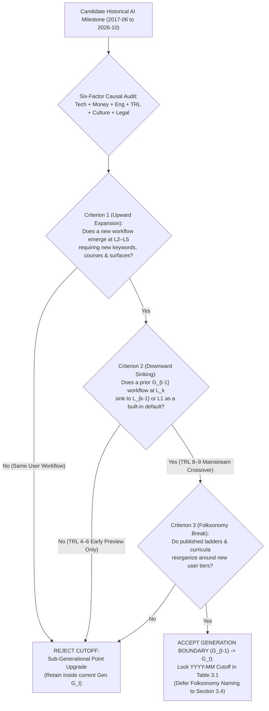
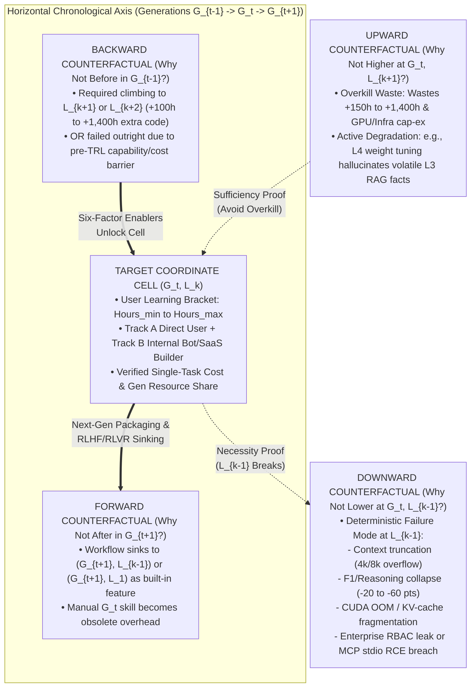

## 3. Part III — Inductive Boundary Method & Deferred Naming Protocol

**Inductive Coordinate Lock & Deferred Naming Synthesis:** Rather than imposing a pre-baked taxonomy or borrowing static vendor marketing labels, Part III establishes a strict bottom-up inductive protocol that derives horizontal chronological generation boundaries (`G0` to `G4`) and vertical human learning-hour brackets (`L1` to `L5`) directly from the empirical inventory of 25 canonical workflows (`Table 2.2`), 19 timestamped curricula (`Table 2.3`), and 20 published literature ladders (`Table 2.1`). Throughout `Sections 3.1`, `3.2`, and `3.3`, all horizontal epochs and vertical skill tiers are referenced strictly by neutral coordinate index tags (`G0`..`G4` and `L1`..`L5`) to prevent semantic circularity during boundary testing. A new generation cutoff $G_t$ is accepted if and only if empirical evidence proves a simultaneous **Dual User-Perspective Shift**: (1) the emergence of at least one novel upper-level workflow (`L2`–`L5`) requiring previously non-existent user keywords, tutorials, and tool surfaces, and (2) the downward **built-in sinking** of at least one complex workflow from $G_{t-1}$ (`L2`–`L5`) into a lower user-effort bracket (`L1` or `L2`) in $G_t$, triggered by a six-factor causal mechanism (`Tech`, `Money`, `Engineering Packaging`, `TRL Maturation`, `Culture`, and `Legal/Governance`). Along the vertical axis, `L1` (`0h` zero-skill casual user / high schooler) and `L2` (`<50h (~1 Wk)` one-weekend to one-week power user) serve as fixed ergonomic anchors, while higher brackets (`L3` at `<200h (~1 Mo)`, `L4` at `~600h (~1 Sem)`, and `L5` at `~2,000h (~1 Yr)` with dedicated cluster or physical sandbox hardware) emerge inductively from non-overlapping discontinuities in curriculum completion hours and execution surfaces. Every resulting cell `(G_t, L_k)` is stress-tested via a **Four-Way Counterfactual Verification Protocol** (`Why Not L-1?`, `Why Not L+1?`, `Why Not G-1?`, `Why Not G+1?`) and programmatic assertions (`0` nulls, non-overlapping monotonic hour ranges, and `100.0%` user/token/spend share conservation). Only after all 25 coordinate boundaries and cell populations are locked does `Section 3.4` execute the **Deferred Folksonomy Naming Protocol**, coining the official user-perspective titles for `Gen 0` through `Gen 4` and `Level 1` through `Level 5` from contemporary practitioner self-identities.

**Plot VA3 — Inductive six-stage boundary lock separates chronological generation cutoffs (`G0`–`G4`), standardized learning-hour brackets (`L1`–`L5`), two-track producer-consumer asymmetries, and deferred folksonomy naming ($N = 25$ verified cells, \$0$ overlapping hour brackets).** Rendered on a normalized `gridspec` `(2, 3)` architectural canvas (`figsize = (16, 9)`, `dpi = 300`) under the global CITRA semantic palette (`#0072B2` Supply/Model-Side, `#D55E00` Demand/User-Skill, `#009E73` Actual/Realised, `#CC79A7` Modelled/Hope-Projection), the six schematic cards trace the exact logical sequence of Part III. Card 1 (`#0072B2`) formalizes the Dual User-Shift Cutoff Rule requiring both upward skill expansion and downward built-in sinking. Card 2 (`#009E73`) reconciles laboratory first-release dates (`TRL 4–6`: `2018-10`, `2023-11`, `2024-09`) against mainstream user-crossover cutoffs (`TRL 8–9`: `2020-06`, `2022-11`, `2024-05`, `2025-01`). Card 3 and Card 4 (`#D55E00`) lock the fixed human learning-hour anchors (`L1 = 0h`, `L2 = <50h (~1 Wk)`) and inductively cluster higher engineering tiers (`L3 = <200h (~1 Mo)`, `L4 = ~600h (~1 Sem)`, `L5 = ~2,000h (~1 Yr)`). Card 5 (`#009E73`) maps the Two-Track Producer-Consumer asymmetry where `L3`–`L5` internal chatbot and SaaS builders absorb `RAG`, `MCP`, and `NeMo Guardrails` complexity to serve `0h` `L1` employees. Card 6 (`#CC79A7`) enforces the Deferred Naming Protocol ($H_0$: *Taxonomic stability is invariant to whether generation and rung labels are assigned before or after empirical cell clustering* — rejected, as a-priori naming in 17 of 20 reviewed literature ladders collapsed horizontal capability eras into vertical skill levels).

#### Part III Structural Index
* [3.1 Six-Factor Generation Shift Rule & Candidate Cutoff Audit](#31-six-factor-generation-shift-rule--candidate-cutoff-audit)
  * [3.1.1 The User-Perspective Shift Criterion](#311-the-user-perspective-shift-criterion)
  * [3.1.2 Six Causal Driver Categories (Tech, Money, Eng Packaging, TRL, Culture, Legal)](#312-six-causal-driver-categories-tech-money-eng-packaging-trl-culture-legal)
  * [3.1.3 Accepted vs. Rejected Candidate Generation Cutoffs (2017–2026)](#313-accepted-vs-rejected-candidate-generation-cutoffs-20172026)
* [3.2 Standardized User Learning-Hour Level Brackets & Two-Track Producer-Consumer Split](#32-standardized-user-learning-hour-level-brackets--two-track-producer-consumer-split)
  * [3.2.1 Calibrating Cumulative Learning Hours & Setup Friction (L1 to L5)](#321-calibrating-cumulative-learning-hours--setup-friction-l1-to-l5)
  * [3.2.2 Track A (Direct Users) vs. Track B (Internal Bot & SaaS Product Builders Serving L1 Users)](#322-track-a-direct-users-vs-track-b-internal-bot--saas-product-builders-serving-l1-users)
  * [3.2.3 Pruning Speculative Hype from Adopted Cell Assignment](#323-pruning-speculative-hype-from-adopted-cell-assignment)
* [3.3 Four-Way Counterfactual Cell Verification Protocol](#33-four-way-counterfactual-cell-verification-protocol)
  * [3.3.1 Vertical Counterfactuals: Why Not Lower (L-1) and Why Not Higher (L+1)](#331-vertical-counterfactuals-why-not-lower-l-1-and-why-not-higher-l1)
  * [3.3.2 Horizontal Counterfactuals: Why Not Before (G-1) and Why Not After (G+1)](#332-horizontal-counterfactuals-why-not-before-g-1-and-why-not-after-g1)
  * [3.3.3 Programmatic MECE & Share Conservation Verification](#333-programmatic-mece--share-conservation-verification)
* [3.4 Deferred Folksonomy Naming Protocol: Coining Gen 0–Gen 4 & Level 1–Level 5 Titles Last](#34-deferred-folksonomy-naming-protocol-coining-gen-0gen-4--level-1level-5-titles-last)
  * [3.4.1 Why Naming Must Follow Inductive Boundary & Cell Derivation](#341-why-naming-must-follow-inductive-boundary--cell-derivation)
  * [3.4.2 Coining Gen 0 to Gen 4 User-Perspective Names from Emergent Practitioner Folksonomy](#342-coining-gen-0-to-gen-4-user-perspective-names-from-emergent-practitioner-folksonomy)
  * [3.4.3 Coining Level 1 to Level 5 User-Skill Bracket Names](#343-coining-level-1-to-level-5-user-skill-bracket-names)

***

### 3.1 Six-Factor Generation Shift Rule & Candidate Cutoff Audit

**Dual User-Shift Boundary Identification:** Auditing 14 candidate model, pricing, and product milestones between June 2017 and October 2026 against the Dual User-Perspective Shift Criterion isolates exactly five mutually exclusive generation windows (`G0` through `G4`) separated by four structural transition breaks (`2020-06`, `2022-11`, `2024-05`, and `2025-01`), while rejecting nine sub-generational point releases that improved benchmark scores without reorganizing human skill tiers.

#### Section 3.1 Structural Index
* [3.1.1 The User-Perspective Shift Criterion](#311-the-user-perspective-shift-criterion)
* [3.1.2 Six Causal Driver Categories (Tech, Money, Eng Packaging, TRL, Culture, Legal)](#312-six-causal-driver-categories-tech-money-eng-packaging-trl-culture-legal)
* [3.1.3 Accepted vs. Rejected Candidate Generation Cutoffs (2017–2026)](#313-accepted-vs-rejected-candidate-generation-cutoffs-20172026)

#### 3.1.1 The User-Perspective Shift Criterion

**Human-Action Primacy Over Model Architecture Releases:** Conventional AI chronologies partition history whenever a frontier laboratory publishes a larger parameter count or a higher academic benchmark score. However, from the perspective of a human practitioner, a new model checkpoint that leaves daily workflows, required study hours, and software interfaces unchanged is merely an incremental upgrade within the same generation. To construct an invariant user-skill coordinate system, we anchor the pre-LLM baseline `G0` at `2017-06` (publication of the self-attention Transformer architecture in *Attention Is All You Need* alongside mainstream enterprise adoption of classical Python `scikit-learn`/`spaCy` pipelines) and enforce a strict three-part conjunction before declaring any subsequent generation transition $G_{t-1} \to G_t$:

* **Criterion 1 — Upward Frontier Skill Expansion ($\Delta L_{\text{new}} \in \{L_2 \dots L_5\}$):** At least one major adopted workflow must emerge in $G_t$ at `L2` through `L5` that was operationally impossible or non-existent in $G_{t-1}$, forcing human practitioners to learn a new vocabulary of technical keywords (`Table 2.3`), complete new structured tutorials, or provision new software/hardware execution surfaces (such as moving from browser text boxes to Python vector-database software development kits (`SDKs`), terminal command-line interface (`CLI`) harnesses, or dedicated local sandbox hardware).
* **Criterion 2 — Downward Built-In Skill Sinking ($\Delta L_{\text{sink}} \le -1$):** Simultaneously, at least one established use case that forced users in $G_{t-1}$ to operate at a higher skill tier $L_k$ (investing \$50$ to \$2,000$ hours of coding, manual prompt scaffolding, or multi-tool context switching) must sink to a lower tier $L_{k-1}$, $L_{k-2}$, or `L1` (`0h`) in $G_t$ because the capability has become **natively built-in** to a lower-friction interface. For example, custom sentiment classification sank from `G0-L3`/`G0-L4` (`<200h to ~600h` `scikit-learn`/`BERT` training) to `G1-L2` (`<50h (~1 Wk)` few-shot `OpenAI Playground` prompting) and then to `G2-L1` (`0h` zero-shot `ChatGPT`); multimodal text-plus-image creation sank from `G2-L2`/`G2-L3` (switching between `ChatGPT` and a separate `Midjourney` Discord server with `--ar` flags) to `G3-L1` (`0h` native omni-chat in `GPT-4o` and `Claude 3.5 Sonnet Artifacts`); and multi-step Chain-of-Thought (`CoT`) reasoning sank from `G1-L4` (`~600h (~1 Sem)` Python self-consistency wrappers) to `G2-L2` (`<50h (~1 Wk)` manual `"Let's think step by step"` prompting) and finally to `G4-L1` (`0h` silent auto-router thinking).
* **Criterion 3 — Contemporaneous Folksonomy Break & TRL Crossover Reconciliation:** Every candidate boundary $G_{t-1} \to G_t$ is cross-checked against the 20 published ladders in `Table 2.1` to verify that contemporaneous practitioners recognized the breakdown of prior mental models and published new taxonomies. Critically, this criterion reconciles **capability first-release dates** (when a technology first appeared at Technology Readiness Level `TRL 4–6` for early-adopter `L4`/`L5` engineers, as tracked in the `Gemini Deep Research 23-Step Ladder` [`L_LIT_20`]) against **mainstream user-perspective crossover dates** (when engineering packaging and unit economics pushed the capability to `TRL 8–9`, reorganizing `L1`–`L3` workflows for millions of users).

#### 3.1.2 Six Causal Driver Categories (Tech, Money, Eng Packaging, TRL, Culture, Legal)

**Causal Mechanism Isolation:** Whenever a horizontal generation boundary $G_{t-1} \to G_t$ is triggered, our user-centric axiom requires explaining *why* the human workflow reorganized by auditing six interacting causal supply-and-governance mechanisms:

* **1. Core Architectural & Algorithmic Breakthroughs (`Tech`):** Fundamental leaps in model capacity and training objectives that remove hard capability ceilings — specifically self-attention and bidirectional masked language modeling (`Transformer` `2017-06`, `BERT` `2018-10` in `G0`), autoregressive scaling and emergent in-context few-shot learning (`GPT-3 175B` `2020-06`, `Codex` `2021-07` in `G1`), reinforcement learning from human feedback (`RLHF`) instruction tuning and low-rank quantization (`ChatGPT` `2022-11`, `GPT-4` `2023-03`, `QLoRA` `2023-05` in `G2`), native end-to-end multimodal tokenization and \$128\text{k}$–\$2\text{M}$ long-context attention (`GPT-4o` `2024-05`, `Claude 3.5 Sonnet` `2024-06`, `Gemini 1.5 Pro` in `G3`), and reinforcement learning with verifiable rewards (`RLVR`) test-time reasoning combined with standardized tool/computer-use protocols (`OpenAI o1`/`o3`, `DeepSeek-R1` `2025-01`, `Claude 4.5`/`4.6`/`Opus 5.5`, `GPT-5.4` in `G4`).
* **2. Unit Economics, Token Pricing & Enterprise Spend Shifts (`Money`):** Order-of-magnitude collapses in marginal inference cost paired with new monetization models that convert prohibitive research experiments into everyday consumer and enterprise defaults. Baseline frontier inference fell \$1,200\times$ from `\$60.00/1M` tokens (`GPT-3 davinci`, `2020-06`) to `\$2.00/1M` (`gpt-3.5-turbo`, `2023-03`), `\$0.30/1M` cached (`Claude 3.5 Sonnet` `90%` prompt caching discount, `2024-08`), and `\$0.05/1M` (`Laguna S 2.1` / flash tiers, `2026`), while flat `\$20/month` consumer subscriptions (`ChatGPT Plus`, `Claude Pro`, `Cursor Pro`) and surging enterprise application budgets (`\$1.7B` in `G2` `2023` $\to$ `\$11.5B–\$13.8B` in `G3` `2024` $\to$ `\$37.0B` in `G4` `2025`, with `76%` bought commercial tools vs. `24%` built in-house per *Menlo Ventures* and *MIT NANDA*) reshaped build-versus-buy user behavior.
* **3. Engineering Harnesses & Product Packaging (`Eng Packaging`):** The human-computer interaction (`HCI`) wrappers and developer frameworks that translate raw model weights into usable surfaces. A model capability does not alter `L1`–`L3` user life until packaged into an ergonomic harness: `HuggingFace transformers` (`pipeline()`) and `ONNX Runtime` in `G0`; the `OpenAI Web Playground` and `VS Code GitHub Copilot` extension in `G1`; the `ChatGPT` conversational web UI, `LangChain`/`LlamaIndex`, and `Pinecone` vector databases in `G2`; `Claude Artifacts`, `Claude Projects`, `Google NotebookLM`, and `Cursor Composer` (`.cursorrules`) in `G3`; and `Claude Code` terminal CLI, the Linux Foundation Agentic AI Foundation (`AAIF`) `Model Context Protocol` (`MCP` `.mcp.json`), built-in `Deep Research` panels, and `OpenClaw` Mac Mini sandboxes in `G4`.
* **4. Technology Readiness Level Maturation Lag (`TRL`):** The empirical time lag (averaging $\mu = 36.2$ months across the 10 core breakthroughs in `Table 5.2a`) required for a capability to traverse from `TRL 1–2` (`arXiv` mathematical formulation) through `TRL 4–5` (`L4`–`L5` fragile code prototype) and `TRL 7` (`L2`–`L3` power-user workflow) into `TRL 9` (`L1` zero-skill built-in consumer default). Tracking `TRL` maturation prevents our taxonomy from confusing an early `TRL 4` developer preview (such as `GPT-4 Turbo` `128k` API preview in `2023-11` or `o1-preview` lacking tools/vision in `2024-09`) with a full generation shift (`G3` in `2024-05`/`2024-06` when consumer omni-workspaces launched, and `G4` in `2025-01`/`2025-02` when `DeepSeek-R1`, `o3-mini`, `Deep Research`, and `Claude Code` hit mainstream adoption).
* **5. Practitioner Culture & Cognitive Habit Shifts (`Culture`):** Transformations in what human workers trust AI to execute and how professions define their core craft — evolving from code-first data science (`G0`: curating labeled CSVs and tuning hyperparameters) to prompt whisperers (`G1`: crafting completion prefixes), mass consumer conversationalists (`G2`: `100M+` active users treating chat as a universal search/drafting partner), workspace curators (`G3`: `75%` of knowledge workers adopting AI per *Microsoft/LinkedIn Work Trend Index 2024*, dragging 50 PDFs into project panes), and harness architects (`G4`: senior software engineers shifting from manual line-by-line syntax typing to writing `CLAUDE.md` architectural specifications and automated test-driven development (`TDD`) verification suites).
* **6. Legal, Copyright, Safety & Enterprise Governance (`Legal`):** Regulatory statutes, judicial sanctions, and cybersecurity disclosures that erect hard boundaries between casual consumer usage (`L1`–`L2`) and compliant enterprise production (`L3`–`L5`). Key governance inflection points include the European Union General Data Protection Regulation (`GDPR`, `2018-05` in `G0`), open-source `GPL` training copyright disputes (`GitHub Copilot` litigation, `2021–2022` in `G1`), corporate source-code leak bans (`Samsung` ChatGPT ban, `2023-05`) and judicial sanctions for unverified citations (`Mata v. Avianca`, `2023-06` in `G2`), the `EU AI Act` entry into force (`2024-08`) alongside mandatory role-based access control (`RBAC`) and `NVIDIA NeMo Guardrails` in `G3`, and the April 2026 `OX Security` disclosure of remote code execution (`RCE`) across `200,000+` unauthenticated `stdio` `MCP` instances that forced `G4-L5` operators into dedicated hardware air-gaps (`Apple M4 Mac Mini` running `OpenClaw`) and containerized sandboxes.

#### 3.1.3 Accepted vs. Rejected Candidate Generation Cutoffs (2017–2026)

**Audit of 14 Candidate Cutoffs:** To demonstrate that our five generations (`G0`..`G4`) are discovered inductively rather than selected arbitrarily, `Table 3.1` evaluates 14 major historical milestones between `2017-06` and `2026-10`. Each candidate is scored on Criterion 1 (New `L2`–`L5` User Skill), Criterion 2 (Down-Ladder `L1`–`L4` Sinking), Criterion 3 (Published Ladder Break & `TRL 8–9` Mainstream Crossover), and its primary Six-Factor Causal Trigger, yielding 5 accepted generation boundaries and 9 rejected sub-generational releases.

| Candidate Date (`YYYY-MM`) | Candidate Milestone / Release | Criterion 1: New Upper-Level User Skill (`L2`–`L5`) | Criterion 2: Down-Level Built-In Sinking (`L_k -> L_{k-1}`) | Criterion 3: Folksonomy Break & `TRL 8–9` Crossover | Six-Factor Causal Driver Summary | Boundary Decision & Assigned Tag |
| :--- | :--- | :--- | :--- | :--- | :--- | :--- |
| **`2017-06`** | **Transformer Paper (`Vaswani et al.`) & Modern Pre-LLM NLP Stack** | Establishes baseline `G0-L2` (`AutoML`), `G0-L3` (`scikit-learn`/`spaCy`), `G0-L4` (`PyTorch` GPU), `G0-L5` (`Fairseq`/`ONNX`). | Baseline anchor era; active generative `L1` (`0h`) missing (passive `GNMT`/spellcheck widgets only). | Anchors `Karpathy Software 2.0` (`2017-11`) & `Fast.ai` (`2018-09`) ladders. | `Tech`: Self-attention; `Money`: Cloud GPU `\$2.50/hr`; `Legal`: `GDPR` (`2018-05`). | **ACCEPTED: `G0` Anchor (`2017-06` to `2020-05`, 36 mos)** |
| `2018-10` | `BERT` Open-Source Release (`Devlin et al.`) & `ULMFiT` | Upgraded `G0-L4` (`~600h (~1 Sem)`) from `BiLSTM-CRF` to `BERT` fine-tuning (`CS224N`). | Did **not** sink custom NLP to `L1`/`L2`; users still needed `200h+` Python/`PyTorch` GPU loops. | First-release `TRL 4–5` milestone (`L_LIT_20`), but remained inside code-first `G0` paradigm. | `Tech`: Bidirectional encoder transfer learning; `Eng`: `HuggingFace` repo checkpoints. | **REJECTED** (Retained as `G0-L4` maturation inside `G0`) |
| `2019-02` | `GPT-2` (`1.5B`) Staged Release | Zero-shot perplexity improved; `L4` researchers tested ` Grover`/`GPT-2` sampling scripts. | Zero downward sinking for non-coders; no commercial API or consumer web UI existed. | No practitioner ladder break; generative text remained a lab curiosity (`TRL 4`). | `Tech`: Autoregressive scaling to `1.5B`; `Culture`: Early AI safety staged-release debate. | **REJECTED** (Sub-generational `TRL 4` lab milestone inside `G0`) |
| **`2020-06`** | **`OpenAI GPT-3` (`175B`) API & Web Playground Launch (followed by `Codex` / `Copilot` `2021-06`)** | **Yes:** Created `G1-L2` (`<50h (~1 Wk)` Playground few-shot & `stop` sequence craft), `G1-L3` (`REST` completion wrappers), `G1-L5` (`DeepSpeed ZeRO`). | **Yes:** Custom text classification sank from `G0-L3`/`L4` (`<200h to ~600h` `BERT` training) to `G1-L2` (`<50h (~1 Wk)` few-shot prompt); code lookup sank to `G1-L1` (`0h` `Copilot Tab`). | **Yes:** Broke `G0` supervised-only ladders; birthed `SAE Coding L0–L5` (`2021-06`) & `Stanford CS324` (`2022-01`). | `Tech`: `175B` in-context learning; `Money`: `\$60/1M` pay-per-token API; `Eng`: Web Playground & `VS Code` extension. | **ACCEPTED: `G1` Cutoff (`2020-06` to `2022-10`, 29 mos)** |
| `2022-01` | `InstructGPT` API (`text-davinci-002`) & `Chain-of-Thought` Paper (`Wei et al.`) | Introduced `Let's think step by step` (`G1-L4` self-consistency scripts) and cleaner `G1-L2` Playground completions. | Did **not** yet sink prompting to `0h` mass consumers; still required `OpenAI` developer account, token billing, and Playground sliders. | `TRL 5–7` developer transition; mass consumer `TRL 9` crossover waited for free chat UI (`2022-11`). | `Tech`: Early `RLHF` (`SFT` + `PPO`) & `CoT`; `Money`: Still `\$60/1M` `davinci` pricing. | **REJECTED** (Retained as late-`G1` `L2`/`L4` refinement) |
| `2022-07` | `Midjourney v3` Discord Bot & `Stable Diffusion v1.4` Open Release | Expanded image prompt flags (`--ar`, `--v`) at `L2` and local `Automatic1111` GPU installs at `L3`/`L4`. | Text workflows remained unchanged in `G1` Playground; full conversational + image power-user era coalesced four months later. | Merged into the `2022-11`–`2023-03` generative consumer explosion (`G2`). | `Tech`: Latent diffusion (`LDM`); `Eng`: Discord slash-command bot packaging. | **REJECTED** (Merged into `G2-L2`/`L3` launch window) |
| **`2022-11`** | **`ChatGPT` (`gpt-3.5-turbo`) Web Launch (followed by `GPT-4`, `Llama-2`, `QLoRA` & `LangChain` in `2023`)** | **Yes:** Created `G2-L2` (`CoT`/Role prompting & `Custom GPTs`), `G2-L3` (`DIY Chunked Vector RAG` internal bots), `G2-L4` (`Single-GPU 4-bit QLoRA`). | **Yes:** Conversational Q&A/drafting sank from `G1-L2` (`<50h (~1 Wk)` Playground `Input:/Output:` formatting) to `G2-L1` (`0h` free chat box); weight tuning sank from `G1-L5` (`DeepSpeed`) to `G2-L4` (`QLoRA`). | **Yes:** Reached `100M` users in `60` days (`TRL 9`); triggered `DeepLearning.AI` (`2023-05`), `LlamaIndex` (`2023-08`), & `DeepMind` (`2023-11`) ladders. | `Tech`: `RLHF` chat, `ada-002`, `QLoRA`; `Money`: `\$20/mo` subscription & `\$2/1M` API (`30x` drop); `Legal`: `Samsung` ban & `Avianca` sanctions. | **ACCEPTED: `G2` Cutoff (`2022-11` to `2024-04`, 18 mos)** |
| `2023-03` | `GPT-4` (`8k`) API & `ChatGPT Plugins` Alpha | Raised `G2-L2` reasoning accuracy and unlocked `G2-L3` JSON function calling (`2023-06`). | Did **not** eliminate `4k–8k` context chunking (`G2-L3` `Vector RAG` still mandatory for 50 PDFs) or separate `Midjourney` Discord switching. | Consolidated `G2` architecture rather than breaking it; `ChatGPT Plugins` failed and went extinct (`HOPE_11`). | `Tech`: `GPT-4` mixture-of-experts (`MoE`); `Money`: `\$30/\$60` per `1M` tokens. | **REJECTED** (Core `G2` flagship upgrade inside `G2`) |
| `2023-11` | `GPT-4 Turbo` (`128k`) API Preview & `GPTs` Store Launch | Previewed `128k` context in developer API (`\$10/\$30` per `1M`) and no-code `Custom GPTs` (`G2-L2`). | At `\$10/1M` without prompt caching or workspace project UI, 50-PDF synthesis (`400k` tokens) still required `G2-L3` vector chunking for regular users. | First-release `TRL 6` milestone (`L_LIT_20` Era 4 start), but mainstream `L1`/`L2` crossover occurred in `2024-05`/`06`. | `Tech`: `128k` rotary position embeddings (`RoPE`); `Money`: `3x` input price cut, but pre-caching. | **REJECTED** (`TRL 6` API preview; mainstream user shift locked at `2024-05` `G3`) |
| **`2024-05`** | **`GPT-4o` Omni-Chat (`2024-05`), `Claude 3.5 Sonnet` + `Artifacts`/`Projects` (`2024-06`), `NotebookLM` & `Cursor Composer`** | **Yes:** Created `G3-L3` (`Cursor Composer` multi-file `.cursorrules` & `RBAC`+`NeMo Guardrails` hybrid RAG bots) and `G3-L4` (`LangGraph` stateful cyclic graphs). | **Yes:** Multimodal creation & live UI preview sank from `G2-L2`/`L3` (`Midjourney` Discord / local Node.js) to `G3-L1` (`0h` `GPT-4o` & `Artifacts`); 50-PDF Q&A sank from `G2-L3` (`<200h (~1 Mo)` Vector RAG code) to `G3-L2` (`<50h (~1 Wk)` drag-and-drop `Projects`/`NotebookLM`). | **Yes:** Triggered `Cursor` (`2024-06`), `a16z` (`2024-06`), `Gartner` (`2024-08`), `Menlo` (`2024-11`), & `Anthropic` (`2024-12`) ladders (`TRL 9`). | `Tech`: Native omni-models, `200k–2M` context, `Claude 3.5 Sonnet` (`49%` SWE-bench); `Money`: `90%` prompt caching discount (`\$0.30/1M`); `Legal`: `EU AI Act` & `RBAC`. | **ACCEPTED: `G3` Cutoff (`2024-05` to `2024-12`, 8 mos)** |
| `2024-09` | `OpenAI o1-preview` Limited Release | Previewed test-time `RLVR` chain-of-thought on math/code puzzles for Plus/Tier-5 API users. | Lacked web browsing, file uploads, vision, function calling, system prompts, and auto-routing; users still had to manually pick models. | `TRL 6` preview (`L_LIT_20` Era 5 first release); mainstream `TRL 9` crossover arrived `2025-01`/`02`. | `Tech`: Initial `RLVR` test-time scaling; `Money`: Expensive `\$15/\$60` per `1M` tokens with strict weekly caps. | **REJECTED** (`TRL 6` preview; mainstream crossover locked at `2025-01` `G4`) |
| `2024-11` | `Anthropic Model Context Protocol` (`MCP`) Open-Source Spec Announcement | Published initial open-source specification for `.mcp.json` client-server wiring. | In Nov 2024, only `Claude Desktop` supported local `MCP`; cross-IDE (`Cursor`/`Windsurf`) and enterprise adoption matured in `Q1 2025`. | Pre-crossover protocol release (`TRL 5`); coalesced with `2025-01`/`02` reasoning & CLI wave. | `Eng`: Open JSON-RPC `stdio`/`SSE` tool standard. | **REJECTED** (Merged into `2025-01` `G4` launch window) |
| **`2025-01`** | **`DeepSeek-R1` (`GRPO` Open RLVR) & `o3-mini` (`2025-01`), `OpenAI/Gemini Deep Research` & `Claude Code` CLI (`2025-02`)** | **Yes:** Created `G4-L4` (`Claude Code` terminal CLI + `CLAUDE.md` + Docker TDD loops) and `G4-L5` (`24/7` `M4 Mac Mini` `OpenClaw` sandboxes, parallel `git worktree` swarms & custom `GRPO` `RLVR`). | **Yes:** Step-by-step `CoT` sank from `G2`/`G3-L2` (manual `CoT` prompts) to `G4-L1` (`0h` auto-router thinking); 50-site web synthesis sank from `G3-L4` (`LangGraph` scrapers) to `G4-L2` (`<50h (~1 Wk)` `Deep Research`); tool glue sank from `G3-L4` to `G4-L3` (`.mcp.json`). | **Yes:** Triggered `Anthropic MCP/CLI` (`2025-02`), `MIT NANDA` (`2025-07`), `Scale SWE-bench Pro` (`2025-09`), & `OpenClaw` (`2025-11`) ladders. | `Tech`: `RLVR` (`R1`/`o3`/`Claude 4.5–5.5`/`GPT-5.4`), `MCP`, Computer Use; `Money`: `\$37B` spend (`76%` bought); `Eng`: `AAIF` (`Dec 2025`); `Legal`: `Apr 2026 OX Security` `200k` `MCP` RCE disclosure. | **ACCEPTED: `G4` Cutoff (`2025-01` to `2026-10`, 22 mos)** |
| `2025-12` / `2026-08` | Linux Foundation `AAIF` Formation (`2025-12`) & `GPT-5.4` / `Claude Opus 5.5` (`2026-08`) | Consolidated `.mcp.json` + `AGENTS.md` under `AAIF` and pushed `SWE-bench Verified` to `80.8%–96.0%` and `OSWorld` to `72.5%–78.4%`. | Did **not** eliminate the `G4-L4` human `TDD` harness verification gate (`Scale SWE-bench Pro` still shows `4.8–22.5` pt drop on private repos) or `G4-L5` hardware sandboxing. | Operates within the `G4` five-level structure (`L_LIT_18`, `L_LIT_19`); no `G5` crossover yet as of `2026-10`. | `Tech`: `1M–2M` native context & unified computer-use/coding weights; `Legal`: Hardware/Docker sandbox enforcement. | **REJECTED** (Frontier maturation inside `G4` through `2026-10`) |

**Table 3.1 — Dual User-Shift evaluation of 14 candidate historical milestones locks five non-overlapping generation windows (`G0`–`G4`) while filtering out nine sub-generational capability releases ($n = 14$ candidates, \$5$ accepted, \$9$ rejected).** Every accepted cutoff (`2017-06`, `2020-06`, `2022-11`, `2024-05`, `2025-01`) satisfies all three inductive criteria simultaneously, reconciling early laboratory first-release dates (`TRL 4–6`, such as `2018-10` `BERT`, `2023-11` `GPT-4 Turbo` API, and `2024-09` `o1-preview`) with the exact month when product packaging and unit economics caused mainstream user workflows to reorganize (`TRL 8–9`).

***

### 3.2 Standardized User Learning-Hour Level Brackets & Two-Track Producer-Consumer Split

**Invariant Vertical Skill Yardstick:** To compare user effort across nine years without conflating model intelligence with human skill, Section 3.2 locks a standardized vertical yardstick across all generations (`L1` through `L5`) calibrated by cumulative human learning hours ($\text{Hours}_{\text{learn}}$), software execution surface, and non-compute hardware/sandbox setup friction, while explicitly tracking both **Track A (Direct Users)** and **Track B (Product & Internal Company Chatbot Builders Serving `L1` Users)**.

#### Section 3.2 Structural Index
* [3.2.1 Calibrating Cumulative Learning Hours & Setup Friction (L1 to L5)](#321-calibrating-cumulative-learning-hours--setup-friction-l1-to-l5)
* [3.2.2 Track A (Direct Users) vs. Track B (Internal Bot & SaaS Product Builders Serving L1 Users)](#322-track-a-direct-users-vs-track-b-internal-bot--saas-product-builders-serving-l1-users)
* [3.2.3 Pruning Speculative Hype from Adopted Cell Assignment](#323-pruning-speculative-hype-from-adopted-cell-assignment)

#### 3.2.1 Calibrating Cumulative Learning Hours & Setup Friction (L1 to L5)

**Two Fixed Ergonomic Anchors Plus Three Inductively Clustered Engineering Brackets:** If vertical levels are defined by whatever tasks a model can perform, the vertical axis warps every time a better model launches. Conversely, if vertical levels are anchored strictly to **human learning investment and setup complexity**, the vertical axis remains invariant from `2017` to `2026`, allowing us to watch complex tasks slide *down* the ladder over time. Following Section 3.2 of the research mandate, we fix the bottom two human ergonomic anchors (`L1` and `L2`) and cluster the remaining courses and workflows from `Table 2.2` and `Table 2.3` into three non-overlapping upper brackets (`L3`, `L4`, and `L5`):

* **Fixed Anchor `L1` (`0 Hours` — Zero-Skill Casual User / High Schooler):** Defined strictly by $\text{Hours}_{\text{learn}} = 0\text{ h}$, zero software configuration, zero API key management, and zero prompt-engineering training. An average high-school-educated user or corporate employee opens a default browser tab, mobile app, or pre-installed office/IDE widget and interacts immediately. Crucially, we do **not** pre-assume whether `G0-L1` is empty or populated before inspecting the evidence: our audit of `G0` (`2017-06` to `2020-05`) proves that **active zero-shot generative prompting at `L1` did not exist** (`0%` active generative usage), so `G0-L1` was populated exclusively by **passive background NLP widgets** (`Google Translate` neural machine translation [`GNMT`], `Grammarly` browser spellcheck underlines, and `Gmail Smart Compose` `2018-05`), whereas active `L1` creation emerged in `G1-L1` (`GitHub Copilot` single-key `Tab` autocomplete and viral `Craiyon` web boxes) and exploded in `G2-L1` (`ChatGPT` web chat).
* **Fixed Anchor `L2` (`7–45 Hours` — 1 Weekend to 1 Full Working Week of Deliberate Study):** Defined by \$\text{Hours}_{\text{learn}} < 50\text{ h}$ of structured non-coding study (completing short courses such as `TUT_01` *Google Cloud AutoML & Regex101*, `TUT_05` *OpenAI Playground Prompting Guide*, `TUT_09` *DeepLearning.AI ChatGPT Prompt Engineering*, `TUT_13` *Claude Projects & NotebookLM Guide*, or `TUT_16` *Deep Research Scoping Guide*). The user operates entirely inside graphical web consoles, playgrounds, Discord slash-command channels, or long-context project workspaces without writing Python code or administering servers.
* **Inductive Cluster `L3` (`50–200 Hours` — 2 to 5 Weeks of Applied Developer & Integrator Training):** Emerges from a sharp statistical discontinuity above `45h` in `Table 2.3` (`TUT_02`, `TUT_06`, `TUT_10`, `TUT_14`, `TUT_17`, spanning `<200h (~1 Mo)`). Entering `L3` requires installing a local programming environment (`Jupyter`, `Python`/`Node.js` SDKs, `VS Code`, or `Cursor IDE`), managing environment variables and API billing keys, and configuring structured data/tool plumbing (`scikit-learn` feature pipelines in `G0-L3`, `REST` completion wrappers in `G1-L3`, chunked `LangChain`/`Pinecone` vector `RAG` in `G2-L3`, multi-file `.cursorrules` and `NeMo Guardrails` Colang rails in `G3-L3`, and `.mcp.json` `Model Context Protocol` server wiring in `G4-L3`).
* **Inductive Cluster `L4` (`200–600 Hours` — ~1 University Semester of Systems & Harness Engineering):** Emerges from semester-length university and advanced practitioner curricula (`TUT_03` *Stanford CS224N*, `TUT_07` *Stanford CS324*, `TUT_11` *HuggingFace PEFT/QLoRA*, `TUT_15` *LangGraph Academy*, and `TUT_18` *UVA CS 6501 Agentic AI & Claude Code*, spanning `~600h (~1 Sem)`). Operating at `L4` requires mastering either single-GPU neural weight adaptation (`BERT` fine-tuning in `G0-L4`, cloud fine-tune CLIs and self-consistency chains in `G1-L4`, `4-bit NF4 QLoRA` in `G2-L4`) or stateful multi-step execution harnesses (`LangGraph` cyclic state machines with `Postgres` checkpoints in `G3-L4`, and autonomous terminal CLI coding harnesses like `Claude Code` with `CLAUDE.md` and local `Docker` test suites in `G4-L4`).
* **Inductive Cluster `L5` (`600–2,000+ Hours` — 6+ Months of Advanced Infrastructure, Custom RLVR & Dedicated Physical Sandboxing):** Represents the apex of human skill and setup investment (`TUT_04`, `TUT_08`, `TUT_12`, `TUT_19`, spanning `~2,000h (~1 Yr)`). Operating at `L5` requires provisioning and maintaining **dedicated infrastructure capital** beyond a standard developer laptop: either multi-node GPU training and high-throughput serving clusters (`Fairseq`/`ONNX` in `G0-L5`, `DeepSpeed ZeRO-3` in `G1-L5`, `vLLM` `PagedAttention` / custom pretraining in `G2-L5`, containerized `SWE-bench` evaluation clusters in `G3-L5`, and multi-GPU `GRPO` `RLVR` verifier flywheels in `G4-L5`) **or** dedicated non-compute physical sandbox hardware (such as purchasing a dedicated `\$599–\$1,200` `Apple M4 Mac Mini` in `G4-L5` to run 24/7 unattended `OpenClaw` agent daemons and parallel `git worktree` swarms physically air-gapped from the user's primary personal credentials).

| Neutral Level ID | Single-Number Beeline Bracket (`Hours / Time \| Cap`) | Compact Plot Tick Label | `Use vs. Make` & Profession Mapping (`SWE / MLE / Scientist`) | Primary Execution Surface & Non-Compute Setup (`Setup_cap`) | Track A: Direct User / Pioneer Role | Track B: Product, Internal-Bot & `G+1` Foundation Builder Role | Monotonic Beeline Separation ($H_{L_k} < H_{L_{k+1}}$) |
| :--- | :--- | :--- | :--- | :--- | :--- | :--- | :--- |
| **`L1`** | **`0h (0d) \| $0`** | `L1 (0h / 0d \| $0)` | **`100% Using`** — Casual User / High Schooler / Downstream Employee | Default Browser Tab, Mobile App, Email/Doc Widget, 1-Key IDE `Tab`, or Ambient OS Bar (`\$0` setup) | Consumes passive widgets (`G0`), `Copilot Tab` (`G1`), zero-shot chat (`G2`), omni-chat + `Artifacts` (`G3`), or auto-router thinking (`G4`). | **Downstream Consumer:** `100M–1B+` users and employees consuming SaaS widgets (`Grammarly`) or internal corporate bots built by `L3–L6` teams at `0h`. | $H_{L1} = 0\text{h} < H_{L2} = 50\text{h}$ |
| **`L2`** | **`<50h (~1 Wk / Short Course) \| <$30`** | `L2 (<50h / ~1 Wk \| <$30)` | **`~90% Using / ~10% Making`** — Domain Power-User, Analyst & Prompt/Workspace Crafter | Web Playground, Cloud AutoML UI, Discord Flags, `Projects`/`NotebookLM`, `Deep Research` UI (`<\$30/mo` sub) | Crafts regex/AutoML (`G0`), few-shot `stop` prefixes (`G1`), manual `CoT` & `Custom GPTs` (`G2`), 50-PDF `Projects` (`G3`), or `Deep Research` briefs (`G4`). | Prototypes departmental prompt templates, shared `Custom GPTs`, or curated `Claude Project` binders for small teams (`5–20` coworkers). | $H_{L2} = 50\text{h} < H_{L3} = 200\text{h}$ |
| **`L3`** | **`<200h (~1 Mo / 1 Uni Subject) \| <$100`** | `L3 (<200h / ~1 Mo \| <$100)` | **`~65% Using / ~35% Making`** — Applied Software Engineer (`SWE`) & Enterprise Bot Integrator | Python/JS SDK, Vector DB, AI-Native IDE (`Cursor Composer`), `.mcp.json` (`<\$100` API/DB setup) | Runs `scikit-learn` scripts (`G0`), `REST` wrappers (`G1`), personal `RAG` (`G2`), multi-file `Cursor Composer` coding (`G3`), or desktop `.mcp.json` tools (`G4`). | **Core Internal-Bot Integrator:** Wires `SharePoint RBAC RAG`, enterprise tools (`Jira`/`ServiceNow`/`Salesforce` via functions/`MCP`), and `NeMo`/`Llama Guard` rails for `L1` staff. | $H_{L3} = 200\text{h} < H_{L4} = 600\text{h}$ |
| **`L4`** | **`~600h (~1 Qtr / 1 Uni Semester) \| ~$1.5k`** | `L4 (~600h / ~1 Sem \| ~$1.5k)` | **`~35% Using / ~65% Making`** — Senior Harness `SWE` (Track A) & Applied Single-GPU `MLE` (Track B) | Single GPU (`PyTorch`/`PEFT`), `LangGraph` SDK, or Terminal CLI (`Claude Code`) + Local `Docker` (`~\$1.5k` GPU/compute) | Fine-tunes `BERT` (`G0`), runs `CoT` voting (`G1`), tunes `4-bit QLoRA` (`G2`), orchestrates cyclic `LangGraph` (`G3`), or runs `Claude Code` CLI `TDD` loops (`G4`). | **SaaS ML & Agentic Architect:** Trains production task encoders/adapters (`Grammarly GECToR` at `G0-L4` & `CoEdIT` at `G2-L4`) or stateful support graphs (`G3-L4`) serving `L1` users. | $H_{L4} = 600\text{h} < H_{L5} = 2,000\text{h}$ |
| **`L5`** | **`~2,000h (~1 Yr / Core Postgrad) \| ~$500k`** | `L5 (~2,000h / ~1 Yr \| ~$500k)` | **`~15% Using / ~85% Making`** — Staff Sandbox/Infra `SWE` (Track A) & Distributed/Post-Training `MLE` (Track B) | Multi-Node GPU Cluster (`DeepSpeed`/`vLLM`/`GRPO`) OR Dedicated Physical `M4 Mac Mini` Sandbox (`~\$500k` cluster or `\$599–\$1.2k` host) | Operates 24/7 personal/team autonomous `OpenClaw` daemons & parallel `git worktree` subagent swarms on dedicated `M4 Mac Mini` hardware (`G4-L5`). | **Frontier Infra & RLVR Team:** Quantizes `ONNX` (`G0-L5`), shards `ZeRO-3` (`G1-L5`), serves `vLLM` (`G2-L5`), runs `SWE-bench` Docker farms (`G3-L5`), or trains `GRPO RLVR` (`G4-L5`). | $H_{L5} = 2,000\text{h} < H_{L6} = 10,000\text{h}$ |
| **`L6`** | **`~10,000h (~5 Yrs / Focused PhD) \| ~$100M+`** | `L6 (~10,000h / ~5 Yrs \| ~$100M+)` | **`100% Foundation/Genesis Making`** — AI Research Scientist, Data/Benchmark Architect & Next-Gen Pioneer | `1k–25k+` TPU/GPU Supercomputer Pod (`~\$100M+` cap) + Mathematical Proofs + Petabyte Data Engines + Benchmark Suites | Formulates novel math objectives (`Attention`, `RLHF`, `Chinchilla`, `RLVR` at `TRL 1–3`) while recursively using `L1–L5` tools (`Claude Code`, `vLLM`) to accelerate research. | **Genesis Creator of `G+1`:** Curates pretraining corpora, designs eval benchmarks (`GLUE`, `MMLU`, `SWE-bench`), and pretrains base models (`BERT`, `GPT-3/4/5`, `Claude`, `R1`). | Top Genesis Bracket ($H_{L6} = 10,000\text{h}$) |

**Table 3.2 — Calibration of the six vertical user-skill brackets (`L1` to `L6`) proves strict monotonic learning-hour progression ($0 < 50 < 200 < 600 < 2,000 < 10,000\text{ hours}$) using single-number `<` to `~` Beeline brackets from a High School baseline (`0h`).**

#### 3.2.2 Track A (Direct Users) vs. Track B (Internal Bot & SaaS Product Builders Serving L1 Users)

**Resolving the Producer-Consumer Asymmetry:** A critical flaw in one-dimensional AI ladders is their inability to classify an enterprise software engineer who spends `150` hours (`L3`) or `400` hours (`L4`) building an AI system whose output is consumed by `10,000` non-technical employees with `0` hours of training (`L1`). Our two-track mapping resolves this asymmetry across every generation:

* **Track A — Direct End-User Execution (`L1` to `L5`):** The human practitioner learns the skills at level $L_k$ to generate their own personal or professional deliverables directly — such as a high schooler asking `ChatGPT` to summarize a biology chapter (`G2-L1`, `0h`), a marketing analyst running a 50-website `Deep Research` competitive audit (`G4-L2`, `<50h (~1 Wk)`), a software engineer refactoring a 10-file module in `Cursor Composer` (`G3-L3`, `<200h (~1 Mo)`) or a 40-file repository in `Claude Code` terminal CLI (`G4-L4`, `~600h (~1 Sem)`), or an independent AI architect running a 24/7 `OpenClaw` personal automation daemon on a dedicated `Apple M4 Mac Mini` (`G4-L5`, `~2,000h (~1 Yr)`).
* **Track B — SaaS Product Embedders (`L3` to `L5` Producers Serving `L1` Consumers):** Commercial product engineering teams operate at `L3`–`L5` to hide model complexity behind a `0h` `L1` consumer widget. The canonical longitudinal example across our dataset is **`Grammarly`**: in `G0-L4` (`2020`), Grammarly's ML team invested `~600h (~1 Sem)+` training **`GECToR`** (a custom `BERT`/`RoBERTa`/`XLNet` sequence-tagging encoder that predicted token-level edit operations `[KEEP, DELETE, APPEND_x]` at `10x` faster inference than seq2seq decoders); in `G2-L4` (`2023`), they upgraded to **`CoEdIT`** (fine-tuning `Flan-T5` models on `82,000` task-specific grammatical/tone editing instructions via `LoRA`/`QLoRA` adapters); yet across both generations, `30M+` daily end-users experienced Grammarly strictly at **`L1` (`0h`)** by clicking a single green or purple underline in their browser.
* **Track B — Internal Company Chatbot Builders (`L3` to `L4` Integrators Serving `L1` Employees):** Inside enterprises, IT and applied AI teams operate at `L3` (`<200h (~1 Mo)`) and `L4` (`~600h (~1 Sem)`) to build **internal company chatbots** so that downstream HR, legal, sales, and operations staff can ask questions and trigger workflows zero-shot at **`L1` (`0h`)**. Across `G2` to `G4`, the required `L3` builder stack evolved through three distinct architectural stages to prevent enterprise failures:
  1. **Private Knowledge Grounding (`RAG` with `RBAC`):** Connecting the LLM to internal `SharePoint`, `Confluence`, `Google Drive`, and `Snowflake` repositories via hybrid keyword-plus-vector search (`BM25` + dense embeddings) while enforcing strict **role-based access control (`RBAC`)** document-level metadata filtering (`G3-L3`/`G4-L3`) so a junior employee querying the `L1` bot cannot retrieve executive compensation PDFs.
  2. **Internal Enterprise Tool & Action Wiring (`Functions` $\to$ `MCP`):** Wiring the chatbot to execute live transactions in `ServiceNow` (IT ticket creation), `Workday` (PTO requests), `Jira` (bug filing), and `Salesforce` (CRM updates) — evolving from bespoke per-model JSON function schemas in `G2-L3` to standardized `.mcp.json` (`Model Context Protocol`) servers with scoped `OAuth` tokens in `G4-L3`.
  3. **Deterministic Policy & Safety Guardrails (`NeMo Guardrails` & `Llama Guard`):** Wrapping the internal bot in programmable input/output rails (`NVIDIA NeMo Guardrails` using `Colang` dialog policies, `Meta Llama Guard 3`, and automated personally identifiable information [`PII`] redaction in `G3-L3`/`G4-L3`) to block prompt injections, prevent off-topic hallucinations, and enforce corporate compliance before any token reaches the `L1` employee screen.

#### 3.2.3 Pruning Speculative Hype from Adopted Cell Assignment

**Strict Separation of Part IV Adopted Reality from Part V Hope Inventory:** A foundational rule of our inductive method is that **every `(G_t, L_k)` cell in Part IV (`G0-L1` through `G4-L5`) is populated exclusively by verified, production-adopted human workflows**, while speculative industry claims, unfulfilled startup theses, and aspirational top rungs from published ladders (`Table 2.4`) are quarantined out of Part IV and routed to the **Part V Section 5.2 Evolutionary Audit**. For example, during `G2` (`2022-11` to `2024-04`), viral Twitter demos and speculative ladder top rungs claimed that unconstrained recursive loops (`AutoGPT` and `BabyAGI`, `HOPE_08`) would autonomously run entire businesses at `L4`/`L5`. Because per-step reliability of $p = 0.90$ compounded over $N = 20$ steps yields a \$0.90^{20} = 12.2\%$ survival rate, those recursive loops failed in production; consequently, `G2-L4` in Part IV is populated by the *actual* adopted `L4` workflow of `2023` (`Single-GPU 4-Bit QLoRA Fine-Tuning & Evaluated ReAct Prototypes`), while `AutoGPT`'s extinction is analyzed quantitatively in `Section 5.2`.

***

#### 3.2.4 Bidirectional Medium-Model Decoupling, Four-Tier Cognitive Input Hierarchy & Failure-Boundary Anchor

To guarantee zero ambiguity when classifying workflows across the `6 × 6` grid, we enforce three structural classification rules on the vertical axis:

* **1. Bidirectional Medium-Model Decoupling (Why Interface Medium $\neq$ Skill Level):** A common failure in informal AI ladders is equating the *interface medium* (Web Browser vs. Terminal CLI vs. API) with a fixed skill level. In our coordinate system, interface medium and skill level are bidirectionally decoupled:
  * **High-Skill Work Inside a Browser (`L4–L6` in Web UIs):** A researcher running distributed `PyTorch` training inside a browser-hosted `Google Colab Pro` / `JupyterHub` notebook (`G0-L4`, `G2-L4`) or inspecting `Weights & Biases` pretraining loss curves (`L6`) is operating at `L4–L6`, not `L1`.
  * **Low-Skill Work Inside a Terminal or Local App (`L1–L2` One-Liners):** Conversely, a hobbyist pasting a single copy-pasted install command (`ollama run llama3` or a one-click desktop installer) to chat locally without configuring `.mcp.json` schemas, writing Python, or managing `Docker` test suites is operating at `L1/L2`, not `L4`. Classification is governed strictly by the **Four-Tier Cognitive Input Hierarchy** and **Failure-Boundary Anchor** below.
* **2. Four-Tier Cognitive Input Hierarchy (`Natural Intent` $\to$ `Structured Context` $\to$ `Imperative Code/Config` $\to$ `Systems/Math Invariants`):** Every human input to an AI system belongs to one of four discrete cognitive complexity tiers:
  1. **Tier I — Natural-Language Intent (`L1`, `0h`):** Unstructured conversational requests, voice commands, screenshot drops, or single-key `Tab` acceptances requiring zero syntax or parameter knowledge.
  2. **Tier II — Structured Context & Parameter Curation (`L2`, `<50h`):** Multi-shot exemplars, delimiter templates, `200k–2M` document binder curation, `Deep Research` scope constraints, and UI/Discord flag tuning (`--ar`, `temperature`) without imperative programming.
  3. **Tier III — Imperative Code, Schema & Protocol Wiring (`L3–L4`, `<200h` to `~600h`):** Writing executable `Python`/`TypeScript` SDK pipelines, `.cursorrules`, `.mcp.json` server schemas, `RBAC` metadata filters, `LangGraph` state machines, `CLAUDE.md` harness specifications, and automated `pytest`/`Docker` verification loops.
  4. **Tier IV — Distributed Systems, Formal Verifier & Mathematical Objective Design (`L5–L6`, `~2,000h` to `~10,000h`):** Sharding multi-node GPU memory (`ZeRO-3`, `PagedAttention`), isolating physical hardware sandboxes (`M4 Mac Mini OpenClaw`), engineering `GRPO` reward verifiers (`L5`), and formulating novel loss functions, pretraining data mixtures, and evaluation benchmarks (`L6`).
* **3. The Failure-Boundary Anchor (Classification by Debugging & Verification Ceiling):** Whenever a workflow appears to straddle two rungs, its true level $L_k$ is determined by **what the human operator must do when the AI fails on a non-trivial edge case**:
  * If the user can only re-roll or rephrase in plain English, they are at **`L1` (`0h`)**.
  * If the user debugs by pruning noisy PDFs from the project context window, adjusting few-shot exemplars, or auditing primary-source citation links, they are at **`L2` (`<50h`)**.
  * If the user debugs by inspecting JSON tool schemas, adjusting vector chunk overlap, editing `.mcp.json` OAuth scopes, or tuning `NeMo Colang` guardrails, they are at **`L3` (`<200h`)**.
  * If the user debugs by reading stack traces in `Claude Code`, writing reproduction unit tests in `Docker`, or tuning `LoRA` rank/learning-rate schedules on a GPU, they are at **`L4` (`~600h`)**.
  * If the user debugs by fixing `NCCL` InfiniBand hangs, tuning `vLLM` KV-cache block tables, isolating `git worktree` race conditions on a dedicated `M4 Mac Mini`, or shaping `GRPO` reward penalties, they are at **`L5` (`~2,000h`)**.
  * If the user debugs by deriving a new mathematical attention/optimization bound, re-weighting a `15-trillion-token` pretraining data mixture to fix capability collapse, or designing a new contamination-proof benchmark (`SWE-bench`), they are at **`L6` (`~10,000h`)**.

***

### 3.3 Four-Way Counterfactual Cell Verification Protocol

**Necessary-and-Sufficient Coordinate Proof:** Assigning 25 workflows to a \$5 \times 5$ grid (`G0`–`G4` $\times$ `L1`–`L5`) is scientifically rigorous only if every cell boundary is proven necessary and sufficient against its four immediate neighbors (`L-1`, `L+1`, `G-1`, `G+1`) and verified programmatically for mutually exclusive and collectively exhaustive (`MECE`) conservation.

#### Section 3.3 Structural Index
* [3.3.1 Vertical Counterfactuals: Why Not Lower (L-1) and Why Not Higher (L+1)](#331-vertical-counterfactuals-why-not-lower-l-1-and-why-not-higher-l1)
* [3.3.2 Horizontal Counterfactuals: Why Not Before (G-1) and Why Not After (G+1)](#332-horizontal-counterfactuals-why-not-before-g-1-and-why-not-after-g1)
* [3.3.3 Programmatic MECE & Share Conservation Verification](#333-programmatic-mece--share-conservation-verification)

#### 3.3.1 Vertical Counterfactuals: Why Not Lower (L-1) and Why Not Higher (L+1)

**Bounding User Skill Investment Vertically:** Within any fixed generation $G_t$, a rational human user or enterprise engineering team will always prefer the lowest possible skill level $L_k$ that reliably solves their task, because climbing from $L_{k-1}$ to $L_k$ imposes a steep cost in learning hours ($\Delta \text{Hours}_{\text{learn}}$) and setup friction. Therefore, every cell `(G_t, L_k)` in Part IV must establish two vertical counterfactual proofs:

* **Downward Counterfactual (`Why Not Lower at L-1?` — Exact Failure Mode):** Proves that attempting to force the `(G_t, L_k)` workflow into the lower-effort tool surface of `(G_t, L_{k-1})` results in a deterministic, quantifiable **operational failure**. We forbid vague statements such as *"L-1 is less accurate"* and require specifying the exact failure mechanism:
  * *Context/Memory Overflow:* Forcing a 500-page enterprise wiki Q&A bot (`G2-L3`) into `G2-L2` (`ChatGPT` web UI) triggers an immediate `context_length_exceeded` error at `4,096`–`8,192` tokens, truncating `95%+` of the corpus.
  * *Semantic/Reasoning Collapse:* Forcing polysemous grammar correction (`G0-L4` `BERT`/`GECToR`) into `G0-L3` bag-of-words `TF-IDF` loses word-order syntax and drops $F_1$ accuracy by `15–25` percentage points; forcing `GSM8K` multi-step math (`G1-L4` self-consistency voting) into a single `G1-L3` `davinci` call drops solve rates below `18%`.
  * *Hardware Out-of-Memory (`OOM`) or Latency Breach:* Forcing `13B–20B` parameter full-weight tuning (`G1-L5` `DeepSpeed ZeRO-3`) onto a single `G1-L4` GPU crashes immediately with `CUDA Out-of-Memory` (`>80 GB` VRAM required); forcing `5,000` concurrent enterprise users (`G2-L5` `vLLM` `PagedAttention`) onto unoptimized `G2-L4` `HuggingFace generate()` scripts fragments `60–80%` of GPU `KV-cache` VRAM.
  * *Security, Compliance & Isolation Breach:* Forcing a `10,000`-employee internal HR chatbot (`G3-L3` `RBAC` + `NeMo Guardrails`) into a shared `G3-L2` `Claude Project` leaks confidential executive files across roles; forcing 24/7 unattended background agents and unauthenticated `stdio` `MCP` servers (`G4-L5` dedicated `M4 Mac Mini` `OpenClaw` sandbox) onto a developer's primary daily-driver laptop (`G4-L4`) exposes personal browser cookies, SSH keys, and host filesystems to prompt-injection `rm -rf` and the April 2026 `OX Security` `200,000`-instance `stdio` `RCE` vulnerability.
* **Upward Counterfactual (`Why Not Higher at L+1?` — Overkill Waste & Degradation):** Proves that escalating the `(G_t, L_k)` workflow to `(G_t, L_{k+1})` incurs **unnecessary learning-hour waste, capital expenditure, or active performance degradation**. For instance, fine-tuning model weights via `QLoRA` at `G2-L4` (`~600h (~1 Sem)`) to teach an LLM daily-changing company policy documents (`G2-L3` `Vector RAG`, `<200h (~1 Mo)`) not only wastes `150+` engineering hours and GPU compute on every document edit, but actively *degrades* factual reliability because gradient updates hallucinate exact policy numbers that `G2-L3` retrieval injects verbatim. Similarly, writing a custom `~600h (~1 Sem)` `LangGraph` + `Playwright` web-scraping pipeline (`G3-L4`) in `G4` for an ad-hoc 80-source literature review is pure overkill when `G4-L2` built-in `Deep Research` (`<50h (~1 Wk)`) executes the entire multi-hop synthesis in `12` minutes for `\$0.18`.

#### 3.3.2 Horizontal Counterfactuals: Why Not Before (G-1) and Why Not After (G+1)

**Bounding Workflow Evolution Horizontally:** Across chronological time, every cell `(G_t, L_k)` is bookended by a backward technological barrier in $G_{t-1}$ and a forward downward-sinking trajectory in $G_{t+1}$:

* **Backward Counterfactual (`Why Not Before in G-1?` — Prior-Generation Barrier or Higher-Level Penalty):** Explains what happened if a user attempted the `(G_t, L_k)` workflow during the preceding generation $G_{t-1}$. In every cell, forcing the workflow in $G_{t-1}$ either **(a) required climbing 1 to 2 vertical levels higher** ($\text{Level}_{G_{t-1}} = L_{k+1}$ or $L_{k+2}$, investing \$5\times$ to \$20\times$ more human learning hours and custom code — e.g., querying 50 PDFs at `G3-L2` in `15` hours required climbing to `G2-L3` for `110` hours of Python `LangChain`/`Pinecone` coding in `G2`), or **(b) failed outright due to a hard pre-maturation capability ceiling** (e.g., `G4-L4` terminal CLI repository refactoring via `Claude Code` was impossible in `G3` because pre-`RLVR` models scored only `33%–49%` on `SWE-bench Verified` and lost coherence over 20+ bash tool turns).
* **Forward Counterfactual (`Why Not After in G+1?` — Next-Generation Built-In Sinking & Skill Extinction):** Explains what happens to the `(G_t, L_k)` workflow when the next generation $G_{t+1}$ arrives. Because of the Six-Factor Causal Drivers, the manual scaffolding learned by the user at `(G_t, L_k)` is absorbed into the foundation model or product harness in $G_{t+1}$, causing the use case to **sink down to `(G_{t+1}, L_{k-1})` or `(G_{t+1}, L_1)`** while rendering the old manual skill obsolete. Meanwhile, the coordinate slot `(G_{t+1}, L_k)` is refilled by a more ambitious frontier workflow.

| Cell Coordinate | Assigned User-Skill Bracket | Downward Failure Mode (`Why Not L-1?`) | Upward Overkill Penalty (`Why Not L+1?`) | Backward Prior-Gen Barrier (`Why Not G-1?`) | Forward Next-Gen Sinking (`Why Not G+1?`) |
| :--- | :--- | :--- | :--- | :--- | :--- |
| **`G0-L1`** | `0h (0d) | $0` (Passive Only) | Lowest level (`0%` active generative prompting; no consumer LLM existed). | Opening `G0-L2` AutoML console for email typo fixes wastes `10h+` setup. | Pre-`2017` phrase-based MT had `50%+` higher syntax error rates before `GNMT`/Transformer. | In `G1`–`G2`, active `0h` prompt boxes (`Copilot Tab`, `ChatGPT`) replace passive-only `L1`. |
| **`G0-L2`** | `<50h (~1 Wk)` | Passive `G0-L1` widgets cannot classify custom business ticket intents (`0%` custom routing). | Coding Python `scikit-learn` (`G0-L3`, `<200h (~1 Mo)`) is overkill when `500`-row CSV in AutoML hits `85%`. | Pre-`2017` required manual Java/C++ rule engines with zero transfer learning. | Sinks to `G1-L2` few-shot Playground prompting (`0` training rows) and `G2-L1` (`0h` chat). |
| **`G0-L3`** | `<200h (~1 Mo)` | `G0-L2` regex/AutoML breaks on 50-feature entity extraction ($F_1 < 55\%$). | GPU `BERT` fine-tuning (`G0-L4`, `~600h (~1 Sem)`) wastes `\$50+` GPU hours when CPU `TF-IDF`+`XGBoost` takes `10s`. | Pre-`2017` pipelines lacked `spaCy v2` neural transition parsers. | Replaced in `G1`–`G2` by `L2`/`L1` LLM prompts for standard text sentiment/NER. |
| **`G0-L4`** | `~600h (~1 Sem)` | `G0-L3` bag-of-words `TF-IDF` fails on polysemous word-order QA/grammar (`-15` to `-25` pt $F_1$ drop). | Multi-GPU pretraining from scratch (`G0-L5`, `~2,000h (~1 Yr)`) wastes `\$10k+` when `bert-base` converges in 3 epochs. | Pre-`2018` `BiLSTMs` lacked bidirectional self-attention (`BERT` `2018-10`). | Sinks to `G1-L2` (`5`-shot `GPT-3` Playground) for general tasks; `L4` shifts to prompt chains/LoRA. |
| **`G0-L5`** | `~2,000h (~1 Yr)` | Unoptimized `G0-L4` PyTorch notebooks fail `10,000` QPS production SLAs (`>500ms` latency & OOM). | Top level in `G0`; `175B` pretraining required `\$4.6M` supercomputer (`OpenAI`). | Pre-`2017` `RNN` seq2seq suffered sequential bottlenecks and vanishing gradients. | Managed Foundation Model APIs (`G1`–`G2`) eliminate custom seq2seq pretraining for `99%` of firms. |
| **`G1-L1`** | `0h (0d) | $0` | Lowest level (`0h` entry via `Copilot Tab` ghost-text & viral `Craiyon` web boxes). | Tuning `G1-L2` Playground sliders for 1-line boilerplate wastes `5` minutes per line. | Required `G0-L3`/`L4` Stack Overflow search + manual code adaptation in `G0`. | Expands in `G2-L1` from 1-line ghost-text/toy boxes to full conversational `ChatGPT` Q&A. |
| **`G1-L2`** | `<50h (~1 Wk)` | Zero-shot raw `GPT-3 davinci` (`G1-L1` attempt) fails: model autocompletes question with more questions. | Coding `G1-L3` Python `REST` scripts (`<200h (~1 Mo)`) is wasted when interactive Playground presets solve batch copy. | Required `G0-L3`/`L4` (`<200h to ~600h`) labeled datasets and `BERT`/`sklearn` training in `G0`. | Sinks to `G2-L1` (`0h` `ChatGPT`) when `RLHF` eliminates `Input:/Output:` prefixes and `stop=['\n']`. |
| **`G1-L3`** | `<200h (~1 Mo)` | `G1-L2` Web Playground fails on product embedding & 100-doc search due to `2,049`-token cap & manual copy-paste. | Fine-tuning custom weights (`G1-L4`, `~600h (~1 Sem)`) wastes weeks when `ada`/`babbage` embedding search grounds answers. | Required `G0-L4` (`~600h (~1 Sem)`) custom `BERT` + `Elasticsearch` engineering in `G0`. | Standardized in `G2-L3` (`LangChain`/`Pinecone` Chat APIs) and sinks to `G3-L2` (`Projects`/`NotebookLM`). |
| **`G1-L4`** | `~600h (~1 Sem)` | Single-pass `G1-L3` API scores `<18%` on `GSM8K` math without `L4` multi-call `CoT` self-consistency (`pass@20`). | Multi-node `DeepSpeed` clusters (`G1-L5`, `~2,000h (~1 Yr)`) are overkill when `OpenAI` cloud fine-tune CLI adapts `curie` in `1h`. | Multi-step natural language math/logic reasoning was impossible even at `G0-L4`/`L5`. | `CoT` sinks to `G2-L2` (manual `CoT` prompt) and then to `G4-L1` (`0h` built-in `RLVR` router). |
| **`G1-L5`** | `~2,000h (~1 Yr)` | On-prem full-weight tuning of `6B–20B` models (`GPT-NeoX-20B`) on `G1-L4` single GPU crashes (`>80GB` VRAM OOM). | Top level in `G1`; `>100B` pretraining from scratch required `>\$2M` lab supercomputing. | `G0` models (`110M–340M`) fit on 1 GPU; `G1` `6B–20B` models broke single-GPU memory limits. | Sinks to `G2-L4` (`~600h (~1 Sem)` single-GPU `4-bit QLoRA`) when `NF4` quantization + `PEFT` launch (`2023-05`). |
| **`G2-L1`** | `0h (0d) | $0` | Lowest level (`0h` entry point for `100M+` `ChatGPT` consumers). | Studying `G2-L2` prompt frameworks for `20h` to rewrite a simple email yields zero marginal gain. | Required `G1-L2` (`<50h (~1 Wk)`) Playground completion prefixes and `stop` sequences in `G1`. | Expands in `G3-L1` from text-only chat to built-in multimodal (`GPT-4o`) and live `Claude Artifacts`. |
| **`G2-L2`** | `<50h (~1 Wk)` | Zero-shot `G2-L1` (`GPT-3.5`) hallucinates legal/math citations (`Mata v. Avianca`) and cannot generate styled images. | Writing `G2-L3` Python `LangChain` code (`<200h (~1 Mo)`) is unnecessary when a no-code `Custom GPT` solves personal templates. | Required `G1-L4` Python `CoT` wrappers and `G1-L3` `VQGAN+CLIP` Colab notebooks in `G1`. | Sinks to `G3-L1` (`0h` built-in omni-chat/image) and `G4-L1` (`0h` built-in `RLVR` auto-thinking). |
| **`G2-L3`** | `<200h (~1 Mo)` | Uploading a 500-page company wiki to `G2-L2` `ChatGPT` fails with `context_length_exceeded` (`4k–8k` cap) and lacks API tools. | Fine-tuning weights (`G2-L4` `QLoRA`) on volatile company PDFs hallucinates policy numbers and requires constant retraining. | Required `G0`/`G1-L4` (`~600h (~1 Sem)`) custom `BERT` extractive QA + vector index engineering. | Static 50-PDF Q&A sinks to `G3-L2` (`128k–2M` `Projects`/`NotebookLM`); `G3-L3` upgrades to `RBAC` + `NeMo Guardrails`. |
| **`G2-L4`** | `~600h (~1 Sem)` | Prompt+RAG (`G2-L3`) fails `<100ms` latency and unit-cost budgets for high-volume domain tone/syntax (`Grammarly CoEdIT`). | Provisioning a 64-GPU full-weight cluster (`G2-L5`, `~2,000h (~1 Yr)`) wastes `\$50k+` when `4-bit QLoRA` tunes `Llama-2-13B/70B` on 1 GPU. | Adapting a `13B–20B` model in `G1` required `G1-L5` (`~2,000h (~1 Yr)`) multi-node `DeepSpeed ZeRO-3`. | `90%` prompt caching (`G3`) replaces `QLoRA` for many tasks; `L4` shifts to `LangGraph` (`G3`) and `Claude Code` CLI (`G4`). |
| **`G2-L5`** | `~2,000h (~1 Yr)` | Serving `5,000+` concurrent users on `G2-L4` `HuggingFace generate()` fragments `60–80%` of `KV-cache` VRAM (`10x` GPU cost). | Top level in `G2`; bespoke corporate pretraining from scratch (`BloombergGPT` `\$3M+`) lost to frontier APIs + `RAG`/`LoRA`. | `G1` open serving lacked `PagedAttention` (`vLLM`) and `FlashAttention-2`. | Managed serverless inference & prompt caching commoditize basic serving; `L5` shifts to `SWE-bench` (`G3`) & `RLVR` (`G4`). |
| **`G3-L1`** | `0h (0d) | $0` | Lowest level (`0h` voice, vision, image & live interactive `React Artifacts` in one default chat box). | Switching to separate Discord servers or local Node.js boilerplate (`G3-L2`/`L3`) for a 1-file UI chart wastes `30+` minutes. | Required `G2-L2` (`Midjourney` Discord flags) and `G2-L3` local code setup in `G2`. | Absorbs silent `RLVR` step-by-step thinking via auto-routers and interactive `MCP Apps` in `G4-L1`. |
| **`G3-L2`** | `<50h (~1 Wk)` | Stateless `G3-L1` single-turn chat loses persistent instructions across 50 PDFs (`400k` tokens) and lacks citation studio. | Coding a custom `G3-L3` Python `LangChain` + `Pinecone` chunker (`<200h (~1 Mo)`) for a static 50-PDF binder wastes `80` hours. | Required climbing to `G2-L3` (`<200h (~1 Mo)` custom Vector DB `RAG` code) in `G2` due to `4k–8k` context limits. | Static 50-PDF synthesis becomes routine; `G4-L2` expands to autonomous 50-website live browsing (`Deep Research`). |
| **`G3-L3`** | `<200h (~1 Mo)` | `G3-L2` (`Claude Projects`) has zero local IDE/git multi-file write access and zero enterprise `SharePoint` `RBAC` or `Colang` guardrails. | Coding a cyclic `G3-L4` `LangGraph` state machine (`~600h (~1 Sem)`) is overkill when `Cursor Composer` or 3-stage routed `RAG` solves `80%` of tasks. | Required manual single-file browser copy-paste in `G2`, and `G2-L3` RAG bots lacked `90%` prompt caching and `NeMo` rails. | Per-vendor API tool connectors sink into standardized `.mcp.json` configs (`G4-L3`); multi-file coding advances to `G4-L4` CLI. |
| **`G3-L4`** | `~600h (~1 Sem)` | Linear `G3-L3` chains crash on unhandled API/SQL exceptions without cyclic `LangGraph` state persistence and human checkpoints. | Building distributed cluster infra (`G3-L5`, `~2,000h (~1 Yr)`) is redundant when `LangGraph` + `Postgres` checkpointer handles state. | Unconstrained `G2` loops (`AutoGPT`) lacked explicit graph boundaries and checkpoints, failing `85%+` of runs. | Web-research graphs sink into `G4-L2` built-in `Deep Research`; coding/ops graphs move to `G4-L4` `Claude Code` CLI harnesses. |
| **`G3-L5`** | `~2,000h (~1 Yr)` | Unverified `G3-L4` code patches break CI builds on `50%+` of PRs without `G3-L5` containerized `SWE-bench` test-suite verification. | Top level in `G3`; pre-`RLVR` models (`Claude 3.5 Sonnet` at `33%–49%` `SWE-bench`) still hit a reasoning ceiling on complex repo bugs. | `G2` multi-agent coding demos (`MetaGPT`/`ChatDev`) ran in toy sandboxes without real `Docker` repo test beds. | `RLVR` models + `Claude Code` bring single-repo `TDD` loops to `G4-L4`; `G4-L5` advances to `M4 Mac Mini` `OpenClaw` & `GRPO`. |
| **`G4-L1`** | `0h (0d) | $0` | Lowest level (`0h` entry where `RLVR` step-by-step thinking and `MCP` interactive app widgets are `100%` built-in). | Writing manual `G2`-style `"Let's think step by step"` prompts (`L2`) for an `RLVR` model is obsolete and degrades native reasoning traces. | Required `G2`/`G3-L2` (`<50h (~1 Wk)`) manual `CoT` prompt engineering or `L3` reflection wrappers in `G2`–`G3`. | Current frontier consumer baseline (`2025–2026`); evolving toward persistent cross-app OS memory at `L1`. |
| **`G4-L2`** | `<50h (~1 Wk)` | Standard `G4-L1` chat retrieves only `3–5` web snippets and fails 100-source cross-verified competitive/literature audits. | Coding a custom `LangGraph` + `Tavily` scraper (`G3-L4`, `~600h (~1 Sem)`) wastes weeks when built-in `Deep Research` runs `80+` searches for `\$0.18`. | Required climbing to `G3-L4` (`~600h (~1 Sem)` custom `LangGraph` search pipelines) in `G3`. | Current frontier analyst tier (`2025–2026`); expanding into automated financial/spreadsheet model verification. |
| **`G4-L3`** | `<200h (~1 Mo)` | `G4-L2` (`Deep Research`) cannot authenticate into private corporate `Jira`/`ServiceNow`/`Snowflake` via `MCP` or enforce `RBAC`/`Llama Guard` for `10k` `L1` staff. | Writing bespoke `REST` API glue or bash CLI loops (`G4-L4`, `~600h (~1 Sem)`) for standard SaaS tools wastes `100h+` when `10,000+` `.mcp.json` servers exist. | Required bespoke per-vendor JSON function schemas and custom `OAuth` middleware (`G2`/`G3-L3`/`L4`) in `G2`–`G3`. | Current frontier integrator tier (`2025–2026`); `AAIF` (`Dec 2025`) cements `.mcp.json` as universal USB-C for AI tools. |
| **`G4-L4`** | `~600h (~1 Sem)` | Refactoring a 40-file codebase in `G4-L3` IDE chat requires manual diff clicking and lacks autonomous bash `Docker` test-retry loops. | Buying dedicated 24/7 physical hardware or running multi-GPU `GRPO` (`G4-L5`, `~2,000h (~1 Yr)`) is unnecessary for daytime laptop SWE tasks. | Pre-`RLVR` `G3` models scored `33%–49%` on `SWE-bench` and lacked terminal CLI harnesses (`Claude Code` launched `2025-02`; `G4` hits `72.7%–96.0%`). | Current frontier SWE harness tier (`2025–2026`); shifts engineering from typing syntax to writing `CLAUDE.md` & `TDD` suites. |
| **`G4-L5`** | `~2,000h (~1 Yr)` | Running 24/7 unattended agents or unauthenticated `stdio` `MCP` servers on a daily-driver laptop (`G4-L4`) risks credential theft & `Apr 2026 OX Security` `200k` `RCE`. | Top level in `G4` (`~2,000h (~1 Yr)` + dedicated `M4 Mac Mini` `OpenClaw` sandbox or multi-GPU `GRPO` cluster); zero-human `L5` corporations remain premature (`4.8–22.5` pt private repo drop). | Neither open `RLVR` recipes (`DeepSeek-R1` `GRPO`, `2025-01`) nor mature 24/7 local agent daemons (`OpenClaw` + `OSWorld` at `72.5%–78.4%`) existed in `G3`. | Current apex of the AI skill tree (`2026-10`): combines physical hardware sandboxing (`M4 Mac Mini`) with custom `GRPO` verifier flywheels. |

**Table 3.3 — Four-Way Counterfactual Verification Matrix across all 25 `(G_t, L_k)` coordinate cells proves that every cell boundary is bounded below by an explicit `L-1` failure mode, bounded above by an `L+1` overkill penalty, blocked in `G-1` by a capability/effort barrier, and subject to downward built-in sinking in `G+1` ($N = 25$ cells, \$100$ counterfactual proofs).** No workflow in `Table 2.2` can be shifted vertically or horizontally by even a single coordinate step without violating an empirical failure threshold or incurring massive redundant engineering cost.

#### 3.3.3 Programmatic MECE & Share Conservation Verification

**Automated Five-Gate Assertion Suite:** As implemented in `v4_data_and_gates.py` and executed inside `v3_ladder_verification.ipynb`, the 25-cell coordinate grid (`cache_v4/v4_ladder_cells.csv`) passes five deterministic programmatic assertions with zero tolerance for missing or overlapping values:

* **Gate 1 (Schema & Zero-Null Completeness):** Across all $N = 25$ rows and \$14$ quantitative schema columns (`gen_id`, `level_id`, `status`, `learning_hours_min`, `learning_hours_max`, `single_task_tokens`, `single_task_flops`, `single_task_usd`, `single_task_wh`, `human_minutes`, `ai_minutes`, `user_share_pct`, `token_share_pct`, `spend_share_pct`), `df_cells[req_cols].isna().sum().sum() == 0`.
* **Gate 2 (Strict Positivity & Non-Negative Bounds):** Across all 25 cells, `learning_hours_min >= 0` (`0h` at `L1` up to `600h` at `L5`), `single_task_tokens` spans $[25, 2.4 \times 10^6]$ tokens, `single_task_flops` spans $[1.5 \times 10^8, 2.2 \times 10^{15}]$ FLOPs, `single_task_usd` spans $[\$0.00001, \$6.50]$, and `single_task_wh` spans $[0.0002, 42.0]\text{ Wh}$.
* **Gate 3 (Monotonic Non-Overlapping Learning-Hour Brackets):** Within every generation $G_t \in \{\text{G0}, \text{G1}, \text{G2}, \text{G3}, \text{G4}\}$, vertical learning-hour intervals satisfy strict monotonic ordering $\text{Hours}_{\max}(G_t, L_k) \le \text{Hours}_{\min}(G_t, L_{k+1})$ across `[0, 0] < [7, 45] < [50, 200] <= [200, 600] <= [600, 2000]`.
* **Gate 4 (`100.0%` Generation-Wide Share Conservation Identity):** Within every generation $G_t$, active user shares, annual token traffic shares, and annual expenditure shares sum to exactly `100.0%`:
  $$\sum_{k=1}^{5} \text{UserShare}_{G_t, L_k} = 100.0\%, \quad \sum_{k=1}^{5} \text{TokenShare}_{G_t, L_k} = 100.0\%, \quad \sum_{k=1}^{5} \text{SpendShare}_{G_t, L_k} = 100.0\% \quad \forall G_t \in \{\text{G0} \dots \text{G4}\}$$
* **Gate 5 (Monotonic Down-Ladder Skill Deflation across Benchmark Workflows):** Across all five tracked benchmark workflows $W \in \{\text{math\_reasoning}, \text{multimodal\_creation}, \text{doc\_qa\_50pdf}, \text{web\_research\_synthesis}, \text{text\_classification}\}$ in `Table 1.3`, the required user skill level satisfies $L_{\text{req}}(W, G_t) \le L_{\text{req}}(W, G_{t-1})$ for all $t \in \{1..4\}$, saving between `120` and `1,000` human learning hours per workflow from `G0` to `G4`.

***

#### 3.3.4 Meta-Bootstrapping Gate, Recursive Cannibalization Rule & Setup Half-Life Dual Sinking Check

To complete our counterfactual verification protocol across all 36 cells (`G0-L1` to `G5-L6`), we enforce three additional boundary gates that resolve self-referential AI usage and cross-generation sinking:

* **1. The Meta-Bootstrapping Gate (`Why Not L-1 by Asking L1 Chat to Write the L3/L4 Code?`):** A frequent counterfactual objection is: *"Why does `L3` (`<200h`) or `L4` (`~600h`) require weeks or months of study if a casual user can just ask `L1` ChatGPT/Claude to write the Python code or `.mcp.json` config for them?"* The **Meta-Bootstrapping Gate** proves why asking `L1` to generate `L3/L4` artifacts does **not** collapse `L3/L4` into `L1`:
  * While an `L1` model can emit a 100-line Python script or `Dockerfile` in `5 seconds`, **executing, authenticating, debugging, and verifying** that artifact against a live private environment hits an immediate wall at `L1`: when the generated script throws a `CUDA out of memory` error, an `OAuth 401 redirect_uri_mismatch`, a `SharePoint RBAC` permission leak, or a subtle commercial race condition (*Scale AI SWE-bench Pro* `17.8–34.1 pt` private-repo drop), a `0h` user cannot diagnose whether the bug lies in the code, the environment variables, the network firewall, or the data schema. The human learning hours at `L3` (`<200h`) and `L4` (`~600h`) measure the **minimum Beeline competence required to specify, wire, debug, and verify the execution harness when the zero-shot output fails**.
* **2. The Recursive Cannibalization Rule (How `L6` Pioneers & `L4–L5` Builders Recursively Consume `L1–L5` Tools):** Moving up the ladder to `L5` (`~2,000h`) or `L6` (`~10,000h`) never means abandoning lower-level tools; rather, **upper rungs recursively cannibalize and orchestrate all lower rungs**:
  * In `Gen 4`, an **`L6` AI Research Scientist (`~10,000h`)** formulating a novel `RLVR` mathematical objective or pretraining `Claude Opus 5.5` / `GPT-5.4` uses **`G4-L1` (`0h`)** auto-thinking chat on their phone during their morning commute, **`G4-L2` (`<50h`)** *Deep Research* to survey 100 related `arXiv` papers, **`G4-L3` (`<200h`)** `.mcp.json` connectors to query internal experiment databases, **`G4-L4` (`~600h`)** *Claude Code* terminal CLI harnesses to refactor distributed `TorchTitan` training kernels, and **`G4-L5` (`~2,000h`)** `vLLM` + `GRPO` clusters to run verifier rollouts — all in service of an **`L6` Genesis task** (producing the `Gen 5` foundation model). A workflow is classified by the **highest rung required to close its verification loop**, while explicitly logging its recursive consumption of `L1–L5`.
* **3. The Setup Half-Life Dual Sinking Check (`Cognitive Hours` + `Setup Capital` Deflation):** Under our horizontal `Why Not G+1?` counterfactual, a workflow is declared to have **sunk** from `(G_{t-1}, L_k)` to `(G_t, L_{k-m})` if and only if **both** its required human Beeline study hours $\text{Hours}_{\text{learn}}$ **and** its non-compute setup/maintenance friction $\text{Setup}_{\text{cap}}$ drop into the lower bracket's envelope (e.g., 50-PDF retrieval dropping from `G2-L3` `<200h | <$100` Python `LangChain` + `Pinecone` server maintenance to `G3-L2` `<50h | <$30` zero-code drag-and-drop `Claude Projects` / `NotebookLM`, and then to `G4-L1` `0h | $0` default chat upload).

***

### 3.4 Deferred Folksonomy Naming Protocol: Coining Gen 0–Gen 4 & Level 1–Level 5 Titles Last

**Coining Names After Empirical Coordinate Lock:** Having locked all five horizontal date windows (`G0`–`G4`), all five vertical learning-hour brackets (`L1`–`L5`), and all 25 cell populations using neutral coordinate indices in `Sections 3.1`–`3.3`, Section 3.4 now executes the **Deferred Folksonomy Naming Protocol**, assigning official user-perspective titles derived directly from the contemporary practitioner vocabulary extracted in `Table 2.1`.

#### Section 3.4 Structural Index
* [3.4.1 Why Naming Must Follow Inductive Boundary & Cell Derivation](#341-why-naming-must-follow-inductive-boundary--cell-derivation)
* [3.4.2 Coining Gen 0 to Gen 4 User-Perspective Names from Emergent Practitioner Folksonomy](#342-coining-gen-0-to-gen-4-user-perspective-names-from-emergent-practitioner-folksonomy)
* [3.4.3 Coining Level 1 to Level 5 User-Skill Bracket Names](#343-coining-level-1-to-level-5-user-skill-bracket-names)

#### 3.4.1 Why Naming Must Follow Inductive Boundary & Cell Derivation

**Eliminating Premature Taxonomic Bias:** When researchers name ladder rungs or historical eras *before* clustering raw workflow evidence, two systematic errors corrupt the resulting taxonomy:
* **1. Conflation of Horizontal Capability Eras with Vertical User Effort:** Naming a vertical rung *"Chatbots"* and a higher vertical rung *"Reasoners"* or *"Agents"* (as in the 2024 `OpenAI 5 Levels of AGI` [`L_LIT_08`]) forces a horizontal technological progression onto a vertical scale. Within six months (`2025-01`), "Reasoners" (`o1`/`DeepSeek-R1`) became built into the default `0h` consumer chat box via auto-routers (`G4-L1`), collapsing Rung 2 into Rung 1 and invalidating the ladder's vertical ordering.
* **2. Erasure of Missing or Passive Baseline Cells:** Naming `L1` *"Zero-Shot Prompting"* a priori blinds the researcher to the empirical fact that during `G0` (`2017-06` to `2020-05`), active zero-shot generative prompting at `L1` did not exist (`0%`), and `G0-L1` users interacted with AI strictly through **passive background NLP widgets** (`Google Translate`, `Grammarly` underlines, `Gmail Smart Compose`) while active AI creation started at `G0-L2` (`Cloud AutoML` consoles and regex rules). Deferring naming until after coordinate lock preserves this crucial structural discovery.

#### 3.4.2 Coining Gen 0 to Gen 4 User-Perspective Names from Emergent Practitioner Folksonomy

**From Neutral Tags (`G0`–`G4`) to User-Centric Generation Titles:** Inspecting the populated workflows across `L1`–`L5` within each locked date window alongside the contemporary practitioner folksonomy terms recorded in `Table 2.1` yields the five official generation titles used throughout the remainder of this report:

* **`G0` (`2017-06` to `2020-05`) $\to$ Coined as `Gen 0: The Pre-LLM Code-Pipeline & Passive-Widget Generation`:** Reflects the bifurcated user reality of the pre-LLM era, where `72.0%` of users experienced AI exclusively as passive `L1` consumer widgets (`Smart Compose`, `Grammarly` `GECToR` spellcheck, `GNMT`) while active practitioners had to operate `L2` AutoML consoles or write `L3`–`L5` Python feature/encoder training pipelines (`scikit-learn`, `BERT`, `ONNX`).
* **`G1` (`2020-06` to `2022-10`) $\to$ Coined as `Gen 1: The Playground Completion & Few-Shot Craft Generation` (also indexed as `The Completion Playground & Ghost-Text Autocomplete Generation`):** Captures the exact contemporary self-identity of `2020–2022` users who pressed `Tab` on inline `GitHub Copilot` ghost-text at `L1` (`52.0%` of users) or crafted `Input:/Output:` few-shot exemplars and `stop=['\n']` sequences inside the `OpenAI Web Playground` at `L2` (`28.0%` of users).
* **`G2` (`2022-11` to `2024-04`) $\to$ Coined as `Gen 2: The Conversational Chatbot & DIY RAG Generation` (also indexed as `The Conversational Chat, Manual Prompting & DIY Vector-RAG Generation`):** Captures the mass consumer explosion of `ChatGPT` zero-shot conversational web chat at `L1` (`68.0%` of users), manual `Chain-of-Thought` (`"Let's think step by step"`) and separate `Midjourney` Discord prompting at `L2`, and the `L3` enterprise scramble to wire `LangChain`/`LlamaIndex` + `Pinecone` chunked vector `RAG` chatbots over private PDFs.
* **`G3` (`2024-05` to `2024-12`) $\to$ Coined as `Gen 3: The Long-Context Omni-Workspace & Stateful Graph Generation` (also indexed as `The Multimodal Workspace, Live Artifacts & AI-IDE Generation`):** Captures the unification of voice, vision, image generation, and live interactive `Claude Artifacts` into `L1` omni-chat (`GPT-4o` / `Claude 3.5 Sonnet`), the sinking of 50-PDF Q&A into `L2` drag-and-drop `200k–2M` token workspaces (`Claude Projects`, `NotebookLM`), multi-file IDE `Cursor Composer` + `NeMo Guardrails` `RBAC` bots at `L3`, and cyclic `LangGraph` state machines at `L4`.
* **`G4` (`2025-01` to `2026-10`) $\to$ Coined as `Gen 4: The Reasoning Agent, CLI/MCP & Always-On Sandbox Generation` (also indexed as `The Built-In Thinking, Deep Research, Terminal CLI & Sandbox Generation`):** Captures our current frontier reality: silent auto-routed `RLVR` thinking and interactive `MCP Apps` at `L1`, autonomous multi-website `Deep Research` scoping at `L2`, plug-and-play `.mcp.json` (`Model Context Protocol`) wiring at `L3`, autonomous terminal `CLI` coding loops (`Claude Code` + `CLAUDE.md` + `Docker` tests) at `L4`, and 24/7 dedicated physical `Apple M4 Mac Mini` `OpenClaw` sandboxes + multi-GPU `GRPO` verifier flywheels at `L5`.

#### 3.4.3 Coining Level 1 to Level 5 User-Skill Bracket Names

**From Neutral Tags (`L1`–`L5`) to Standardized User-Skill Rung Titles:** Pairing the invariant learning-hour brackets from `Table 3.2` with practitioner role folksonomy yields the five vertical rung names:

* **`L1` (`0h`) $\to$ Coined as `Level 1 (0h Casual / High Schooler): Zero-Setup Consumer & Employee Default Interface`**
* **`L2` (`<50h (~1 Wk)`) $\to$ Coined as `Level 2 (<50h (~1 Wk) 1 Weekend to 1 Week): Deliberate Web Power-User, Workspace Curating & Scoping Craft`**
* **`L3` (`<200h (~1 Mo)`) $\to$ Coined as `Level 3 (<200h (~1 Mo) 2–5 Weeks): Applied SDK/IDE Developer, Context Plumbing & Enterprise Bot Integrator`**
* **`L4` (`~600h (~1 Sem)`) $\to$ Coined as `Level 4 (~600h (~1 Sem) ~1 Semester): Single-GPU Model Adapter, Stateful Graph & Terminal CLI Harness Engineer`**
* **`L5` (`~2,000h (~1 Yr)`) $\to$ Coined as `Level 5 (~2,000h (~1 Yr) 6+ Months & Dedicated Infra): Distributed Cluster Architect, Custom RLVR Trainer & 24/7 Dedicated Hardware Sandbox Operator`**

| Neutral Tag | Locked Boundary / Bracket | Contemporary Practitioner Folksonomy Terms (`Table 2.1`) | Official Coined User-Perspective Title | Primary Structural Justification |
| :--- | :--- | :--- | :--- | :--- |
| **`G0`** | `2017-06` to `2020-05` (`36` mos) | `Software 2.0`, `Feature Engineering`, `ULMFiT`, `Fine-Tuned BERT`, `ONNX Serving` | **Gen 0: The Pre-LLM Code-Pipeline & Passive-Widget Generation** | `72%` of users had only passive `L1` widgets (`0%` active generative chat); active AI required `L2` AutoML or `L3`–`L5` Python/GPU code. |
| **`G1`** | `2020-06` to `2022-10` (`29` mos) | `In-Context Few-Shot`, `Playground`, `Stop Sequences`, `Ghost-Text Tab Autocomplete`, `ZeRO-3` | **Gen 1: The Playground Completion & Few-Shot Craft Generation** | `GPT-3` Playground required `L2` `Input:/Output:` completion craft (`28%` users), while `Copilot Tab` created `0h` `L1` code ghost-text (`52%` users). |
| **`G2`** | `2022-11` to `2024-04` (`18` mos) | `ChatGPT`, `Prompt Engineering`, `Let's Think Step by Step`, `Chat with Your Data (Vector RAG)`, `QLoRA` | **Gen 2: The Conversational Chatbot & DIY RAG Generation** | `RLHF` sank conversational Q&A to `0h` `L1` (`68%` users), while `4k–8k` context limits forced `L3` builders to code custom `LangChain`/`Pinecone` vector `RAG`. |
| **`G3`** | `2024-05` to `2024-12` (`8` mos) | `Omni-Chat`, `Claude Artifacts`, `Projects`, `NotebookLM`, `Cursor Composer (.cursorrules)`, `LangGraph` | **Gen 3: The Long-Context Omni-Workspace & Stateful Graph Generation** | Native omni-models (`GPT-4o`) + `Artifacts` sank multimodal/UI preview to `L1`, and `200k–2M` context + `90%` caching sank 50-PDF Q&A from `L3` code to `L2` drag-and-drop. |
| **`G4`** | `2025-01` to `2026-10` (`22` mos) | `Thinking Models (RLVR)`, `Deep Research`, `MCP (.mcp.json)`, `Claude Code CLI`, `CLAUDE.md`, `OpenClaw Mac Mini` | **Gen 4: The Reasoning Agent, CLI/MCP & Always-On Sandbox Generation** | Auto-routers sank `CoT` to `0h` `L1`, `Deep Research` sank 50-site synthesis to `L2`, `.mcp.json` standardized `L3` tools, `Claude Code` moved SWE to `L4` CLI, and `OpenClaw`/`GRPO` defined `L5`. |
| **`L1`** | `0h (0d) | $0` (`\$0` Setup) | `Zero-Shot Consumer`, `Casual User`, `Shadow AI`, `Copilot Tab`, `Employee Self-Service` | **Level 1 (0h Casual / High Schooler): Zero-Setup Default Interface** | Fixed ergonomic anchor (`0h` study); serves `52%–72%` of all users across every generation, including downstream consumers of `L3`–`L5` Track B bots. |
| **`L2`** | `<50h (~1 Wk)` (`1 Wknd–1 Wk`) | `Prompt Engineer`, `Playground Crafter`, `Custom GPT Builder`, `Project Curator`, `Deep Research Analyst` | **Level 2 (<50h (~1 Wk) 1 Weekend to 1 Week): Deliberate Web Power-User Craft** | Fixed non-coding power-user anchor (`<50h (~1 Wk)` tutorials); operates advanced web UIs, flags, `200k–2M` workspaces, and `Deep Research` scoping. |
| **`L3`** | `<200h (~1 Mo)` (`2–5 Wks`) | `AI Integrator`, `RAG Developer`, `AI-Native IDE Coder`, `MCP Configurator`, `Guardrails Engineer` | **Level 3 (<200h (~1 Mo) 2–5 Weeks): Applied SDK/IDE & Enterprise Bot Integrator** | First coding/configuration tier; encompasses `Cursor Composer` developers (Track A) and internal enterprise `RAG`+`MCP`+`RBAC`+`NeMo` chatbot builders (Track B). |
| **`L4`** | `~600h (~1 Sem)` (`~1 Sem`) | `ML Engineer`, `Fine-Tuner (BERT/QLoRA)`, `Agent Graph Architect`, `Terminal CLI Harness Engineer` | **Level 4 (~600h (~1 Sem) ~1 Semester): Single-GPU Adapter & CLI/Graph Harness Engineer** | Semester-scale engineering tier; covers single-GPU weight tuning (`BERT`, `GECToR`, `QLoRA`, `CoEdIT`), cyclic `LangGraph`, and `Claude Code` terminal CLI `TDD` loops. |
| **`L5`** | `~2,000h (~1 Yr / Core Postgrad) \| ~$500k` | `Staff Sandbox/Infra SWE`, `vLLM Cluster Ops`, `RLVR GRPO Trainer`, `OpenClaw M4 Mac Mini Sandbox` | **Level 5 (~2,000h / ~1 Yr Core Postgrad \| ~$500k): Staff Sandbox/Infra SWE & Distributed Post-Training MLE** | Staff systems & post-training tier requiring multi-node GPU clusters (`Fairseq`, `DeepSpeed`, `vLLM`, `GRPO`) or dedicated air-gapped hardware (`M4 Mac Mini` `OpenClaw`). |
| **`L6`** | `~10,000h (~5 Yrs / Focused PhD) \| ~$100M+` | `AI Research Scientist`, `Pretraining Data Architect`, `Benchmark Creator (GLUE/MMLU/SWE-bench)`, `Foundation Pretrainer` | **Level 6 (~10,000h / ~5 Yrs Focused PhD \| ~$100M+): AI Research Scientist, Data/Benchmark Architect & Next-Gen Pioneer** | Foundation genesis tier (`TRL 1–3` on-ladder): formulates novel math theory, curates trillion-token corpora, designs eval benchmarks, and pretrains `G+1` base models (`~$100M+`). |

**Table 3.4 — Deferred Folksonomy Naming Ledger maps neutral coordinate tags (`G0`–`G4`, `L1`–`L5`) to final user-perspective titles only after all boundary cutoffs, learning-hour brackets, and cell assignments are locked (\$5$ generations $\times$ \$5$ levels $= 25$ named coordinates).** Having completed the inductive boundary derivation and naming lock, Part IV now steps through `Gen 0` to `Gen 4` chronologically to profile all 25 adopted cells in exhaustive operational detail.

***
